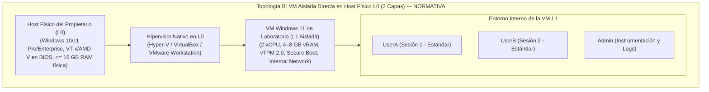

# PrivGuard — Preflight de Aprovisionamiento del Host Físico (Hipervisor L0) para Validación en VM Aislada (Topología B)

**Fecha:** 2026-11-08  
**Fase:** 8B.1A.7.2-R7  
**Estado Actual del Laboratorio:** `GUEST DETECTED — L0 NOT VERIFIED`  
**Estado de Pruebas Dinámicas:** `LAB HOLD / NOT RUN`  
**Topología Objetivo:** Topología B (VM Windows 11 Aislada Directa en Host Físico L0)

---

## 1. Contexto, Diagnóstico del Entorno Actual y Necesidad de L0

### 1.1 Diagnóstico del Entorno de Desarrollo Actual
El entorno en el que se ejecuta la suite de pruebas unitarias y de integración de PrivGuard ha sido diagnosticado de forma exhaustiva mediante consultas CIM/WMI de solo lectura:

| Parámetro Observado | Valor Registrado | Significado Técnico |
|---|---|---|
| **Fabricante / Modelo** | `innotek GmbH` / `VirtualBox` | Confirma categóricamente que este entorno es una Máquina Virtual Invitada (Guest L1). |
| **HypervisorPresent** | `True` | El SO invitado detecta la capa del hipervisor anfitrión. |
| **CPU Virtual** | Intel Core i7-7700HQ (4 vCPUs) | Procesador virtualizado asignado por el hipervisor. |
| **VirtualizationFirmwareEnabled** | `False` | Las instrucciones de virtualización anidada (VT-x / AMD-V) **no están habilitadas ni expuestas** a este guest. |
| **Memoria RAM Visible** | 3.98 GB utilizables (~0.39 GB libres) | Memoria asignada al guest; completamente insuficiente para albergar otra VM. |
| **SLAT / Extensiones Monitor** | `False`, `False` | No hay soporte de traducción de direcciones de segundo nivel expuesto al guest. |
| **Clasificación Oficial** | **`GUEST DETECTED — L0 NOT VERIFIED`** | **Imposibilitado para anidar hipervisores L2 (Hyper-V / VirtualBox).** |

> [!IMPORTANT]
> **Delimitación de Recursos:** Los 3.98 GB de RAM y las 4 vCPUs corresponden exclusivamente a la asignación del Guest VirtualBox actual. **No representan la memoria física ni el procesador del equipo físico real (L0)**.

---

## 2. Topología B: Modelo Arquitectónico Aprobado

Para realizar pruebas dinámicas con garantías de aislamiento y sin overhead excesivo, se descarta la virtualización anidada en 3 capas (Topología A) y se aprueba exclusivamente la **Topología B**:



---

## 3. Matriz de Requisitos del Host Físico (L0) vs. Entorno Actual

| Requisito | Mínimo Aceptable | Recomendado | Estado en Entorno Actual | Estado Requerido en Host L0 |
|---|---|---|---|---|
| **Tipo de Sistema** | Equipo Físico Bare-Metal | Estación de trabajo / Portátil físico | **FALLO (VirtualBox Guest)** | Físico (`Manufacturer` != VirtualBox/VMware) |
| **Virtualización en Firmware** | Habilitada (`True`) | VT-x (Intel) o AMD-V (AMD) activo en BIOS | **FALLO (`False`)** | Habilitado en BIOS/UEFI (`True`) |
| **Extensiones SLAT** | Soportadas (`True`) | EPT (Intel) o NPT (AMD) | **FALLO (`False`)** | Soportado (`True`) |
| **Memoria RAM Física Total** | 12.0 GB | 16.0 GB – 32.0 GB | 3.98 GB (vRAM Guest) | >= 12.0 GB visible en el SO host |
| **Memoria RAM Física Libre** | 6.0 GB libres | >= 8.0 GB libres | ~0.39 GB libres | >= 6.0 GB libres antes de arrancar VM |
| **Almacenamiento Libre** | 40 GB libres en SSD | 80–100 GB libres en SSD | 24.9 GB libres (vDisk) | >= 50 GB libres en volumen destino |
| **Hipervisor L0** | Hyper-V, VirtualBox o VMware | Hyper-V (incluido en Windows Pro/Ent) | Ninguno operativo | Uno instalado y operativo en L0 |
| **Seguridad de Red** | Aislamiento completo | Conmutador Interno / Private Network | Red NAT compartida | Sin acceso a red física ni internet durante test |
| **Dispositivos Multimedia** | Desconectados / Virtuales | Null Audio Driver / Cámara virtual | Compartidos con anfitrión | Cámaras/micrófonos físicos no compartidos |

---

## 4. Instrucciones de Ejecución del Preflight en el Host Físico (L0)

El script de diagnóstico read-only se encuentra ubicado en:
[`scripts/lab/Get-L0HostPreflight.ps1`](file:///c:/Users/Cristian/Documents/GitHub/PrivGuard/scripts/lab/Get-L0HostPreflight.ps1)

### 4.1 Ejecución en PowerShell desde el Host Físico
Abra una ventana de PowerShell en el equipo anfitrión físico (L0) y ejecute:

```powershell
# Ejecución con salida por pantalla y exportación de snapshot a JSON
powershell.exe -NoProfile -ExecutionPolicy Bypass -File .\scripts\lab\Get-L0HostPreflight.ps1 -OutputPath .\l0-preflight-snapshot.json
```

### 4.2 Criterio de Interpretación de `HypervisorPresent` en el Host Físico
> [!NOTE]
> En Windows 10/11, si Hyper-V, WSL2, Virtual Machine Platform, o características de aislamiento del núcleo (*Core Isolation / Memory Integrity*) están habilitadas en el host físico, el sistema operativo raíz se ejecuta sobre el hipervisor tipo 1 de Microsoft, lo que provoca que `HypervisorPresent` devuelva `True`.
> **Esto no significa que el equipo sea una VM.** Para validar si el host es físico, se correlaciona `HypervisorPresent` con:
> 1. `Manufacturer` y `Model` (deben ser fabricantes reales: Lenovo, Dell, HP, ASUS, Apple, etc., y **no** `innotek GmbH`, `VirtualBox`, `VMware`, `Virtual Machine` o `QEMU`).
> 2. `BIOSManufacturer` y `SMBIOSBIOSVersion`.
> 3. Memoria total visible (en un equipo físico suele ser 8, 16, 32 o 64 GB).

---

## 5. Especificaciones de Configuración de la VM Aislada (L1)

Una vez confirmado que el host L0 cumple los requisitos, el propietario aprovisionará la VM con los siguientes parámetros:

1. **Generación y Firmware:**
   - Hyper-V: Generación 2 (UEFI).
   - VirtualBox: EFI habilitado, Secure Boot activo.
   - VMware: Firmware UEFI, Secure Boot activo.
2. **Componentes Virtuales:**
   - 2 vCPUs dedicadas.
   - 4096 MB – 6144 MB de memoria RAM estática (no dinámica).
   - vTPM 2.0 (Módulo de plataforma segura virtual) habilitado.
   - Disco virtual de 50–60 GB en almacenamiento SSD rápido.
3. **Red:**
   - Aislada (*Internal Only* o *Host-Only* sin salida a internet).
4. **Cuentas de Usuario Requeridas en la VM:**
   - `UserA`: Cuenta de usuario estándar local (para sesión primaria PrivGuard).
   - `UserB`: Cuenta de usuario estándar local independiente (para probar FUS, DACL y handoff).
   - `AdminLab`: Cuenta administradora local separada (exclusiva para depuración, WinDbg, Process Explorer y ProcMon).
5. **Configuración de Fast User Switching (FUS):**
   - FUS habilitado en directivas de Windows.
   - Comprobación de cambio rápido de usuario interactivo entre `UserA` y `UserB`.
6. **Estrategia de Snapshots:**
   - `SNAP-00-BASE-CLEAN`: Windows 11 instalado, cuentas creadas, sin PrivGuard.
   - `SNAP-01-TOOLS-READY`: ProcMon, WinObj, Process Explorer y SDK instalados.
   - `SNAP-02-TEST-CERT`: Certificado autofirmado de laboratorio instalado en almacén raíz de la VM.

---

## 6. Procedimiento Previo a Pruebas Dinámicas (`TEST-09.7`, `TEST-09`, `TEST-10`)

Antes de iniciar la ejecución de `TEST-09.7` en la VM:
1. Compilar un paquete MSIX fresco desde el HEAD canónico verificado de `main` (`scripts/build-msix.ps1 -Configuration Release-Store -ValidateStoreIdentity`).
2. Transferir el `.msix` a la VM mediante carpeta compartida aislada o medio virtual.
3. Firmar el `.msix` dentro de la VM con el certificado de prueba de `SNAP-02-TEST-CERT`.
4. Registrar los hashes SHA-256 (unsigned de build y signed de prueba).
5. Verificar la reversibilidad de los snapshots antes de cualquier prueba.

---

## 7. Dictamen de Estado del Gate L0

$$\mathbf{DICTAMEN:\ L0\ NOT\ VERIFIED\ —\ LAB\ HOLD}$$

El laboratorio permanece bloqueado en **`LAB HOLD / NOT RUN`** hasta que el propietario del repositorio ejecute el script `Get-L0HostPreflight.ps1` en el host físico, documente los resultados en la matriz de evidencia y aprovisione la máquina virtual Windows 11 aislada de acuerdo con este runbook.
