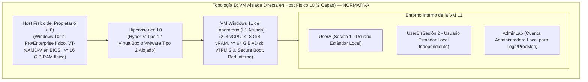

# PrivGuard — Preflight de Aprovisionamiento del Host Físico (Hipervisor L0) para Validación en VM Aislada (Topología B)

- **Fecha:** 2026-11-08
- **Fase:** 8B.1A.7.2-R8.1
- **Estado Actual del Laboratorio:** `GUEST DETECTED — L0 NOT VERIFIED`
- **Estado de Pruebas Dinámicas:** `LAB HOLD / NOT RUN`
- **Topología Objetivo:** Topología B (VM Windows 11 Aislada Directa en Host Físico L0)

---

## 1. Contexto, Diagnóstico del Entorno Actual y Necesidad de L0

### 1.1 Diagnóstico del Entorno de Desarrollo Actual
El entorno en el que se ejecuta la suite de pruebas unitarias y de integración de PrivGuard ha sido diagnosticado de forma exhaustiva mediante consultas CIM/WMI de solo lectura:

| Parámetro Observado | Valor Registrado | Significado Técnico |
|---|---|---|
| **Fabricante / Modelo** | `innotek GmbH` / `VirtualBox` | Confirma categóricamente que este entorno es una Máquina Virtual Invitada (Guest L1). |
| **HypervisorPresent** | `True` | El SO invitado detecta la capa del hipervisor anfitrión. |
| **CPU Virtual** | Intel Core i7-7700HQ (4 vCPUs) | Procesador virtualizado asignado por el hipervisor anfitrión. |
| **VirtualizationFirmwareEnabled** | `FALSE` | Las instrucciones de virtualización por hardware (VT-x / AMD-V) **no están expuestas** a este guest. |
| **Memoria RAM Visible** | 3.98 GiB utilizables (~0.39 GiB libres) | Memoria asignada al guest; completamente insuficiente para albergar otra VM. |
| **SLAT / Extensiones Monitor** | `FALSE`, `FALSE` | No hay soporte de traducción de direcciones de segundo nivel expuesto al guest. |
| **Clasificación Oficial** | **`GUEST DETECTED — L0 NOT VERIFIED`** | **Imposibilitado para anidar hipervisores L2 (Hyper-V / VirtualBox).** |

> [!IMPORTANT]
> **Delimitación de Recursos:** Los 3.98 GiB de RAM y las 4 vCPUs corresponden exclusivamente a la asignación del Guest VirtualBox actual. **No representan la memoria física, el procesador ni el almacenamiento del equipo físico real (L0)**.

---

## 2. Topología B: Modelo Arquitectónico Aprobado

Para realizar pruebas dinámicas con garantías de aislamiento y sin overhead excesivo, se descarta la virtualización anidada en 3 capas (Topología A) y se aprueba exclusivamente la **Topología B**:



### 2.1 Taxonomía de Hipervisores en L0
- **Hyper-V**: Hipervisor de **Tipo 1** (nativo / bare-metal). El sistema operativo Windows anfitrión se ejecuta en la partición raíz (*root partition*). Al activarse, la consulta CIM reporta `HypervisorPresent = True` incluso en hardware físico.
- **VirtualBox / VMware Workstation**: Hipervisores **alojados / Tipo 2** (*hosted*). Se ejecutan como aplicaciones sobre el kernel del sistema operativo anfitrión (utilizando extensiones de virtualización por hardware directas o la plataforma Windows Hypervisor Platform).

---

## 3. Matriz Armonizada de Requisitos: Host L0 vs. VM Windows 11

### 3.1 Requisitos Mínimos Oficiales de Windows 11 para Máquinas Virtuales (Microsoft)
Según la especificación técnica de Microsoft ([Windows 11 VM Requirements](https://learn.microsoft.com/en-us/windows/whats-new/windows-11-requirements)):
1. **Procesador:** 2 o más procesadores virtuales (vCPUs) de 64 bits compatibles.
2. **Memoria:** Mínimo absoluto de 4 GiB de RAM (4096 MB).
3. **Almacenamiento:** Mínimo absoluto de **64 GiB** de disco virtual asignado.
4. **Firmware:** UEFI con capacidad de Secure Boot.
5. **Seguridad:** vTPM 2.0 habilitado.

### 3.2 Matriz Comparativa de Tiers de Laboratorio

| Componente / Recurso | Mínimo Oficial SO | Mínimo Práctico de Lab (Constrained) | Recomendado de Lab (Pass Candidate) | Host Físico L0 Requerido |
|---|---|---|---|---|
| **vCPUs** | 2 vCPUs | 2 vCPUs dedicadas | 4 vCPUs dedicadas | Host con >= 4 núcleos físicos / 8 lógicos (mín. 2 núcleos / 4 lógicos) |
| **vRAM (Memoria)** | 4 GiB | 4 – 5 GiB estática | 8 GiB estática | Host con >= 16 GiB RAM total (mín. 12 GiB) |
| **RAM Libre en Host** | N/A | >= 5.0 GiB libres | >= 8.0 GiB libres | Inmediatamente antes de iniciar la VM |
| **Disco Virtual VM** | 64 GiB | 64 – 80 GiB (VHDX/VDI dinámico) | 80 – 100 GiB (VHDX/VDI) | Almacenamiento SSD local rápido |
| **Espacio Libre en Host** | N/A | >= 70 GiB libres en volumen VM | >= 100 GiB libres en volumen VM | Para imagen base + snapshots + dumps |
| **Virtualización CPU** | VT-x / AMD-V | Habilitada en BIOS/UEFI | Habilitada en BIOS/UEFI | `VirtualizationFirmwareEnabled = TRUE` |
| **SLAT / EPT / NPT** | Requerido | Soportado por CPU | Soportado por CPU | `SLAT = TRUE` |
| **vTPM** | TPM 2.0 | vTPM 2.0 virtual activado | vTPM 2.0 virtual activado | No requiere TPM físico obligatorio en host |
| **Firmware VM** | UEFI / Secure Boot | Habilitado en VM | Habilitado en VM | Generación 2 (Hyper-V) / EFI (VirtualBox) |
| **Red de la VM** | N/A | Conmutador Interno Privado | Conmutador Interno Privado | Sin salida a internet ni LAN física durante pruebas |

---

## 4. Instrucciones para la Ejecución del Preflight en el Host Físico (L0)

El script de diagnóstico endurecido se encuentra ubicado en:
[`scripts/lab/Get-L0HostPreflight.ps1`](../../scripts/lab/Get-L0HostPreflight.ps1)

### 4.1 Parámetro Obligatorio de Almacenamiento Objetivo (`-VmStoragePath`)
Para evitar falsos positivos y verificar el espacio real en el volumen donde residirá la máquina virtual (que puede ser `C:`, `D:`, `E:`, etc.), se debe especificar explícitamente la ruta de almacenamiento de la VM.

**Contrato de Validación de Almacenamiento:**
- **Ruta Absoluta de Unidad Local Fija:** La ruta debe iniciar con una letra de unidad y barra (`X:\...`). El volumen debe ser de tipo disco fijo local (`DriveType = 3`). Se rechazan terminantemente unidades de red (UNC `\\servidor\share`), rutas relativas, y medios extraíbles/USB (`DriveType = 2`).
- **Existencia Previa del Directorio:** El operador debe crear previamente el directorio de destino en el host antes de ejecutar el preflight (por ejemplo, `New-Item -ItemType Directory -Path "D:\PrivGuard-Lab\VMs" -Force`). El script valida la existencia de la carpeta pero no crea directorios ni modifica el sistema (invariante de solo lectura). Si el directorio no existe, el preflight reportará `DIRECTORY_NOT_FOUND` y se mantendrá en `PREFLIGHT_INCOMPLETE`.

### 4.2 Semántica de Solo Lectura y Escritura de Reporte
El script realiza estrictamente consultas de solo lectura mediante CIM/WMI y variables de entorno del sistema operativo. **No modifica el firmware, BIOS/UEFI, BCD, registro, servicios ni la configuración de hipervisores**. La única operación de escritura permitida es la generación opcional del archivo JSON de diagnóstico cuando se proporciona el parámetro `-OutputPath`.

### 4.3 Comando de Ejecución en el Host Físico
Abra PowerShell como usuario estándar en el **equipo físico anfitrión (fuera de la VM de desarrollo)**:

```powershell
$vmStoragePath = "D:\PrivGuard-Lab\VMs" # Sustituir por la ruta real del volumen físico local
$outputPath = Join-Path $env:TEMP ("PrivGuard-L0-preflight-{0}.json" -f (Get-Date -Format "yyyyMMdd-HHmmss"))

.\scripts\lab\Get-L0HostPreflight.ps1 `
    -VmStoragePath $vmStoragePath `
    -OutputPath $outputPath

Write-Host "Snapshot generado en: $outputPath"
```
*(Sustituya `"D:\PrivGuard-Lab\VMs"` por la ruta del volumen local donde creará la máquina virtual).*

### 4.4 Pautas de Sanitización antes de Compartir el JSON
El script recopila exclusivamente métricas técnicas de hardware y sistema operativo. No obstante, antes de compartir el archivo JSON generado, el propietario puede revisar y reemplazar por identificadores genéricos:
- `CPUName` (si contiene números de lote).
- `BIOSVersion` (si contiene identificadores institucionales).
- Rutas locales que contengan nombres de usuario personales en `VmStoragePathRequested`.

---

## 5. Procedimiento de Aprovisionamiento de la VM Aislada (L1)

Una vez que el preflight confirme la clasificación `L0_PREFLIGHT_PASS_CANDIDATE`:

1. **Creación de la VM:**
   - Hyper-V: Máquina de Generación 2.
   - VirtualBox: Tipo Windows 11 (64-bit), habilitar EFI y Secure Boot.
   - VMware Workstation: Firmware UEFI con Secure Boot y Virtual TPM.
2. **Asignación de Recursos:**
   - 2 a 4 vCPUs.
   - 4096 MB – 8192 MB de memoria RAM estática (desactivar memoria dinámica).
   - Disco virtual de tamaño inicial >= 64 GiB en formato dinámico sobre SSD.
3. **Aislamiento de Red:**
   - Se distinguen tres niveles de aislamiento:
     1. *Sin salida a Internet:* Bloqueo de gateway WAN obligatorio durante pruebas.
     2. *Sin acceso a LAN física:* Bloqueo de tráfico hacia otros equipos de la red local.
     3. *Conmutador Interno Privado (Internal / Private Virtual Switch):* Máximo aislamiento; la VM no tiene comunicación con la LAN física ni con el host, salvo que se active explícitamente un adaptador Host-Only para transferencias puntuales de artefactos. El modo *Bridged* está estrictamente prohibido.
4. **Cuentas de Usuario en la VM:**
   - `UserA`: Usuario estándar local (contraseña conocida; sesión primaria para PrivGuard).
   - `UserB`: Usuario estándar local independiente (para verificar contención FUS inter-sesión, DACL y handoff).
   - `AdminLab`: Cuenta administradora local separada (para ejecutar ProcMon, WinDbg, Process Explorer).
5. **Habilitación de Fast User Switching (FUS):**
   - Comprobar que la directiva *Hide the entry points for Fast User Switching* se encuentre deshabilitada (FUS activo).
   - Iniciar sesión simultáneamente con `UserA` y `UserB` y conmutar escritorios para validar el funcionamiento de FUS.
6. **Cadena Normativa de Snapshots:**
   - `SNAP-00-BASE-CLEAN`: Windows 11 instalado, cuentas creadas, FUS verificado, sin PrivGuard.
   - `SNAP-01-TOOLS-READY`: ProcMon, WinObj, Process Explorer y SDK instalados.
   - `SNAP-02-TEST-CERT`: Certificado de prueba de laboratorio instalado en el almacén raíz de la VM.
7. **Prueba de Reversibilidad:**
   - Realizar una restauración efectiva desde `SNAP-01` hacia `SNAP-00` y retorno a `SNAP-01` para verificar que el hipervisor restaura el estado de forma determinista antes de iniciar cualquier prueba.

---

## 6. Procedimiento Previo a Pruebas Dinámicas (`TEST-09.7`, `TEST-09`, `TEST-10`)

Antes de iniciar la ejecución de `TEST-09.7` en la VM:
1. Compilar un paquete MSIX fresco desde el HEAD canónico verificado de `main` (`./scripts/build-msix.ps1 -Configuration Release-Store -ValidateStoreIdentity`).
2. Transferir el `.msix` a la VM mediante medio virtual o carpeta compartida aislada.
3. Firmar el `.msix` dentro de la VM con el certificado de prueba de `SNAP-02-TEST-CERT`.
4. Registrar los hashes SHA-256 (unsigned de build y signed de prueba).
5. Verificar la reversibilidad de los snapshots antes de cualquier prueba interactiva.

---

## 7. Dictamen de Estado del Gate L0

$$\mathbf{DICTAMEN:\ L0\ NOT\ VERIFIED\ —\ LAB\ HOLD}$$

El laboratorio permanece bloqueado en **`LAB HOLD / NOT RUN`** hasta que el propietario del repositorio ejecute el script `Get-L0HostPreflight.ps1` en el host físico, documente los resultados en la matriz de evidencia y aprovisione la máquina virtual Windows 11 aislada de acuerdo con este runbook.
