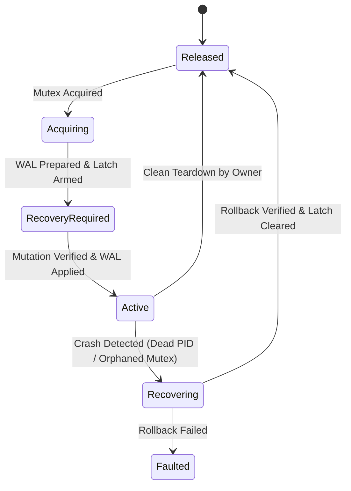
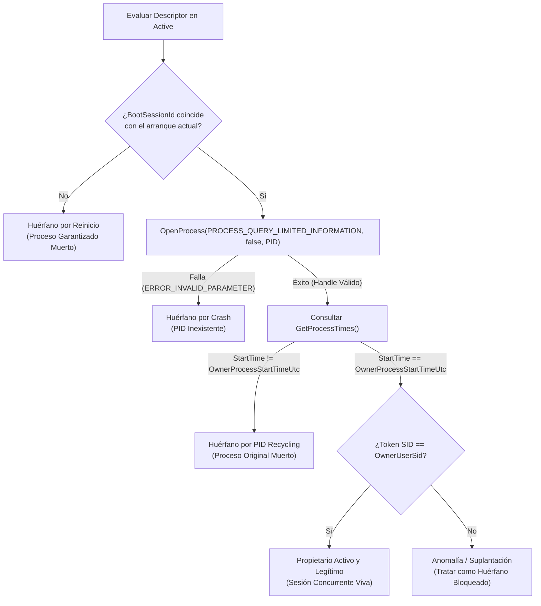
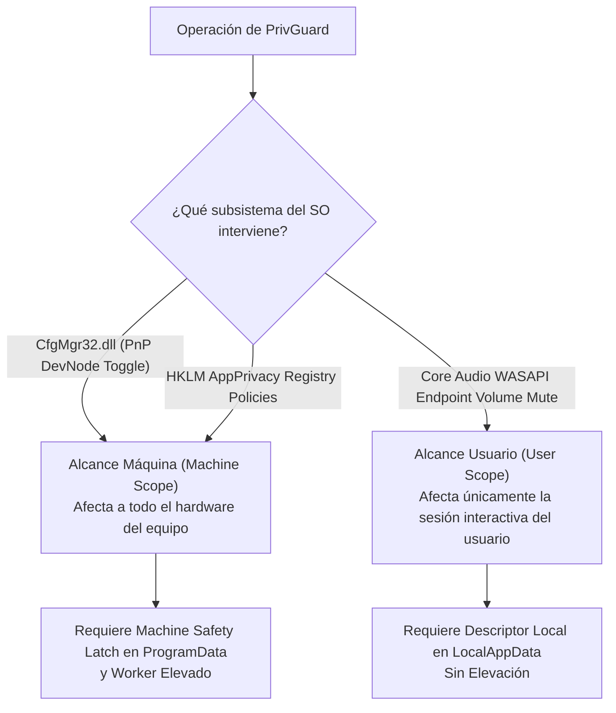
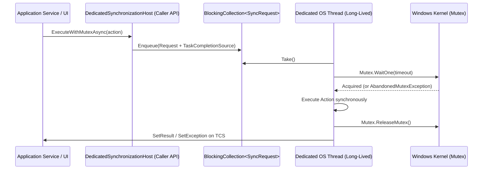
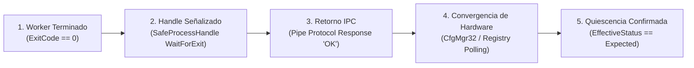
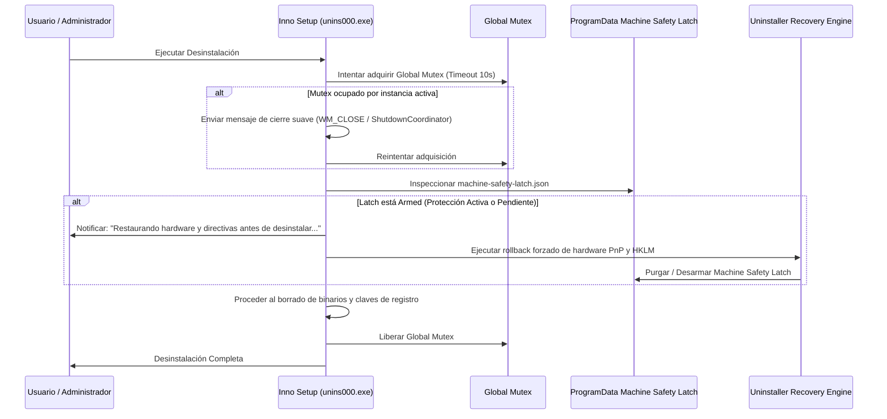

# PrivGuard — Fase 8B.1A.3: Cierre Definitivo de Recuperación Transaccional, Machine Safety Latch y Ownership

**Fecha:** 5 de noviembre de 2026  
**Tipo de Fase:** Auditoría Técnica, Diseño de Arquitectura y Especificación Formal (Sin modificación de código)  
**Repositorio:** `cristianbarreiro/PrivGuard`  
**Rama:** `main`  
**HEAD Remoto Verificado:** `94f4f7aa082255dc2437fe41d17fcb7ee21261b2`  
**Veredicto de Fase:** **`PASS — DESIGN READY`**  
**Microsoft Store:** Permanece en **`CONDITIONAL HOLD`**

---

## 1. Contexto, Baseline y Verificación Preflight

### 1.1 Estado del Workspace
- **Rama:** `main` (rastreando `origin/main` en `94f4f7aa082255dc2437fe41d17fcb7ee21261b2`).
- **Estado de Git:** 5 archivos modificados en el working tree correspondientes a la Fase 8B.1B.3 (hardening de defaults de enums y resolver inmutable), preservados íntegramente:
  1. `src/PrivLock.Infrastructure.Common/Packaging/NoOpPackageIdentityDetector.cs`
  2. `src/PrivLock.Infrastructure.Common/Storage/DefaultEditionProfileResolver.cs`
  3. `src/PrivLock.Platform.Abstractions/EditionProfile.cs`
  4. `src/PrivLock.Platform.Abstractions/PackageIdentityKind.cs`
  5. `tests/PrivLock.Infrastructure.Tests/EditionProfileResolverTests.cs`
- **Integridad de Pruebas:** 554 pruebas superadas al 100% en la compilación base (`dotnet test PrivGvard.sln`).
- **Restricción de Fase:** Cero modificaciones de código o contratos. Esta especificación formal resuelve documentalmente todas las inconsistencias de concurrencia, crash-recovery y ownership para habilitar la implementación segura de la Fase 8B.1C.

---

## 2. Problema A: Semántica Transaccional y Recuperación tras Crash desde `Active`

### 2.1 Significado Durable de `Active`
Un descriptor en estado `Active` certifica durablemente que:
1. La sesión de privacidad adquirió la exclusividad de hardware mediante el Mutex global y el Machine Safety Latch.
2. El diario WAL de mutación fue completado, validado y sincronizado a disco (`Applied`).
3. La mutación nativa del sistema operativo (PnP DevNode o HKLM AppPrivacy) culminó exitosamente con convergencia de estado verificada.
4. **Invariante de Proceso:** El descriptor permanece en `Active` durante toda la vida útil de la sesión protegida. Solo transiciona de forma legítima a `Released` mediante un desmantelamiento controlado (*clean teardown*) por parte de la edición propietaria.

> [!CRITICAL]
> **Axioma de Abandono Anormal:** Si un proceso finaliza (por crash, terminación de tarea, excepción no controlada, fallo de alimentación o kernel panic) mientras el descriptor está en `Active`, dicho estado **debe ser interpretado inmediatamente por el siguiente proceso como `RecoveryRequired` implícito**. No es admisible requerir que un proceso agonizante actualice su estado antes de morir.



### 2.2 Identificación y Detección del Proceso Propietario (Liveness Check)
Para determinar si el proceso que figura en el descriptor como propietario sigue vivo o si el descriptor ha quedado huérfano, se implementa una tupla de correlación cuádruple:

$$\text{OwnerTuple} = \langle \text{BootSessionId}, \text{OwnerProcessId}, \text{OwnerProcessStartTimeUtc}, \text{OwnerUserSid} \rangle$$

El algoritmo de detección evalúa en orden estricto:



### 2.3 Diferenciación: `AbandonedMutexException` vs. Arranque tras Reboot
- **En la misma sesión de Windows (Runtime Crash):**
  - El Mutex del sistema operativo (`Global\PrivGuard_CrossEdition_Coordinator`) es un objeto del kernel de Windows con afinidad de hilo.
  - Si el hilo o proceso propietario muere sin invocar `ReleaseMutex()`, el kernel de Windows marca el mutex como abandonado.
  - El siguiente proceso que invoca `WaitOne()` recibe una `AbandonedMutexException`.
  - **Acción:** La captura de `AbandonedMutexException` **no indica que el sistema esté limpio**. Indica que el mutex fue recuperado del kernel, pero la persistencia en disco está en un estado potencialmente sucio (`Active` o `RecoveryRequired`). El hilo captura la excepción, asume el control temporal de coordinación y procede a examinar el descriptor.
- **Después de un Reinicio de Windows (Cold Boot / Post-Reboot):**
  - Los objetos del kernel de Windows (incluyendo los mutexes con nombre) desaparecen en su totalidad al apagarse el sistema operativo.
  - Al arrancar, el Mutex `Global\PrivGuard_CrossEdition_Coordinator` se crea nuevo y no está señalado ni abandonado; `WaitOne()` retorna inmediatamente `true`.
  - Sin embargo, los archivos persistentes (`machine-safety-latch.json`, `system-ownership.json`, diarios WAL) continúan en el almacenamiento secundario.
  - El proceso adquirente inspecciona el descriptor y detecta que `BootSessionId` del descriptor es anterior al `BootSessionId` del sistema operativo actual.
  - **Acción:** Trata el descriptor como huérfano por reinicio y bloquea cualquier nueva sesión independiente hasta que se complete la verificación y reconciliación de recuperación.

### 2.4 Reutilización de PID (PID Recycling) y Precisión Temporal
El subsistema de procesos de Windows recicla PIDs agresivamente tras la muerte de un proceso. Para anular cualquier riesgo de colisión:
- Se utiliza `GetProcessTimes` a través de P/Invoke nativo, extrayendo el campo `ftCreationTime` estructurado como `FILETIME` (resolución de 100 nanosegundos desde el 1 de enero de 1601 UTC).
- La probabilidad de que un proceso recién creado reciba el mismo PID de un proceso anterior y coincida en la misma fracción de 100 nanosegundos es exactamente cero dentro de la precisión del kernel NT.

### 2.5 Detección Confiable del Arranque del Sistema (`BootSessionId`)
Para evitar discrepancias ocasionadas por cambios manuales de reloj del usuario o ajustes NTP:
- Se utiliza `QueryUnbiasedInterruptTime` (o en su defecto `GetTickCount64` combinado con la fecha de arranque inicial calculada una sola vez en el arranque del servicio).
- De forma complementaria, PrivGuard consulta la clave volátil del kernel de Windows:
  `HKLM\SYSTEM\CurrentControlSet\Control\Session Manager\Memory Management\PrefetchParameters` o genera un UUID de arranque efímero en la memoria compartida del kernel (`Global\PrivGuard_BootSessionMarker`) que solo existe mientras el kernel de Windows no se reinicie.

### 2.6 Aislamiento de WAL por Edición
- **Invariante:** Cada edición es la **única autoridad autorizada** para deserializar, interpretar y revertir su propio archivo WAL.
- Si Store Edition arranca y detecta un descriptor de Standalone en `Active` abandonado:
  - Store Edition **NO debe intentar leer ni aplicar el WAL de Standalone**.
  - Store Edition no posee privilegios elevados (UAC / worker) y fallaría al intentar mutar PnP o HKLM.
  - Store Edition entra inmediatamente en estado **`SupervisionOnly`** (D-04), notificando al usuario en la interfaz: *"Existe una sesión de hardware interrumpida creada por PrivGuard Standalone. Inicie PrivGuard Standalone para completar la restauración segura del hardware."*

---

## 3. Problema B: Machine Safety Latch Unificado

### 3.1 Evaluación y Comparativa de Fuentes de Verdad

Se evaluaron formalmente las 3 alternativas contempladas en revisiones anteriores:

| Criterio de Seguridad y Robustez | Alternativa 1: Descriptor en `LocalAppData` | Alternativa 2: Valor en Registro `HKLM` | Alternativa 3: Archivo en `ProgramData` (Recomendada) |
| :--- | :--- | :--- | :--- |
| **Visibilidad Multiusuario (Cross-User)** | **Nula**: Inaccesible para otros usuarios por ACLs de perfil de usuario (`C:\Users\<User>`). | **Total**: Accesible por cualquier cuenta local. | **Total**: Accesible por cualquier cuenta local (`C:\ProgramData\PrivGuard`). |
| **Escritura por Store (`asInvoker`)** | Permitida (su propio perfil). | **Imposible**: Denegada por seguridad de Windows sin elevación. | **Imposible sin elevación** (garantía de seguridad). |
| **Lectura por Store (`asInvoker`)** | Denegada para cuentas de otros usuarios. | Permitida (`KEY_READ` no requiere elevación). | **Permitida**: `GENERIC_READ` para el grupo `Users`. |
| **Protección contra Manipulación No Privilegiada** | Débil ante el propio usuario; aislada de otros. | Fuerte (protegida por ACLs del Registro de Windows). | **Fuerte**: Protegida por ACL explícita NTFS configurada en instalación. |
| **Atomicidad y Recuperación ante Corrupción** | Sujeta a corrupción de disco local. | Transaccional del Registro (KTM), pero compleja de auditar en crudo. | **Excelente**: Archivo transaccional con reemplazo atómico (`ReplaceFileW`) y backup `.bak`. |
| **Resiliencia tras Reboot / Crash** | Persiste en disco. | Persiste en registro. | **Persiste en disco en ubicación estándar del sistema**. |

### 3.2 Decisión Arquitectónica Canónica: Fuente Única de Verdad
La **única fuente de verdad autoritativa para el bloqueo a nivel de máquina** es:

$$\mathbf{MachineLatchPath} = \text{\%ProgramData\%}\backslash\text{PrivGuard}\backslash\text{machine-safety-latch.json}$$

Complementada por su archivo de respaldo atómico: `machine-safety-latch.json.bak`.

### 3.3 Modelo de Permisos y ACL de `ProgramData\PrivGuard`
El instalador de PrivGuard (y el worker elevado en su primera ejecución si el directorio no existe) establece una ACL explícita y no heredable en la carpeta `C:\ProgramData\PrivGuard`:
- `NT AUTHORITY\SYSTEM`: Full Control (`GENERIC_ALL`).
- `BUILTIN\Administrators`: Full Control (`GENERIC_ALL`).
- `BUILTIN\Users`: Read and Execute (`GENERIC_READ | GENERIC_EXECUTE`).
- **Creator Owner / Cuentas Estándar:** Sin permisos de escritura, modificación ni borrado.

### 3.4 Operativa por Edición: Store vs. Standalone
1. **PrivGuard Standalone (con Worker Elevado):**
   - Es la única edición con capacidad de escribir en el Machine Safety Latch.
   - Cualquier armado o desarmado del latch se ejecuta a través del worker autenticado (`--privileged-worker`) con privilegios administrativos.
2. **PrivGuard Store (sin Elevación, `asInvoker`):**
   - Abre el archivo exclusivamente con `FileAccess.Read` y `FileShare.ReadWrite`.
   - Consulta el latch de forma no intrusiva al inicio y antes de cualquier mutación local (WASAPI).
   - Si el latch está armado, Store bloquea la adquisición y permanece en modo pasivo.
   - Si el latch no existe o está en estado `Disarmed`, Store opera con normalidad sobre su ámbito permitido (Standard Audio Mute).

### 3.5 Clasificación Estricta de Alcance de Operaciones



> [!WARNING]
> **Invariante de Hardware PnP:** El hecho de que un dispositivo se encuentre en estado `CM_PROB_DISABLED` (código de error 0x16) **no prueba que PrivGuard lo haya deshabilitado**. PnP puede haber sido deshabilitado por el usuario en el Administrador de Dispositivos, por drivers defectuosos o por políticas corporativas externas. PrivGuard **solo** reconoce un dispositivo como propio si el `DeviceId` canónico figura explícitamente en el snapshot del WAL y en el Machine Safety Latch activo.

---

## 4. Problema C: Consistencia entre WAL y Descriptor (Protocolo Transaccional)

### 4.1 Secuencia Transaccional de Escritura Garantizada
Para eliminar cualquier ventana de asincronía donde el hardware esté mutado pero el disco no lo refleje, se establece la siguiente secuencia de barrera estricta:

```text
PASO 1: [Host]   Adquisición del Mutex Global (Global\PrivGuard_CrossEdition_Coordinator).
PASO 2: [Host]   Descriptor neutral -> Escribir "Acquiring" (Flush a disco).
PASO 3: [Host]   WAL de Edición -> Escribir snapshot hardware previo "Prepared" (Flush a disco).
PASO 4: [Worker] Machine Safety Latch -> Escribir "Armed" en ProgramData (Flush a disco).
PASO 5: [Host]   Descriptor neutral -> Escribir "RecoveryRequired" (Flush a disco).
------------------------ BARRERA DE NO RETORNO DE HARDWARE ------------------------
PASO 6: [Worker] Mutación Nativa del SO (CM_Disable_DevNode o RegSetValueEx).
PASO 7: [Worker] Verificación de Convergencia Nativa (EffectiveStatus confirmada).
-----------------------------------------------------------------------------------
PASO 8: [Host]   WAL de Edición -> Escribir "Applied" (Flush a disco).
PASO 9: [Host]   Descriptor neutral -> Escribir "Active" (Flush a disco).
PASO 10:[Host]   Liberación del Mutex Global.
```

### 4.2 Matriz de Ventanas de Crash y Resolución Automática

| Ventana de Crash | Estado Persistente en Disco | ¿Hubo Mutación de Hardware? | Edición Autorizada | Acción de Recuperación Requerida | Estado Final |
| :--- | :--- | :---: | :---: | :--- | :--- |
| **V-01: Crash durante Paso 2** | Descriptor: `Acquiring`. WAL: Ausente. Latch: No armado. | **No** | Standalone o Store | El proceso que encuentra `Acquiring` sin WAL sabe que la mutación ni siquiera inició. Limpia el descriptor a `Released`. | `Released` |
| **V-02: Crash durante Paso 3** | Descriptor: `Acquiring`. WAL: `Prepared`. Latch: No armado. | **No** | Standalone | Mutación no iniciada. Standalone invalida el WAL marcado `Prepared` y restablece descriptor a `Released`. | `Released` |
| **V-03: Crash durante Paso 4** | Descriptor: `Acquiring`. WAL: `Prepared`. Latch: En proceso/corrupto. | **No** | Standalone | Si el latch no llegó a armarse válidamente y el descriptor no es `RecoveryRequired`, se purga el latch parcial y se libera. | `Released` |
| **V-04: Crash durante Paso 5** | Descriptor: `RecoveryRequired`. WAL: `Prepared`. Latch: `Armed`. | **Potencial / No** | Standalone | El sistema debe asumir el peor caso: ejecuta rollback del WAL contra el hardware basándose en el snapshot previo y luego desmarca el Latch. | `Released` |
| **V-05: Crash durante Paso 6 (Mid-Mutation)** | Descriptor: `RecoveryRequired`. WAL: `Prepared`. Latch: `Armed`. | **Parcial** (Dispositivo 1 bloqueado, Dispositivo 2 activo) | Standalone (con Worker Elevado) | Detección de mutación parcial. Ejecuta rollback idempotente de todos los recursos listados en el WAL hacia su estado original snapshot. | `Released` |
| **V-06: Crash durante Paso 7 (Antes de WAL Applied)** | Descriptor: `RecoveryRequired`. WAL: `Prepared`. Latch: `Armed`. | **Sí** | Standalone (con Worker Elevado) | El hardware fue mutado pero el proceso murió antes de consolidar. Standalone ejecuta rollback completo para restablecer la disponibilidad. | `Released` |
| **V-07: Crash durante Paso 8 (WAL Applied, Desc: RecoveryRequired)** | Descriptor: `RecoveryRequired`. WAL: `Applied`. Latch: `Armed`. | **Sí** | Standalone | El WAL está completo. Standalone puede optar por completar la transición a `Active` o restaurar a `Released` según la directiva de inicio. Para maximizar disponibilidad tras crash, ejecuta rollback limpio a `Released`. | `Released` |
| **V-08: Crash tras Paso 9 (Descriptor en Active con PID muerto)** | Descriptor: `Active`. WAL: `Applied`. Latch: `Armed`. PID muerto. | **Sí** | Standalone | Al detectar PID muerto en el mismo boot o arranque posterior, el nuevo proceso Standalone clasifica el estado como `RecoveryRequired` implícito y ejecuta rollback completo. | `Released` |
| **V-09: Crash durante Rollback** | Descriptor: `Recovering`. WAL: `RollbackInProgress`. | **Parcial** | Standalone | Al reiniciar, detecta `Recovering`. La rutina de rollback es **100% idempotente**: re-ejecuta el restablecimiento del estado snapshot tantas veces como sea necesario. | `Released` |
| **V-10: Crash tras restaurar hardware y antes de marcar `Released`** | Hardware: Desbloqueado. Descriptor: `Recovering`. Latch: `Armed`. | **No** (Hardware ya restaurado) | Standalone | Re-ejecuta verificación native: al observar hardware restaurado, confirma convergencia, purga el Latch y escribe `Released`. | `Released` |
| **V-11: Crash tras marcar `Released` y antes de liberar Mutex** | Descriptor: `Released`. Mutex: Abandonado por el SO. | **No** | Standalone o Store | El siguiente proceso adquiere el mutex capturando `AbandonedMutexException`. Lee descriptor `Released`: el sistema está limpio. Operación normal. | `Released` |

---

## 5. Problema D: Durabilidad y Atomicidad de Almacenamiento en Windows

### 5.1 Inadecuación de `File.Move(..., overwrite: true)` Simple
En sistemas de archivos NTFS/ReFS, `File.Move` con sobrescritura sustituye la entrada en el directorio de metadatos, pero no garantiza que los sectores del archivo temporal ni los cambios en la Master File Table (MFT) se hayan volcado al soporte físico (*platter / NAND flash*). Si se produce un corte de energía (*hard power loss*) inmediatamente después de `File.Move`, el archivo puede quedar con longitud cero o contener ceros (*null bytes corruption*).

### 5.2 Implementación Nativa de Reemplazo Atómico Transaccional
PrivGuard implementará un protocolo de reemplazo atómico en 5 pasos utilizando P/Invoke directo de Win32:

```csharp
[DllImport("kernel32.dll", SetLastError = true, CharSet = CharSet.Unicode)]
private static extern bool ReplaceFileW(
    string lpReplacedFileName,
    string lpReplacementFileName,
    string? lpBackupFileName,
    int dwReplaceFlags,
    IntPtr lpExclude,
    IntPtr lpReserved);

private const int REPLACEFILE_WRITE_THROUGH = 0x00000001;
private const int REPLACEFILE_IGNORE_MERGE_ERRORS = 0x00000002;
```

#### Protocolo de Escritura Durable
1. **Escritura en Archivo Temporal:** Escribir el nuevo contenido JSON en `[TargetFilePath].tmp.[Guid]`.
2. **Forzar Vuelco de Búferes (`FlushFileBuffers`):** Invocar `FileStream.Flush(flushToDisk: true)` o la API Win32 `FlushFileBuffers(fileHandle)`. Esto fuerza al controlador del disco y a la caché de Windows a comprometer los bloques físicos.
3. **Cierre de Handle:** Cerrar el handle del archivo temporal para permitir operaciones de renombrado.
4. **Reemplazo Atómico con Backup (`ReplaceFileW`):**
   - Invocar `ReplaceFileW` apuntando a `[TargetFilePath]` con el reemplazo `[TargetFilePath].tmp.[Guid]` y generando automáticamente `[TargetFilePath].bak`.
   - La bandera `REPLACEFILE_WRITE_THROUGH` (0x01) asegura que la actualización de la entrada de directorio se guarde inmediatamente en el medio físico.
5. **Purga del Temporal:** Eliminar cualquier remanente temporal una vez confirmado el éxito de `ReplaceFileW`.

### 5.3 Resiliencia y Recuperación de Backup
Al abrir cualquier descriptor, WAL o latch:
1. Intentar deserializar `[File].json`.
2. Si el archivo no existe, está vacío (0 bytes) o produce una excepción de JSON corrupto:
   - Registrar advertencia de integridad en `CrashReporter`.
   - Intentar cargar inmediatamente `[File].json.bak`.
   - Si `[File].json.bak` es válido, restaurar el estado desde el backup y reescribir el archivo principal.
3. Si ambos archivos están corruptos:
   - Pasar a estado **`Faulted`** a prueba de fallos (*Fail-Closed*).
   - Impedir nuevas mutaciones de hardware y exigir remediación del usuario.

---

## 6. Problema E: Contrato Arquitectónico de `DedicatedSynchronizationHost`

### 6.1 Razón de Ser: Afinidad de Hilos del Mutex en Windows
En el runtime de .NET, `System.Threading.Mutex` es una envoltura sobre un objeto Mutex de Win32. Win32 impone **afinidad estricta de hilo**: el hilo del sistema operativo que adquiere el mutex mediante `WaitOne()` es el único que puede liberarlo mediante `ReleaseMutex()`.
Si una operación asíncrona (`async/await`) en C# adquiere un mutex en un hilo de ThreadPool y luego de un `await` se reanuda en otro hilo de ThreadPool, la llamada a `ReleaseMutex()` arroja fatalmente una `ApplicationException`:
> *"Object synchronization method was called from an unsynchronized block of code."*

### 6.2 Especificación de `DedicatedSynchronizationHost`



#### Reglas de Diseño del Host:
1. **Hilo Único Dedicado:** Se crea un hilo `System.Threading.Thread` con `IsBackground = true`, `Priority = ThreadPriority.Normal` y nombre `"PrivGuard-MutexSyncHost"`.
2. **Sin Concurrencia Interna:** Solo existirá una única instancia singleton de `DedicatedSynchronizationHost` por proceso. Cualquier intento de crear un segundo host arrojará `InvalidOperationException`.
3. **Mapeo de Solicitudes:** La comunicación desde capas asíncronas (`IProtectionService`) se realiza encolando elementos en una `BlockingCollection<SyncRequest>`. Cada solicitud transporta un `TaskCompletionSource<T>` que se completa en el hilo dedicado cuando la acción finaliza o falla.
4. **Tratamiento de `AbandonedMutexException`:** El hilo dedicado captura la excepción, marca un indicador interno `MutexWasAbandoned = true`, y procede a ejecutar la acción de reconciliación requerida, garantizando que el mutex quede retenido mientras se sanea el almacenamiento.
5. **Timeout Estricto:** La adquisición del mutex utiliza un timeout acotado (predeterminado: 5000 ms). Si el mutex no se adquiere en ese lapso, la solicitud falla limpiamente con `TimeoutException` y no deja tareas bloqueadas.
6. **Muerte Inesperada del Hilo:** Si el hilo dedicado colisiona por un error crítico del sistema, la cola cancela todas las tareas pendientes con `OperationCanceledException` y el host transiciona a un estado no operable, exigiendo reinicio del servicio.

---

## 7. Problema F: Worker Elevado, Señalización y Quiescencia

### 7.1 Niveles de Confirmación de Operación Privilegiada
Para evitar que PrivGuard considere una mutación exitosa antes de que el kernel y los controladores hayan aplicado realmente los cambios, se establecen 5 fases de convergencia:



### 7.2 Reglas de Quiescencia
1. **Uso de `SafeProcessHandle`:** El proceso worker lanzado con `Verb="runas"` se administra exclusivamente mediante `SafeProcessHandle`. El host nunca asume la muerte del worker sin esperar la señalización del handle mediante `Process.WaitForExit(timeout)`.
2. **Prohibición de Liberación por Timeout:** Si la llamada al worker se agota por timeout, PrivGuard **no libera el ownership ni desmarca el latch**. Un timeout es una falla de convergencia: el descriptor transiciona a `Faulted` o `RecoveryRequired` y se registra en `CrashReporter`.
3. **Verificación de Hardware Obligatoria:** Un código de salida `0` del worker no basta. Inmediatamente después de que el worker finaliza, el proceso host consulta `CfgMgr32.dll` (en el caso de dispositivos) o el Registro de Windows (en el caso de directivas) para verificar que el estado observado nativamente (`EffectiveStatus`) coincida exactamente con la directiva solicitada.

---

## 8. Problema G: Modelo Multiusuario y Alcance de Sesiones

### 8.1 Matriz de Escenarios Multiusuario

| ID | Escenario | Alcance | Comportamiento del Sistema | Garantía de Seguridad |
| :--- | :--- | :---: | :--- | :--- |
| **MU-01** | Usuario A activa Standard Protection (WASAPI Mute). | Usuario | Se aplica el silencio de endpoint WASAPI en la sesión de audio del Usuario A. | No interfiere con el audio de otras sesiones de usuario concurrentes en Windows. |
| **MU-02** | Usuario A activa Secure Protection (PnP / HKLM). | Máquina | El worker elevado arma el Machine Safety Latch en `ProgramData` y deshabilita el nodo PnP. | Todos los usuarios del equipo ven el hardware deshabilitado. |
| **MU-03** | Fast User Switching: Usuario A (con Secure) cede sesión a Usuario B. | Máquina | Usuario B abre PrivGuard (Store o Standalone). La app detecta el Machine Safety Latch armado por Usuario A (`OwnerUserSid = UserA`). | **Bloqueo Total:** Usuario B no puede desarmar la protección ni borrar el WAL de Usuario A. |
| **MU-04** | Usuario B intenta activar protección concurrente. | Máquina | Usuario B intenta adquirir el Mutex global y leer el Latch. Encuentra el Latch armado por Usuario A. | Operación rechazada: *"El hardware está gestionado por otra sesión de usuario."* |
| **MU-05** | Usuario A cierra sesión (*Logoff*) con Secure Protection activo. | Máquina | El hardware permanece bloqueado a nivel de kernel PnP. El Machine Safety Latch permanece en `ProgramData`. | La máquina continúa protegida aun sin usuarios interactivos en sesión. |
| **MU-06** | Reinicio de Windows e inicio de sesión de Usuario B. | Máquina | PrivGuard en sesión de Usuario B detecta Latch armado con `OwnerUserSid = UserA`. | Usuario B no puede restaurar el hardware salvo que sea Administrador e invoque la herramienta de contingencia. |
| **MU-07** | Cuenta de Usuario A es eliminada del sistema operativo. | Máquina | La cuenta propietaria ya no existe. El Latch huérfano bloquea la máquina. | El desinstalador o un Administrador ejecutando PrivGuard Standalone detecta `OwnerUserSid` huérfano y ejecuta el procedimiento de liberación de contingencia administrativa. |
| **MU-08** | Store Edition iniciada desde Usuario B con Standalone en Usuario A. | Máquina | Store Edition lee el Machine Safety Latch de `ProgramData` con `GENERIC_READ`. Detecta que Standalone tiene el hardware tomado. | Store Edition muestra estado informativo pasivo (`SupervisionOnly`) y no intenta mutar. |

---

## 9. Problema H: Desinstalación Segura e Integración con Inno Setup

### 9.1 Riesgos de Desinstalación Abrupta
Si el usuario ejecuta `unins000.exe` mientras PrivGuard mantiene una cámara deshabilitada por PnP o directivas HKLM aplicadas:
- La eliminación de los binarios dejaría el hardware permanentemente inaccesible para el sistema operativo sin interfaz gráfica para restaurarlo.
- El desinstalador corriendo como Administrador no debe confiar a ciegas en que los recursos están limpios.

### 9.2 Protocolo de Coordinación con `UninstallGate`
El flujo del desinstalador (`setup.iss`) se estructurará formalmente de acuerdo con el siguiente protocolo transaccional:



---

## 10. Matriz de Pruebas Exhaustiva (35 Escenarios Críticos)

La siguiente matriz define los 35 escenarios obligatorios de fallo, concurrencia y durabilidad que serán implementados en las pruebas automatizadas de 8B.1C y en los experimentos de inyección de fallos en VM de 8B.1D:

| ID | Categoría | Escenario | Condición de Fallo Inyectada | Comportamiento Esperado | Mitigación Arquitectónica |
| :--- | :--- | :--- | :--- | :--- | :--- |
| **TC-01** | Normal | Activación y desactivación limpia Standalone. | Ninguna. | Transición `Released -> Acquiring -> RecoveryRequired -> Active -> Released`. | Protocolo WAL de 10 pasos. |
| **TC-02** | Normal | Activación y desactivación limpia Store. | Ninguna. | Mute de endpoint WASAPI en sesión de usuario. | Descriptor de usuario sin elevación. |
| **TC-03** | Crash | Crash de proceso inmediatamente tras adquirir Mutex. | `Process.Kill()` en `Acquiring` sin WAL. | Siguiente instancia detecta `Acquiring` sin WAL y libera a `Released`. | Ventana V-01. |
| **TC-04** | Crash | Crash tras escribir WAL `Prepared` antes de Latch. | `Process.Kill()` tras escribir WAL temporal. | Siguiente instancia descarta WAL no comprometido. | Ventana V-02. |
| **TC-05** | Crash | Crash tras armar Latch antes de mutar hardware. | `Process.Kill()` tras Latch `Armed`. | Standalone detecta Latch sin mutación native y desarma. | Ventana V-04. |
| **TC-06** | Crash | Crash a mitad de mutación PnP (1 de 2 dispositivos). | `Process.Kill()` en loop de deshabilitación. | Rollback idempotente restaura el dispositivo 1. | Rollback idempotente + snapshot. |
| **TC-07** | Crash | Crash tras mutar hardware antes de marcar `Active`. | `Process.Kill()` tras `CM_Disable_DevNode`. | Siguiente arranque detecta `RecoveryRequired` y restaura. | Ventana V-06. |
| **TC-08** | Crash | Proceso muerto en `Active` durante el mismo boot. | `Process.Kill()` mientras app está en `Active`. | Siguiente instancia detecta PID muerto y ejecuta recovery. | Verificación de tupla `OwnerTuple`. |
| **TC-09** | Crash | Crash en hilo dedicado (`DedicatedSynchronizationHost`). | `ThreadAbortException` / unhandled exception. | Host cancela operaciones pendientes y libera mutex vía OS. | Aislamiento en hilo dedicado. |
| **TC-10** | Energía | Corte de energía durante escritura del descriptor. | Corte de suministro / Reset durante `WriteFile`. | Archivo `.tmp` ignorado; archivo principal restaurado desde `.bak`. | `ReplaceFileW` transaccional. |
| **TC-11** | Energía | Corte de energía durante escritura del WAL. | Bloques de ceros en `wal.json`. | Checksum SHA256 falla; carga `wal.json.bak` o falla cerrado. | Checksum + backup transaccional. |
| **TC-12** | Energía | Corte de energía durante actualización del Latch. | Descriptor corrupto en `ProgramData`. | Latch se recupera desde `.bak`; si ambos fallan, `Faulted`. | Atomicidad en `ProgramData`. |
| **TC-13** | Reboot | Reinicio de Windows con sesión `Active`. | Reboot limpio de Windows sin cerrar PrivGuard. | BootSessionId no coincide; clasifica como recovery necesario. | Detección de arranque por `BootSessionId`. |
| **TC-14** | Reboot | Reinicio abrupto (BSOD) con sesión `Active`. | BSOD forzado por driver test. | Reconciliación en arranque: restaura hardware y directivas. | Latch durable en `ProgramData`. |
| **TC-15** | Corrupción| Archivo `system-ownership.json` con longitud 0 bytes. | Truncamiento a 0 bytes. | Carga automática de `system-ownership.json.bak`. | Failover a backup `.bak`. |
| **TC-16** | Corrupción| Archivo de descriptor y backup ambos corruptos. | Inyección de basura en ambos archivos. | Sistema entra en `Faulted`; bloquea mutación y alerta usuario. | Fail-Closed estricto. |
| **TC-17** | Corrupción| WAL con `SessionGuid` distinto al del descriptor. | Mismatch de UUIDs en runtime. | Rechazo de deserialización; no aplica WAL ajeno. | Correlación criptográfica por GUID. |
| **TC-18** | Concurrencia| Store y Standalone arrancan exactamente en el mismo tick. | Disparo simultáneo de procesos en dos hilos. | Uno adquiere el Mutex global; el otro espera y luego respeta el Latch. | Mutex kernel con timeout. |
| **TC-19** | Concurrencia| Intento de adquisición de Mutex agota timeout (5000ms). | Mutex bloqueado artificialmente. | Operación falla limpiamente con `TimeoutException` sin corromper. | Timeout acotado en host. |
| **TC-20** | Concurrencia| Standalone intenta mutar mientras Store corre. | Store activo en Standard; Standalone solicita Secure. | Standalone adquiere coordinación y escala la sesión legalmente. | Matriz de compatibilidad cross-edition. |
| **TC-21** | Multiusuario| Usuario B intenta desarmar latch creado por Usuario A. | Sesión iniciada con SID diferente. | Operación denegada: solo el propietario original puede restaurar. | Validación de `OwnerUserSid`. |
| **TC-22** | Multiusuario| Administrador ejecuta contingencia para limpiar latch de Usuario A. | Cuenta Admin local con flag `--force-recovery`. | Administrador autenticado toma posesión y limpia el latch. | Contingencia administrativa autorizada. |
| **TC-23** | Multiusuario| Fast User Switching sin cierre de sesión. | Conmutación de escritorio de Windows. | La app en segundo plano retiene estado sin interferencia. | Aislamiento por sesión de escritorio. |
| **TC-24** | Worker | Proceso worker finaliza con ExitCode != 0. | Worker simula fallo nativo de `CfgMgr32`. | Host detecta error, aborta transacción y ejecuta rollback. | Verificación de ExitCode y protocolo IPC. |
| **TC-25** | Worker | Proceso worker se cuelga indefinidamente. | Worker entra en bucle infinito simulado. | Host agota timeout de pipe (15s), mata al worker y pasa a `Faulted`. | SafeProcessHandle + kill por timeout. |
| **TC-26** | Worker | Muerte del proceso host mientras el worker ejecuta. | Host termina abruptamente. | Worker detecta desconexión de Named Pipe, aborta y restaura. | Detección de caída de Pipe bilateral. |
| **TC-27** | Desinstalación| Desinstalador ejecutado con sesión `Active`. | `unins000.exe` lanzado durante bloqueo. | Desinstalador detecta Latch, restaura hardware y luego borra. | Integración con `UninstallGate`. |
| **TC-28** | Desinstalación| Desinstalador ejecutado mientras PrivGuard está mutando. | Desinstalación disparada durante Paso 6. | Desinstalador espera en el Mutex hasta que la mutación culmine. | Adquisición previa de Mutex en setup. |
| **TC-29** | Desinstalación| Desinstalador encuentra Latch corrupto en `ProgramData`. | Basura en `machine-safety-latch.json`. | Desinstalador audita hardware nativo y elimina claves de directiva. | Limpieza profunda de desinstalador. |
| **TC-30** | Hardware | Dispositivo de cámara desconectado (hot-unplug) mientras está bloqueado. | Extracción de hardware USB durante `Active`. | Detección de hotplug actualiza lista; WAL preserva registro previo. | Resiliencia de hotplug en CfgMgr32. |
| **TC-31** | Hardware | Dispositivo bloqueado previamente por el SO (`CM_PROB_DISABLED`). | Cámara deshabilitada en Device Manager antes de PrivGuard. | PrivGuard registra en snapshot que el dispositivo no era propio. | No adopción de estados ajenos. |
| **TC-32** | Políticas | Directiva HKLM modificada externamente por GPO corporativa. | Cambio en `LetAppsAccessCamera` mientras app corre. | App detecta discrepancia en sondeo y notifica al usuario. | Sondeo nativo periódico de directivas. |
| **TC-33** | Permisos | Usuario revoca permisos de lectura en `ProgramData`. | Modificación forzada de ACLs. | App falla cerrado y notifica error de entorno restringido. | Manejo seguro de `UnauthorizedAccessException`. |
| **TC-34** | Versión | Deserialización de WAL creado por una versión futura. | Inyección de `SchemaVersion: 99`. | Validador rechaza el WAL por incompatibilidad y pasa a `Faulted`. | Versionado estricto de esquema WAL. |
| **TC-35** | Rollback | Fallo en rollback del dispositivo 1 durante recuperación. | Error nativo simulado en restauración. | Sistema marca `Faulted` y conserva el descriptor de recuperación. | Detección de fallo en rollback. |

---

## 11. Modelo de Amenazas STRIDE Actualizado

| Amenaza (STRIDE) | Vector Específico en PrivGuard | Mitigación Arquitectónica | Estado de Evidencia |
| :--- | :--- | :--- | :--- |
| **Spoofing (Suplantación)** | Una aplicación maliciosa intenta suplantar el PID de PrivGuard para evitar que se restaure el hardware. | Verificación de tupla completa: PID + `CreationTime` en nanosegundos + SID de token. | Mitigado por diseño. Verificación experimental prevista en 8B.1D. |
| **Tampering (Manipulación)** | Un proceso no elevado modifica `machine-safety-latch.json` para deshabilitar las protecciones. | ACL NTFS estricta en `C:\ProgramData\PrivGuard`: solo `SYSTEM` y `Administrators` poseen `GENERIC_WRITE`. | Mitigado por ACLs de Windows. |
| **Repudiation (Repudio)** | Un proceso deja hardware deshabilitado sin que sea atribuible a PrivGuard. | Diarios WAL transaccionales firmados con GUID de sesión y timestamps sincronizados. | Mitigado por diseño WAL. |
| **Information Disclosure** | Fuga de datos de telemetría o diagnósticos de privacidad entre cuentas locales. | Descriptores de usuario aislados en `LocalAppData` con ACLs por usuario. | Mitigado por aislamiento de perfiles. |
| **Denial of Service** | Bloqueo permanente del Mutex global por crash de la aplicación adquirente. | Uso de `AbandonedMutexException` y timeouts acotados de adquisición (5000 ms). | Mitigado por arquitectura de sincronización. |
| **Elevation of Privilege** | Store Edition intenta invocar el worker elevado de Standalone para modificar HKLM. | Worker elevado valida bilateralmente el hash del binario padre, PID de llamada y nonce de 256 bits vía Named Pipe ACL. | Mitigado por protocolo IPC autenticado. |

---

## 12. Decisiones de Producto Pendientes de Confirmación

Se hace constar explícitamente que las siguientes decisiones permanecen en estado **Pendiente de Aprobación Formal**:

1. **Decisión D-04 (Supervisión Informativa en Store):**
   - Cuando Standalone mantiene una sesión activa en la máquina, Store Edition operará exclusivamente en modo de supervisión informativa pasiva (`SupervisionOnly`), mostrando el estado real del hardware pero sin ofrecer botones de conmutación que requieran elevación.
2. **Decisión D-05 (Perfiles de Almacenamiento Aislados y Migración):**
   - Store Edition iniciará con almacenamiento 100% aislado y limpio (`PrivGuard\Store`), sin migrar datos antiguos.
   - Standalone Edition migrará datos de la versión 1.x (`PrivLock`) mediante una lista de permitidos (*allowlist*) estricta de configuración sin importar sesiones de hardware huérfanas.
3. **Alcance Multiusuario:**
   - La aplicación interactiva atiende únicamente al usuario en sesión activa; otras cuentas en segundo plano permanecen en modo fail-closed sin alterar directivas de hardware.

---

## 13. Criterios de Entrada a la Fase 8B.1C (Implementación)

Para autorizar la transición a la Fase 8B.1C (Implementación de Modelos de Datos, Latch y Host de Sincronización), deben cumplirse rigurosamente los siguientes requisitos:

1. **Aprobación de este Informe de Diseño (Fase 8B.1A.3):** Revisión y validación por parte del usuario de todas las decisiones de concurrencia y durabilidad.
2. **Preservación Continua de 8B.0.6, 8B.1B, 8B.1B.2 y 8B.1B.3:** Confirmación de que el baseline de 554 pruebas se mantiene intacto.
3. **Aislamiento en Ramas de Trabajo:** La implementación en 8B.1C debe iniciarse manteniendo Microsoft Store en `CONDITIONAL HOLD` y sin conectar componentes al contenedor de producción `Program.cs` hasta que la suite transaccional esté completamente probada.

---

## 14. Veredicto Final

**`PASS — DESIGN READY`**

Todas las contradicciones conceptuales previas sobre la recuperación tras crash en `Active`, la fuente única del Machine Safety Latch, la consistencia transaccional del WAL y la atomicidad del sistema de archivos en Windows han quedado formalmente resueltas y especificadas con nivel de ingeniería principal. No se ha modificado ningún archivo de código en el repositorio.
