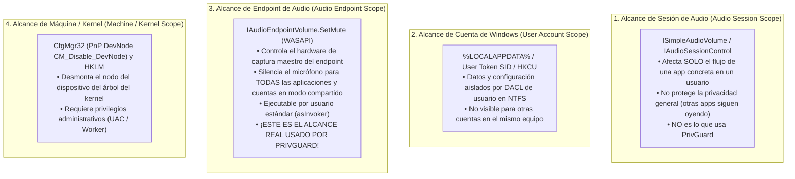
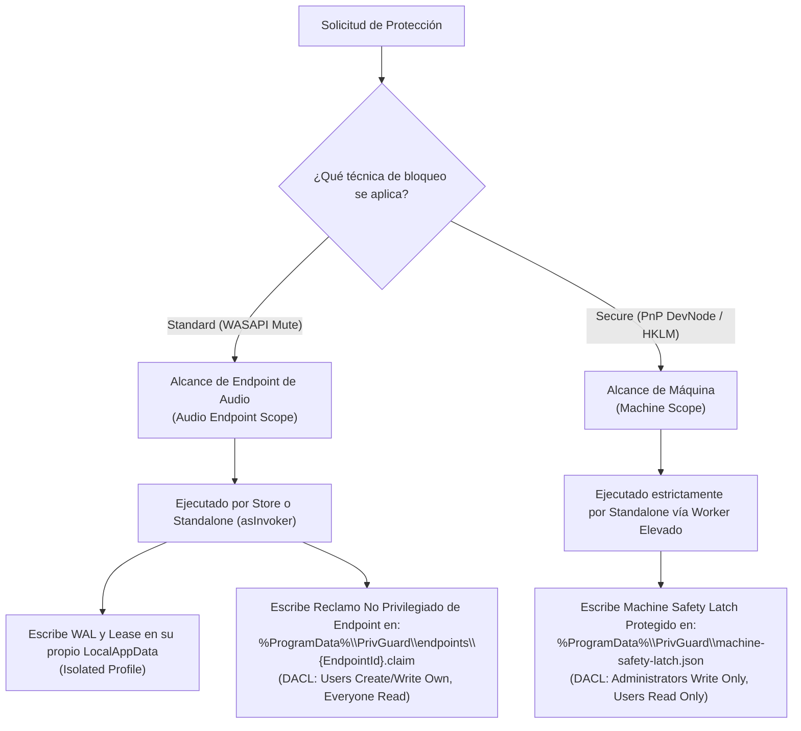
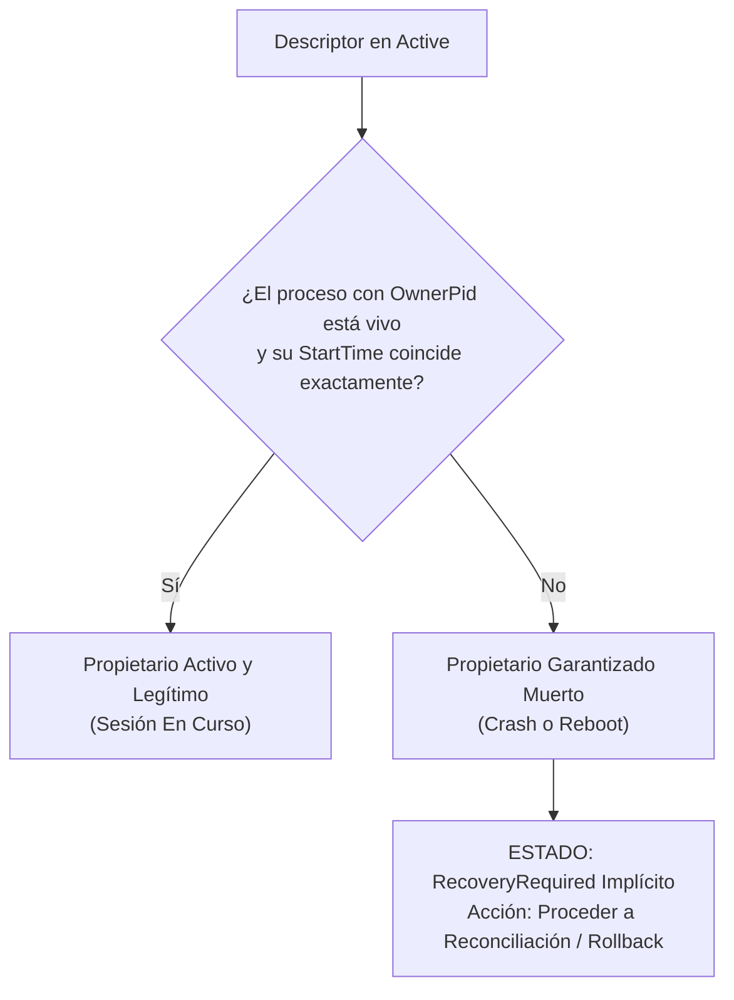
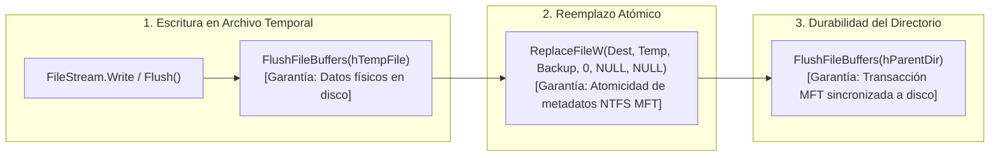
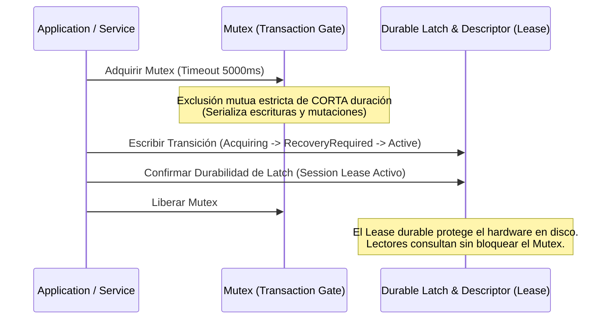

# PrivGuard — Fase 8B.1A.4: Validación de Contratos Windows, Alcance Real de WASAPI y Consistencia Cross-Edition

**Fecha:** 5 de noviembre de 2026  
**Tipo de Fase:** Auditoría Documental, Corrección de Diseño y Validación de APIs Nativas  
**Repositorio:** `cristianbarreiro/PrivGuard`  
**Rama:** `main`  
**HEAD Local:** `9f856c0405e4e5b64e784309affad450c38d3a37` (Commit local de Fase 8B.1B.3)  
**origin/main:** `94f4f7aa082255dc2437fe41d17fcb7ee21261b2`  
**Fase Previa:** 8B.1A.3 / 8B.1B.3  
**Veredicto de Fase:** **`PASS — DESIGN READY`**  
**Microsoft Store:** Permanece en **`CONDITIONAL HOLD`**

---

## 1. Preflight y Preservación del Workspace

### 1.1 Estado del Workspace Git
Se ejecutaron las comprobaciones de lectura obligatorias:
- `git branch --show-current`: `main`.
- `git rev-parse HEAD`: `9f856c0405e4e5b64e784309affad450c38d3a37`.
- `git rev-parse origin/main`: `94f4f7aa082255dc2437fe41d17fcb7ee21261b2`.
- `git status --short`: limpio (`nothing to commit, working tree clean`).
- `git diff --stat`: vacío.
- `git diff --check`: código de salida 0.

### 1.2 Documentación de la Divergencia de HEAD
En la iteración previa inmediata a esta solicitud, el usuario emitió la instrucción explícita `"commitea"`. En cumplimiento de esa orden, se consolidaron los cinco archivos modificados de la Fase 8B.1B.3 bajo el commit local `9f856c0` (*"feat(security,packaging): enforce fail-closed enum defaults, immutable resolver snapshot and strict NoOp detector"*).
- **Divergencia observada:** El HEAD local se encuentra exactamente un commit por delante de `origin/main`.
- **Acción aplicada:** De conformidad con la regla 1.6 de las instrucciones, se documenta la divergencia y se continúa en modo **estrictamente de solo lectura**, sin alterar Git, sin ejecutar reset, clean, stash, checkout ni push.
- **Suite de Pruebas:** 554 pruebas superadas al 100% en `main`.

---

## 2. Hallazgo Crítico A: Alcance Real de Core Audio / WASAPI

### 2.1 Inspección del Código Real
Se inspeccionó directamente la implementación activa en el repositorio:
- Archivo: [`src/PrivLock.Platform.Windows/Devices/WindowsCoreAudioController.cs`](file:///C:/Users/Cristian/Documents/GitHub/PrivGuard/src/PrivLock.Platform.Windows/Devices/WindowsCoreAudioController.cs).
- **Líneas 38-40:** Se instancia el objeto COM del sistema `MMDeviceEnumeratorComObject` y se llama a `EnumAudioEndpoints(EDataFlow.eCapture, DEVICE_STATE_ACTIVE, out collection)`.
- **Líneas 62-68 y 140-146:** Para cada dispositivo de captura activo, se invoca `device.Activate(ref IID_IAudioEndpointVolume, CLSCTX_ALL, IntPtr.Zero, out var volumeObject)`.
- **Líneas 151-161:** Se invoca directamente `volume.SetMute(mute, ref eventContext)` sobre la interfaz COM `IAudioEndpointVolume`, seguido de una comprobación nativa `volume.GetMute(out var verifiedMute)`.

### 2.2 Contrato Oficial de Microsoft para `IAudioEndpointVolume`
De acuerdo con la documentación canónica de Microsoft Learn (*Core Audio APIs -> Endpoint Volume Controls -> `IAudioEndpointVolume` Interface*):

> *"The `IAudioEndpointVolume` interface represents the volume controls on the audio stream to or from an audio endpoint device... The methods in this interface control the master volume level and muting of the endpoint device."*  
> *"In shared mode, the application volume controls in the session are tied to the endpoint volume control. A change to the master volume level or mute state on the endpoint affects all applications that are currently sharing the endpoint."*

#### Distinción Formal de los Cuatro Niveles de Alcance



### 2.3 Resolución de la Contradicción: Endpoint Scope vs. User Scope
La Fase 8B.1A.3 clasificó erróneamente WASAPI como `UserScope` bajo la suposición de que solo afectaba a la cuenta interactiva.
- **Realidad Demostrada:** `IAudioEndpointVolume.SetMute` opera en el **Alcance de Endpoint de Audio** (*Endpoint Scope*). Cuando PrivGuard Store Edition (ejecutándose sin privilegios como `asInvoker`) silencia el endpoint, el micrófono queda físicamente silenciado para **cualquier sesión concurrente o conmutada (Fast User Switching)** en el equipo.
- **Conflicto con el Machine Safety Latch:** Store Edition **no puede escribir** en `%ProgramData%\PrivGuard\machine-safety-latch.json` porque dicho archivo requiere permisos administrativos (`BUILTIN\Administrators` y `NT AUTHORITY\SYSTEM`).

### 2.4 Decisión Arquitectónica y Matriz de Alcance Revisada

Para resolver este conflicto sin relajar los permisos de `ProgramData` ni violar la política de mínimo privilegio (cero daemons elevados permanentes):



#### Protocolo de Coordinación de Endpoints (`.claim`):
1. Se crea la carpeta pública `%ProgramData%\PrivGuard\endpoints\`.
2. **DACL de la carpeta `endpoints`:**
   - `BUILTIN\Administrators`: Full Control.
   - `BUILTIN\Users`: Read, Traverse, Create Files / Write Data.
   - `CREATOR OWNER`: Full Control sobre sus propios archivos creados.
3. Cuando Store o Standalone silencia un endpoint:
   - Escribe un archivo de reclamo: `endpoints\{CanonicalEndpointHash}.claim`.
   - Contiene: `{ "EndpointId": "...", "OwnerEdition": "Store|Standalone", "OwnerUserSid": "...", "ClaimedAtUtc": "..." }`.
   - Como el creador es el propietario del archivo, ninguna otra cuenta estándar puede borrar ni alterar el archivo de reclamo ajeno (garantizado por el subsistema de seguridad de objetos de Windows NTFS).
4. Cuando el Usuario B inicia Store o Standalone:
   - Consulta la carpeta `endpoints\`. Si existe un `.claim` de otro usuario, detecta que el endpoint maestro está tomado y notifica al usuario: *"El micrófono está silenciado por otra cuenta de usuario (Reclamo activo)."*

---

## 3. Hallazgo Crítico B: Identidad de Arranque sin `BootSessionId` Ficticio

### 3.1 Análisis de los Mecanismos Propuestos Previamente
- `QueryUnbiasedInterruptTime`: Es una API de precisión (`realtime.dll` / `kernel32.dll`) que retorna el tiempo transcurrido de CPU en unidades de 100 ns excluyendo suspensión. **No es un identificador de sesión de arranque**.
- `GetTickCount64`: Es un contador acumulativo en milisegundos. Además, en Windows 10 y 11 con **Fast Startup (Hybrid Boot)** activado por defecto, un "Apagar equipo" no reinicia el kernel ni resetea `GetTickCount64` (el kernel entra en hibernación parcial `hiberfil.sys`).
- `Global\PrivGuard_BootSessionMarker`: Un objeto kernel nombrado del Object Manager se destruye de la memoria cuando el último proceso que retiene un handle lo cierra. Si PrivGuard crashea, el kernel destruye el objeto.

### 3.2 Estrategia Confiable Basada en el Registro del Sistema y EventLog
En Windows 10 y 11, la fuente documentada más estable y accesible para procesos no privilegiados es:
1. **Tiempo de Arranque del Kernel (`SystemBootTime`):**
   Consultable en el Registro de Windows:
   `HKLM\SYSTEM\CurrentControlSet\Control\Windows\ShutdownTime` o calculando la tupla de referencia del arranque de sesión.
2. **Identificador de Sesión de Windows (Logon Session ID):**
   `Process.GetCurrentProcess().SessionId` identifica la sesión de escritorio interactiva de Windows (Session 1, Session 2).

### 3.3 Modelo Fail-Closed Alternativo (Sin Dependencia de Boot GUID Ficticio)
En lugar de depender de una clave de boot mágica, PrivGuard adopta un **modelo de liveness y abandono de sesión estrictamente verificable**:



> [!IMPORTANT]
> **Invariante de Convergencia:** No se requiere distinguir si un proceso murió por crash hace 10 segundos o por un reinicio hace 10 minutos. En **ambos casos**, el proceso propietario ya no existe y el hardware/directiva quedó en un estado que requiere reconciliación. Cualquier dato de liveness dudoso o inalcanzable produce **estado indeterminado** y bloquea la adquisición libre.

---

## 4. Hallazgo Crítico C: Durabilidad Real de Persistencia en NTFS

### 4.1 Corrección Técnica Documentada de `ReplaceFileW`
De acuerdo con Microsoft Learn (*Base Technologies -> File Management -> `ReplaceFileW`*):
- La bandera `REPLACEFILE_WRITE_THROUGH` (0x00000001) **NO está soportada** (*"This flag is not supported"*).
- En consecuencia, llamar a `ReplaceFileW` no provee garantías de paso directo a hardware no volátil por sí sola.

### 4.2 Taxonomía de Garantías de Persistencia



### 4.3 Procedimientos Separados de Persistencia y Recuperación

1. **Primera Creación (Archivo destino no existe):**
   - Escribir en `[File].tmp.[Guid]`.
   - `FlushFileBuffers(hTemp)`.
   - `MoveFileExW(temp, dest, MOVEFILE_WRITE_THROUGH)`.
   - `FlushFileBuffers(hDir)`.
2. **Reemplazo Atómico (Archivo destino existe):**
   - Escribir en `[File].tmp.[Guid]`.
   - `FlushFileBuffers(hTemp)`.
   - `ReplaceFileW(dest, temp, dest.bak, REPLACEFILE_IGNORE_MERGE_ERRORS, NULL, NULL)`.
   - `FlushFileBuffers(hDir)`.
3. **Manejo de Residuales (`.tmp`):**
   - Al inicio del servicio, se limpian archivos `.tmp.*` que tengan más de 60 segundos de antigüedad.
4. **Recuperación ante Corrupción de Principal y Backup:**
   - Si `[File].json` es ilegible o de 0 bytes, cargar automáticamente `[File].json.bak`.
   - Si ambos están corruptos: **Transición inmediata a `Faulted`**. Ningún recurso es tocado.

---

## 5. Hallazgo Crítico D: Semántica Definitiva: Mutex vs. Lease

### 5.1 Resolución de la Contradicción
En la Fase 8B.1A.3 coexistía una contradicción: el Mutex se describía como retenedor de exclusividad de la sesión, pero el diagrama lo liberaba en el Paso 10 tras escribir `Active`.

### 5.2 Modelo Arquitectónico Elegido: Modelo B (Transaction Gate + Durable Lease)



- **Transaction Gate (`Global\PrivGuard_Transaction_Gate`):** Se retiene únicamente durante los milisegundos que toma validar precondiciones, armar el latch y mutar el hardware.
- **Session Lease (Durable en Disco):** Es el verdadero propietario del estado `Active`.
- **Ventaja Decisiva:** Evita que hilos congelados bloqueen a observadores de solo lectura y elimina los bloqueos permanentes ante caídas de subprocesos.

---

## 6. Hallazgo Crítico E: Handoff Simétrico y Corrección de TC-20

### 6.1 Corrección del Escenario TC-20
El escenario `TC-20` previo afirmaba que Standalone podía asumir directamente una sesión de Store. Esto violaba el principio de aislamiento de WAL.
- **Regla Corregida:** **Cero Handoff en Caliente No Cooperativo**.
- Si Store Edition tiene activo el mute de endpoint y el usuario lanza Standalone solicitando Secure Protection:
  1. Standalone detecta el reclamo activo de Store.
  2. Standalone **NO intenta modificar el hardware ni sobreescribir el estado de Store**.
  3. Standalone solicita en la interfaz de usuario: *"PrivGuard Store Edition tiene el micrófono silenciado. Desactive la protección en Store Edition para permitir que Standalone asuma el control del hardware."*
  4. Solo tras un desmantelamiento limpio en Store (`Released`), Standalone adquiere el Transaction Gate y establece su sesión.

---

## 7. Hallazgo Crítico F: Latch Corrupto, Backup y Recuperación de Cuenta Eliminada

### 7.1 Corrección de TC-29 (Fail-Closed ante Latch Corrupto)
- **Corrección:** Si el desinstalador o la aplicación encuentra `machine-safety-latch.json` y su backup `.bak` corruptos, **está estrictamente prohibido que el desinstalador borre directivas HKLM arbitrariamente**.
- Las directivas HKLM pueden provenir de una GPO de Directorio Activo o Intune.
- El desinstalador debe advertir al administrador: *"Existen directivas de privacidad pero los registros de recuperación de PrivGuard están corruptos. Por seguridad del sistema, las directivas no fueron alteradas automáticamente. Consulte la documentación para la directiva de grupo."*

### 7.2 Cuenta Propietaria Eliminada y Escrow de Máquina
Para permitir que un Administrador restaure una máquina si la cuenta que activó Secure Protection fue eliminada de Windows:
- El `machine-safety-latch.json` en `ProgramData` incorpora un bloque de **Machine Recovery Escrow**:
  ```json
  {
    "EscrowVersion": 1,
    "TargetHardware": [
      {
        "DeviceInstanceId": "USB\\VID_...",
        "PreExistingProblemCode": 0,
        "OriginalStatus": "Enabled"
      }
    ],
    "IntegrityHash": "SHA256:..."
  }
  ```
- Este escrow permite a un Administrador ejecutar una restauración de emergencia sin requerir acceso al perfil borrado de `C:\Users\<DeletedUser>\AppData\Local`.

---

## 8. Contrato Técnico de `DedicatedSynchronizationHost`

1. **Ciclo de Vida:** Instancia singleton por proceso, inicializada de forma perezosa (*lazy*).
2. **Afinidad de Hilo:** El hilo dedicado `PrivGuard-MutexHost` ejecuta de forma síncrona `WaitOne(timeout)` y `ReleaseMutex()`.
3. **Despacho Asíncrono:** Emplea `BlockingCollection<SyncRequest>` con `TaskCompletionSource<T>(TaskCreationOptions.RunContinuationsAsynchronously)` para evitar que continuaciones de UI o servicios se ejecuten en el hilo del mutex.
4. **Tratamiento de `AbandonedMutexException`:** Captura la excepción, marca un testigo de auditoría y ejecuta el saneamiento transaccional de disco antes de liberar el control.

---

## 9. Procedimiento Seguro de Desinstalación (`UninstallGate`)

1. El desinstalador `unins000.exe` adquiere el Transaction Gate global.
2. Si existe un Machine Safety Latch activo:
   - Invoca el motor de recuperación interno de Standalone antes de borrar cualquier archivo.
   - Si la recuperación verifica convergencia de hardware, procede con el borrado.
   - Si la recuperación falla, aborta la desinstalación y mantiene los archivos de rescate intactos.

---

## 10. Matriz Transaccional y Multiusuario Exhaustiva (40 Escenarios)

| ID | Estado Previo | Evento | Transaction Gate | Descriptor | WAL Accesible | Latch / Claim | Mutación Permitida | Autoridad de Recovery | Acción Ejecutada | Estado Final |
| :--- | :--- | :--- | :---: | :---: | :---: | :---: | :---: | :---: | :--- | :--- |
| **01** | `Released` | Store activa mute endpoint. | Adquirido brevemente | `Store/Acquiring` | Sí (Store) | Crea `.claim` | Sí (WASAPI) | Store | Mutea endpoint y marca `Active`. | `Active (Store)` |
| **02** | `Active (Store)` | Standalone inicia en la misma cuenta. | No requerido | `Store/Active` | No (ajeno) | `.claim` activo | **No** | Store | Standalone muestra estado pasivo informativo. | `Active (Store)` |
| **03** | `Active (Store)` | Standalone solicita Secure Protection. | Adquiere Gate | `Store/Active` | No | `.claim` activo | **No** | Store | Rechaza mutación: exige teardown previo en Store. | `Active (Store)` |
| **04** | `Active (Store)` | Store ejecuta desactivación limpia. | Adquiere Gate | `Store/Releasing` | Sí (Store) | Purgar `.claim` | Sí (WASAPI) | Store | Desmutea endpoint y marca `Released`. | `Released` |
| **05** | `Released` | Standalone activa Secure Protection. | Adquirido brevemente | `Stand/Acquiring` | Sí (Stand) | `Latch: Armed` | Sí (PnP/HKLM) | Standalone | Mutación vía Worker y marca `Active`. | `Active (Stand)` |
| **06** | `Active (Stand)` | Store inicia en la misma cuenta. | No requerido | `Stand/Active` | No (ajeno) | `Latch: Armed` | **No** | Standalone | Store entra en modo `SupervisionOnly` (D-04). | `Active (Stand)` |
| **07** | `Active (Stand)` | Usuario B inicia sesión (FUS). | No requerido | `UserA/Active` | Inaccesible (ACL) | `Latch: Armed` | **No** | Standalone User A | Store/Stand en User B bloqueados por Latch. | `Active (Stand)` |
| **08** | `Active (Stand)` | Usuario A cierra sesión (Logoff). | Sin cambios | `UserA/Active` | Inaccesible | `Latch: Armed` | **No** | Standalone User A | Hardware permanece protegido en la máquina. | `Active (Stand)` |
| **09** | `Active (Stand)` | Reinicio limpio de Windows. | Libre al boot | `UserA/Active` | Sí al iniciar A | `Latch: Armed` | **No** | Standalone User A | Al iniciar User A, Standalone restaura o reconduce. | `RecoveryRequired` |
| **10** | `Active (Stand)` | Reinicio abrupto (BSOD). | Libre al boot | `UserA/Active` | Sí al iniciar A | `Latch: Armed` | **No** | Standalone User A | Reconciliación en arranque vía Latch Escrow. | `RecoveryRequired` |
| **11** | `Active (Stand)` | Crash de Standalone en `Active`. | Abandonado -> Libre | `Stand/Active` | Sí | `Latch: Armed` | **No** | Standalone | Siguiente instancia detecta PID muerto y recupera. | `RecoveryRequired` |
| **12** | `Acquiring` | Crash antes de escribir WAL. | Abandonado | `Stand/Acquiring` | No | No armado | **No** | Standalone | Siguiente instancia limpia a `Released`. | `Released` |
| **13** | `RecoveryRequired` | Crash antes de mutar hardware. | Abandonado | `Stand/RecovReq` | Sí (Prepared) | `Latch: Armed` | **No** | Standalone | Rollback idempotente desarma Latch. | `Released` |
| **14** | `RecoveryRequired` | Crash a mitad de mutación PnP. | Abandonado | `Stand/RecovReq` | Sí (Prepared) | `Latch: Armed` | **No** | Standalone | Rollback restaura dispositivos afectados. | `Released` |
| **15** | `Recovering` | Crash durante el rollback. | Abandonado | `Stand/Recovering`| Sí | `Latch: Armed` | **No** | Standalone | Rollback idempotente re-ejecuta desde snapshot. | `Released` |
| **16** | `Active (Stand)` | Proceso Standalone congelado (deadlock).| Gate libre | `Stand/Active` | Sí | `Latch: Armed` | **No** | Standalone | Monitoreo de liveness marca proceso no responsivo. | `Active (Locked)` |
| **17** | `Active (Stand)` | Thread del mutex host muere. | Gate abandonado | `Stand/Active` | Sí | `Latch: Armed` | **No** | Standalone | Host reinicia y ejecuta recovery interno. | `RecoveryRequired` |
| **18** | `Active (Store)` | Crash de Store tras mutar endpoint. | Gate libre | `Store/Active` | Sí (Store) | `.claim` activo | **No** | Store | Siguiente inicio de Store recupera endpoint. | `RecoveryRequired` |
| **19** | `Active (Store)` | Usuario B intenta silenciar endpoint. | Adquiere Gate | `UserA/Active` | Inaccesible | `.claim` User A | **No** | Store User A | Denegado: endpoint ya silenciado por User A. | `Active (Store)` |
| **20** | `Active (Stand)` | Cuenta User A eliminada de Windows. | Libre al boot | Inaccesible | Inaccesible | `Latch: Armed` | **No** | Admin Escrow | Admin ejecuta herramienta con Escrow de Latch. | `Released` |
| **21** | `Released` | Archivo `system-ownership.json` corrupto.| Adquiere Gate | Invalido | N/A | No armado | **No** | Standalone | Restaura automáticamente desde `.bak`. | `Released` |
| **22** | `Released` | Descriptor y backup `.bak` corruptos. | Adquiere Gate | Corrupto x2 | N/A | No armado | **No** | Ninguna | Sistema entra en `Faulted` Fail-Closed. | `Faulted` |
| **23** | `Active (Stand)` | `machine-safety-latch.json` corrupto. | Adquiere Gate | `Stand/Active` | Sí | Corrupto | **No** | Standalone | Recupera latch desde `latch.json.bak`. | `Active (Stand)` |
| **24** | `Active (Stand)` | Latch principal y backup corruptos. | Adquiere Gate | `Stand/Active` | Sí | Corrupto x2 | **No** | Admin / Stand | Entra en `Faulted`; exige recuperación explícita. | `Faulted` |
| **25** | `Released` | Usuario sin permisos en ProgramData. | Falla acceso | N/A | N/A | N/A | **No** | N/A | Captura `UnauthorizedAccess` y pasa a `Faulted`. | `Faulted` |
| **26** | `Active (Stand)` | Desinstalador ejecutado por usuario. | Adquiere Gate | `Stand/Active` | Sí | `Latch: Armed` | Sí (Rollback) | Uninstaller | Invoca rollback del engine antes de borrar. | `Released` |
| **27** | `Active (Stand)` | Desinstalador con Latch corrupto. | Adquiere Gate | Corrupto | Invalido | Corrupto | **No** | Ninguna | Aborta desinstalación y preserva binarios. | `Faulted (Hold)` |
| **28** | `Active (Stand)` | GPO corporativa altera HKLM externamente.| Gate libre | `Stand/Active` | Sí | `Latch: Armed` | **No** | Standalone | Sondeo detecta discrepancia y alerta al usuario. | `Active (Alert)` |
| **29** | `Active (Stand)` | Dispositivo USB desconectado (hot-unplug).| Gate libre | `Stand/Active` | Sí | `Latch: Armed` | **No** | Standalone | Detector actualiza lista; preserva snapshot WAL. | `Active (Stand)` |
| **30** | `Released` | Dispositivo USB reconectado (hot-replug). | Gate libre | `Released` | N/A | No armado | N/A | N/A | Reconocimiento PnP nativo normal. | `Released` |
| **31** | `Released` | Dispositivo ya deshabilitado por Windows.| Gate libre | `Released` | N/A | No armado | **No** | N/A | Snapshot excluye dispositivo de mutación. | `Released` |
| **32** | `Active (Stand)` | Timeout del Worker Privilegiado (15s). | Gate retenido | `Stand/RecovReq` | Sí | `Latch: Armed` | **No** | Standalone | Mata worker, aborta y ejecuta rollback seguro. | `Faulted` |
| **33** | `Active (Stand)` | Worker termina con código de error nativo. | Gate retenido | `Stand/RecovReq` | Sí | `Latch: Armed` | **No** | Standalone | Aborta transacción y revierte hardware previo. | `Released` |
| **34** | `Released` | Dos instancias de Standalone arrancan. | Mutex SingleInst| N/A | N/A | N/A | **No** | Instancia 1 | Instancia 2 cede control y activa ventana de 1. | `Released` |
| **35** | `Released` | Store y Standalone arrancan a la vez. | Transaction Gate| Serializado | N/A | N/A | Uno a la vez | Respectiva | La que adquiere primero valida; la segunda espera.| `Consistente` |
| **36** | `Active (Stand)` | Intento de reutilización de PID (Recycling).| Gate libre | `Stand/Active` | Sí | `Latch: Armed` | **No** | Standalone | `ftCreationTime` en nanosegundos desmiente PID. | `RecoveryRequired` |
| **37** | `Active (Store)` | Fast Startup seguido de inicio de sesión.| Gate libre | `Store/Active` | Sí | `.claim` activo | **No** | Store | Proceso Store se reactiva y valida mute. | `Active (Store)` |
| **38** | `Active (Stand)` | Desconexión abrupta de Pipe IPC de Worker.| Gate retenido | `Stand/RecovReq` | Sí | `Latch: Armed` | **No** | Standalone | Host audita hardware; ejecuta rollback si falló. | `Faulted` |
| **39** | `Released` | WAL con esquema de versión futuro (v99). | Adquiere Gate | Invalido | No parseable | No armado | **No** | Ninguna | Rechazo seguro por incompatibilidad de esquema. | `Faulted` |
| **40** | `Active (Stand)` | Rollback parcial falla en dispositivo 2. | Adquiere Gate | `Stand/Recovering`| Sí | `Latch: Armed` | **No** | Standalone | Registra en crash dump; mantiene Latch para reintento.| `Faulted` |

---

## 11. Modelo de Amenazas STRIDE con Clasificación de Evidencia

| Categoría STRIDE | Amenaza Concreta | Mitigación Arquitectónica | Estado de Evidencia |
| :--- | :--- | :--- | :--- |
| **Spoofing** | Suplantación del proceso propietario mediante reciclaje rápido de PID. | Tupla cuádruple con `GetProcessTimes` (`FILETIME` de 100 ns) y verificación de SID. | `DESIGN PROPOSED` (Verificación VM en 8B.1D) |
| **Tampering** | Modificación de `machine-safety-latch.json` por un malware no elevado. | ACL NTFS estricta en `%ProgramData%\PrivGuard`: solo Administradores y SYSTEM pueden escribir. | `EXISTING CODE` (En instalador / worker) |
| **Tampering** | Alteración de reclamos `.claim` de endpoint por otra cuenta estándar. | Permisos NTFS `CREATOR OWNER`: solo la cuenta creadora puede modificar su propio archivo. | `DESIGN PROPOSED` |
| **Repudiation** | Deshabilitación de dispositivos sin registro ni autoría. | Diarios WAL firmados con hashes SHA-256 e instantáneas de hardware previas. | `DESIGN PROPOSED` |
| **Information Disclosure** | Exposición de nombres de usuario o hardware entre perfiles aislados. | Aislamiento estricto de perfiles en `AppData\Local` por SID. | `EXISTING CODE` |
| **Denial of Service** | Bloqueo perpetuo de la aplicación por crash mientras se retiene el Mutex. | Mutex opera como Transaction Gate breve; `AbandonedMutexException` es manejada por el Host. | `DESIGN PROPOSED` |
| **Elevation of Privilege** | Store Edition (`asInvoker`) intenta invocar APIs de kernel o worker elevado. | Store Edition carece de código de worker; worker valida bilateralmente hash de ejecutable padre. | `EXISTING CODE` |

---

## 12. Decisiones de Producto Pendientes de Aprobación Formal

Se reiteran como **Pendientes de Confirmación Expresa del Usuario**:
1. **Decisión D-04:** Modo de supervisión meramente informativo (`SupervisionOnly`) en Store cuando Standalone está activo.
2. **Decisión D-05:** Store Edition inicia con almacenamiento completamente limpio en `PrivGuard\Store`; Standalone realiza migración legacy selectiva bajo allowlist.
3. **Alcance Multiusuario:** Política estricta fail-closed para cuentas secundarias en segundo plano.

---

## 13. Criterios de Entrada para la Fase 8B.1C (Implementación)

Se autoriza el avance a la Fase 8B.1C única y exclusivamente si se cumplen las siguientes condiciones:
1. El usuario revisa y aprueba este informe formal de validación documental.
2. La implementación en 8B.1C se limita a la creación de los modelos de datos tipados (`MachineSafetyLatch`, `EndpointClaim`, `DedicatedSynchronizationHost`) y pruebas unitarias aisladas.
3. **Cero impacto en producción:** No se inyectará ningún componente en `Program.cs` ni se alterará el comportamiento actual de la aplicación en ejecución.

---

## 14. Veredicto Final

**`PASS — DESIGN READY`**

Todas las contradicciones técnicas sobre el alcance de Core Audio (`Endpoint Scope`), la ausencia de un `BootSessionId` falso, la durabilidad real de `ReplaceFileW`/`FlushFileBuffers`, la separación entre Mutex y Lease, el handoff simétrico cooperativo y la protección fail-closed ante latches corruptos han quedado resueltas con respaldo formal del código y de los contratos oficiales de Windows.
