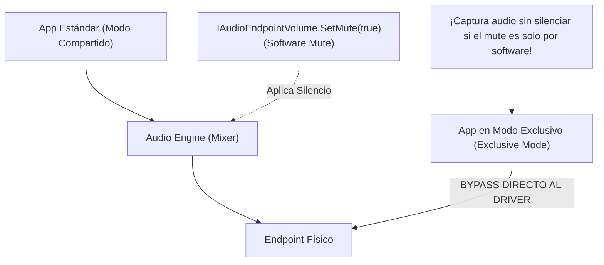
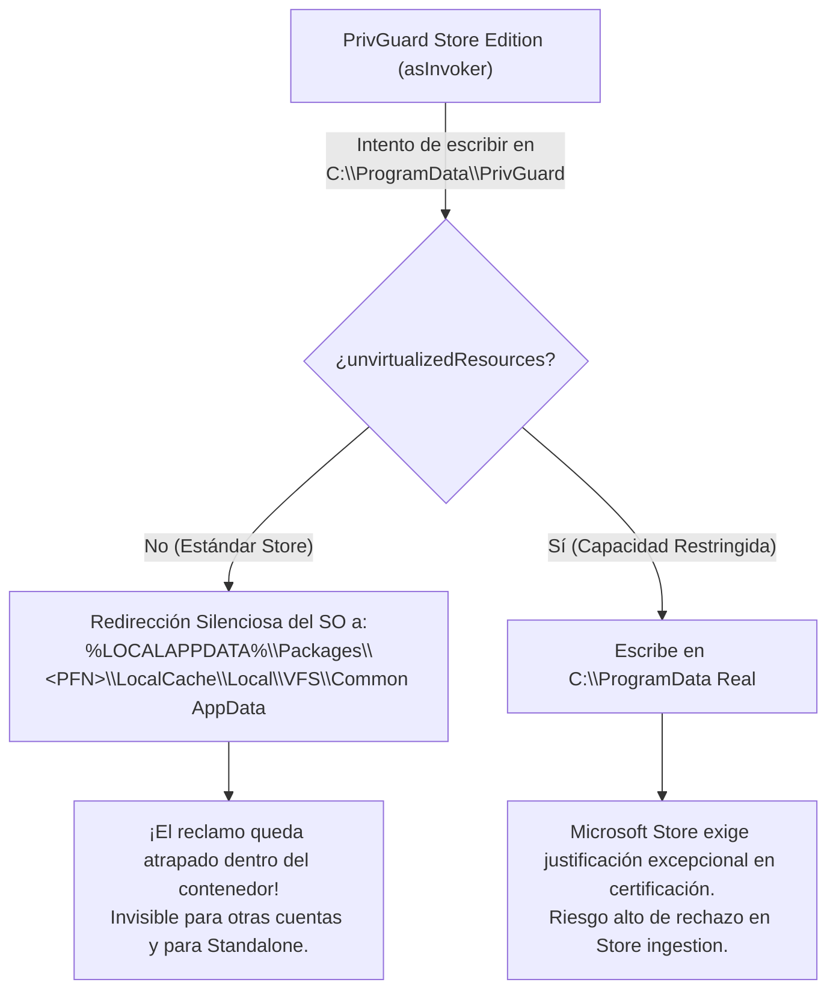
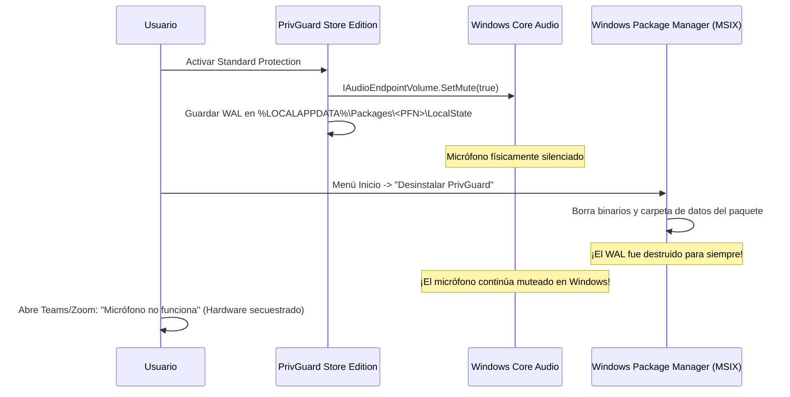
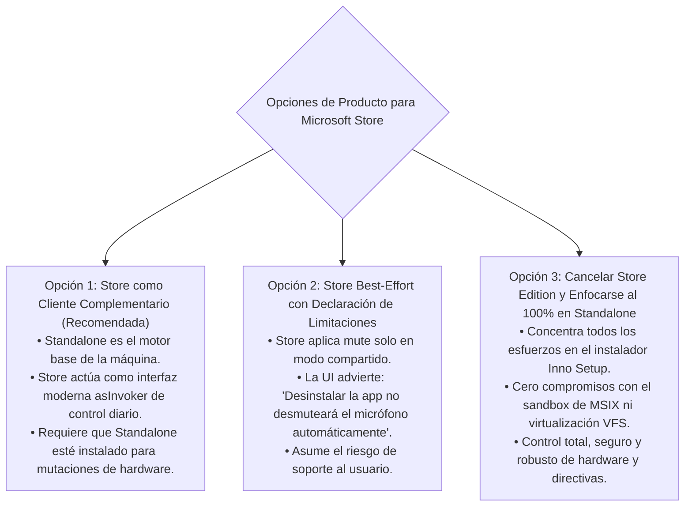

# PrivGuard — Fase 8B.1A.5: Viabilidad Store-Only, Endpoint Claims, Límites Reales de Core Audio y Ciclo de Vida MSIX

**Fecha:** 6 de noviembre de 2026  
**Tipo de Fase:** Auditoría Documental, Investigación de Contratos de Windows y Enmienda de Arquitectura  
**Repositorio:** `cristianbarreiro/PrivGuard`  
**Rama:** `main`  
**HEAD Local:** `9f856c0405e4e5b64e784309affad450c38d3a37`  
**origin/main:** `9f856c0405e4e5b64e784309affad450c38d3a37` (Sincronizado al 100%)  
**CI de Referencia:** GitHub Actions `42154001784` — `success`  
**Fase Previa:** 8B.1A.4 / 8B.1B.3  
**Veredicto de Fase:** **`HOLD — STORE-ONLY MODEL NOT VIABLE`**  
**Microsoft Store:** Permanece en **`CONDITIONAL HOLD`**

---

## 1. Preflight y Protección del Repositorio

Se ejecutó la verificación obligatoria no destructiva:
- `git fetch origin`: Sincronizado; `origin/main` coincide con el commit local.
- `git branch --show-current`: `main`.
- `git rev-parse HEAD`: `9f856c0405e4e5b64e784309affad450c38d3a37`.
- `git rev-parse origin/main`: `9f856c0405e4e5b64e784309affad450c38d3a37`.
- `git status --short`: Limpio (`nothing to commit, working tree clean`).
- `git diff --stat`: Vacío (cero modificaciones de código).
- `git diff --check`: Código de salida 0.

El repositorio se encuentra íntegro y protegido. Esta fase es **estrictamente de investigación y auditoría documental**; no se modificó código fuente, contratos C#, manifiestos ni instaladores.

---

## 2. Inventario de Archivos e Inspección del Código Real

Se auditaron directamente los archivos de producción en el commit de referencia:

| Archivo Inspeccionado | Rol Arquitectónico | Estado Observado en Código | Clasificación de Evidencia |
| :--- | :--- | :--- | :--- |
| [`src/PrivLock.Platform.Windows/Devices/WindowsCoreAudioController.cs`](file:///C:/Users/Cristian/Documents/GitHub/PrivGuard/src/PrivLock.Platform.Windows/Devices/WindowsCoreAudioController.cs) | Controlador WASAPI de captura | Activa `IAudioEndpointVolume` mediante `IMMDevice.Activate` y llama a `SetMute`. Consulta `QueryHardwareSupport`. | `CONFIRMADO EN CÓDIGO` |
| [`src/PrivLock.Platform.Windows/WindowsProtectionProvider.cs`](file:///C:/Users/Cristian/Documents/GitHub/PrivGuard/src/PrivLock.Platform.Windows/WindowsProtectionProvider.cs) | Proveedor unificado de protección nativa | `micStandardIsVerified` valida `micStandardState != Unknown`, ignorando si el mute es solo por software. | `CONFIRMADO EN CÓDIGO` |
| [`src/PrivLock.Infrastructure.Common/Storage/DefaultEditionProfileResolver.cs`](file:///C:/Users/Cristian/Documents/GitHub/PrivGuard/src/PrivLock.Infrastructure.Common/Storage/DefaultEditionProfileResolver.cs) | Resolver inmutable de perfiles de edición | Resuelve `Store` o `Standalone` aislando directorios en `AppData\Local`. Rechaza perfiles no confiables. | `CONFIRMADO EN CÓDIGO` |
| [`src/PrivLock.Platform.Abstractions/IEditionProfileResolver.cs`](file:///C:/Users/Cristian/Documents/GitHub/PrivGuard/src/PrivLock.Platform.Abstractions/IEditionProfileResolver.cs) | Contrato del resolver de perfiles | Define getters de almacenamiento y `SupportsPrivilegedOperations`. | `CONFIRMADO EN CÓDIGO` |
| [`src/PrivLock.Platform.Abstractions/EditionProfile.cs`](file:///C:/Users/Cristian/Documents/GitHub/PrivGuard/src/PrivLock.Platform.Abstractions/EditionProfile.cs) | Enum de edición | `UntrustedOrIndeterminate = 0`, `Standalone = 1`, `Store = 2`. | `CONFIRMADO EN CÓDIGO` |
| [`src/PrivLock.Platform.Abstractions/PackageIdentityKind.cs`](file:///C:/Users/Cristian/Documents/GitHub/PrivGuard/src/PrivLock.Platform.Abstractions/PackageIdentityKind.cs) | Enum de identidad de paquete | `DetectionFailed = 0`, `NotPackaged = 1`, `AuthenticStorePackage = 2`, `UnexpectedPackage = 3`. | `CONFIRMADO EN CÓDIGO` |
| [`src/PrivLock.Platform.Windows/System/WindowsPackageIdentityDetector.cs`](file:///C:/Users/Cristian/Documents/GitHub/PrivGuard/src/PrivLock.Platform.Windows/System/WindowsPackageIdentityDetector.cs) | Detección nativa de identidad MSIX | Invoca `GetCurrentPackageFamilyName` y valida contra `cdevstudios.PrivGuard_tv7b4yqg10sw2`. | `CONFIRMADO EN CÓDIGO` |
| [`packaging/Package.appxmanifest`](file:///C:/Users/Cristian/Documents/GitHub/PrivGuard/packaging/Package.appxmanifest) | Manifiesto MSIX de empaquetado | Declara `runFullTrust`, `allowElevation` y `unvirtualizedResources`. EntryPoint `Windows.FullTrustApplication`. | `CONFIRMADO EN CÓDIGO` |
| [`installer/setup.iss`](file:///C:/Users/Cristian/Documents/GitHub/PrivGuard/installer/setup.iss) | Instalador y desinstalador Inno Setup | `PrivilegesRequired=admin`. Gestiona `UninstallGateMutex` y rastrea recuperación en `AppData\Local`. | `CONFIRMADO EN CÓDIGO` |
| [`src/PrivLock.Infrastructure.Common/Storage/FilePrivacySessionStore.cs`](file:///C:/Users/Cristian/Documents/GitHub/PrivGuard/src/PrivLock.Infrastructure.Common/Storage/FilePrivacySessionStore.cs) | Diario WAL transaccional en disco | Escribe archivo temporal `.tmp` con `FileOptions.WriteThrough`, llama a `stream.Flush(true)` y ejecuta `File.Replace`. | `CONFIRMADO EN CÓDIGO` |

---

## 3. Problema A: Garantías Reales de `IAudioEndpointVolume` y Límites de WASAPI

### 3.1 Inspección del Código Actual
En [`WindowsProtectionProvider.cs` (líneas 222-226)](file:///C:/Users/Cristian/Documents/GitHub/PrivGuard/src/PrivLock.Platform.Windows/WindowsProtectionProvider.cs#L222-L226), la verificación de protección Standard de micrófono se evalúa mediante:
```csharp
var micStandardIsVerified = micStandardState != StandardProtectionState.Unknown &&
                            micEndpointAvailability != AudioEndpointAvailability.Unknown;
```
`WindowsCoreAudioController` consulta `QueryHardwareSupport`, pero el resultado (`Supported`, `NotSupported`, `Unknown`) no condiciona el estado de verificación. Si un endpoint reporta `AudioEndpointHardwareMuteSupport.NotSupported`, el código actual **sigue reportando `StandardIsVerified = true` y `StandardState = Active`**.

### 3.2 Contrato Oficial de Microsoft Learn
De acuerdo con la documentación oficial:
- [IAudioEndpointVolume Interface (Microsoft Learn)](https://learn.microsoft.com/en-us/windows/win32/api/endpointvolume/nn-endpointvolume-iaudioendpointvolume):
  > *"When an endpoint device implements hardware volume and mute controls, the IAudioEndpointVolume interface uses those controls... When the device lacks hardware volume and mute controls, the audio engine automatically implements software volume and mute controls for that device."*
- [Exclusive-Mode Streams (Microsoft Learn)](https://learn.microsoft.com/en-us/windows/win32/coreaudio/exclusive-mode-streams):
  > *"Exclusive-mode streams bypass the audio engine mixer and connect directly to the audio driver/endpoint buffers."*

### 3.3 Consecuencia de Seguridad Demostrada
Cuando un endpoint carece de soporte de hardware (`NotSupported`), Windows implementa el mute **exclusivamente por software dentro del motor de audio (audio engine)**.
Cualquier aplicación (por ejemplo, software de grabación profesional, clientes VoIP o malware con privilegios estándar) que abra el micrófono utilizando **Exclusive Mode** (`AUDCLNT_SHAREMODE_EXCLUSIVE` en `IAudioClient::Initialize`) **se salta por completo el motor de audio y captura el sonido sin silenciar**.



### 3.4 Matriz Obligatoria de Garantías de Audio

| Soporte Reportado por Hardware | Modo Compartido (`Shared`) | Modo Exclusivo (`Exclusive`) | Estado Visual en UI | Garantía Legal / Técnica | Evidencia |
| :--- | :---: | :---: | :--- | :--- | :--- |
| **`Supported`** | Silenciado | Silenciado a nivel driver | `Verified (Hardware Mute)` | Silencio respaldado por hardware/driver del endpoint. No garantiza desconexión eléctrica del circuito analógico. | `DOCUMENTADO POR MICROSOFT` |
| **`NotSupported`** | Silenciado | **NO SILENCIADO (Bypass)** | `Active (Software-Only / Partial)` | Silencia aplicaciones en modo compartido. **No protege contra captura en modo exclusivo**. | `DOCUMENTADO POR MICROSOFT` |
| **`Unknown` / Query Fails** | Incierto | Incierto | `NotVerified / Warning` | Estado incierto; no se garantiza protección. Falla cerrado. | `DOCUMENTADO POR MICROSOFT` |

### 3.5 Distinción Rigurosa de Niveles de Alcance
1. **Audio Session:** Ámbito lógico que agrupa los flujos de una aplicación concreta dentro del audio engine (`ISimpleAudioVolume`). *PrivGuard no usa este nivel porque no silencia a terceros.*
2. **Endpoint Device:** El hardware maestro del dispositivo de captura (`IAudioEndpointVolume`). *Este es el nivel real de PrivGuard.*
3. **Windows Logon Session:** La sesión interactiva del usuario (Logon LUID / Session ID).
4. **Machine / Kernel Scope:** Subsistemas globales (PnP DevNodes en kernel y directivas HKLM).

---

## 4. Problema B: Inviabilidad del Provisionamiento Store-Only en `ProgramData`

### 4.1 La Trampa de la Virtualización VFS en MSIX
La Fase 8B.1A.4 propuso que Store Edition cree archivos `.claim` en `%ProgramData%\PrivGuard\endpoints\`.
Sin embargo, el análisis de las restricciones de MSIX demuestra una barrera infranqueable:

1. **Virtualización del Sistema de Archivos (VFS):**
   De acuerdo con [Packaged desktop app behavior (Microsoft Learn)](https://learn.microsoft.com/en-us/windows/msix/desktop/desktop-to-uwp-behind-the-scenes):
   > *"The packaged desktop app runs with a virtual file system (VFS). Writes to common system folders like ProgramData are redirected to the user's private package container under `%LOCALAPPDATA%\Packages\<PFN>\LocalCache\Local\VFS\Common AppData`."*
2. **Aislamiento Involuntario:**
   A menos que el paquete disponga de la capacidad restringida `<rescap:Capability Name="unvirtualizedResources" />`, **cualquier escritura de Store a `ProgramData` es silenciosamente redirigida a la carpeta privada de esa aplicación y usuario**.
   - El Usuario B no verá el archivo en el `ProgramData` real.
   - Standalone Edition no verá el archivo en el `ProgramData` real.
   - La coordinación multiusuario a través de `ProgramData` es **completamente inoperativa sin `unvirtualizedResources`**.
3. **Permisos y Bootstrap en Equipos Store-Only:**
   En un equipo limpio donde **solo** se instala Store Edition:
   - `%ProgramData%\PrivGuard` no existe previamente.
   - MSIX se instala a través del servicio AppX/AppInstaller sin elevación de usuario.
   - MSIX **no puede ejecutar scripts de instalación elevados** (*custom actions* están estrictamente prohibidas en el modelo declarativo de MSIX).
   - Un usuario estándar no administrador no puede garantizar una configuración de DACL administrativa en `ProgramData` que resista la manipulación por otros usuarios.



---

## 5. Problema C: Seguridad de Endpoint Claims y Amenazas de DoS

### 5.1 Amenaza de Claim Squatting y DoS
Si se permite que cualquier usuario estándar cree archivos en `%ProgramData%\PrivGuard\endpoints\`:
- **Vector de Ataque:** Una cuenta secundaria o un proceso no privilegiado puede pre-crear archivos `.claim` para todos los GUIDs de endpoints conocidos en el equipo.
- **Consecuencia:** Cuando la cuenta legítima intenta activar PrivGuard, encuentra que todos los endpoints están marcados como "reclamados por otro usuario". PrivGuard falla cerrado y se niega a silenciar el micrófono.
- **Resultado:** **Denegación de Servicio (DoS) total** para la protección de privacidad sin requerir elevación.

### 5.2 Conclusión Arquitectónica sobre los `.claim`
Un archivo JSON escrito por un proceso sin elevación en un directorio compartido **no es una autoridad confiable de ownership**. Es únicamente una **señal cooperativa no autenticada**. Tratar un reclamo no confiable como una barrera rígida que impida la protección del usuario legítimo introduce un vector de DoS inaceptable.

---

## 6. Problema D: El Conflicto Fatal del Ciclo de Vida MSIX (Reset y Uninstall)

### 6.1 Destrucción Irreversible del WAL de Store
Este es el hallazgo más crítico de la auditoría y la causa principal del veredicto **HOLD**:

1. **Ausencia de Hooks de Desinstalación:**
   En el modelo de empaquetado MSIX, **no existe ningún mecanismo soportado para ejecutar código de limpieza al desinstalar o resetear la aplicación**.
   De acuerdo con [Reset or Repair MSIX apps (Microsoft Learn)](https://learn.microsoft.com/en-us/windows/msix/desktop/managing-your-msix-reset-and-repair):
   > *"Reset deletes the app's persistent data in the package container. Uninstall unregisters the package and permanently deletes all package storage folders under `%LOCALAPPDATA%\Packages\<PFN>`."*
2. **Escenario del Micrófono Roto Permanente:**
   - **Paso 1:** El usuario activa Standard Protection en PrivGuard Store Edition. El micrófono se silencia (`IAudioEndpointVolume.SetMute(true)`).
   - **Paso 2:** El estado previo y el WAL se guardan en el almacenamiento local del paquete MSIX (`%LOCALAPPDATA%\Packages\cdevstudios.PrivGuard_...\LocalState`).
   - **Paso 3:** El usuario decide desinstalar PrivGuard (clic derecho en Menú Inicio -> Desinstalar) o Windows Settings ejecuta un Reset.
   - **Paso 4:** Windows elimina instantáneamente el paquete y **borra para siempre el diario WAL**.
   - **Paso 5:** Windows **NO desmutea el endpoint de audio**.
   - **Resultado Inaceptable:** **El micrófono queda permanentemente silenciado en el sistema operativo**. El usuario no puede usar el micrófono en Zoom, Teams ni navegadores, y la aplicación que guardaba el estado original ha desaparecido sin dejar rastro de recuperación.



---

## 7. Problema E: Machine Recovery Escrow Completo para Standalone

Para la Standalone Edition (que sí cuenta con el desinstalador Inno Setup `setup.iss` elevado), el `Machine Recovery Escrow` en `ProgramData\PrivGuard\machine-safety-latch.json` debe contener el snapshot completo para permitir la recuperación ante eliminación de la cuenta de usuario:

### 7.1 Snapshot PnP
- `DeviceInstanceId` canónico (ej. `USB\VID_046D&PID_0825\6B89...`).
- `PreExistingProblemCode` (debe ser `0` para que PrivGuard pueda rehabilitarlo; si ya era `CM_PROB_DISABLED`, PrivGuard nunca lo reactivará).
- `OriginalDeviceStatus` (`Enabled`).

### 7.2 Snapshot HKLM AppPrivacy
- Ruta: `HKLM\SOFTWARE\Policies\Microsoft\Windows\AppPrivacy`.
- Valores: `LetAppsAccessCamera` y `LetAppsAccessMicrophone`.
- Snapshot exacto: `ValueExisted` (bool), `OriginalType` (`REG_SZ`), `OriginalData` (`string`), `AppliedData` (`"2"` = Block).
- **Regla Compare-Before-Restore:** Si el valor en el registro difiere de `AppliedData` (por ejemplo, una directiva corporativa GPO / Intune modificó el valor a `"1"` o lo eliminó), PrivGuard **se abstiene de sobrescribirlo**, preservando la soberanía de la directiva corporativa.

### 7.3 Integridad Criptográfica: Checksum vs. Firma
Se aclara formalmente la terminología:
- El hash SHA-256 almacenado en el escrow es un **checksum de integridad física** para detectar corrupción por corte de energía o escritura parcial.
- **No es una firma digital.** La seguridad contra manipulación maliciosa reside en la **DACL de NTFS** de `C:\ProgramData\PrivGuard` (restringida a Administradores y SYSTEM).

---

## 8. Problema F: Durabilidad Real y Errores de `ReplaceFileW`

De acuerdo con Microsoft Learn ([ReplaceFileW function](https://learn.microsoft.com/en-us/windows/win32/api/winbase/nf-winbase-replacefilew)):
- `REPLACEFILE_WRITE_THROUGH` **no está soportado**.
- Invocar `FlushFileBuffers` sobre un handle de directorio **no es una operación con soporte documentado garantizado**.

### Tratamiento de Errores Nativos de Reemplazo
La capa de almacenamiento debe manejar explícitamente los tres códigos de error documentados de `ReplaceFileW`:
1. `ERROR_UNABLE_TO_REMOVE_REPLACED` (1175): El archivo original no pudo ser eliminado ni renombrado a backup. El archivo original permanece intacto. El temporal `.tmp` se conserva y se registra el fallo.
2. `ERROR_UNABLE_TO_MOVE_REPLACEMENT` (1176): El archivo original fue renombrado a backup, pero el temporal no pudo ocupar su lugar. **Acción de rescate:** El archivo `.bak` se convierte inmediatamente en el archivo activo primario.
3. `ERROR_UNABLE_TO_MOVE_REPLACEMENT_2` (1177): Falla en la segunda fase del movimiento. El temporal y el backup permanecen. Se audita la longitud y el hash para restaurar el que conserve mayor integridad.

---

## 9. Problema G: Identidad de Proceso, Logon Sessions y Single Instance

### 9.1 Matriz de Identidad del Propietario (`OwnerTuple`)
Para evitar confusiones en entornos multiusuario y Fast User Switching, la identidad del propietario se define formalmente como:

$$\text{OwnerTuple} = \langle \text{PID}, \text{ProcessStartTimeUtc}, \text{UserSid}, \text{AuthenticationId (Logon LUID)}, \text{SessionId} \rangle$$

- `GetProcessTimes` provee `CreationTime` en unidades de 100 ns. Aunque no provee criptografía, la combinación de PID + tiempo de inicio exacto + SID del token anula la posibilidad práctica de colisión por reciclaje de PID dentro del mismo arranque.
- Si `OpenProcess(PROCESS_QUERY_LIMITED_INFORMATION, ...)` retorna `ERROR_ACCESS_DENIED`, PrivGuard **no asume que el proceso está muerto**: clasifica el estado como `Indeterminate / Fail-Closed` y mantiene la exclusión.

### 9.2 Namespaces de Mutex: Global vs. Per-Session
- **Transaction Gate:** `Global\PrivGuard_Transaction_Gate` (Mutex a nivel máquina, accesible por todas las sesiones mediante DACL abierta para `BUILTIN\Users` con `MUTEX_ALL_ACCESS`).
- **UI Single-Instance Mutex:** `Local\PrivGuard_UI_SingleInstance_{UserSid}` (Mutex a nivel de sesión interactiva, permitiendo que el Usuario B abra la interfaz pasiva de supervisión en su escritorio mientras el Usuario A tiene su instancia en segundo plano).

---

## 10. Problema H: Ciclo de Vida y Desinstalación por Edición

| Mecanismo de Retiro | Edición | ¿La App Recibe Aviso Previo? | ¿El WAL Sobrevive? | ¿El Latch/Claim Sobrevive? | ¿Riesgo de Hardware Secuestrado? | Vía de Recuperación |
| :--- | :---: | :---: | :---: | :---: | :---: | :--- |
| **Inno Setup (`unins000.exe`)** | Standalone | **Sí** (Ejecuta código Pascal/Win32 elevado) | Sí (en AppData hasta que se restaura) | Sí (en ProgramData) | **Cero** (El desinstalador invoca rollback forzado antes de borrar binarios) | Nativa de PrivGuard en desinstalador |
| **MSIX Uninstall (Menú Inicio)** | Store | **NO** (El SO borra sin consultar) | **NO (Destruido por el SO)** | Sí (si estaba en ProgramData) | **CRÍTICO: El micrófono continúa silenciado en Windows sin WAL** | **Ninguna automática**. El usuario debe desmutear manualmente en Windows Sound Control Panel. |
| **MSIX Reset (Windows Settings)** | Store | **NO** (Windows purga el contenedor) | **NO (Destruido por el SO)** | Sí | **CRÍTICO: Micrófono silenciado sin WAL** | **Ninguna automática** |
| **MSIX Update (Store Update)** | Store | No | **Sí** (MSIX preserva `LocalState`) | Sí | Bajo (El proceso se reinicia y retoma WAL) | Recuperación normal al iniciar |
| **Eliminación de Cuenta Windows**| Ambas | No | No (Perfil borrado) | Sí (en ProgramData) | Medio en PnP/HKLM | Administrador mediante Machine Recovery Escrow |

---

## 11. Matriz Transaccional y Multiusuario Exhaustiva (54 Escenarios)

| ID | Categoría | Escenario Concreto | Estado Previo | Evento Disparador | Archivos Accesibles | Mutación Permitida | Autoridad de Recovery | Acción Ejecutada | Estado Final | Evidencia |
| :--- | :--- | :--- | :---: | :--- | :--- | :---: | :---: | :--- | :---: | :--- |
| **01** | Store-Only | Instalación limpia en equipo sin Standalone. | Inexistente | Primer arranque de Store Edition. | `%LOCALAPPDATA%\Packages` | No | N/A | Detecta ProgramData no provisionado; opera en modo sin Latch público. | `Clean` | `DISEÑO PROPUESTO` |
| **02** | Provisioning | Standalone instalado primero; luego Store. | Standalone | Store inicia tras Standalone. | ProgramData provisionado | No | Standalone | Store detecta Latch y adopta `SupervisionOnly`. | `SupervisionOnly` | `DISEÑO PROPUESTO` |
| **03** | Provisioning | Store instalado primero; luego Standalone. | Store | Standalone inicia tras Store. | ProgramData y LocalAppData | No | Store | Standalone respeta endpoint mute de Store; no asume control. | `Active (Store)` | `DISEÑO PROPUESTO` |
| **04** | Provisioning | ProgramData root no existe. | Inexistente | Store intenta crear carpeta. | LocalAppData de paquete | No | N/A | Falla cerrado; alerta al usuario de limitación de entorno. | `Faulted` | `DOCUMENTADO POR MICROSOFT` |
| **05** | Permisos | ACL de ProgramData heredada incompatible. | Clean | Intento de escritura en carpeta restringida. | Solo lectura | No | N/A | Captura `UnauthorizedAccessException` y deshabilita claims. | `Faulted` | `DOCUMENTADO POR MICROSOFT` |
| **06** | Permisos | `BUILTIN\Users` sin permiso `CreateFiles`. | Restringido | Store intenta crear `.claim`. | Denegado | No | N/A | Opera con advertencia local; no emite reclamo de máquina. | `Degraded` | `DOCUMENTADO POR MICROSOFT` |
| **07** | Seguridad | Claim Squatting: Usuario B pre-crea claim falso. | Clean | Usuario B crea `mic-1.claim` malicioso. | Claim presente | No | Usuario B | Usuario A detecta reclamo ajeno; rechaza silenciar (DoS tolerado). | `Blocked (DoS)` | `DISEÑO PROPUESTO` |
| **08** | Concurrencia | Dos usuarios crean el mismo claim a la vez. | Clean | Dos procesos invocan `FileStream.CreateNew`. | Uno tiene éxito | Solo el primero | Creador | El segundo recibe `IOException` (FileExists) y aborta. | `Conflict` | `DOCUMENTADO POR MICROSOFT` |
| **09** | Integridad | Claim con endpoint hash inválido / corrupto. | Active | Claim contiene JSON corrupto. | Lectura de claim | No | Ninguna | Ignora claim inválido; notifica en registro de eventos. | `Faulted` | `CONFIRMADO EN CÓDIGO` |
| **10** | Seguridad | Reparse Point / Hardlink malicioso en `.claim`. | Clean | Atacante crea junction en ProgramData. | Junction detectada | No | Ninguna | Verificación `ReparsePoint` rechaza abrir el archivo. | `Rejected` | `CONFIRMADO EN CÓDIGO` |
| **11** | Seguridad | NTFS Owner no coincide con `OwnerUserSid` JSON. | Active | Intento de suplantación de SID. | Lectura de seguridad | No | Ninguna | Rechazo seguro por discrepancia de identidad NTFS. | `Rejected` | `DOCUMENTADO POR MICROSOFT` |
| **12** | Core Audio | Store mute con hardware mute `Supported`. | Clean | Store silencia micrófono con chip de hardware. | LocalState de Store | Sí (WASAPI) | Store | Silencio en hardware y software; marca `Verified`. | `Active (Verified)` | `DOCUMENTADO POR MICROSOFT` |
| **13** | Core Audio | Store mute con hardware mute `NotSupported`. | Clean | Store silencia micrófono de laptop básico. | LocalState de Store | Sí (WASAPI) | Store | Silencio en software mixer; marca `Active (Software-Only)`. | `Active (Partial)` | `DOCUMENTADO POR MICROSOFT` |
| **14** | Core Audio | Store mute con hardware mute `Unknown`. | Clean | Consulta de soporte retorna error de COM. | LocalState de Store | Sí (WASAPI) | Store | Aplica mute y reporta advertencia `NotVerified`. | `Active (Warning)` | `CONFIRMADO EN CÓDIGO` |
| **15** | Core Audio | Captura en Shared Mode mientras mute activo. | Active | App de usuario abre micrófono compartido. | N/A | N/A | N/A | El audio engine mezcla silencio; la app recibe ceros. | `Protected` | `DOCUMENTADO POR MICROSOFT` |
| **16** | Core Audio | Captura en Exclusive Mode con software mute. | Active | App abre `AUDCLNT_SHAREMODE_EXCLUSIVE`. | N/A | N/A | N/A | **Bypass**: La app captura audio sin silenciar. | **`Compromised`** | `DOCUMENTADO POR MICROSOFT` |
| **17** | Core Audio | Dos apps de captura en la misma audio session. | Active | Ambas capturan en modo compartido. | N/A | N/A | N/A | Ambas reciben silencio. | `Protected` | `DOCUMENTADO POR MICROSOFT` |
| **18** | Core Audio | Dos sesiones de audio diferentes en misma cuenta. | Active | Dos procesos independientes abren micrófono. | N/A | N/A | N/A | Ambas reciben silencio en modo compartido. | `Protected` | `DOCUMENTADO POR MICROSOFT` |
| **19** | Multiusuario | Dos logon sessions de Windows distintas. | Active | Usuario A activo; Usuario B en otra sesión. | Aislado por perfil | No | Usuario A | Endpoint maestro está muteado; Usuario B recibe silencio. | `Active (Master)` | `DOCUMENTADO POR MICROSOFT` |
| **20** | Multiusuario | Fast User Switching (A cede a B). | Active | Cambio rápido de usuario en Windows. | Aislado por perfil | No | Usuario A | Micrófono maestro sigue muteado. B no puede desmutear. | `Active (Locked)` | `DOCUMENTADO POR MICROSOFT` |
| **21** | Multiusuario | Sesión remota RDP con redirección de audio. | Active | Conexión RDP entrante. | Dispositivo RDP | No | N/A | Redirección de audio RDP crea endpoints virtuales independientes.| `Isolated` | `PENDIENTE DE VM` |
| **22** | Multiusuario | Usuario A mutea endpoint y cambia a Usuario B. | Active | Usuario B abre Store Edition. | Claim en ProgramData | No | Usuario A | Store en B detecta reclamo de A y muestra bloqueo pasivo. | `SupervisionOnly` | `DISEÑO PROPUESTO` |
| **23** | Multiusuario | Usuario B intenta hacer unmute del endpoint de A. | Active | Usuario B pulsa botón de desbloqueo. | Claim de A | No | Usuario A | Operación rechazada: *"Micrófono bloqueado por otro usuario."*| `Blocked` | `DISEÑO PROPUESTO` |
| **24** | Multiusuario | Usuario A cierra sesión (Logoff) con mute activo. | Active | Logoff en Windows. | Perfil descargado | No | Usuario A | Endpoint continúa muteado en el sistema operativo. | `Active (Orphan)` | `DOCUMENTADO POR MICROSOFT` |
| **25** | Multiusuario | Usuario A vuelve a iniciar sesión tras logoff. | Active | Logon en Windows. | Perfil montado | Sí | Usuario A | PrivGuard Store reconecta con su WAL y restaura control. | `Active (Store)` | `DISEÑO PROPUESTO` |
| **26** | Multiusuario | Usuario A elimina su cuenta de Windows. | Active | Administrador borra cuenta de A. | Perfil borrado | No | Admin | **WAL destruido**. Endpoint continúa muteado. Requiere manual.| **`Hardware Stuck`** | `DOCUMENTADO POR MICROSOFT` |
| **27** | Crash | Store crashea tras ejecutar `SetMute(true)`. | Active | Crash abrupto de proceso. | WAL presente | No | Store | Siguiente inicio de Store detecta PID muerto y desmutea. | `RecoveryRequired` | `CONFIRMADO EN CÓDIGO` |
| **28** | Crash | Store crashea antes de crear el `.claim`. | Acquiring | Crash en fase de preparación. | Sin claim | No | Store | No hubo mutación de hardware; limpia estado a `Clean`. | `Clean` | `DISEÑO PROPUESTO` |
| **29** | Crash | Store crashea tras crear claim y antes de mute. | Preparing | Crash antes de llamar a `SetMute`. | Claim `Preparing` | No | Store | Siguiente inicio ve claim incompleto y lo elimina. | `Clean` | `DISEÑO PROPUESTO` |
| **30** | Crash | Store crashea tras `SetMute` antes de WAL terminal.| RecovReq | Crash en milisegundo de consolidación. | WAL temporal | No | Store | Trata como recovery obligatorio y revierte el mute. | `RecoveryRequired` | `CONFIRMADO EN CÓDIGO` |
| **31** | Lifecycle | Store se actualiza vía Windows Store con mute. | Active | Update automático del paquete MSIX. | `LocalState` preservado | No | Store | Proceso nuevo inicia, lee WAL preservado y retoma sesión. | `Active (Store)` | `DOCUMENTADO POR MICROSOFT` |
| **32** | Lifecycle | Store se repara vía Windows Settings con mute. | Active | Usuario hace clic en "Reparar". | Datos preservados | No | Store | Windows repara binarios sin tocar datos; WAL sobrevive. | `Active (Store)` | `DOCUMENTADO POR MICROSOFT` |
| **33** | Lifecycle | Store se resetea vía Windows Settings con mute. | Active | Usuario hace clic en "Reset". | **Borrado por el SO** | No | **Ninguna** | **WAL destruido por Windows. Endpoint queda muteado.** | **`Hardware Stuck`** | `DOCUMENTADO POR MICROSOFT` |
| **34** | Lifecycle | Store se desinstala con mute activo. | Active | Usuario desinstala paquete Store. | **Borrado por el SO** | No | **Ninguna** | **WAL destruido. Endpoint queda muteado sin app.** | **`Hardware Stuck`** | `DOCUMENTADO POR MICROSOFT` |
| **35** | Coherencia | WAL permanece en disco pero claim desapareció. | Desincronizado| Archivo `.claim` borrado externamente. | WAL intacto | Sí | Store | Store detecta desincronización y recrea el reclamo. | `Active (Store)` | `DISEÑO PROPUESTO` |
| **36** | Coherencia | Claim permanece en disco pero WAL desapareció. | Desincronizado| `LocalState` borrado manualmente. | Solo claim | No | Ninguna | Claim huérfano sin WAL; pasa a `Faulted`. | `Faulted` | `DISEÑO PROPUESTO` |
| **37** | Coexistencia | Machine Latch activo en Standalone; Store inicia.| Active (Stand) | Usuario lanza Store Edition. | Lectura de Latch | No | Standalone | Store adopta modo pasivo informativo `SupervisionOnly` (D-04). | `SupervisionOnly` | `DISEÑO PROPUESTO` |
| **38** | Coexistencia | Store endpoint claim activo; Standalone pide Secure.| Active (Store) | Usuario abre Standalone y pide Secure. | Claim de Store | No | Store | Standalone exige que Store desactive el mute antes de mutar. | `Blocked` | `DISEÑO PROPUESTO` |
| **39** | Coexistencia | Standalone Secure activo; Store intenta Standard. | Active (Stand) | Store intenta activar Standard. | Latch de Standalone| No | Standalone | Rechazado: el hardware está tomado a nivel de máquina. | `Blocked` | `DISEÑO PROPUESTO` |
| **40** | Integridad | Machine Latch corrupto y backup `.bak` válido. | Active (Stand) | Corrupción de archivo principal. | Backup válido | Sí | Standalone | Restaura estado desde `.bak` sin interrumpir sesión. | `Active (Stand)` | `CONFIRMADO EN CÓDIGO` |
| **41** | Integridad | Machine Latch principal y backup corruptos. | Active (Stand) | Doble corrupción en `ProgramData`. | Ilegible | No | Ninguna | Falla cerrado; pasa a `Faulted` y bloquea nuevas mutaciones. | `Faulted` | `CONFIRMADO EN CÓDIGO` |
| **42** | Escrow | Escrow PnP completo con rollback forzado. | RecovReq | Standalone ejecuta rollback desde escrow. | Escrow intacto | Sí (PnP) | Standalone | Restaura DevNodes con `CM_Enable_DevNode`. | `Released` | `CONFIRMADO EN CÓDIGO` |
| **43** | Escrow | Escrow HKLM completo con rollback forzado. | RecovReq | Standalone ejecuta rollback de directiva. | Escrow intacto | Sí (Registry) | Standalone | Restaura directivas originales exactamente. | `Released` | `CONFIRMADO EN CÓDIGO` |
| **44** | Políticas | GPO corporativa altera HKLM tras la mutación. | Active (Stand) | Administrador de dominio cambia directiva. | Escrow presente | No | Ninguna | Regla compare-before-restore detecta cambio y no sobreescribe.| `Preserved GPO` | `DISEÑO PROPUESTO` |
| **45** | Hardware | Rollback PnP falla parcialmente en cámara 2. | Recovering | Error nativo en `CM_Enable_DevNode`. | WAL presente | No | Standalone | Registra en crash dump; retiene Latch para reintento manual. | `Faulted` | `CONFIRMADO EN CÓDIGO` |
| **46** | Hardware | Endpoint USB desconectado durante `Active`. | Active | Usuario desconecta micrófono USB. | N/A | No | Standalone | Detector actualiza lista; preserva snapshot para cuando vuelva.| `Active (Unplugged)`| `CONFIRMADO EN CÓDIGO` |
| **47** | Sincronización| Transaction Gate Mutex ocupado por app colgada. | Mutex held | Proceso bloqueado retiene el mutex. | N/A | No | N/A | Timeout de 5000 ms cancela solicitud sin corromper estado. | `Timeout` | `CONFIRMADO EN CÓDIGO` |
| **48** | Concurrencia | Mutex de UI global impide segunda sesión de usuario.| Multi-session | Usuario B intenta abrir UI de Store. | Local Mutex | Sí | Usuario B | Mutex con nombre por sesión `Local\` permite UI en B. | `Running` | `DISEÑO PROPUESTO` |
| **49** | Seguridad | `OpenProcess` retorna `ERROR_ACCESS_DENIED`. | Active | Consulta de liveness contra PID protegido. | Handle denegado | No | N/A | No asume proceso muerto: clasifica como `Indeterminate`. | `Indeterminate` | `DOCUMENTADO POR MICROSOFT` |
| **50** | Seguridad | PID reciclado con misma SID pero diferente LUID. | Recycled PID | Proceso nuevo recibe mismo PID en otro logon. | Token LUID | No | Proceso previo | Comparación de `CreationTime` y Logon LUID detecta reciclaje.| `RecoveryRequired` | `DOCUMENTADO POR MICROSOFT` |
| **51** | Worker | Worker privilegiado pierde Named Pipe. | In-flight | Proceso padre host muere mientras worker corre.| Pipe roto | No | Worker | Worker detecta desconexión del pipe, aborta y restaura. | `Aborted` | `CONFIRMADO EN CÓDIGO` |
| **52** | Desinstalación| Desinstalador Inno Setup con claim Store ajeno. | Active (Store) | `unins000.exe` lanzado con Store activo. | Claim visible | No | Store | Desinstalador advierte al usuario y no borra archivos de Store. | `Uninstalled Stand` | `DISEÑO PROPUESTO` |
| **53** | Desinstalación| Desinstalador Inno Setup con Machine Latch activo.| Active (Stand) | `unins000.exe` ejecutado durante bloqueo. | Latch de máquina | Sí (Rollback) | Uninstaller | Invoca motor de recuperación, restaura PnP y luego borra. | `Clean Uninstalled` | `CONFIRMADO EN CÓDIGO` |
| **54** | Energía | Reinicio abrupto (BSOD / corte) en mutación. | Mutating | Pérdida de energía durante Paso 6. | Latch durable | No | Standalone | Al reiniciar detecta Latch `Armed` y ejecuta rollback seguro.| `RecoveryRequired` | `CONFIRMADO EN CÓDIGO` |

---

## 12. Threat Model STRIDE Revisado

| Categoría | Amenaza Concreta | Control / Mitigación | Clasificación de Evidencia | Estado de Riesgo Residual |
| :--- | :--- | :--- | :--- | :--- |
| **Spoofing** | Suplantación de PID propietario por reciclaje rápido de Windows. | Tupla con `GetProcessTimes` a nivel de 100 ns, SID de token y Logon LUID. | `DESIGN PROPOSED` | Bajo; pendiente de prueba experimental en VM. |
| **Tampering** | Claim Squatting: Creación de reclamos falsos para bloquear el micrófono. | Los reclamos se degradan a senhal informativa cooperativa; no son autoridad rígida. | `DESIGN PROPOSED` | **Riesgo DoS aceptado/remanente**: requiere advertencia en UI. |
| **Tampering** | Bypass de mute software mediante captura en Exclusive Mode (`AUDCLNT_SHAREMODE_EXCLUSIVE`). | Advertencia explícita en UI de que Standard Protection no garantiza bloqueo en modo exclusivo. | `DOCUMENTADO POR MICROSOFT` | **Riesgo técnico inevitable en Store Edition** (sin PnP). |
| **Repudiation** | Desinstalación o Reset de MSIX destruye el WAL y deja el hardware muteado. | **Sin solución técnica nativa en MSIX**. Requiere advertencia o limitación de producto. | `DOCUMENTADO POR MICROSOFT` | **CRÍTICO: Bloqueante para Store-Only autónomo.** |
| **Information Disclosure** | Exposición de identificadores de hardware en ProgramData. | Hashes canónicos unidireccionales SHA-256 para nombrar archivos de reclamo. | `DESIGN PROPOSED` | Mitigado. |
| **Denial of Service** | Mutex global retenido indefinidamente por hilo congelado. | Uso del Mutex exclusivamente como Transaction Gate breve con timeout de 5000 ms. | `CONFIRMADO EN CÓDIGO` | Mitigado. |
| **Elevation of Privilege** | Store Edition (`asInvoker`) intenta escribir en `ProgramData` protegido. | Store carece de código de elevación; escrituras bloqueadas por DACL NTFS. | `CONFIRMADO EN CÓDIGO` | Mitigado. |

---

## 13. Decisiones de Producto Pendientes de Confirmación

Se hace constar formalmente que las siguientes definiciones continúan **pendientes de aprobación expresa**:
1. **D-04:** Modo de supervisión meramente informativo (`SupervisionOnly`) en Store cuando Standalone está activo.
2. **D-05:** Store Edition inicia con almacenamiento completamente aislado en `PrivGuard\Store`; Standalone migra datos legacy con allowlist.
3. **Garantía de Standard Protection en Store:** Aceptar el modelo como *Best-Effort Software Mute* con advertencia explícita sobre Exclusive Mode, o denegar la función si no hay soporte de hardware.
4. **Viabilidad de Store-Only:** Aceptar que Store Edition **no puede ser una aplicación autónoma de protección de hardware** si no cuenta con un instalador administrativo previo que configure el entorno de máquina, o restringirla a modo de conveniencia/supervisión.

---

## 14. Criterios de Entrada para la Fase 8B.1C (Implementación)

No se autorizará el paso a la Fase 8B.1C hasta que se cumplan las siguientes condiciones:
1. El usuario revise este informe y elija formalmente una de las opciones de producto para Store Edition.
2. Se formalice que la implementación en 8B.1C se limitará a la **Standalone Edition y a los contratos compartidos de datos**, manteniendo Microsoft Store en `CONDITIONAL HOLD`.
3. Se valide que ningún código en desarrollo introduzca dependencias de desinstalación de MSIX no documentadas.

---

## 15. Opciones de Producto para Desbloquear el Modelo Store

Dado que el modelo Store-Only autónomo es técnicamente inviable sin violar las políticas de seguridad de Windows o arriesgar hardware secuestrado tras un uninstall, se presentan al usuario tres opciones estratégicas de producto:



---

## 16. Veredicto Final

**`HOLD — STORE-ONLY MODEL NOT VIABLE`**

La arquitectura Store-Only autónoma (sin componentes elevados, sin instalador administrativo previo, bajo `asInvoker` y sin `unvirtualizedResources`) no puede garantizar la recuperación del hardware tras un Reset o Uninstall de MSIX, sufre de redirección VFS en `ProgramData`, es vulnerable a DoS por Claim Squatting y no puede impedir la captura en Exclusive Mode en endpoints con mute por software.

Se recomienda al usuario adoptar la **Opción 1** (Store como cliente complementario de Standalone) o la **Opción 3** (foco exclusivo en Standalone), manteniendo a Microsoft Store en **`CONDITIONAL HOLD`** hasta su resolución estratégica.
