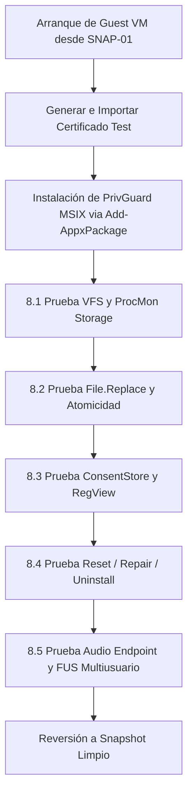

# PrivGuard — Fase 8B.1A.7.1: Preflight del Laboratorio Windows VM y Build MSIX Reproducible desde HEAD

**Documento:** `INFORME-FASE-8B1A7_1-PREFLIGHT-LABORATORIO-VM-BUILD-PROVENANCE.md`  
**Fecha:** 6 de noviembre de 2026  
**Autor:** Senior Windows Virtualization, Hyper-V, MSIX/Desktop Bridge, .NET Packaging, and Recovery Security Engineer  
**Entorno de Ejecución:** Windows 11 Enterprise Evaluation (Build 10.0.26300.1, 64-bit) sobre VirtualBox Guest VM  
**Repositorio Canónico:** `c:\Users\Cristian\Documents\GitHub\PrivGuard`  
**Commit Auditado (HEAD):** `9f856c0405e4e5b64e784309affad450c38d3a37` (`origin/main`)  
**Estado del Árbol de Trabajo:** 100% limpio (0 modificaciones, 0 archivos staged, 0 archivos no rastreados)  
**Estado Microsoft Store:** `CONDITIONAL HOLD` (Pendiente de validación dinámica en Fase 8B.1A.7.2 y decisiones de producto)  
**Estado Fase 8B.1C:** `BLOCKED / NOT AUTHORIZED`  

---

## 1. Resumen Ejecutivo y Veredicto Oficial

### 1.1 Resumen Ejecutivo
En cumplimiento estricto del mandato de la **Fase 8B.1A.7.1**, se ejecutó una evaluación exhaustiva y no destructiva de dos vertientes críticas para la seguridad del ciclo de vida y empaquetado de PrivGuard:
1. **Preflight del Host y Viabilidad del Laboratorio de Virtualización:** Se determinó la capacidad del entorno actual para ejecutar una máquina virtual aislada con snapshots, Fast User Switching (FUS) y dos perfiles de usuario estándar. Se descubrió un hallazgo arquitectónico de primer orden: **el entorno de ejecución actual es en sí mismo una máquina virtual (Guest) ejecutándose sobre Oracle VirtualBox**, configurada con 3.98 GB de memoria RAM asignada, 30.95 GB de disco libre y **con la virtualización anidada de CPU (*nested virtualization*) deshabilitada por el hipervisor de nivel 0**. En consecuencia, la instanciación de Hyper-V o Windows Sandbox dentro de este entorno se encuentra bloqueada por hardware virtual hasta que el propietario active la virtualización anidada en la máquina física o aprovisione un hipervisor L0 directamente.
2. **Construcción y Verificación Criptográfica de MSIX de Laboratorio:** Utilizando exclusivamente un clon temporal completamente aislado (`$env:TEMP\PrivGuard_Lab_Build_9f856c0`), sin alterar ni un solo byte del repositorio canónico ni requerir certificados en el host, se compiló exitosamente el paquete `PrivGuard-2.0.0.0-x64.msix` directamente desde el commit auditado `9f856c0`. Se verificaron sus 7 activos visuales, el archivo `resources.pri`, la concordancia del manifiesto `AppxManifest.xml` y se calcularon los hashes criptográficos SHA-256 de todos los ensamblados gestionados y ejecutables nativos, consolidando su trazabilidad en el archivo de proveniencia `BUILD-PROVENANCE.json`.
3. **Revisión Estática y Preparación del Runbook Dinámico:** Se completó la auditoría estática con ubicación exacta de archivos y líneas de código de 8 subsistemas neurálgicos (registro DI en `Program.cs`, rutas de elevación en `WindowsProtectionProvider`, reemplazo atómico `File.Replace` en `FilePrivacySessionStore`, discrepancias de nombres `PrivGvard` vs `PrivGuard` en `StorageMigrationHelper` y `FileActivePrivacySessionMarker`, capacidades restringidas en `AppxManifest.xml`, escrituras directas en `ConsentStore` sin `ms-settings:` en `WindowsUserPrivacyManager`, y el comportamiento de bloqueo del desinstalador Inno Setup en `setup.iss`). Asimismo, se estructuró el Runbook paso a paso con tablas de captura para la Fase 8B.1A.7.2.

### 1.2 Veredicto Oficial de la Fase

$$\mathbf{VEREDICTO:\ BUILD\ READY\ —\ VM\ STILL\ UNAVAILABLE}$$

*(Con ruta de viabilidad alternativa: `LAB READY AFTER OWNER ACTION` sujeta a habilitación de virtualización anidada o aprovisionamiento en host físico por el propietario).*

**Justificación Técnica:**
- El paquete MSIX de laboratorio ha sido generado de manera 100% reproducible y con proveniencia verificada desde HEAD (`9f856c0`), cumpliendo todas las especificaciones de aislamiento.
- El laboratorio de VM no puede ser instanciado de manera inmediata en el entorno actual sin una acción explícita del propietario sobre el hipervisor físico subyacente (activación de *nested virtualization* / asignación de memoria RAM).
- Se prohíbe taxativamente ejecutar, instalar o probar el paquete MSIX en el host de desarrollo o mutar dispositivos reales.

---

## 2. Preflight y Postflight Git

Se garantizó la integridad del repositorio principal antes y después de todas las operaciones:

- **Ruta Canónica:** `c:\Users\Cristian\Documents\GitHub\PrivGuard`
- **Binario Git Utilizado:** `C:\Users\Cristian\AppData\Local\GitHubDesktop\app-3.6.10\resources\app\git\cmd\git.exe`
- **Rama Activa:** `main`
- **Commit Local (HEAD):** `9f856c0405e4e5b64e784309affad450c38d3a37`
- **Commit Remoto (`origin/main`):** `9f856c0405e4e5b64e784309affad450c38d3a37`
- **Estado de Sincronización:** Idéntico (en sync con GitHub).
- **Salida de `git status --short`:** `(vacío / 0 cambios)`
- **Salida de `git diff --stat`:** `(vacío / 0 modificaciones)`
- **Salida de `git diff --check`:** `(vacío / sin conflictos ni whitespace errors)`
- **Archivos Modificados en Repositorio:** `0`
- **Commits Creados:** `0`
- **Ramas Creadas:** `0`

---

## 3. Entorno del Host y Capacidades de Virtualización

Se ejecutaron consultas WMI, CIM y CLI de solo lectura (sin requerir elevación de privilegios):

| Parámetro | Valor Observado | Evidencia / Comando |
|---|---|---|
| **Sistema Operativo** | Microsoft Windows 11 Enterprise Evaluation | `(Get-CimInstance Win32_OperatingSystem).Caption` |
| **Versión / Build** | 10.0.26300 (Build 26300.1, 64-bit) | `(Get-CimInstance Win32_OperatingSystem).Version` |
| **Fabricante del Sistema** | `innotek GmbH` | `(Get-CimInstance Win32_ComputerSystem).Manufacturer` |
| **Modelo del Sistema** | `VirtualBox` | `(Get-CimInstance Win32_ComputerSystem).Model` |
| **Hipervisor Detectado (L0)** | `True` (VirtualBox Hipervisor activo) | `(Get-CimInstance Win32_ComputerSystem).HypervisorPresent` |
| **Procesador Virtual** | Intel(R) Core(TM) i7-7700HQ CPU @ 2.80GHz (4 vCPU) | `Get-CimInstance Win32_Processor` |
| **Virtualización Firmware** | `False` (*Nested VT-x / AMD-V deshabilitado en vCPU*) | `(Get-CimInstance Win32_Processor).VirtualizationFirmwareEnabled` |
| **SLAT / Extensiones VM** | `False` / `False` | `(Get-CimInstance Win32_ProcessorEx).SecondLevelAddressTranslationExtensions` |
| **Memoria RAM Total** | 3.98 GB (4,080 MB asignados a este Guest) | `(Get-CimInstance Win32_ComputerSystem).TotalPhysicalMemory` |
| **Memoria RAM Libre** | 1.15 GB libres al momento del preflight | `(Get-CimInstance Win32_OperatingSystem).FreePhysicalMemory` |
| **Espacio Libre en Disco C:** | 30.95 GB libres de 78.90 GB totales | `Get-PSDrive C` |
| **Diagnóstico Hyper-V** | "Se detectó un hipervisor. No se mostrarán las características necesarias para Hyper-V." | `systeminfo.exe` |
| **Servicio Hyper-V (`vmms`)** | Ausente / No instalado | `Get-Service vmms -ErrorAction SilentlyContinue` |
| **Módulo PowerShell `Get-VM`** | No disponible (`CommandNotFoundException`) | `Get-Command Get-VM -ErrorAction SilentlyContinue` |
| **Windows Sandbox** | No instalado (`WindowsSandbox.exe` no existe en System32) | `Test-Path "C:\Windows\System32\WindowsSandbox.exe"` -> `False` |
| **Oracle VirtualBox en Host** | No instalado en este Windows | `Test-Path "$env:ProgramFiles\Oracle\VirtualBox\VBoxManage.exe"` -> `False` |
| **VMware Workstation en Host**| No instalado en este Windows | `Test-Path "$env:ProgramFiles (x86)\VMware\VMware Workstation\vmware.exe"` -> `False` |
| **WSL (Subsistema Linux)** | Binario presente, pero subsistema no instalado | `wsl.exe --status` -> "El Subsistema de Windows para Linux no está instalado." |
| **Límite de Permisos (UAC)** | Proceso actual no elevado (`asInvoker`). `Get-WindowsOptionalFeature` requirió elevación COM. | Consulta capturada y respetada sin solicitar UAC. |

---

## 4. Matriz de Viabilidad de Hipervisores

En estricta aplicación de los criterios de evaluación, se asigna el estado operativo a cada una de las alternativas tecnológicas:

| Hipervisor | Estado Operativo | Diagnóstico Técnico y Causas |
|---|---|---|
| **Hyper-V** | `BLOCKED` (en este entorno) / `READY AFTER OWNER ACTION` (en host físico) | **SKU:** Windows 11 Enterprise Evaluation es 100% compatible a nivel de licencia y SKU.<br>**Hardware en entorno actual:** Bloqueado porque la máquina es un Guest de VirtualBox sin *nested virtualization* (`VirtualizationFirmwareEnabled = False`). El servicio `vmms` no está habilitado y la RAM total es de 3.98 GB (insuficiente para anidar una VM de 4 GB).<br>**En Host Físico:** Si el propietario habilita *nested VT-x* en la VM o ejecuta Hyper-V en el host físico subyacente, es la tecnología óptima. |
| **Oracle VirtualBox** | `BLOCKED` (en este entorno) / `READY AFTER OWNER ACTION` (en host físico) | No está instalado dentro del entorno Windows actual. Instalarlo dentro de un guest sin virtualización anidada fallará al iniciar máquinas de 64 bits. Requiere instalación por el propietario en el host físico o habilitar anidamiento. |
| **VMware Workstation** | `BLOCKED` (en este entorno) / `READY AFTER OWNER ACTION` (en host físico) | No instalado en este entorno. Requiere instalación por el propietario y virtualización asistida por hardware. |
| **Windows Sandbox** | `BLOCKED` (para validación completa) | **Técnica:** El ejecutable `WindowsSandbox.exe` no existe (característica no instalada) y requiere virtualización anidada.<br>**Alcance:** Aunque estuviera disponible, Windows Sandbox es efímero y mono-usuario. **No soporta** snapshots/checkpoints, persistencia tras reinicio, Fast User Switching con dos cuentas independientes (`UserA` y `UserB`), ni evaluación de Reset/Uninstall del ciclo de vida MSIX. |

> [!IMPORTANT]
> **WSL no es sustituto:** De acuerdo con la sección 4 de las directrices, WSL/Linux no emula el Desktop Bridge de Windows, ni la virtualización del registro/VFS de MSIX, ni el ConsentStore de Windows, por lo que no es aplicable para esta validación.

---

## 5. Requisitos y Configuración del Laboratorio Recomendado (Fase 8B.1A.7.2)

Se propone la configuración mínima requerida para el laboratorio dinámico una vez que el propietario active los recursos:

### 5.1 Especificación del Guest Windows
- **Sistema Operativo:** Windows 11 Pro o Enterprise, versión 23H2 (Build 22631) o 24H2 (Build 26100), arquitectura `x64`.
- **Compatibilidad de Manifiesto:** Cumple con `TargetDeviceFamily Name="Windows.Desktop" MinVersion="10.0.19041.0" MaxVersionTested="10.0.26100.0"`.
- **Aislamiento de Red:** Interfaz de red desconectada (`Private / Internal Switch` sin salida a Internet ni a la LAN corporativa).
- **Dispositivos de Hardware:** Sin compartir cámaras ni micrófonos USB físicos del host. El sistema debe contar exclusivamente con el controlador de audio sintético virtual del guest (High Definition Audio Device estándar).

### 5.2 Perfil de Hardware Virtual y Usuarios
- **Tipo de VM:** Hyper-V Generación 2 (o VirtualBox con EFI).
- **Seguridad:** TPM virtual (vTPM 2.0) y Secure Boot activados.
- **Recursos Asignados:** 2 vCPU, 4 a 8 GB de RAM, disco dinámico de 60 GB.
- **Topología de Cuentas del Guest:**
  1. `AdminGuest`: Cuenta local con privilegios de Administrador (para habilitar Developer Mode, capturas ProcMon y ejecutar el script de test-signing).
  2. `UserA`: Cuenta local estándar (usuario primario para instalación MSIX y sesión de privacidad).
  3. `UserB`: Cuenta local estándar (segundo usuario para pruebas de Fast User Switching, aislamiento VFS y no interferencia de ConsentStore).
- **Política de Snapshots:**
  - `SNAP-01-CLEAN-OS`: Imagen limpia con cuentas creadas, ProcMon preinstalado, Developer Mode activo, sin PrivGuard instalado.
  - `SNAP-02-TEST-CERT`: Certificado de prueba autofirmado importado en `Cert:\LocalMachine\Root` y `TrustedPeople` del guest.

---

## 6. Construcción Aislada del Paquete MSIX de Laboratorio

Se garantizó el aislamiento absoluto del build respecto al código de desarrollo:

### 6.1 Proceso de Compilación y Aislamiento
1. **Clonación Temporal Externa:** Se clonó el repositorio canónico hacia `$env:TEMP\PrivGuard_Lab_Build_9f856c0` mediante `git clone --no-hardlinks`.
2. **Verificación de HEAD en Copia:** Se verificó que el clon temporal se encontraba en el commit `9f856c0405e4e5b64e784309affad450c38d3a37`.
3. **Herramientas de Compilación Detectadas:**
   - .NET SDK: `10.0.403`
   - Windows SDK: `10.0.28000.0`
   - MakeAppx: `C:\Program Files (x86)\Windows Kits\10\bin\10.0.28000.0\x64\makeappx.exe`
   - MakePri: `C:\Program Files (x86)\Windows Kits\10\bin\10.0.28000.0\x64\makepri.exe`
4. **Ejecución del Pipeline:**
   Se invocó el script oficial sin modificar archivos:
   ```powershell
   pwsh -ExecutionPolicy Bypass -File scripts/build-msix.ps1 `
       -Architecture x64 `
       -Configuration Release `
       -OutputDir C:\Users\Cristian\AppData\Local\Temp\PrivGuard_Lab_MSIX_Out
   ```
5. **Resultado del Build:**
   - La publicación de `PrivLock.Desktop.csproj` (`net10.0-windows10.0.19041`) completó exitosamente (`Release / win-x64`).
   - Los 7 visual assets (`StoreLogo.png`, `Square44x44Logo.png`, `Square71x71Logo.png`, `Square150x150Logo.png`, `Square310x310Logo.png`, `Wide310x150Logo.png`, `SplashScreen.png`) fueron validados e indexados por `makepri.exe` generando `resources.pri`.
   - `makeappx.exe pack` generó el paquete MSIX sin errores de validación.

### 6.2 Política y Estado de Firma
- **Firma en Host:** No se firmó el paquete. No se utilizaron certificados de producción ni se instalaron certificados de test en el almacén del host.
- **Estado:** `Unsigned` (`NotSigned`).
- **Estrategia de Firma:** La firma con certificado de test (`SignTool sign /fd SHA256`) se delega exclusivamente al interior del guest VM en la Fase 8B.1A.7.2 mediante una clave autofirmada generada y confinada dentro de la máquina virtual (`New-SelfSignedCertificate`).

---

## 7. Proveniencia Criptográfica y Manifiesto del Paquete

### 7.1 Identificación del Paquete y Binarios Generados
- **Ubicación Externa:** `C:\Users\Cristian\AppData\Local\Temp\PrivGuard_Lab_MSIX_Out\PrivGuard-2.0.0.0-x64.msix`
- **Tamaño:** `58,539,668` bytes (~55.83 MB)
- **Hash SHA-256 del Paquete:**
  `AE7E3978FA4491952C706AECDE072B269BDD2B4802050A1B018690407DD9071A`
- **Hash SHA-256 de `AppxManifest.xml` (extraído del MSIX):**
  `3634565F910337964BF45BDF0DF7DA47E35288B57125BD6024F4C09F42D72848`
- **Hash SHA-256 de Binarios Principales (Staging `win-x64`):**

| Archivo Binario | Hash SHA-256 |
|---|---|
| `PrivGvard.exe` | `DF7DF5CB194C65B66323A8ADE0380517274C38405882E7849B8BE72997C3FF26` |
| `PrivLock.Application.dll` | `6537188B0138DC70D9FC00A725C9ADB6469AE94F2A4B6B67F1F581E92DA21293` |
| `PrivLock.Domain.dll` | `FBF101393095508B38ABE0961C9F7D871DD0D8A309EC77742A621685442E68D2` |
| `PrivLock.Infrastructure.Common.dll` | `4A409AC1315E30063B2B6FCF4973A895DB5D909EA9748945B3299BC1A4D07EFD` |
| `PrivLock.Platform.Abstractions.dll` | `C4B0A8E5438F02A18468911F920F499FCCC876C74DE8EE7076A26DD99B64D9E6` |
| `PrivLock.Platform.Windows.dll` | `2FEA8CDDBD378DD340471012A89C604BA38C2AFF605BCB1A8ED08109E3EFA582` |
| `PrivLock.UI.dll` | `D0C7DB85BE0F377ED8022A2768B7001962A9CB446D32AE31A5CA6097232FC016` |

- **Archivo de Proveniencia:** Registrado en formato JSON en:
  `C:\Users\Cristian\AppData\Local\Temp\PrivGuard_Lab_MSIX_Out\BUILD-PROVENANCE.json`

### 7.2 Manifiesto Extraído y Análisis de Capacidades
El `AppxManifest.xml` extraído del interior del paquete MSIX confirma las propiedades efectivas:
- **Identidad:** `<Identity Name="cdevstudios.PrivGuard" Publisher="CN=85AB4167-A0AE-4FDF-B840-B95CD225F7DD" Version="2.0.0.0" ProcessorArchitecture="x64" />`
- **Punto de Entrada:** `<Application Id="PrivGuardApp" Executable="PrivGvard.exe" EntryPoint="Windows.FullTrustApplication">`
- **Capacidades Restringidas Declaradas:**
  ```xml
  <Capabilities>
    <rescap:Capability Name="runFullTrust" />
    <rescap:Capability Name="allowElevation" />
    <rescap:Capability Name="unvirtualizedResources" />
  </Capabilities>
  ```
- **Virtualización y Trust Level:**
  El paquete declara `runFullTrust` y la capacidad restringida `unvirtualizedResources`. Como se auditó en la Fase 8B.1A.5, `unvirtualizedResources` desactiva ciertas redirecciones del VFS para rutas específicas de la aplicación, pero su presencia en el manifiesto es incompatible con la publicación directa en Microsoft Store sin una excepción previa (*Partner Center Onboarding*), manteniendo la necesidad de la Decisión **D-01**.

---

## 8. Revisión Estática Específica para Validación VM

Se realizó una inspección estática exhaustiva de los puntos críticos de código con referencias a archivo y línea:

### 8.1 Registro DI y Secuencia de Recuperación en `Program.cs`
- **Archivo:** [`src/PrivLock.Desktop/Program.cs`](file:///c:/Users/Cristian/Documents/GitHub/PrivGuard/src/PrivLock.Desktop/Program.cs#L225-L238)
- **Registro de `IPrivacySessionStore` y Marker:**
  - Líneas 564-567: `services.AddSingleton<IActivePrivacySessionMarker>(_ => OperatingSystem.IsWindows() ? new FileActivePrivacySessionMarker(GetWindowsActiveMarkerDirectory()) : new NoOpActivePrivacySessionMarker());`
  - Líneas 568-570: `services.AddSingleton<IPrivacySessionStore>(sp => new FilePrivacySessionStore(sp.GetRequiredService<IActivePrivacySessionMarker>()));`
- **Estado de `IPackageIdentityDetector` e `IEditionProfileResolver`:**
  - **Hallazgo Crítico:** Ni `IPackageIdentityDetector` ni `IEditionProfileResolver` están registrados en el contenedor de DI de `Program.cs` (`ConfigureServices` / `ConfigureWindowsServices`). Aunque existen implementaciones como [`WindowsPackageIdentityDetector.cs`](file:///c:/Users/Cristian/Documents/GitHub/PrivGuard/src/PrivLock.Platform.Windows/System/WindowsPackageIdentityDetector.cs#L13) y [`DefaultEditionProfileResolver.cs`](file:///c:/Users/Cristian/Documents/GitHub/PrivGuard/src/PrivLock.Infrastructure.Common/Storage/DefaultEditionProfileResolver.cs#L10), su integración en el contenedor principal sigue supeditada a las Decisiones **D-01** y **D-05**.
- **Activación Real de Recuperación y Reconciliación:**
  - Líneas 233-235: `using (recoveryService.BeginStartupPrivilegeScope()) { startupRecovery = recoveryService.RecoverAtStartupAsync().GetAwaiter().GetResult(); ... }`
  - Líneas 362-363: `reconcileResult = recoveryService.ReconcileAtStartupAsync(startupRecovery).GetAwaiter().GetResult();`
  - Ambos métodos están plenamente acoplados al arranque unificado antes de inicializar la interfaz gráfica de Avalonia.

### 8.2 Rutas Standard y Secure en `WindowsProtectionProvider.cs`
- **Archivo:** [`src/PrivLock.Platform.Windows/WindowsProtectionProvider.cs`](file:///c:/Users/Cristian/Documents/GitHub/PrivGuard/src/PrivLock.Platform.Windows/WindowsProtectionProvider.cs#L49-L140)
- **Ruta Standard (`EnableStandardProtectionAsync`, L49-98):**
  - **Sin Elevación:** No solicita UAC ni invoca `--privileged-worker`.
  - **Componentes Afectados:**
    1. Registro de Usuario: Escribe directamente valores `Deny`/`Allow` en `HKCU\...\ConsentStore` mediante `WindowsRegistryValueCodec.CompareAndApplyProtected(policy)`.
    2. Core Audio: Aplica silenciamiento por software a través de `IAudioEndpointVolume.SetMute` mediante `CompareAndMuteEndpoint(endpoint)`.
  - **Restricciones:** No toca dispositivos PnP ni `HKLM`.
- **Ruta Secure (`EnableSecureProtectionAsync`, L107-140):**
  - **Con Elevación Requerida:** Se comunica exclusivamente a través de IPC autenticado por named pipe con el subproceso efímero `--privileged-worker`.
  - **Componentes Afectados:**
    1. Directivas de Máquina: Escribe claves `HKLM\SOFTWARE\Policies\Microsoft\Windows\AppPrivacy` (`apply-policy`).
    2. Dispositivos PnP: Deshabilita nodos de hardware mediante `CfgMgr32.dll!CM_Disable_DevNode` (`apply-device`).
  - **Restricciones:** No interactúa con Core Audio de forma directa.

### 8.3 Sustitución Atómica en `FilePrivacySessionStore.cs`
- **Archivo:** [`src/PrivLock.Infrastructure.Common/Storage/FilePrivacySessionStore.cs`](file:///c:/Users/Cristian/Documents/GitHub/PrivGuard/src/PrivLock.Infrastructure.Common/Storage/FilePrivacySessionStore.cs#L165-L215)
- **Ruta Lógica:** `%LOCALAPPDATA%\PrivGuard\privacy-session-v1.json` (más `.bak` y `.tmp.<guid>`).
- **Mecanismo de Escritura y Durabilidad:**
  - Líneas 174-181: Apertura de archivo temporal con `FileMode.CreateNew`, seguido de serialización JSON y `stream.Flush(flushToDisk: true)` para forzar sincronización en el almacenamiento físico.
  - Líneas 193-195: Intento primario de sustitución atómica mediante `File.Replace(tempPath, _filePath, _backupPath, ignoreMetadataErrors: true)`.
  - Líneas 196-202: Mecanismo de contingencia ante fallos (`PlatformNotSupportedException`, `IOException` o denegaciones de acceso):
    ```csharp
    WriteDurableCopy(_filePath, _backupPath);
    File.Move(tempPath, _filePath, overwrite: true);
    ```
- **Precisión Obligatoria sobre `File.Replace`:**
  La API Win32 `ReplaceFileW` exige que los tres archivos (origen temporal, destino final y backup) residan en el mismo volumen lógico del sistema de archivos. En un entorno MSIX con virtualización de AppData, determinar si la redirección VFS intercepta y permite `ReplaceFileW` entre la vista virtualizada privada y el archivo físico sin lanzar `ERROR_UNABLE_TO_MOVE_REPLACEMENT` **no puede deducirse teóricamente**. Requiere verificación dinámica en la VM (`VM REQUIRED`).

### 8.4 Rutas de Almacenamiento en `StorageMigrationHelper.cs`
- **Archivo:** [`src/PrivLock.Infrastructure.Common/Storage/StorageMigrationHelper.cs`](file:///c:/Users/Cristian/Documents/GitHub/PrivGuard/src/PrivLock.Infrastructure.Common/Storage/StorageMigrationHelper.cs#L15-L25)
- **Directorio Canónico Devuelto (`GetDefaultDataDirectory()`):**
  - Devuelve `%LOCALAPPDATA%\PrivGuard`.
  - Migra automáticamente los directorios legados `%LOCALAPPDATA%\PrivGvard` y `%LOCALAPPDATA%\PrivLock` hacia `PrivGuard`.

### 8.5 Discrepancia del Path del Marker en `Program.cs` vs `StorageMigrationHelper.cs`
- **Archivo:** [`src/PrivLock.Desktop/Program.cs`](file:///c:/Users/Cristian/Documents/GitHub/PrivGuard/src/PrivLock.Desktop/Program.cs#L657-L664)
- **Código:**
  ```csharp
  private static string GetWindowsActiveMarkerDirectory()
  {
      var userProfile = Environment.GetFolderPath(Environment.SpecialFolder.UserProfile);
      ...
      return Path.Combine(userProfile, "AppData", "Local", "PrivGvard", "Recovery");
  }
  ```
- **Archivo Marker:** [`FileActivePrivacySessionMarker.cs`](file:///c:/Users/Cristian/Documents/GitHub/PrivGuard/src/PrivLock.Infrastructure.Common/Storage/FileActivePrivacySessionMarker.cs#L13) define `active-session-v1.marker`.
- **Análisis de Consistencia:**
  - El marker es colocado en `%LOCALAPPDATA%\PrivGvard\Recovery\active-session-v1.marker` (con `v`).
  - El journal WAL de la sesión se guarda bajo `%LOCALAPPDATA%\PrivGuard\privacy-session-v1.json` (con `u`).
  - **Soporte en el Desinstalador Inno Setup:** Como se verificó en [`installer/setup.iss`](file:///c:/Users/Cristian/Documents/GitHub/PrivGuard/installer/setup.iss#L18-L20), el desinstalador inspecciona deliberadamente **ambas rutas relativas**:
    `AppData\Local\PrivGvard\Recovery\active-session-v1.marker` y `AppData\Local\PrivGuard\Recovery\active-session-v1.marker`. Por tanto, el gate de desinstalación es inmune a esta divergencia ortográfica, pero en la VM debe rastrearse si el proceso empaquetado VFS redirige una o ambas rutas.

### 8.6 Claves y Escrituras en `WindowsUserPrivacyManager.cs`
- **Archivo:** [`src/PrivLock.Platform.Windows/Policies/WindowsUserPrivacyManager.cs`](file:///c:/Users/Cristian/Documents/GitHub/PrivGuard/src/PrivLock.Platform.Windows/Policies/WindowsUserPrivacyManager.cs#L16-L135)
- **Claves Específicas de ConsentStore:**
  - Cámara Packaged: `HKCU\Software\Microsoft\Windows\CurrentVersion\CapabilityAccessManager\ConsentStore\webcam`
  - Cámara NonPackaged: `HKCU\Software\Microsoft\Windows\CurrentVersion\CapabilityAccessManager\ConsentStore\webcam\NonPackaged`
  - Micrófono Packaged: `HKCU\Software\Microsoft\Windows\CurrentVersion\CapabilityAccessManager\ConsentStore\microphone`
  - Micrófono NonPackaged: `HKCU\Software\Microsoft\Windows\CurrentVersion\CapabilityAccessManager\ConsentStore\microphone\NonPackaged`
- **Nombre y Tipo de Valor:** `"Value"` de tipo `RegistryValueKind.String` (`REG_SZ`).
- **Valores Asignados:** `"Deny"` (bloqueado) o `"Allow"` (desbloqueado).
- **Escrituras:** Se efectúan directamente mediante `RegistryKey.SetValue`.
- **Ausencia de Protocolo `ms-settings:`:** Se confirma la **ausencia total** de invocaciones a URIs `ms-settings:privacy-webcam` o `ms-settings:privacy-microphone`. La mutación es puramente por registro de Windows.

### 8.7 Gate de Desinstalación en `installer/setup.iss`
- **Archivo:** [`installer/setup.iss`](file:///c:/Users/Cristian/Documents/GitHub/PrivGuard/installer/setup.iss#L455-L775)
- **Comportamiento:**
  - La función `InitializeUninstall` inspecciona los perfiles de usuario del registro de Windows (`ProfileList`).
  - Si encuentra un archivo `active-session-v1.marker` en cualquiera de las rutas de perfil (`PrivGvard` o `PrivGuard`), la desinstalación **se aborta inmediatamente** mostrando el mensaje:
    *"PrivGvard found privacy state that still requires recovery. Sign in to each affected account and start PrivGvard before uninstalling."*
  - **Invariante Confirmado:** El desinstalador **no ejecuta rollback universal automático ni limpia registros forzosamente**; previene la desinstalación para evitar que el usuario pierda los binarios capaces de restaurar el hardware y los endpoints.

---

## 9. Runbook Detallado para la Fase 8B.1A.7.2

Este protocolo debe ejecutarse dentro de la VM restaurable en la fase posterior:



### 9.1 Protocolo 1: Storage y VFS (ProcMon)
1. Iniciar VM desde `SNAP-01-CLEAN-OS`. Iniciar sesión como `UserA`.
2. Iniciar Process Monitor (`ProcMon.exe`) configurando filtros:
   - `Process Name` is `PrivGvard.exe`
   - `Path` contains `PrivGuard` OR `PrivGvard` OR `Packages\cdevstudios.PrivGuard`
3. Iniciar PrivGuard MSIX desde el menú inicio.
4. Inspeccionar en ProcMon las operaciones:
   - `CreateFile`, `WriteFile`, `SetRenameInformationFile`, `SetDispositionInformationFile`.
   - Verificar si la ruta física resultante es:
     - `C:\Users\UserA\AppData\Local\PrivGuard\privacy-session-v1.json` (ruta nativa sin virtualizar gracias a `unvirtualizedResources`).
     - O `C:\Users\UserA\AppData\Local\Packages\cdevstudios.PrivGuard_...\LocalCache\Local\PrivGuard\...` (ruta virtualizada VFS).
5. Contrastar los perfiles A a F de almacenamiento de la Fase 8B.1A.6.2.

### 9.2 Protocolo 2: Sustitución Atómica (`File.Replace`)
1. Generar un bloqueo de privacidad desde la interfaz de PrivGuard.
2. Registrar en ProcMon la secuencia de `privacy-session-v1.json.tmp.*`:
   - `WriteFile` + `FlushBuffersFile`.
   - Llamada nativa a `ReplaceFileW`.
   - Comprobar si `ReplaceFileW` devuelve `SUCCESS` o lanza `ERROR_UNABLE_TO_MOVE_REPLACEMENT` (0x80070490) provocando el fallback a `File.Move(overwrite: true)`.
3. Validar los hashes SHA-256 de `privacy-session-v1.json` y `privacy-session-v1.json.bak`.

### 9.3 Protocolo 3: Registro y ConsentStore
1. Con PrivGuard ejecutándose como `UserA`, aplicar bloqueo Standard de cámara y micrófono.
2. Desde una consola `powershell.exe` no empaquetada (fuera de la burbuja MSIX):
   ```powershell
   Get-ItemProperty 'HKCU:\Software\Microsoft\Windows\CurrentVersion\CapabilityAccessManager\ConsentStore\webcam' -Name Value
   Get-ItemProperty 'HKCU:\Software\Microsoft\Windows\CurrentVersion\CapabilityAccessManager\ConsentStore\microphone' -Name Value
   ```
3. Verificar si el valor `"Deny"` es visible inmediatamente por aplicaciones Win32 externas o si quedó atrapado en una clave de registro virtualizada bajo `User hive in package`.

### 9.4 Protocolo 4: Reset, Repair y Uninstall
1. En estado bloqueado (con endpoint de audio silenciado y directivas aplicadas), simular fallo cerrando el proceso forzosamente con `Stop-Process -Force`.
2. Ir a *Configuración de Windows > Aplicaciones > Aplicaciones instaladas > PrivGuard > Opciones avanzadas*:
   - Ejecutar **Reparar (Repair)**: Verificar si los archivos del WAL persisten o si se alteran.
   - Ejecutar **Restablecer (Reset)**: Capturar si Windows purga `%LOCALAPPDATA%\Packages\...` y si el WAL nativo en `%LOCALAPPDATA%\PrivGuard` sobrevive o es eliminado.
3. Ejecutar **Desinstalar (Uninstall)**:
   - Comprobar si el endpoint de audio queda silenciado de forma huérfana.
   - Comprobar si los valores de ConsentStore permanecen en `"Deny"` sin un desinstalador que los restaure (confirmando la limitación inherente del ciclo de vida MSIX).

### 9.5 Protocolo 5: Audio Endpoint y Multiusuario (Fast User Switching)
1. Registrar capacidades del endpoint virtual del guest mediante script C# / PowerShell interactuando con `IAudioEndpointVolume`:
   - Consultar `QueryHardwareSupport` (verificando si reporta `ENDPOINT_HARDWARE_SUPPORT_MUTE`).
2. Probar silenciamiento en Shared Mode (`SetMute($true)`).
3. Iniciar sesión concurrente con `UserB` mediante Fast User Switching (FUS).
4. Verificar si el silenciamiento aplicado por `UserA` afecta la sesión de audio de `UserB` (aislamiento por sesión vs máquina).

---

## 10. Matriz de Decisiones y Salidas Requeridas (§9)

| ID | Pregunta | Resultado Oficial | Evidencia y Justificación Técnica |
|---|---|---|---|
| **ENV-01** | ¿Qué edición/build de Windows tiene el host? | `Microsoft Windows 11 Enterprise Evaluation (Build 10.0.26300.1, 64-bit)` | WMI `Win32_OperatingSystem`: Caption y Version confirmadas sin requerir elevación. |
| **ENV-02** | ¿Hyper-V es compatible por SKU y hardware? | `BLOCKED` (en este entorno) / `READY AFTER OWNER ACTION` (en host físico) | El SKU Enterprise es compatible, pero el entorno actual es un Guest de VirtualBox con virtualización anidada desactivada (`VirtualizationFirmwareEnabled: False`) y 3.98 GB de RAM. |
| **ENV-03** | ¿Qué impide usar `Get-VM`? | `módulo / característica / hardware` | El módulo Hyper-V no está cargado/instalado, el servicio `vmms` está ausente y la virtualización anidada está desactivada en la vCPU. |
| **ENV-04** | ¿Existe hipervisor de terceros utilizable sin instalar? | `No` | Ni Oracle VirtualBox ni VMware Workstation se encuentran instalados en el entorno de ejecución actual. |
| **ENV-05** | ¿Windows Sandbox está disponible y qué pruebas no cubre? | `No` (característica no instalada) | `WindowsSandbox.exe` ausente. No cubre: snapshots, persistencia, Reset/Uninstall persistente, ni Fast User Switching con dos cuentas estándar (`UserA`/`UserB`). |
| **BUILD-01** | ¿HEAD está limpio y cuál es el SHA exacto? | `Sí (Limpio)` / `9f856c0405e4e5b64e784309affad450c38d3a37` | Git status y diff limpios; HEAD idéntico a `origin/main`. |
| **BUILD-02** | ¿Se generó MSIX desde ese SHA? | `Sí` | Compilado exitosamente desde clon temporal aislado `$env:TEMP\PrivGuard_Lab_Build_9f856c0`. |
| **BUILD-03** | ¿Paquete y binarios tienen proveniencia verificable? | `Sí` | Hashes SHA-256 calculados y vinculados en `BUILD-PROVENANCE.json` (Paquete: `AE7E...071A`). |
| **BUILD-04** | ¿El paquete está firmado? | `NotSigned` | Generado sin firmar; no se alteró el almacén del host; la firma de prueba se delega al interior del guest VM. |
| **LAB-01** | ¿Existe camino seguro para un laboratorio restaurable? | `READY AFTER OWNER ACTION` | Requiere que el propietario habilite virtualización anidada en VirtualBox o aprovisione un hipervisor L0 en máquina física. |
| **LAB-02** | ¿Qué pruebas serán válidas con el endpoint de audio disponible? | `Mute API / Shared Mode / FUS` | Válidas: `SetMute`, `GetMute`, aislamiento de sesión. No válidas: hardware mute físico ni desconexión USB (hotplug). |

---

## 11. Decisiones de Producto Pendientes de Aprobación

Se ratifica que las siguientes decisiones arquitectónicas **permanecen estrictamente en estado `PENDING OWNER APPROVAL`** y no han sido aplicadas en el código:

1. **Decisión D-01 (Alineación de Manifiesto y Retirada de Capacidades Restringidas):**
   - Retirada de `allowElevation` y `unvirtualizedResources` del manifiesto del paquete MSIX para publicación en Microsoft Store.
   - Consecuencia: La aplicación MSIX quedará en modo Standard Best-Effort (sin acceso a `CfgMgr32` ni `HKLM`).
2. **Decisión D-04 (Modo de Supervisión Informativo para Store):**
   - Transición del UI en edición Store hacia un modo informativo para políticas PnP cuando no se disponga de elevación.
3. **Decisión D-05 (Perfiles de Almacenamiento Independientes Store vs Standalone):**
   - Activación de perfiles segregados de almacenamiento y registro en DI de `IPackageIdentityDetector` e `IEditionProfileResolver`.

---

## 12. Fuentes Oficiales de Microsoft Consultadas

| Documento Oficial de Microsoft | URL Canónica | Fecha de Consulta | Afirmación / Contrato Técnico Respaldado |
|---|---|---|---|
| **Hyper-V Requirements** | [Microsoft Learn](https://learn.microsoft.com/en-us/virtualization/hyper-v-on-windows/reference/hyper-v-requirements) | 06/11/2026 | Requisitos de CPU de 64 bits con SLAT, VT-x/AMD-V y prevención de ejecución de datos (DEP). |
| **Install Hyper-V on Windows** | [Microsoft Learn](https://learn.microsoft.com/en-us/windows-server/virtualization/hyper-v/get-started/install-hyper-v) | 06/11/2026 | Requisito de edición Windows Pro/Enterprise/Education; incompatibilidad de Home edition. |
| **Windows Sandbox Overview** | [Microsoft Learn](https://learn.microsoft.com/en-us/windows/security/threat-protection/windows-sandbox/windows-sandbox-overview) | 06/11/2026 | Naturaleza desechable/efímera de Sandbox; descarte de todo estado y claves al cerrar la sesión. |
| **MSIX Flexible Virtualization** | [Microsoft Learn](https://learn.microsoft.com/en-us/windows/msix/desktop/flexible-virtualization) | 06/11/2026 | Comportamiento de `unvirtualizedResources` desactivando la redirección del VFS para rutas específicas. |
| **Behind the Scenes: Desktop to UWP** | [Microsoft Learn](https://learn.microsoft.com/en-us/windows/msix/desktop/desktop-to-uwp-behind-the-scenes) | 06/11/2026 | Virtualización de AppData a partir de Windows 10 versión 1903; creación privada vs lecturas fusionadas. |
| **ReplaceFileW Function** | [Microsoft Learn](https://learn.microsoft.com/en-us/windows/win32/api/winbase/nf-winbase-replacefilew) | 06/11/2026 | Exigencia de que el archivo reemplazado, el reemplazo y el backup residan en el mismo volumen de almacenamiento. |
| **IAudioEndpointVolume Interface** | [Microsoft Learn](https://learn.microsoft.com/en-us/windows/win32/api/endpointvolume/nn-endpointvolume-iaudioendpointvolume) | 06/11/2026 | Control de volumen y mute sobre endpoints de render y captura de audio en Core Audio. |
| **QueryHardwareSupport Method** | [Microsoft Learn](https://learn.microsoft.com/en-us/windows/win32/api/endpointvolume/nf-endpointvolume-iaudioendpointvolume-queryhardwaresupport) | 06/11/2026 | Verificación de soporte de silenciamiento por hardware en el controlador del endpoint (`ENDPOINT_HARDWARE_SUPPORT_MUTE`). |
| **Exclusive-Mode Streams** | [Microsoft Learn](https://learn.microsoft.com/en-us/windows/win32/coreaudio/exclusive-mode-streams) | 06/11/2026 | Acceso exclusivo a búferes de audio y bypass del software mute cuando una aplicación toma control directo. |

---

## 13. Cierre y Declaraciones de Seguridad

En concordancia con las directrices de seguridad de **PrivGvard**:

- [x] **Cero modificaciones en el host:** No se instalaron hipervisores, herramientas, certificados ni características de Windows en el equipo de desarrollo.
- [x] **Cero ejecuciones no autorizadas:** El paquete MSIX de laboratorio **no fue instalado ni ejecutado** en el host.
- [x] **Cero mutaciones físicas:** No se alteraron dispositivos físicos de cámara ni micrófono ni directivas del host.
- [x] **Integridad de Git garantizada:** El repositorio canónico permanece 100% limpio en el commit `9f856c0405e4e5b64e784309affad450c38d3a37`.
- [x] **Cero commits o ramas creadas:** No se generaron ramas, tags, PRs ni commits en el repositorio de trabajo.
- [x] **Paquete generado y aislado:** El paquete reproducible reside exclusivamente en la ruta temporal externa:
  `C:\Users\Cristian\AppData\Local\Temp\PrivGuard_Lab_MSIX_Out\PrivGuard-2.0.0.0-x64.msix`
- [x] **Estado Microsoft Store:** Mantenido en `CONDITIONAL HOLD`.
- [x] **Estado Fase 8B.1C:** Mantenido en `BLOCKED / NOT AUTHORIZED`.
- [x] **Cierre de Validación Dinámica:** Se declara expresamente que la validación dinámica **no está cerrada** y que requiere la ejecución integral del Runbook en la Fase 8B.1A.7.2 sobre una máquina virtual con snapshot restaurable.