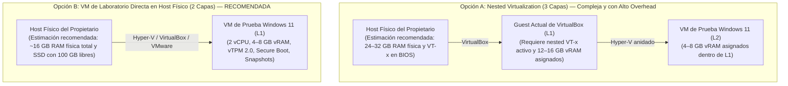

# PrivGuard — Fase 8B.1A.7.2: Rebaseline de Supuestos y Readiness del Laboratorio VM (Revisión Factual y Corrección Estática)

**Fecha de emisión:** 2026-11-07<br />
**Fecha de revisión factual:** 2026-11-07<br />
**Autor:** Senior .NET/Windows Engineer, Transactional Recovery Architect & Security Auditor<br />
**Rama activa de trabajo:** `docs/8b1a7-2-postpush-consistency`<br />
**Baseline de código auditado:** `653be31040da53bea72a540ddb2a111f16b35d50`<br />
**HEAD documental remoto (`origin/main`):** `54fb44670c55b3d0e009e1236dc6a48e0b44378c`<br />
**Parent directo en `main`:** `3f08f1212ebfe18a37b2514ae2763b863f3247e9`<br />
**Parent funcional anterior:** `653be31040da53bea72a540ddb2a111f16b35d50`<br />
**Último workflow CI:** Run #93 (ID: `42410227273`, commit `54fb446`, evento `push`, **7/7 jobs `success`**)<br />
**Workflow CI previo:** Run #92 (ID: `42396473407`, commit `653be31`, evento `push`, **7/7 jobs `success`**)<br />
**Veredicto de Rebaseline:** **PASS — Auditoría estática y conciliación factual corregida**<br />
**Readiness del Laboratorio VM:** **HOLD — Requiere aprovisionamiento/acción del propietario en Hipervisor L0**<br />
**Estado Microsoft Store:** **CONDITIONAL HOLD**<br />
**Estado Fase 8B.1C:** **BLOCKED / NOT AUTHORIZED**

---

## 1. Resumen Ejecutivo y Veredicto Formal

### 1.1 Resumen Ejecutivo
El presente documento constituye la **revisión factual y correctiva final** del rebaseline técnico de la Fase 8B.1A.7.2 (preparación para pruebas dinámicas de almacenamiento MSIX y recuperación transaccional en VM aislada).

Los informes y runbooks previos de virtualización (Fases 8B.1A.5, 8B.1A.6 y 8B.1A.7.1) fueron redactados tomando como base el commit histórico `9f856c0405e4e5b64e784309affad450c38d3a37`. Desde dicho punto, la historia del repositorio avanzó mediante 5 commits en el rango `9f856c0..d8ca7acc` (Sprint 1.0, 1.1 y 1.2) seguidos de **6 commits exclusivamente documentales en `d8ca7acc..54fb446`**:
- Cuatro commits documentales previos: `dded99c`, `b9d4b8f`, `07e4188` y `653be31` (este último fijando el baseline del código auditado).
- Dos commits documentales correctivos posteriores: `3f08f12` y `54fb446`.

La comparación Git confirma que los commits posteriores a `653be31` no modificaron código funcional ni de configuración (`0 líneas de código alteradas`). Por tanto, **`653be31` permanece como el baseline del código auditado estáticamente**, mientras que **`54fb446` representa el HEAD documental remoto canónico**.

Asimismo, el workflow de CI Run #93 (commit `54fb446`, evento `push`) completó 7/7 jobs en `success`, incluyendo la validación técnica del empaquetado Release-Store MSIX en el runner de Windows. No obstante, **CI no publica un paquete MSIX descargable ni el archivo `BUILD-PROVENANCE.json`** (los 4 artefactos publicados corresponden a ejecutables single-file: `win-x64`, `win-arm64`, `linux-x64` y `osx-arm64`). La prueba en laboratorio requiere generar un nuevo paquete MSIX y un manifiesto de proveniencia explícito desde el HEAD canónico a evaluar.

Esta revisión introduce precisiones técnicas indispensables alineadas con el código real y la documentación oficial de Microsoft Learn:

1. **Full Trust no equivale a AppContainer (Comportamiento de AppData):**
   - **Evidencia del Manifiesto:** En `packaging/Package.appxmanifest`, tanto la aplicación principal como la extensión de inicio declaran explícitamente `EntryPoint="Windows.FullTrustApplication"`, y el paquete declara `<rescap:Capability Name="runFullTrust" />`. No se declara un proceso AppContainer.
   - **Contrato de Microsoft Learn:** De acuerdo con la documentación oficial ([*MSIX Containerization Overview*](https://learn.microsoft.com/en-us/windows/msix/msix-containerization-overview) y [*Understanding how packaged desktop apps run on Windows*](https://learn.microsoft.com/en-us/windows/msix/desktop/desktop-to-uwp-behind-the-scenes)), las aplicaciones Full Trust (medium integrity) no están sujetas a la redirección de AppData por paquete característica de los procesos AppContainer. Sus escrituras en AppData pasan directamente a la ruta normal (*pass-through*).
   - **Evidencia del Código:** `FileStateStore`, `FilePrivacySessionStore` y `FileActivePrivacySessionMarker` solicitan rutas canónicas ordinarias de `%LOCALAPPDATA%`, sin inyectar las rutas aisladas calculadas por `DefaultEditionProfileResolver`. Por ende, **D-05 no está integrada en la composición de DI de los stores**.
   - **Expectativa Técnica Correcta:** La expectativa más respaldada por el manifiesto y la arquitectura documentada por Microsoft es que **Store y Standalone utilicen las mismas ubicaciones físicas en `%LOCALAPPDATA%` dentro del mismo perfil de usuario de Windows**, y no una ubicación privada en `LocalCache` por defecto. La colisión física o compartición de estado es la hipótesis primaria más sólida, cuya confirmación empírica en el ejecutable instalado corresponde a las pruebas con ProcMon en VM (donde `Packages\<PFN>\LocalCache` se inspeccionará para descartar anomalías de plataforma).
2. **Alcance Real de la Comprobación del Desinstalador Inno Setup (`setup.iss`):**
   - El marcador activo se construye mediante `GetWindowsActiveMarkerDirectory()` en `Program.cs` bajo `%USERPROFILE%\AppData\Local\PrivGvard\Recovery\active-session-v1.marker`.
   - En `installer/setup.iss`, la función `ProfileMayHaveActiveSession` comprueba:
     - `PrivGvard\Recovery`: busca `active-session-v1.marker` y diario/backup (`privacy-session-v1.json`). **Esta ubicación cubre el marcador activo del código vigente**.
     - `PrivLock\Recovery`: busca marcador y diario/backup.
     - `PrivGuard\Recovery`: busca diario y backup, **no el marcador activo**.
   - `setup.iss` enumera perfiles mediante `HKLM\SOFTWARE\Microsoft\Windows NT\CurrentVersion\ProfileList` y bloquea la desinstalación (*fail-closed*) si detecta un diario o marcador activo.
   - **Límite de Autoridad:** Esta salvaguarda pertenece exclusivamente al desinstalador Standalone de Inno Setup. **No tiene capacidad alguna para impedir que Windows desinstale el paquete MSIX de Store** (a través de Configuración de Windows o `Remove-AppxPackage`).
3. **Alcance Real del Mutex `Global\` y Límites de Coordinación:**
   - `Global\PrivLock_SingleInstance` y `Global\PrivLock_UninstallGate` utilizan el namespace global de objetos nombrados de Windows (`\BaseNamedObjects`).
   - Por su prefijo, el nombre no está restringido al namespace de una sesión interactiva local (`Local\`).
   - No obstante, `WindowsSingleInstanceGuard` invoca el constructor `new Mutex(initiallyOwned: false, name)` sin especificar `MutexSecurity` ni una DACL explícita. En Windows NT, el objeto hereda la seguridad predeterminada del token del proceso creador (UserA).
   - Un segundo usuario estándar (UserB) que intente abrir o adquirir el mutex puede recibir `UnauthorizedAccessException` si la DACL no le concede permisos de sincronización. Dicha excepción es capturada en `TryAcquireSingleInstance()`, registrándose en el log y retornando `false` (*fail-closed*).
   - El mutex actúa como una guarda de admisión de instancia única; **no es un coordinador transaccional de recursos, no provee aislamiento ni arbitraje de almacenamiento, no administra leases de diario y no integra D-03/D-05**. Su comportamiento multiusuario efectivo debe ser verificado en TEST-09.
4. **Significado Exacto de `HypervisorPresent = True`:**
   - La consulta WMI/CIM se ejecutó desde dentro de un Guest de VirtualBox (`innotek GmbH / VirtualBox`). La propiedad `HypervisorPresent = True` indica únicamente que el Windows invitado detecta un hipervisor expuesto a él.
   - El estado real de la CPU física, BIOS/UEFI, memoria RAM total y capacidades de virtualización del host físico L0 son **desconocidos desde el interior del guest** y deben ser verificados por el propietario directamente en el host físico.
5. **Topologías de Virtualización y Estimaciones de Recursos:**
   - Se distinguen los requerimientos reales del sistema operativo invitado (Windows 11: 4 GB vRAM, 2 vCPU, 64 GB almacenamiento, TPM 2.0 y Secure Boot) de las **estimaciones y recomendaciones de planificación** para el host.
   - Se mantiene como alternativa recomendada y más simple la provisión de una VM directa en el host físico (Topología B, ~16 GB RAM física total estimada), frente al overhead y complejidad de tres capas (Topología A: L0 físico -> L1 VirtualBox -> L2 VM anidada).
6. **Cadena de Custodia Criptográfica del Artefacto MSIX:**
   - Se formaliza que el SHA-256 del paquete unsigned generado en build y el SHA-256 del paquete firmado tras test-signing dentro de la VM son distintos y deben registrarse de forma diferenciada en la proveniencia del laboratorio.

### 1.2 Veredicto Oficial

$$\mathbf{VEREDICTO:\ REBASELINE\ PASS\ —\ LAB\ HOLD\ (REQUIRES\ OWNER\ ACTION)}$$

- **Rebaseline de Supuestos:** **PASS**. Se alinea el modelo técnico con la arquitectura Full Trust de MSIX, se corrigen las rutas de comprobación de `setup.iss` y se delimitan hipótesis frente a hechos de código.
- **Readiness del Laboratorio VM:** **HOLD**. El entorno local actual es un guest sin virtualización anidada expuesta y recursos insuficientes. Se requiere acción del propietario en el host físico.
- **Salvaguardas Invariantes:** Microsoft Store en `CONDITIONAL HOLD`, Fase 8B.1C en `BLOCKED / NOT AUTHORIZED`.

---

## 2. Baseline de Control de Versiones e Integración Factual

### 2.1 Verificación de Git y Remoto
- **Repositorio:** `cristianbarreiro/PrivGuard`
- **Rama activa de trabajo:** `docs/8b1a7-2-postpush-consistency`
- **HEAD Remoto Canónico (`origin/main`):** `54fb44670c55b3d0e009e1236dc6a48e0b44378c`
- **Parent directo en `main`:** `3f08f1212ebfe18a37b2514ae2763b863f3247e9`
- **Parent funcional anterior (Baseline auditado):** `653be31040da53bea72a540ddb2a111f16b35d50`
- **Historial `d8ca7acc..54fb446` (6 commits documentales):**
  1. `dded99c` — Documental: corrección de evidencia Sprint 1.2 postflight.
  2. `b9d4b8f` — Documental: ajuste de afirmaciones Sprint 1.2 postflight.
  3. `07e4188` — Documental: reconciliación Sprint 1.2 con estado remoto.
  4. `653be31` — Documental: rebaseline 8B.1A.7.2 contra código vigente (baseline de auditoría estática).
  5. `3f08f12` — Documental: corrección factual 8B.1A.7.2.
  6. `54fb446` — Documental: análisis Full Trust AppData y desinstalación.
- **Forma Real de Integración:** Los commits sobre `main` fueron integrados directamente mediante push sin Pull Request. La rama `main` presenta `protected: false` y required status checks desactivados en GitHub Settings. No existen Pull Requests abiertas actualmente.
- **Estado del Árbol de Trabajo:** Limpio (`nothing to commit, working tree clean`).
- **Código Funcional Modificado:** **0 líneas**. Todos los commits posteriores a `d8ca7ac` son estrictamente documentales.

### 2.2 Evidencia de GitHub Actions (Runs #92 y #93)
- **Workflow Run más reciente:** Run #93
  - **Run ID:** `42410227273`
  - **URL:** [https://github.com/cristianbarreiro/PrivGuard/actions/runs/42410227273](https://github.com/cristianbarreiro/PrivGuard/actions/runs/42410227273)
  - **Commit:** `54fb44670c55b3d0e009e1236dc6a48e0b44378c`
  - **Rama:** `main` | **Evento:** `push`
  - **Estado / Conclusión:** `completed / success`
  - **Jobs:** **7/7 jobs finalizados en `success`** (Build & Test en windows-latest, ubuntu-latest, macos-latest; y Publish Single-File para osx-arm64, win-x64, linux-x64, win-arm64). El paso `Validate Release-Store MSIX Packaging (Windows)` concluyó en `success` en Windows.
  - **Artefactos publicados:** 4 ejecutables single-file (`PrivGvard-win-x64`, `PrivGvard-win-arm64`, `PrivGvard-linux-x64`, `PrivGvard-osx-arm64`). **CI no publicó ningún paquete MSIX descargable ni `BUILD-PROVENANCE.json`**.
- **Workflow Run previo sobre baseline de código:** Run #92
  - **Run ID:** `42396473407`
  - **Commit:** `653be31040da53bea72a540ddb2a111f16b35d50`
  - **Rama:** `main` | **Evento:** `push`
  - **Estado / Conclusión:** `completed / success` (7/7 jobs `success`).

> [!IMPORTANT]
> **Ausencia de Evidencia en Evento `pull_request`:** Todos los runs evaluados (#89, #90, #91, #92 y #93) correspondieron exclusivamente a eventos de tipo `push` sobre la rama `main`. **El comportamiento del workflow en el evento `pull_request` permanece formalmente sin demostración empírica**, ya que dicho evento aún no ha sido ejecutado en CI.

---

## 3. Matriz de Reconciliación Corregida de Supuestos Históricos

La siguiente tabla confronta las afirmaciones de informes históricos frente a la realidad del código en `653be31`, delimitando qué constituye código implementado y qué es una hipótesis que requiere validación en VM:

| Documento Histórico | Afirmación Histórica | Estado Real en Código Actual (`653be31`) | Dictamen de Vigencia | Evidencia / Ubicación en Código |
|---|---|---|---|---|
| **8B.1A.5 / 8B.1A.6** (P0-01) | El manifiesto MSIX declara `allowElevation` y `unvirtualizedResources`, violando D-01. | El manifiesto `packaging/Package.appxmanifest` declara **únicamente** `<rescap:Capability Name="runFullTrust" />`. Las capacidades `allowElevation` y `unvirtualizedResources` fueron eliminadas y su ausencia está protegida por 16 tests unitarios y el CI gate. | **SUPERSEDIDO** (Resuelto por D-01) | [`packaging/Package.appxmanifest#L59-L61`](file:///c:/Users/Cristian/Documents/GitHub/PrivGuard/packaging/Package.appxmanifest#L59-L61)<br />[`StoreMsixManifestVerifier.cs#L95-L105`](file:///c:/Users/Cristian/Documents/GitHub/PrivGuard/src/PrivLock.Platform.Windows/Packaging/StoreMsixManifestVerifier.cs#L95-L105) |
| **8B.1A.5 / 8B.1A.6** (P0-02) | `IPackageIdentityDetector` e `IEditionProfileResolver` no están registrados en el contenedor de DI en `Program.cs`. | `Program.Main` resuelve el snapshot inmutable y `ConfigureServices` **registra como singletons en DI** tanto `IPackageIdentityDetector` como `IEditionProfileResolver`. También se configura en `WindowsPrivilegedSession`. | **SUPERSEDIDO** (Resuelto por Sprint 1.0) | [`Program.cs#L25`](file:///c:/Users/Cristian/Documents/GitHub/PrivGuard/src/PrivLock.Desktop/Program.cs#L25)<br />[`Program.cs#L628-L630`](file:///c:/Users/Cristian/Documents/GitHub/PrivGuard/src/PrivLock.Desktop/Program.cs#L628-L630)<br />[`Program.cs#L682`](file:///c:/Users/Cristian/Documents/GitHub/PrivGuard/src/PrivLock.Desktop/Program.cs#L682) |
| **8B.1A.5 / 8B.1A.6** (P0-03) | `WindowsUserPrivacyManager` escribe directamente en HKCU ConsentStore para Store Edition y no existe uso de `ms-settings:`. | `WindowsUserPrivacyManager` divide sus contratos en Reader y Writer. `SetCameraUserPrivacy` y `SetMicrophoneUserPrivacy` **rechazan explícitamente cualquier intento de escritura si el perfil no es `Standalone`** (D-02). En Store Edition, la mutación de cámara devuelve error dirigiendo a `ms-settings:privacy-webcam`. | **SUPERSEDIDO** (Resuelto por Sprint 1.0 / D-02) | [`WindowsUserPrivacyManager.cs#L62-L71`](file:///c:/Users/Cristian/Documents/GitHub/PrivGuard/src/PrivLock.Platform.Windows/Policies/WindowsUserPrivacyManager.cs#L62-L71)<br />[`WindowsProtectionProvider.cs#L66-L74`](file:///c:/Users/Cristian/Documents/GitHub/PrivGuard/src/PrivLock.Platform.Windows/WindowsProtectionProvider.cs#L66-L74) |
| **8B.1A.5 / 8B.1A.6** (P0-04) | El almacenamiento de Store está aislado por perfil y protegido frente a desinstalación de Windows. | **Precisión Full Trust:** El paquete declara `Windows.FullTrustApplication` y `runFullTrust`. Según Microsoft Learn, las escrituras de Full Trust en AppData no se redirigen por paquete (pass-through). En código, los stores no consumen el resolver (D-05 no integrada en DI). Por ende, **la expectativa técnica documentada es que ambas ediciones compartan las mismas rutas físicas en `%LOCALAPPDATA%`**. La confirmación empírica corresponde a ProcMon en VM. | **PARCIALMENTE VÁLIDO / EXPECTATIVA PASS-THROUGH (REQUIERE VM)** | [`Program.cs#L632-L643`](file:///c:/Users/Cristian/Documents/GitHub/PrivGuard/src/PrivLock.Desktop/Program.cs#L632-L643)<br />[`FileStateStore.cs#L24-L30`](file:///c:/Users/Cristian/Documents/GitHub/PrivGuard/src/PrivLock.Infrastructure.Common/Storage/FileStateStore.cs#L24-L30)<br />[`FilePrivacySessionStore.cs#L59-L62`](file:///c:/Users/Cristian/Documents/GitHub/PrivGuard/src/PrivLock.Infrastructure.Common/Storage/FilePrivacySessionStore.cs#L59-L62) |
| **8B.1A.5 / 8B.1A.6** (P0-05) | `HKLM\SOFTWARE\PrivLock\PrivilegedOwnership\v2` actúa como un Machine Recovery Escrow completo. | Se confirma la refutación: HKLM almacena únicamente un fingerprint criptográfico SHA-256, un SID y una etapa. **No almacena datos de reversión de hardware ni snapshots de registro**. Si el WAL del usuario se destruye, el hardware no puede restaurarse desde HKLM. | **VÁLIDO (REFUTACIÓN CONFIRMADA)** | [`WindowsPrivilegedOwnershipStore.cs#L140-L180`](file:///c:/Users/Cristian/Documents/GitHub/PrivGuard/src/PrivLock.Platform.Windows/Privileged/WindowsPrivilegedOwnershipStore.cs#L140-L180) |
| **8B.1A.5 / 8B.1A.6** (P1-01) | `WindowsProtectionProvider` marca `micStandardIsVerified = true` ignorando si el hardware soporta mute físico. | `EvaluateMicrophoneStandardVerification` evalúa `AudioHardwareMuteSummary`. Si el mute es solo por software (`NotSupported` o `Unknown`), **no se otorga verificación de exclusión ni protección en modo exclusivo**, emitiendo advertencia explícita al usuario. | **SUPERSEDIDO** (Resuelto en código) | [`WindowsProtectionProvider.cs#L351-L355`](file:///c:/Users/Cristian/Documents/GitHub/PrivGuard/src/PrivLock.Platform.Windows/WindowsProtectionProvider.cs#L351-L355)<br />[`WindowsProtectionProvider.cs#L481-L494`](file:///c:/Users/Cristian/Documents/GitHub/PrivGuard/src/PrivLock.Platform.Windows/WindowsProtectionProvider.cs#L481-L494) |
| **8B.1A.5** (Problema B) | Archivos `.claim` en `%ProgramData%\PrivGuard\endpoints` resuelven la exclusión mutua cross-edition. | El diseño de claims en `ProgramData` fue declarado inviable por riesgo de *Claim Squatting*, DoS y redirección VFS. **No existe ninguna implementación de claims en código** (`src/**/*.cs` tiene cero referencias). El diseño está formalmente descartado. | **VÁLIDO (DISEÑO RECHAZADO)** | Búsqueda global en código (`0 coincidencias`). |
| **8B.1A.5** (P1-03) | Existe sincronización cross-edition mediante `Global\PrivGuard_Transaction_Gate` y `OwnerTuple`. | No existen en código. `Global\PrivLock_SingleInstance` y `Global\PrivLock_UninstallGate` utilizan el namespace global de Windows para exclusión de instancia única; no poseen DACL explícita y no constituyen un coordinador de recursos, de almacenamiento ni de diarios cross-edition. | **VÁLIDO (NO IMPLEMENTADO)** | [`WindowsSingleInstanceGuard.cs#L12-L15`](file:///c:/Users/Cristian/Documents/GitHub/PrivGuard/src/PrivLock.Platform.Windows/System/WindowsSingleInstanceGuard.cs#L12-L15) |
| **8B.1A.7.1** (Sección 6-7) | El paquete `PrivGuard-2.0.0.0-x64.msix` y su proveniencia generados en `$env:TEMP` son válidos para la prueba en VM. | Dicho paquete y su `BUILD-PROVENANCE.json` fueron generados desde el commit `9f856c0`. El historial contiene 5 commits en el rango `9f856c0..d8ca7acc` que alteraron código funcional y de packaging. **El artefacto está formalmente obsoleto** y debe reconstruirse desde el HEAD vigente cuando el laboratorio esté listo. | **SUPERSEDIDO (ARTEFACTO OBSOLETO)** | Historial Git: rango `9f856c0..d8ca7acc` (commits `0a270a1`, `391d79e`, `d8ca7ac`). |

---

## 4. Auditoría Estática Corregida del Código Vigente

### 4.1 Full Trust y Rutas Efectivas en AppData (Frontera D-05)
La evaluación de las rutas de almacenamiento se estructura a partir de los siguientes hechos verificables:

1. **Declaración del Manifiesto:**
   - [`packaging/Package.appxmanifest#L36-L38`](file:///c:/Users/Cristian/Documents/GitHub/PrivGuard/packaging/Package.appxmanifest#L36-L38): `Application Id="PrivGuardApp" Executable="PrivGvard.exe" EntryPoint="Windows.FullTrustApplication"`.
   - [`packaging/Package.appxmanifest#L52`](file:///c:/Users/Cristian/Documents/GitHub/PrivGuard/packaging/Package.appxmanifest#L52): Extensión de inicio con `EntryPoint="Windows.FullTrustApplication"`.
   - [`packaging/Package.appxmanifest#L60`](file:///c:/Users/Cristian/Documents/GitHub/PrivGuard/packaging/Package.appxmanifest#L60): `<rescap:Capability Name="runFullTrust" />`.
   - No existe declaración de proceso AppContainer (`uap:AppContainer` ausente).
2. **Doctrina Oficial de Microsoft Learn:**
   - Según [*MSIX Containerization Overview*](https://learn.microsoft.com/en-us/windows/msix/msix-containerization-overview), los procesos Full Trust se ejecutan con nivel de integridad media (*medium integrity*), sin el aislamiento de AppContainer. La redirección de AppData hacia una carpeta privada por paquete (`Packages\<PFN>\LocalCache`) aplica a aplicaciones virtualizadas/AppContainer. En aplicaciones Full Trust, las operaciones sobre AppData siguen la ruta normal del sistema de archivos.
3. **Composición de DI en Código:**
   - En [`Program.cs#L632-L643`](file:///c:/Users/Cristian/Documents/GitHub/PrivGuard/src/PrivLock.Desktop/Program.cs#L632-L643), los tres stores se instancian sin consumir `IEditionProfileResolver`:
     - `FileStateStore` -> [`StorageMigrationHelper.GetDefaultDataDirectory()`](file:///c:/Users/Cristian/Documents/GitHub/PrivGuard/src/PrivLock.Infrastructure.Common/Storage/FileStateStore.cs#L26) -> `%LOCALAPPDATA%\PrivGuard\state.json`.
     - `FilePrivacySessionStore` -> `.../Recovery/privacy-session-v1.json` y `privacy-session-v1.json.bak`.
     - `FileActivePrivacySessionMarker` -> [`GetWindowsActiveMarkerDirectory()`](file:///c:/Users/Cristian/Documents/GitHub/PrivGuard/src/PrivLock.Desktop/Program.cs#L740-L747) -> `%USERPROFILE%\AppData\Local\PrivGvard\Recovery\active-session-v1.marker`.
   - **D-05 no está integrada en DI**.
4. **Conclusión Estática Correcta:**
   - Para esta configuración específica, la expectativa técnica más fundamentada es que **la edición Store y la edición Standalone accedan a las mismas ubicaciones físicas en `%LOCALAPPDATA%`**. La compartición o colisión física es la hipótesis con mayor respaldo formal.
   - **Límite:** ProcMon deberá confirmar empíricamente en la VM que Windows no aplique ninguna redirección inesperada bajo la versión exacta de compilación del sistema operativo.

### 4.2 Alcance Real de la Cobertura de `installer/setup.iss`
Al auditar directamente el desinstalador Inno Setup ([`installer/setup.iss#L18-L21`](file:///c:/Users/Cristian/Documents/GitHub/PrivGuard/installer/setup.iss#L18-L21) y [`lines 501-506`](file:///c:/Users/Cristian/Documents/GitHub/PrivGuard/installer/setup.iss#L501-L506)):

- **Constantes de Ruta:**
  ```pascal
  #define RecoveryRelativePath "AppData\Local\PrivGvard\Recovery\"
  #define LegacyRecoveryRelativePath "AppData\Local\PrivLock\Recovery\"
  #define ModernRecoveryRelativePath "AppData\Local\PrivGuard\Recovery\"
  #define ActiveMarkerFile "active-session-v1.marker"
  #define JournalFile "privacy-session-v1.json"
  ```
- **Lógica de Inspección en `ProfileMayHaveActiveSession`:**
  1. `RecoveryRelativePath` (`PrivGvard\Recovery`): comprueba la existencia de `active-session-v1.marker` y del diario `privacy-session-v1.json` (con `.bak`).
  2. `LegacyRecoveryRelativePath` (`PrivLock\Recovery`): comprueba marcador y diario.
  3. `ModernRecoveryRelativePath` (`PrivGuard\Recovery`): comprueba **únicamente el diario y backup, NO el marcador activo**.
- **Resultado Factual:**
  - Dado que el código en `Program.cs` construye el marcador activo en `PrivGvard\Recovery\active-session-v1.marker`, **dicha ubicación sí está cubierta por la comprobación de Inno Setup**.
  - El diario moderno en `PrivGuard\Recovery` también está cubierto.
  - `setup.iss` enumera los perfiles interactivos desde `ProfileList` en HKLM y adopta una política *fail-closed* bloqueando la desinstalación si detecta un diario o marcador activo.
- **Límite Estricto:** Esta protección es exclusiva del instalador/desinstalador Standalone de Inno Setup. **No tiene intervención ni capacidad para bloquear la desinstalación del paquete MSIX por parte de Windows**.

### 4.3 Cuantificación de Commits (`9f856c0..54fb446`)
El historial entre `9f856c0` y el HEAD remoto `54fb446` se estructura en dos segmentos perfectamente diferenciados:

1. **Rango `9f856c0..d8ca7acc` (5 commits funcionales / CI / merge):**
   - `7066b3b` — **Documental:** Registro de informes de Fase 8B.1A y proveniencia.
   - `0a270a1` — **Funcional / Packaging:** Integración de perfiles Store/Standalone, guardas D-01/D-02 y manifiesto depurado.
   - `391d79e` — **Funcional:** Inmutabilidad de perfil y rechazo fail-closed de mutaciones parciales `Both` en Store.
   - `ffc2273` — **Merge:** Fusión de Pull Request #11 (`feature/sprint-1-store-profile-guards-d01-d02`).
   - `d8ca7ac` — **CI / Packaging:** Incorporación del gate de validación Release-Store en `.github/workflows/ci.yml`.

2. **Rango `d8ca7acc..54fb446` (6 commits exclusivamente documentales):**
   - `dded99c` — **Documental:** Corrección de evidencia de postflight Sprint 1.2.
   - `b9d4b8f` — **Documental:** Ajuste de afirmaciones de postflight Sprint 1.2.
   - `07e4188` — **Documental:** Reconciliación de postflight Sprint 1.2 con estado remoto.
   - `653be31` — **Documental:** Rebaseline 8B.1A.7.2 contra código vigente (baseline de auditoría estática).
   - `3f08f12` — **Documental:** Corrección factual de rebaseline 8B.1A.7.2.
   - `54fb446` — **Documental:** Corrección de análisis Full Trust AppData y rutas de desinstalación.

### 4.4 Mutex Global, DACL y Alcance de Coordinación
El análisis del control de instancia en Windows revela las siguientes características precisas:

1. **Definición e Identificadores:**
   - [`WindowsSingleInstanceGuard.cs#L12-L15`](file:///c:/Users/Cristian/Documents/GitHub/PrivGuard/src/PrivLock.Platform.Windows/System/WindowsSingleInstanceGuard.cs#L12-L15) declara las primitivas:
     - `internal const string MutexName = @"Global\PrivLock_SingleInstance";`
     - `private const string UninstallGateMutexName = @"Global\PrivLock_UninstallGate";`
2. **Namespace Global:**
   - El prefijo `Global\` ubica ambos objetos en el namespace global de objetos nombrados del kernel de Windows (`\BaseNamedObjects`).
   - Por construcción de nombre, el mutex no está confinado al namespace de una sesión interactiva local (`Local\`).
3. **Ausencia de ACL Explícita (DACL Predeterminada):**
   - El código invoca `new Mutex(initiallyOwned: false, _uninstallGateMutexName)` y `new Mutex(initiallyOwned: false, _mutexName)`.
   - No se utiliza `MutexAcl.Create` ni se pasa un `MutexSecurity` explícito con permisos otorgados a `Everyone`, `Authenticated Users` o `World`.
   - En Windows NT, un objeto nombrado creado sin descriptor de seguridad explícito recibe la DACL predeterminada del token del proceso creador (UserA), la cual típicamente concede control total al propio usuario y a SYSTEM/Administradores, pero no concede derechos de sincronización ni apertura a otros usuarios estándar.
4. **Comportamiento ante un Segundo Usuario:**
   - Si un segundo usuario (`UserB`) en otra sesión interactiva (ej. mediante Fast User Switching) intenta instanciar `WindowsSingleInstanceGuard`, la llamada interna a Win32 `OpenMutex`/`CreateMutex` puede arrojar `UnauthorizedAccessException` al carecer de permisos en la DACL.
   - Dicha excepción es capturada en `TryAcquireSingleInstance()` mediante `catch (Exception ex)` (líneas 61-68), la cual registra `"Failed to create or acquire single-instance mutex on Windows"`, libera recursos y retorna `false` (*fail-closed*).
   - Por tanto, la segunda instancia no se ejecuta, pero la denegación deriva de una restricción de permisos o contención, no de un protocolo coordinado de paso de mensajes.
5. **Límites Arquitectónicos Fundamentales:**
   - `Global\PrivLock_SingleInstance` es exclusivamente una **guarda de admisión de proceso/instancia única**.
   - **No es un coordinador transaccional de almacenamiento ni un gestor de recursos**.
   - **No otorga un lease de diario WAL** ni garantiza sincronización entre ediciones (Store y Standalone) si se ejecutan de forma secuencial.
   - **No integra D-03 ni D-05**.
   - Se ratifica que en `src/**/*.cs` **no existe ninguna implementación de `MachineSafetyLatch`, `EndpointClaim` ni leases en `ProgramData`**.

---

## 5. Diagnóstico de Readiness del Entorno y Modelo de Capas

### 5.1 Parámetros Diagnósticos Observados (Solo Lectura)
| Parámetro | Valor Observado | Interpretación Factual Rigurosa |
|---|---|---|
| **OS / Build** | Windows 11 Enterprise Eval (Build 26300, 64-bit) | Sistema operativo de la máquina donde corre el agente. |
| **Manufacturer / Model** | `innotek GmbH` / `VirtualBox` | **Confirma que el entorno actual es un Guest de VirtualBox**. |
| **HypervisorPresent** | `True` | **El sistema invitado detecta un hipervisor expuesto**. No aporta información sobre el hardware ni configuración del host físico L0. |
| **CPU Virtual** | Intel Core i7-7700HQ @ 2.80GHz (4 vCPU) | Procesador virtual asignado a este guest. |
| **VirtualizationFirmwareEnabled** | `False` | **Virtualización anidada no expuesta** a este guest según la consulta. |
| **SLAT Extensions** | `False` | Extensiones de traducción de segundo nivel no expuestas al guest. |
| **Memoria RAM** | 3.98 GB utilizables (~1.15 GB libres) | Memoria asignada a este guest; insuficiente para hospedar otra VM. |
| **Disco C:** | 25.28 GB libres (de 78.90 GB) | Espacio ajustado para discos virtuales anidados. |
| **Herramientas de Virtualización** | `vmms`, `Get-VM`, VirtualBox, VMware, Sandbox ausentes | Ningún hipervisor utilizable dentro del guest. |

### 5.2 Modelo de Topologías y Estimaciones de Recursos



- **Requisitos del SO Invitado (Windows 11):** 4 GB vRAM, 2 vCPU, 64 GB almacenamiento, TPM 2.0 y Secure Boot.
- **Estimaciones de Planificación:**
  - *Topología B (Recomendada):* Provisión de VM directa en el host físico del propietario. Se estima una necesidad de ~16 GB de RAM física total en el anfitrión para sostener el SO base y una VM de 4 a 8 GB con fluidez.
  - *Topología A (Tres Capas):* Requiere que el host físico sostenga dos capas de virtualización simultáneas, estimándose entre 24 y 32 GB de RAM física.

---

## 6. Cadena de Custodia Criptográfica del Artefacto MSIX

Para garantizar la trazabilidad absoluta, se mantiene la separación estricta de hashes:

1. **Fase de Compilación (Build Stage — Fuera de la VM):**
   - Compilación unsigned con `scripts/build-msix.ps1 -Configuration Release-Store -ValidateStoreIdentity`.
   - Se registran en `BUILD-PROVENANCE.json`:
     - SHA del commit Git canónico.
     - Versión del .NET SDK y Windows SDK utilizados.
     - **SHA-256 del archivo `.msix` unsigned generado.**
     - **SHA-256 de los ensamblados en staging (`win-x64`).**
     - SHA-256 de `AppxManifest.xml` y `resources.pri`.
2. **Fase de Transferencia y Test-Signing (Exclusivamente Dentro del Guest VM):**
   - Transferencia a la VM (en red privada/aislada).
   - Verificación de correspondencia del SHA-256 unsigned recibido contra la proveniencia de build.
   - Firma con `SignTool.exe` en el snapshot `SNAP-02-TEST-CERT` usando certificado autofirmado confinado a la VM.
   - **Registro del nuevo SHA-256 del archivo `.msix` firmado resultante.**
   - Registro del Thumbprint del certificado de prueba y confirmación de que dicho certificado no existe en el host físico.

---

## 7. Actualización del Runbook Dinámico 8B.1A.7.2 (TEST-01 a TEST-11)

### Gate de Seguridad Previo a Pruebas Destructivas (TEST-06 / TEST-07)
- Red en modo aislado y dispositivos físicos (cámaras/micrófonos) desconectados/no compartidos.
- Comprobación previa de capacidad de reversión al snapshot `SNAP-02-TEST-CERT`.
- Registro previo de estado de registro, endpoints y archivos AppData.

### Secuencia de Pruebas Normativas
1. **TEST-01 (Equivalencia y Rutas Físicas Efectivas en AppData):**
   - **Objetivo:** Determinar empíricamente si existen divergencias entre las API del entorno y las rutas normalizadas del perfil, y registrar las ubicaciones físicas donde Store y Standalone operan.
   - **Procedimiento por Usuario (UserA y UserB):**
     1. Registrar la ruta devuelta por `Environment.GetFolderPath(Environment.SpecialFolder.LocalApplicationData)`.
     2. Registrar el valor de la variable de entorno `%LOCALAPPDATA%` y `%USERPROFILE%\AppData\Local`.
     3. Registrar el SID del usuario y resolver la ruta `ProfileImagePath` en `HKLM\SOFTWARE\Microsoft\Windows NT\CurrentVersion\ProfileList\<SID>`.
     4. Comparar las rutas normalizadas para verificar si ambas formas apuntan al mismo directorio físico o si existen reparse points, junctions o redirecciones de carpeta de usuario (Known Folder Redirection).
     5. Registrar la ruta construida por `GetWindowsActiveMarkerDirectory()` en `Program.cs`.
     6. Registrar las rutas exactas que inspecciona el desinstalador Inno Setup (`ProfileMayHaveActiveSession`).
     7. Ejecutar PrivGvard en ambas ediciones (Store y Standalone) y capturar con Process Monitor (ProcMon) las rutas físicas efectivas donde se crean y modifican:
        - Estado: `%LOCALAPPDATA%\PrivGuard\state.json`
        - Diario WAL: `%LOCALAPPDATA%\PrivGuard\Recovery\privacy-session-v1.json`
        - Backup WAL: `%LOCALAPPDATA%\PrivGuard\Recovery\privacy-session-v1.json.bak`
        - Marcador activo: `%USERPROFILE%\AppData\Local\PrivGvard\Recovery\active-session-v1.marker`
     8. Inspeccionar `Packages\<PFN>\LocalCache` para documentar la presencia o ausencia de virtualización o carpetas privadas.
2. **TEST-02 (Trazas ProcMon de Operaciones de Archivo):**
   - Capturar con Process Monitor llamadas Win32 `CreateFileW`, `WriteFile`, `ReplaceFileW`/renombrado y `DeleteFileW`.
   - Comparar las rutas físicas observadas entre la ejecución de Store y Standalone.
3. **TEST-03 (Reemplazo Atómico `File.Replace`):**
   - Comprobar el comportamiento y fallbacks de `File.Replace` al persistir el WAL transaccional.
4. **TEST-04 (ConsentStore HKCU en Store Edition):**
   - Confirmar que Store Edition lee el ConsentStore pero devuelve error y no escribe en el registro (D-02).
5. **TEST-05 (Resiliencia ante MSIX App Repair):**
   - Ejecutar `Reparar` desde Configuración de Windows. Registrar por separado la supervivencia de `state.json`, WAL primario/backup, marcador activo y endpoints de audio.
6. **TEST-06 (Impacto de MSIX App Reset):**
   - Comprobación empírica: determinar qué datos elimina realmente la acción `Restablecer` de Windows para este paquete Full Trust; verificar si los archivos en `%LOCALAPPDATA%` fuera del contenedor se conservan y confirmar que ningún reset deje un endpoint silenciado sin camino de recuperación.
7. **TEST-07 (Impacto de MSIX Uninstall):**
   - Desinstalar el paquete MSIX mediante Windows. Verificar por separado la eliminación del paquete, la persistencia de datos en AppData, la capacidad de reinstalar y recuperar, y el estado final de los endpoints de Core Audio.
8. **TEST-08 (Mute de Core Audio y Exclusive Mode):**
   - Probar con aplicación en modo exclusivo (ej. Audacity WASAPI Exclusive) si la captura es bloqueada o si se produce bypass cuando `HardwareMuteSupport` es `NotSupported`.
9. **TEST-09 (Fast User Switching, Perfiles y Comportamiento del Mutex Global):**
   - **Objetivo:** Evaluar el aislamiento multiusuario, la resolución de rutas por perfil, la accesibilidad del mutex global entre distintos usuarios y la seguridad de los endpoints y diarios en escenarios de cambio rápido de usuario (FUS).
   - **TEST-09.1 — Perfiles y Rutas por Usuario:**
     - En `UserA` y `UserB`, registrar y comparar por separado:
       - SID efectivo.
       - Variables `USERPROFILE` y `LOCALAPPDATA`.
       - Valor de `Environment.SpecialFolder.LocalApplicationData`.
       - Ruta del perfil en `HKLM\...\ProfileList\<SID>\ProfileImagePath`.
       - Directorio del marcador devuelto por `GetWindowsActiveMarkerDirectory()`.
       - Rutas físicas reales de `state.json`, `privacy-session-v1.json` y `privacy-session-v1.json.bak`.
     - Normalizar rutas sin asumir identidad física por igualdad textual; verificar si `%LOCALAPPDATA%` resuelve en directorios independientes para cada perfil.
   - **TEST-09.2 — Mutex Global y Permisos de Acceso (DACL):**
     - En la VM de laboratorio bajo snapshot:
       1. Iniciar PrivGvard como `UserA`.
       2. Mantener el proceso activo y documentar PID y Session ID de `UserA`.
       3. Cambiar a `UserB` mediante Fast User Switching (sin cerrar sesión de `UserA`).
       4. Intentar iniciar PrivGvard como `UserB`.
       5. Registrar de forma diferenciada:
          - Intento de creación o apertura de `Global\PrivLock_SingleInstance`.
          - Resultado de `WaitOne(0)`.
          - Ocurrencia de excepción `UnauthorizedAccessException` al abrir el objeto.
          - Denegación de inicio por objeto ocupado o fallo de permisos.
          - Mensaje mostrado en UI / entrada registrada en archivo de registro para `UserB`.
       6. Utilizar herramientas de diagnóstico (WinObj / Process Explorer) para inspeccionar el objeto en `\BaseNamedObjects` y verificar la DACL asignada y los derechos del token de `UserB`.
       7. Restaurar el snapshot al finalizar la medición.
   - **TEST-09.3 — Endpoint y Recuperación Transaccional:**
     - `UserA` aplica protección autorizada sobre un endpoint virtual.
     - `UserA` cambia a `UserB` mediante FUS.
     - Registrar si `UserB` puede abrir PrivGvard y qué `EffectiveStatus` reporta la interfaz.
     - Confirmar que en ningún caso dos procesos administren simultáneamente el mismo diario WAL ni el mismo endpoint físico/virtual.
     - Cerrar la sesión de `UserA` de forma forzada o controlada exclusivamente dentro de la VM.
     - Comprobar si el proceso de `UserA`, el mutex global y el diario WAL se liberan o recuperan limpiamente sin corrupción de estado.
     - **Criterio:** No asumir inmunidad multiusuario sin evidencia empírica directa de laboratorio.
10. **TEST-10 (Coexistencia con Edición Standalone y Jurisdicción de Desinstaladores):**
    - *10.1 Concurrencia:* Comprobar que `Global\PrivLock_SingleInstance` impide la ejecución simultánea de ambas ediciones (Store y Standalone) dentro del sistema.
    - *10.2 Ejecución Secuencial y Rutas:* Ejecutar ambas ediciones de forma alternada y observar mediante ProcMon si acceden a las mismas rutas físicas en AppData, documentando cualquier colisión en `state.json` o en el diario WAL.
    - *10.3 Comprobación del Desinstalador Standalone (`setup.iss`):*
      - Verificar que la función `ProfileMayHaveActiveSession` en `setup.iss` detecta el marcador `active-session-v1.marker` en `PrivGvard\Recovery` y el diario en `PrivGuard\Recovery`, bloqueando la desinstalación (*fail-closed*).
      - Ratificar que la protección de `setup.iss` es exclusiva de Inno Setup y **carece de autoridad sobre el ciclo de vida del paquete MSIX**, el cual puede ser desinstalado por Windows (vía Configuración o `Remove-AppxPackage`) sin consultar a Inno Setup.
11. **TEST-11 (Recuperación tras Caída Simulada):**
    - Forzar terminación del proceso (`taskkill /F`) con marcador activo presente; reiniciar la aplicación y verificar la recuperación automática del WAL sin intervención manual.

---

## 8. Preservación Estricta de Decisiones Arquitectónicas y Salvaguardas

- **Decisión D-01:** **Aprobada**. Manifiesto Store contiene exclusivamente `runFullTrust`. Prohibidas `allowElevation` y `unvirtualizedResources`.
- **Decisión D-02:** **Aprobada con condiciones**. Escritura en `ConsentStore` prohibida en Store Edition. Lectura permitida. Redirección informativa a `ms-settings:privacy-webcam`.
- **Decisión D-03:** **Aprobación parcial**. Aislamiento conceptual de almacenamiento acordado; integración efectiva de rutas en DI y coordinación en tiempo de ejecución pendientes de prueba en VM.
- **Decisión D-04:** **Pendiente** de formalización.
- **Decisión D-05:** **Pendiente** de formalización e integración en los stores reales.
- **Microsoft Store:** **`CONDITIONAL HOLD`** (publicación bloqueada).
- **Fase 8B.1C:** **`BLOCKED / NOT AUTHORIZED`** (desarrollo prohibido).
- **Fase 8B.1A.7.2:** **No ejecutada** (bloqueada por entorno de laboratorio).

---

## 9. Próximos Pasos Recomendados

1. **Aprobación de la Rama de Consistencia:** Completar la revisión de la rama documental `docs/8b1a7-2-postpush-consistency` y publicar hacia `origin`.
2. **Apertura de Pull Request y Verificación de CI:** Abrir la Pull Request hacia `main` en GitHub para observar por primera vez la ejecución del workflow bajo el evento `pull_request` y verificar que los status checks concluyan en `success` antes de cualquier fusión.
3. **Acción del Propietario en el Host Físico (L0):** Aprovisionar una máquina virtual Windows 11 independiente en el host físico según las especificaciones de la Topología B (sección 5.2).
4. **Generación de Artefactos desde HEAD Vigente:** Tras disponer de la VM, compilar el paquete `Release-Store` desde el HEAD canónico actual y registrar la doble proveniencia criptográfica (unsigned y signed).
5. **Ejecución del Runbook 8B.1A.7.2:** Llevar a cabo los tests normativos TEST-01 a TEST-11 en la VM aislada con capturas de ProcMon.
