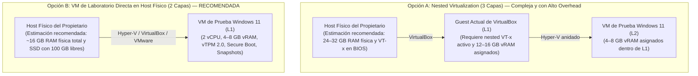

# PrivGuard — Fase 8B.1A.7.2-R7: Rebaseline de Supuestos, Readiness del Laboratorio VM, Carrera de Orden de Liberación de Mutexes y Endurecimiento de Reintento FUS (Reconciliación Post-Push #102, Verificación CI R6, Auditoría de Deadline R5 y Gate L0)

**Fecha de emisión original:** 2026-11-07<br />
**Fecha de revisión factual R1:** 2026-11-07<br />
**Fecha de revisión factual R2:** 2026-11-07<br />
**Fecha de revisión factual R3:** 2026-11-07<br />
**Fecha de revisión factual R4:** 2026-11-07<br />
**Fecha de revisión factual R5:** 2026-11-07<br />
**Fecha de reconciliación post-push R6:** 2026-11-07<br />
**Fecha de reconciliación post-push y gate L0 R7:** 2026-11-08<br />
**Autor:** Principal .NET / Windows Security Engineer, Auditor de Sincronización Interproceso y Responsable de Calidad de Evidencia<br />
**Rama activa de trabajo:** `docs/8b1a7-2-r7-post-r6-reconciliation`<br />
**Baseline de código funcional auditado:** `85d3f71d2c7a1be72d00fc06e47c37d6cdafa15a` (Commit R5)<br />
**HEAD remoto canónico (`origin/main`):** `e6a57ae58d7d0cd30265834fc51e2bab32928732` (Commit R6 Documental)<br />
**Parent directo en `main` (Commit R5):** `85d3f71d2c7a1be72d00fc06e47c37d6cdafa15a`<br />
**Último workflow CI:** Run #102 (ID: `42444149346`, commit `e6a57ae58d7d0cd30265834fc51e2bab32928732`, evento `push`, **7/7 jobs `success`**)<br />
**Workflows CI previos relevantes (SHAs completos verificados vía GitHub Actions API):**<br />
- Run #101 (ID: `42438637184`, commit `85d3f71d2c7a1be72d00fc06e47c37d6cdafa15a`, evento `push`, **7/7 jobs `success`**)<br />
- Run #100 (ID: `42435675882`, commit `86d6adcef9234b579e9313215673cf540e9fa52b`, evento `push`, **7/7 jobs `success`**)<br />
- Run #99 (ID: `42432585253`, commit `4d674ebd933f70edd2a1be789df2e3414e1b59f0`, evento `push`, **7/7 jobs `success`**)<br />
- Run #98 (ID: `42429999278`, commit `2f1281b0df0fa4906f14f690d95be42beadf15aa`, evento `push`, **7/7 jobs `success`**)<br />
- Run #97 (ID: `42428357398`, commit `405f948d9267a5e7c8b4b0b2f74eeedf799cbf9d`, evento `push`, **7/7 jobs `success`**)<br />
- Run #96 (ID: `42426468347`, commit `11a7e497a212000809084d56cb3c596ccd3c6f43`, evento `push`, **7/7 jobs `success`**)<br />
- Run #95 (ID: `42420318570`, commit `fc345ebd06239e8b86c0c502a4b289052e988a8c`, evento `push`, **7/7 jobs `success`**)<br />
- Run #94 (ID: `42417187681`, commit `aedd19c819ddeaf4e482576fb973f490980b7aa5`, evento `push`, **7/7 jobs `success`**)<br />
- Run #93 (ID: `42410227273`, commit `54fb44670c55b3d0e009e1236dc6a48e0b44378c`, evento `push`, **7/7 jobs `success`**)<br />
- Run #92 (ID: `42396473407`, commit `653be31040da53bea72a540ddb2a111f16b35d50`, evento `push`, **7/7 jobs `success`**)<br />
- Run #91 (ID: `42390732091`, commit `07e41885f4b0398c05c7193e7191773bb658bd6f`, evento `push`, **7/7 jobs `success`**)<br />
- Run #90 (ID: `42384884759`, commit `b9d4b8f1627c74b70b977f509cbc56acc7989ad0`, evento `push`, **7/7 jobs `success`**)<br />
- Run #89 (ID: `42379421580`, commit `d8ca7acc703397cabec8d5cbba92f39329fa940a`, evento `push`, **7/7 jobs `success`**)<br />
- Runs #87 y #86 (IDs: `42346415046` y `42342850877`, commits `391d79e9255cb07f87f6e13748225cd55fc6f514` y `0a270a1b7fb50bb894b0137cd17ef2dc65dcc246`, evento `pull_request`, `head_branch`: `feature/sprint-1-store-profile-guards-d01-d02`, destino: `main`, PR #11, **7/7 jobs `success`**)<br />
**Veredicto de Rebaseline R7:** **R7 PASS — R6 REMOTE STATE RECONCILED — CI R6 PASS — L0 NOT VERIFIED — LAB HOLD**<br />
**Clasificación de Host Preflight:** **GUEST DETECTED — L0 NOT VERIFIED**<br />
**Readiness del Laboratorio VM:** **HOLD — Requiere aprovisionamiento del propietario en Hipervisor L0 (Topología B)**<br />
**Estado Microsoft Store:** **CONDITIONAL HOLD**<br />
**Estado Fase 8B.1C:** **BLOCKED / NOT AUTHORIZED**

---

## 1. Resumen Ejecutivo y Veredictos Formales

### 1.1 Resumen Ejecutivo y Addenda de Reconciliación Factual (R1, R2 y R3)
El presente documento constituye la **revisión factual, adversarial, de sincronización y correctiva R3** del rebaseline técnico de la Fase 8B.1A.7.2 (preparación para pruebas dinámicas de almacenamiento MSIX y recuperación transaccional en VM aislada).

Los informes y runbooks previos de virtualización (Fases 8B.1A.5, 8B.1A.6 y 8B.1A.7.1) fueron redactados tomando como base el commit histórico `9f856c0405e4e5b64e784309affad450c38d3a37`. Desde dicho punto, la historia del repositorio avanzó mediante 5 commits en el rango `9f856c0..d8ca7acc` (Sprint 1.0, 1.1 y 1.2) seguidos de **11 commits exclusivamente documentales en `d8ca7acc..2f1281b0`**:
- Cuatro commits documentales iniciales: `dded99c`, `b9d4b8f`, `07e4188` y `653be31` (este último fijando el baseline del código auditado).
- Siete commits documentales correctivos posteriores: `3f08f12`, `54fb446` (SHA real `54fb44670c55...`), `aedd19c` (SHA real `aedd19c819dd...`), `fc345eb`, `11a7e49`, `405f948d` y `2f1281b0df0fa4906f14f690d95be42beadf15aa`.

#### Addendum R3: Reconciliación Post-Push R2, Carrera por Orden de Liberación de Mutexes y Diseño TEST-09.7
1. **Reconciliación Factual Post-Push de `2f1281b` y Trazabilidad Remota:**
   - La consulta a la API de GitHub Actions confirma que el commit `2f1281b0df0fa4906f14f690d95be42beadf15aa` (`docs: reconcile R2 FUS state machine and host preflight`) se encuentra publicado en la rama `main` de `origin/main` y desencadenó el workflow **Run #98** (ID: `42429999278`), completando **7/7 jobs con conclusión `success`**.
   - Se rectifica formalmente la declaración histórica `"ZERO PUSH EJECUTADO"` del informe R2: dicha frase reflejaba el ámbito local de los comandos en la sesión del agente, pero el estado observable en el remoto confirma que **el commit R2 fue publicado en `main`**. No se formula ninguna inferencia sobre el actor, sincronización o cliente que haya producido dicha publicación.
   - En el workflow Run #98 se publicaron 4 ejecutables single-file (`PrivGvard-osx-arm64`, `PrivGvard-linux-x64`, `PrivGvard-win-arm64`, `PrivGvard-win-x64`). **CI no publicó ningún paquete MSIX descargable ni el archivo `BUILD-PROVENANCE.json`**.
2. **Corrección de SHAs Completos de CI en la Tabla Histórica:**
   - Se verificaron directamente contra la API de GitHub Actions los SHAs de 40 caracteres de los workflows anteriores, corrigiendo discrepancias de transcripción presentes en informes previos:
     - Run #86: `0a270a1b7fb50bb894b0137cd17ef2dc65dcc246` (corrigiendo la errata de terminación `...22d645e`).
     - Run #87: `391d79e9255cb07f87f6e13748225cd55fc6f514` (corrigiendo la errata de terminación `...9294ae0`).
     - Run #93: `54fb44670c55b3d0e009e1236dc6a48e0b44378c` (corrigiendo la errata de terminación `...c21ec15`).
     - Run #94: `aedd19c819ddeaf4e482576fb973f490980b7aa5` (corrigiendo la errata de terminación `...06ebf19`).
3. **Moderación de la Declaración sobre el SHA R1 Inexistente:**
   - Se matiza la conclusión absoluta sobre el SHA `405f9485121b6a12dfd54d241772ea59419b4872`:
     - *Declaración ajustada:* **El SHA completo reportado no se encontró en el object database ni en el remoto consultado; la evidencia disponible indica una transcripción incorrecta al expandir el prefijo abreviado `405f948`.**
4. **Corrección del Literal Exacto del Mensaje de Timeout:**
   - Se sustituye la paráfrasis errónea de R2 por el texto literal exacto implementado en el código de producción ([`WindowsUninstallRequestListener.cs#L149-L152`](../../src/PrivLock.Platform.Windows/System/WindowsUninstallRequestListener.cs#L149-L152)):
     ```csharp
     error = requestSent
         ? "The running PrivGvard instance did not finish its safe shutdown before the uninstall handoff expired."
         : "No running PrivGvard instance accepted the uninstall shutdown request.";
     ```
5. **Hallazgo Central R3 — Carrera por Orden de Liberación de Mutexes (*Release-Order Race*):**
   - La revisión de sincronización detectó una intercalación crítica en el orden real de las operaciones de producción:
     - **Orden de Adquisición en Guard:** `Global\PrivLock_UninstallGate` (1º) -> `Global\PrivLock_SingleInstance` (2º).
     - **Orden de Liberación en Guard (`Release()`):** En [`WindowsSingleInstanceGuard.cs#L84-L88`](../../src/PrivLock.Platform.Windows/System/WindowsSingleInstanceGuard.cs#L84-L88), el código ejecuta:
       ```csharp
       public void Release()
       {
           ReleaseMutexCore(ref _mutex, ref _hasAcquired, "single-instance");
           ReleaseUninstallGateCore();
       }
       ```
       Es decir: **`Global\PrivLock_SingleInstance` se libera PRIMERO, y `Global\PrivLock_UninstallGate` se libera DESPUÉS**.
     - **Mutex Sondeado en Handoff:** En `TryRequestRunningInstanceAndAcquire()`, el proceso sondea exclusivamente `Global\PrivLock_SingleInstance`.
     - **Mecanismo de Intercalación en FUS (`requestSent == false`):**
       1. En FUS, el evento `Local\PrivLock_UninstallRequested` de UserA es inaccesible para UserB (`requestSent = false`).
       2. UserA inicia su cierre y llama a `Release()`.
       3. UserA libera `Global\PrivLock_SingleInstance`.
       4. Antes de que UserA alcance a ejecutar `ReleaseUninstallGateCore()`, el planificador del SO cede la CPU a UserB.
       5. UserB estaba esperando sobre `SingleInstance`; su `WaitOne` tiene éxito porque UserA ya lo liberó.
       6. UserB libera su handle de prueba e invoca `singleInstanceGuard.TryAcquireSingleInstance()`.
       7. La guarda de UserB intenta adquirir primero `Global\PrivLock_UninstallGate`.
       8. **`UninstallGate` todavía pertenece a UserA**, por lo que `TryAcquireSingleInstance()` falla y devuelve `false`.
       9. Al evaluar la línea 140, dado que `requestSent == false`, UserB **aborta de inmediato** con el error: *"The Windows uninstall gate is owned, but no running PrivGvard instance accepted a shutdown request."*
       10. UserA libera el uninstall gate un instante después, pero UserB ya finalizó el handoff con fallo.
   - **Clasificación Formal del Hallazgo:**
     $$\mathbf{RACE\ CONDITION\ PLAUSIBLE\ —\ STATICALLY\ GROUNDED\ —\ DYNAMIC\ REPRODUCTION\ REQUIRED}$$
   - **Delimitación de Impacto:** Se trata de un **fallo fail-closed de disponibilidad/fiabilidad del handoff** (se rechaza una desinstalación segura legítima). No constituye bypass de privacidad ni eliminación insegura de archivos.
6. **Incorporación de `TEST-09.7` en el Runbook Dinámico:**
   - Se formula el diseño formal de la prueba falsable `TEST-09.7` para reproducir controladamente esta intercalación mediante pausa en depuración o instrumentación de sincronización, manteniéndola bajo **`LAB HOLD / NOT RUN`**.

#### Addendum R4: Reconciliación Post-Push Run #99, Remediación en Código de la Carrera de Liberación FUS y Tests Automatizados
1. **Reconciliación Factual Post-Push de `4d674ebd` y Trazabilidad Remota:**
   - La consulta a la API de GitHub Actions confirma que el commit `4d674ebd933f70edd2a1be789df2e3414e1b59f0` (`docs: reconcile R3 release-order race and TEST-09.7 design`) se encuentra publicado en la rama `main` de `origin/main` y desencadenó el workflow **Run #99** (ID: `42432585253`), completando **7/7 jobs con conclusión `success`**.
   - Se rectifica formalmente la declaración histórica `"ZERO PUSH EJECUTADO"` / `"LOCAL ONLY"` del informe R3: dicha declaración reflejaba con rigor el ámbito local de los comandos en la sesión del agente al momento de la captura, pero el estado observable en el remoto confirma que **el commit R3 fue publicado en `main`**. No se formula ninguna inferencia sobre el actor, cliente o sincronización externa que haya producido dicha publicación.
   - En el workflow Run #99 se publicaron 4 ejecutables single-file (`PrivGvard-osx-arm64`, `PrivGvard-linux-x64`, `PrivGvard-win-arm64`, `PrivGvard-win-x64`). **CI no publicó ningún paquete MSIX descargable ni el archivo `BUILD-PROVENANCE.json`**.
2. **Matriz de Decisión y Análisis de Opciones de Remediación (Opciones A, B y C):**
   - Se evaluaron tres opciones arquitectónicas para resolver el fallo prematuro por contención en el handoff de desinstalación frente a los 7 criterios de ingeniería:
     - **Opción A (Reintento Acotado con Backoff en `TryRequestRunningInstanceAndAcquire`):** Ante un resultado de contención transitoria (`requestSent == false`), no aborta de inmediato; duerme un intervalo acotado (`effectivePollInterval`, default 100ms) y reintenta dentro de la ventana de timeout global (`Stopwatch` monotónico).
     - **Opción B (Invertir Orden de Liberación en `WindowsSingleInstanceGuard.Release()`):** Liberar `_uninstallGate` antes que `_mutex`. Aunque reduce la ventana entre UserA y UserB, no resuelve la contención transitoria por un tercer proceso, altera el ciclo de vida de cierre en todas las salidas normales, y presenta riesgo de interacción adversa con `ReleaseUninstallGateForHandoff()` en Inno Setup.
     - **Opción C (Resultado Enriquecido Específico de Windows `WindowsSingleInstanceAcquisitionResult`):** Extiende el contrato interno en Windows para discernir si la contención se debió a `UninstallGateBusy`, `SingleInstanceBusy` o `AccessOrCreationError`.
   - **Decisión Adoptada: Opción A + Opción C (Reintento Acotado + Resultado Específico Windows).**
     - Mantiene `ISingleInstanceGuard` 100% inalterado (cero blast radius sobre abstracciones multiplataforma).
     - Conserva intacto el ciclo de vida de apagado e Inno Setup handoff.
     - Suprime la inundación de logs en Serilog (`suppressLogging: true` en reintentos).
     - Resuelve deterministamente tanto la *Release-Order Race* como la contención por tercer proceso.
     - Falla de inmediato (*fail-closed*) ante errores no transitorios (`AccessOrCreationError`).
3. **Remediación en Código de Producción Implementada:**
   - En [`WindowsSingleInstanceGuard.cs`](../../src/PrivLock.Platform.Windows/System/WindowsSingleInstanceGuard.cs):
     - Declarado enum interno `WindowsSingleInstanceAcquisitionResult { Acquired, UninstallGateBusy, SingleInstanceBusy, AccessOrCreationError }`.
     - Declarada interfaz interna `IWindowsDetailedSingleInstanceGuard`.
     - Implementado método `internal WindowsSingleInstanceAcquisitionResult TryAcquireSingleInstanceDetail(bool suppressLogging = false)`.
     - `TryAcquireSingleInstance()` consume `TryAcquireSingleInstanceDetail(suppressLogging: false) == WindowsSingleInstanceAcquisitionResult.Acquired`.
     - Limpieza rigurosa de mutex handles en casos de contención.
   - En [`WindowsUninstallRequestListener.cs`](../../src/PrivLock.Platform.Windows/System/WindowsUninstallRequestListener.cs):
     - Añadido parámetro opcional `TimeSpan? pollInterval = null` a `TryRequestRunningInstanceAndAcquire` (default 100ms).
     - En el bucle `while (stopwatch.Elapsed < timeout)`: si `outcome` es `UninstallGateBusy` o `SingleInstanceBusy`, duerme `Math.Min(effectivePollInterval, remaining)` y reintenta.
     - Si `outcome == AccessOrCreationError`, termina de inmediato devolviendo `false` con `"Failed to create or acquire single-instance mutex on Windows."` sin bucle innecesario.
     - Diagnósticos de salida precisos según `requestSent` y `probeAcquiredAtLeastOnce`.
4. **Nuevos Tests Automatizados de Sincronización:**
   - Añadidos 5 nuevos tests deterministas `[Fact]` en [`WindowsUninstallRequestListenerTests.cs`](../../tests/PrivLock.Platform.Windows.Tests/WindowsUninstallRequestListenerTests.cs):
     - `NoEventTransientContentionThenRecovery_ReturnsSuccessOnlyAfterBothLocksAcquired` (simula Release-Order Race en FUS).
     - `NoEventPermanentContention_FailsClosedAtTimeoutWithoutBusySpin` (prueba fail-closed y ausencia de busy-spin).
     - `PermanentAccessOrCreationError_TerminatesPromptlyWithoutRetryingToTimeout` (prueba terminación inmediata ante error fatal).
     - `ThirdProcessContentionRace_RetriesUntilAdmissionOrTimeout` (simula contención transitoria por tercer proceso y recuperación).
     - `AbandonedMutex_OnProbeHandle_PreservesOwnershipAndSucceedsIfGuardAcquires` (prueba manejo de mutex abandonado).
   - Añadido docstring explicativo en [`WindowsSingleInstanceStartupTests.cs`](../../tests/PrivLock.Platform.Windows.Tests/WindowsSingleInstanceStartupTests.cs) clarificando que los tests concurrentes son unitarios intra-proceso y no sustituyen la validación dinámica en VM.
   - La suite de pruebas de Windows cuenta ahora con **319 tests superados (0 fallos)**, y la solución completa con **601 tests superados (0 fallos)**.
5. **Reafirmación de `TEST-09.7` en el Runbook Dinámico:**
   - El caso de prueba dinámico `TEST-09.7` en VM Windows 11 permanece bajo **`LAB HOLD / NOT RUN`**, reservado para la ejecución en el host físico L0 del propietario.

#### Addendum R5: Reconciliación Post-Push Run #100, Endurecimiento del Contrato de Reintento (R5-01..R5-03), Tests con Mutexes Reales `Local\` y Criterios Post-Fix de TEST-09.7
1. **Reconciliación Factual Post-Push de `86d6adc` y Trazabilidad Remota:**
   - La consulta directa a la API de GitHub Actions y a las referencias remotas (`git ls-remote`) confirma que el commit funcional `86d6adcef9234b579e9313215673cf540e9fa52b` (`fix(windows): retry FUS handoff on transient uninstall-gate contention`, parent `4d674ebd933f70edd2a1be789df2e3414e1b59f0`) se encuentra publicado en la rama `main` de `origin/main` y desencadenó el workflow **Run #100** (ID: `42435675882`, evento `push`), completando **7/7 jobs con conclusión `success`** (601 tests superados en CI: 25 Domain, 167 Application, 90 Infrastructure, 319 Windows Platform).
   - Se reconcilia formalmente la declaración histórica `"ZERO PUSH EJECUTADO"` / `"LOCAL ONLY"` del informe R4: dicha declaración describía con exactitud las acciones ejecutadas dentro de la sesión del agente en el momento de su emisión, pero el estado observable posterior en el remoto confirma que **el commit R4 fue publicado en `main`**. No se realiza ninguna atribución no verificada sobre el cliente o actor que efectuó dicha publicación.
   - En el workflow Run #100 se publicaron 4 ejecutables single-file (`PrivGvard-osx-arm64`, `PrivGvard-linux-x64`, `PrivGvard-win-arm64`, `PrivGvard-win-x64`). **CI no publicó ningún paquete MSIX descargable ni el archivo `BUILD-PROVENANCE.json`**.
   - Se corrigió asimismo en `docs/ai/AUDIT-ROADMAP.md` la discrepancia histórica de conteos de R4 (`266 Windows / 559 total` -> `319 Windows / 601 total` verificados en R4 y Run #100).
2. **Endurecimiento del Contrato de Reintento y Diagnósticos en `WindowsUninstallRequestListener.cs` (R5-01, R5-02 y R5-03):**
   - **R5-02 (Preservación de la Signatura Pública de 5 Parámetros):**
     - Se restauró la signatura pública original de 5 parámetros:
       ```csharp
       public static bool TryRequestRunningInstanceAndAcquire(
           ISingleInstanceGuard singleInstanceGuard,
           TimeSpan timeout,
           out string error,
           string requestEventName = RequestEventName,
           string instanceMutexName = WindowsSingleInstanceGuard.MutexName)
       ```
     - El parámetro `TimeSpan pollInterval` se trasladó a una sobrecarga `internal` consumida por la suite de pruebas (`InternalsVisibleTo("PrivLock.Platform.Windows.Tests")`), garantizando compatibilidad binaria estricta del API público.
   - **R5-01 (Validación Estricta de `timeout` y `pollInterval` y Eliminación de Truncamiento Sub-Milisegundo):**
     - Se incorporó `ValidatePositiveFiniteInterval(TimeSpan value, string paramName)` antes de abrir cualquier handle de evento o mutex y antes de entrar al bucle de espera.
     - Rechaza inmediatamente con `ArgumentOutOfRangeException` valores `<= TimeSpan.Zero`, intervalos sub-milisegundo (`< 1 ms`, que `.NET` truncaría a `0 ms`), `Timeout.InfiniteTimeSpan` (`-1 ms`) y valores superiores a `TimeSpan.FromMilliseconds(int.MaxValue)`.
     - Además, en el cálculo de `waitInterval` y `sleepTime` dentro del bucle, se aplica un límite inferior de `MinWaitHandleInterval` (`1 ms`) cuando `0 < remaining < 1 ms`, impidiendo que el truncamiento entero `(long)TimeSpan.TotalMilliseconds` de `.NET` genere llamadas `Thread.Sleep(0)` (busy-spin) en el último milisegundo del plazo de timeout.
   - **R5-03 (Diagnóstico de Timeout Diferenciado según la Última Causa de Contención Observada):**
     - Se registra `lastContentionOutcome` (`UninstallGateBusy` vs `SingleInstanceBusy`) en cada intento de adquisición de la guarda tras el sondeo.
     - Al expirar el timeout cuando `requestSent == false`:
       - Si la última causa observada fue `UninstallGateBusy`: `"The Windows uninstall gate is owned, but no running PrivGvard instance accepted a shutdown request (last observed contention: UninstallGateBusy; does not guarantee mutex state after timeout)."`
       - Si la última causa observada fue `SingleInstanceBusy`: `"The Windows single-instance mutex remained busy after probe release, and no running PrivGvard instance accepted a shutdown request (last observed contention: SingleInstanceBusy; does not guarantee mutex state after timeout)."` (nunca afirma falsamente que `UninstallGate` está ocupado cuando falló `SingleInstance`).
       - Si el mutex de sondeo nunca llegó a adquirirse (`lastContentionOutcome == null`): `"Timed out waiting for Windows single-instance admission after no running PrivGvard instance accepted the uninstall shutdown request."` (diagnóstico neutral que no presupone si existía o no una instancia activa en otra sesión).
     - Si `requestSent == true`, se preserva intacto el literal: `"The running PrivGvard instance did not finish its safe shutdown before the uninstall handoff expired."`
3. **Ampliación de Cobertura Automatizada con Mutexes con Nombre Reales `Local\`:**
   - En [`WindowsSingleInstanceStartupTests.cs`](../../tests/PrivLock.Platform.Windows.Tests/WindowsSingleInstanceStartupTests.cs):
     - Añadidos 3 tests `[Fact]` que ejercitan `WindowsSingleInstanceGuard.TryAcquireSingleInstanceDetail` sobre **mutexes con nombre reales de Windows en `Local\`** mantenidos por hilos dedicados del SO:
       1. `RealNamedMutexes_WhenUninstallGateOwnedByAnotherThread_ReturnsUninstallGateBusyAndLeavesMainMutexFree`
       2. `RealNamedMutexes_WhenMainMutexOwnedByAnotherThread_ReturnsSingleInstanceBusyAndReleasesGate` (verifica en un hilo separado que el gate fue liberado tras el fallo en `SingleInstance`)
       3. `RealNamedMutexes_WhenBothFree_AcquiresBothAndReleaseAllowsSubsequentAcquisition`
   - En [`WindowsUninstallRequestListenerTests.cs`](../../tests/PrivLock.Platform.Windows.Tests/WindowsUninstallRequestListenerTests.cs):
     - Añadido el test de integración intra-sesión con mutexes reales `Local\` [`RealNamedMutexes_ReleaseOrderInterleaving_RetriesWhileUninstallGateHeldAndAcquiresBothWhenGateReleased`](../../tests/PrivLock.Platform.Windows.Tests/WindowsUninstallRequestListenerTests.cs#L439-L545), que reproduce determinísticamente la ventana de intercalación de orden de liberación R3/R4 entre dos hilos del SO usando `ManualResetEventSlim` (sin hooks en producción ni sleeps arbitrarios).
     - Reforzado `AbandonedMutex_OnProbeHandle_PreservesOwnershipReleasesProbeBeforeGuardAndLeavesNoExtraHoldCount` verificando desde un hilo separado que el handle de sondeo abandonado se libera antes de la adquisición de la guarda y no deja recuento recursivo residual tras `guard.Release()`.
     - Añadidos tests de reflexión para la signatura pública de 5 parámetros, validación de `pollInterval` y `timeout` (incluyendo `0`, `-1 ms` / `Timeout.InfiniteTimeSpan`, negativos, `< 1 ms` y `TimeSpan.MaxValue`), y diagnósticos diferenciados de `UninstallGateBusy`, `SingleInstanceBusy` y secuencia mixta.
     - La suite de Windows alcanza **334 casos de prueba superados (0 fallos)** y la solución completa **616 casos de prueba superados (0 fallos)**.
4. **Actualización del Runbook `TEST-09.7` (Separación Pre-Fix vs. Post-Fix):**
   - La especificación de `TEST-09.7` en la Sección 7 distingue ahora explícitamente entre:
     - **Sección 6.1 (Comportamiento Histórico Pre-Fix R3 — Baseline de Regresión):** Fallo prematuro en el primer intento cuando `requestSent == false` y UserA retiene `UninstallGate`.
     - **Sección 6.2 (Comportamiento Esperado Post-Fix R4/R5 en Código Actual — Criterio de Aceptación):** UserB observa `UninstallGateBusy`, reintenta durante la ventana de timeout y, al reanudarse UserA y liberar `UninstallGate`, adquiere ambos mutexes y retorna `true`.
     - **Sección 6.3 (Controles Negativos):** Retención hasta agotar timeout (`UninstallGateBusy`), contención en `SingleInstance` (`SingleInstanceBusy`), error de DACL (`AccessOrCreationError`) y timeout sin adquirir nunca el sondeo.
   - `TEST-09.7` permanece estrictamente en **`LAB HOLD / NOT RUN`**.

#### Addendum R6: Reconciliación Post-Push Run #101, Verificación CI por SHA, Auditoría de Diffs R5 y Gate Pre-Laboratorio
1. **Reconciliación Factual Post-Push de `85d3f71d` y Trazabilidad Remota:**
   - La consulta directa a la API de GitHub Actions y a las referencias remotas (`git ls-remote`) confirma que el commit funcional + documental R5 `85d3f71d2c7a1be72d00fc06e47c37d6cdafa15a` (`fix(windows): harden FUS handoff retry contract and add real mutex tests`, parent `86d6adcef9234b579e9313215673cf540e9fa52b`) se encuentra publicado en la rama `main` de `origin/main` y desencadenó el workflow **Run #101** (ID: `42438637184`, evento `push`), completando **7/7 jobs con conclusión `success`** (616 tests superados en la solución: 25 Domain, 167 Application, 90 Infrastructure, 334 Windows Platform).
   - Se reconcilia formalmente la declaración histórica `"ZERO PUSH EJECUTADO"` / `"LOCAL ONLY"` del informe R5: describía rigurosamente el ámbito local de los comandos en la sesión del agente al emitir el informe, pero la realidad observable posterior en el remoto demuestra que el commit R5 fue publicado en `main`. No se formula ninguna inferencia sobre el actor, cliente o sincronización externa que haya producido dicha publicación.
   - En el workflow Run #101 se publicaron 4 ejecutables single-file (`PrivGvard-win-arm64`, `PrivGvard-win-x64`, `PrivGvard-osx-arm64`, `PrivGvard-linux-x64`). **CI no publicó ningún paquete MSIX descargable ni el archivo `BUILD-PROVENANCE.json`**.
2. **Auditoría Estática de Diffs R5 y Validación de Cero Regresiones:**
   - El diff `86d6adcef9234b579e9313215673cf540e9fa52b..85d3f71d2c7a1be72d00fc06e47c37d6cdafa15a` afectó a 6 archivos (`WindowsUninstallRequestListener.cs`, `WindowsSingleInstanceStartupTests.cs`, `WindowsUninstallRequestListenerTests.cs`, `AUDIT-ROADMAP.md`, `PROJECT_CONTEXT.md` e `INFORME-FASE-8B1A7_2-READINESS-REBASELINE.md`). `WindowsSingleInstanceGuard.cs` no fue modificado en R5.
   - Se ratifican los 15 puntos estáticos de la remediación: signatura pública original de 5 parámetros preservada, sobrecarga `internal` de 6 parámetros para pruebas, validación pre-handle de `timeout` y `pollInterval` contra valores `<= 0`, sub-milisegundo, `-1 ms` y `> int.MaxValue`, acotamiento de 1ms en esperas residuales contra busy-spin, diagnósticos diferenciados de `UninstallGateBusy`, `SingleInstanceBusy` y timeout neutral sin presuponer instancias activas, y ausencia total de hooks de depuración en producción.
3. **Reproducibilidad Local Exacta y Forense de `task-9809`:**
   - La suite completa de 616 pruebas reproduce 100% PASS localmente en `.NET SDK 10.0.403` bajo ejecución serializada por proyecto (`dotnet test PrivGvard.sln -c Release --no-build -m:1`), coincidiendo con la topología de CI.
   - Se reconcilia el fallo observado en el intento previo `task-9809` de la sesión R5 en `SimulatedGuard_NoEventPermanentUninstallGateContention_FailsClosedAtTimeoutWithoutBusySpin`: la ausencia inicial de límite inferior `MinWaitHandleInterval = 1 ms` en las esperas residuales provocaba que un remanente `< 1 ms` se truncase a `0 ms` (`Thread.Sleep(0)`), inflando el conteo de reintentos a 30 (fuera del rango 1–20); el commit R5 solventó esto acotando a 1ms, estabilizando los intentos entre 8 y 9.
4. **Gate Pre-Laboratorio:**
   - Todo el código de producción y pruebas se encuentra reconciliado, verificado en CI (Run #101) y reproducido localmente. El entorno de desarrollo actual permanece como `GUEST DETECTED — L0 NOT VERIFIED`, por lo que el conjunto de pruebas dinámicas (TEST-01 a TEST-11, incluido TEST-09.7) permanece formalmente bajo **`LAB HOLD / NOT RUN`**, a la espera de que el propietario del repositorio aprovisione una VM aislada directa en el hipervisor físico L0 (Topología B).

#### Addendum R7: Reconciliación Post-Push R6, Verificación CI Run #102, Auditoría de Deadline R5 y Gate L0
1. **Reconciliación Factual Post-Push del Commit R6 (`e6a57ae`):**
   - La consulta directa a las referencias remotas (`git ls-remote --heads origin`) y a la API de GitHub (`GET /repos/cristianbarreiro/PrivGuard/branches/main`, consultado 2026-11-08T00:29:40Z) confirma que el commit R6 `e6a57ae58d7d0cd30265834fc51e2bab32928732` (`docs: reconcile R5 post-push evidence and CI state`) se encuentra publicado en la rama `main` de `origin` y constituye su HEAD canónico actual.
   - El diff `85d3f71..e6a57ae` es estrictamente documental (4 archivos de documentación modificados, cero archivos de código de producción o pruebas).
   - Se rectifica la declaración de cierre de la sesión R6 (`ZERO PUSH / local only`): describía rigurosamente las acciones locales ejecutadas en dicha sesión, pero quedó superada por la publicación remota posterior. No se atribuye quién realizó el push ni mediante qué cliente/herramienta de sincronización.
2. **Verificación de GitHub Actions para R6 (Run #102 — `CI R6 PASS`):**
   - La consulta por `head_sha=e6a57ae58d7d0cd30265834fc51e2bab32928732` arrojó el workflow **Run #102** (ID: `42444149346`, evento `push`, rama `main`, conclusión `success`, 7/7 jobs exitosos).
   - Todos los pasos en Windows (Restore, Build, Domain, Application, Infrastructure, Windows Platform Tests [334 tests] y Validate Release-Store MSIX Packaging) concluyeron en `success`.
   - Se publicaron 4 ejecutables single-file (`PrivGvard-win-x64`, `PrivGvard-win-arm64`, `PrivGvard-osx-arm64`, `PrivGvard-linux-x64`). Cero paquetes `.msix` o archivos `BUILD-PROVENANCE.json` descargables.
3. **Auditoría del Borde Temporal de `WindowsUninstallRequestListener` (R7-04 — `DOCUMENTED ACCEPTANCE`):**
   - Se evaluó estáticamente el matiz por el cual `WaitOne(waitInterval)` en la última iteración puede retornar tras cruzar la ventana nominal `timeout` debido a la granularidad del temporizador de Windows (~15.6 ms) y al límite inferior `MinWaitHandleInterval = 1 ms`.
   - Se adoptó formalmente la **Opción A (Deadline Aproximado Aceptado)**: el contrato de timeout en handoff es monotónico (`Stopwatch`) y acotado por sondeo (*polling bounded*); no constituye una garantía de tiempo real duro sub-milisegundo. Descartar una adquisición legítima post-deadline por microsegundos provocaría un falso negativo destructivo para la desinstalación. Cero cambios en código de producción.
4. **Preparación del Gate de Aprovisionamiento en Host Físico L0 (Topología B):**
   - Se elaboró el script PowerShell read-only [`scripts/lab/Get-L0HostPreflight.ps1`](../../scripts/lab/Get-L0HostPreflight.ps1) y el runbook [`docs/lab/PRIVGUARD-L0-HOST-PREFLIGHT.md`](../lab/PRIVGUARD-L0-HOST-PREFLIGHT.md).
   - Se ratifica el estado **`L0 NOT VERIFIED — LAB HOLD`** hasta que el propietario ejecute el diagnóstico en el hardware físico anfitrión.

#### Addendum R8: Reconciliación Post-Push R7, Verificación CI Run #103, Reparación de Evidencia y Endurecimiento L0
1. **Reconciliación Factual Post-Push del Commit R7 (`f581a1c`):**
   - Al consultar las referencias remotas (`git ls-remote --heads origin` y `git fetch origin main`, consultado 2026-11-08T02:03:30Z), se confirmó que el commit R7 `f581a1c05d44f2a8c98cbf40f1dcddf6eb59a5a5` (`docs: reconcile R6 remote state and prepare L0 lab gate`) se encuentra publicado como HEAD canónico en `origin/main`.
   - La declaración histórica `ZERO PUSH` de la sesión local R7 queda superada por la observación remota, sin atribuir la sincronización a un actor o cliente concreto.
2. **Verificación de GitHub Actions para R7 (Run #103 — `CI R7 PASS`):**
   - La consulta directa por `head_sha=f581a1c05d44f2a8c98cbf40f1dcddf6eb59a5a5` confirmó el workflow **Run #103** (ID: `42448487384`, evento `push`, rama `main`, conclusión `success`, **7/7 jobs exitosos**).
   - Publicados los 4 ejecutables single-file habituales. Cero paquetes `.msix` o archivos `BUILD-PROVENANCE.json` descargables.
3. **Reparación de Integridad de Evidencia en el Informe R7:**
   - Se corrigieron los snippets de código ajenos (`ValueStopwatch`, `MaxAcquisitionRetries`) sustituyéndolos por el algoritmo real de producción de [`WindowsUninstallRequestListener.cs`](../../src/PrivLock.Platform.Windows/System/WindowsUninstallRequestListener.cs#L125-L197).
   - Se corrigieron las firmas pública e internal y se armonizó el inventario real de 16 tests unitarios en `WindowsUninstallRequestListenerTests` y 4 tests en `WindowsSingleInstanceStartupTests`.
   - Se corrigieron los job IDs de Run #102 (`Build & Test (macos-latest)` = `128619439904`, `Publish Single-File (linux-x64)` = `128619848706`), la versión del SDK (`.NET 10.0.403`) y el proyecto de test de infraestructura (`tests/PrivLock.Infrastructure.Tests`).
4. **Endurecimiento del Preflight de Host Físico L0:**
   - Se rediseñó [`scripts/lab/Get-L0HostPreflight.ps1`](../../scripts/lab/Get-L0HostPreflight.ps1) eliminando la etiqueta prematura `L0_READY_FOR_TOPOLOGY_B` e introduciendo estados rigurosos (`L0_PREFLIGHT_PASS_CANDIDATE`, `L0_CAPABLE_CONSTRAINED`, `L0_PREFLIGHT_BLOCKED`, `PREFLIGHT_INCOMPLETE`, `GUEST_DETECTED`).
   - Se incorporó el parámetro `-VmStoragePath` para validar el volumen y espacio libre destino de la VM, y se añadieron pruebas unitarias automatizadas (`scripts/lab/Test-L0HostPreflightLogic.ps1`) con 10/10 casos pasando.
5. **Armonización de Requisitos de VM Windows 11 en Topología B:**
   - Se armonizó [`docs/lab/PRIVGUARD-L0-HOST-PREFLIGHT.md`](../lab/PRIVGUARD-L0-HOST-PREFLIGHT.md) con el mínimo oficial de Microsoft de **>= 64 GiB de almacenamiento** para VMs Windows 11 y se clarificó la taxonomía de hipervisores (Hyper-V como Tipo 1 nativo vs VirtualBox/VMware como Tipo 2 alojados).

### 1.2 Veredicto Oficial

$$\mathbf{VEREDICTO:\ REBASELINE\ R8\ PASS\ —\ R7\ REMOTE/CI\ RECONCILED\ —\ REPORT\ INTEGRITY\ REPAIRED\ —\ L0\ NOT\ VERIFIED\ —\ LAB\ HOLD}$$

- **Rebaseline, Reconciliación Run #103, Reparación de Evidencia y Endurecimiento L0:** **PASS**. Se reconcilia el commit R7 `f581a1c05d44f2a8c98cbf40f1dcddf6eb59a5a5` en `origin/main` y el Run #103 (`42448487384`, 7/7 jobs green), se reparan las firmas y fragmentos en la documentación de R7, se ratifica el dictamen `SOFT DEADLINE ACCEPTED — SEMANTICS DOCUMENTED` sobre el código real, y se endurece el tooling y runbook de preflight de host físico L0 con validación por tests.
- **Readiness del Laboratorio VM:** **HOLD**. El host de desarrollo actual permanece clasificado como `GUEST DETECTED — L0 NOT VERIFIED`. Se requiere aprovisionamiento de una VM aislada directa en el host físico L0 del propietario (Topología B).
- **Salvaguardas Invariantes:** Microsoft Store en `CONDITIONAL HOLD`, Fase 8B.1C en `BLOCKED / NOT AUTHORIZED`.

---

## 2. Baseline de Control de Versiones e Integración Factual

### 2.1 Verificación de Git y Remoto
- **Repositorio:** `cristianbarreiro/PrivGuard`
- **Rama activa de trabajo:** `docs/8b1a7-2-r7-post-r6-reconciliation`
- **HEAD Remoto Canónico (`origin/main`):** `e6a57ae58d7d0cd30265834fc51e2bab32928732` (R6 documental)
- **Parent directo en `main`:** `85d3f71d2c7a1be72d00fc06e47c37d6cdafa15a` (R5 funcional)
- **Baseline de código funcional auditado:** `85d3f71d2c7a1be72d00fc06e47c37d6cdafa15a`
- **Historial `d8ca7acc..e6a57ae` (13 commits documentales + 2 commits funcionales R4 y R5 en `main`):**
  1. `dded99c` — Documental: corrección de evidencia Sprint 1.2 postflight.
  2. `b9d4b8f` — Documental: ajuste de afirmaciones Sprint 1.2 postflight.
  3. `07e4188` — Documental: reconciliación Sprint 1.2 con estado remoto.
  4. `653be31` — Documental: rebaseline 8B.1A.7.2 contra código vigente (baseline de auditoría estática).
  5. `3f08f12` — Documental: corrección factual 8B.1A.7.2.
  6. `54fb44670c55b3d0e009e1236dc6a48e0b44378c` — Documental: análisis Full Trust AppData y desinstalación (SHA verificado).
  7. `aedd19c819ddeaf4e482576fb973f490980b7aa5` — Documental: alineación post-push de baseline y análisis preliminar FUS (SHA verificado).
  8. `fc345ebd06239e8b86c0c502a4b289052e988a8c` — Documental: corrección de análisis de DACL de mutex y handoff en FUS.
  9. `11a7e497a212000809084d56cb3c596ccd3c6f43` — Documental: finalización de reconciliación de evidencia 8B.1A.7.
  10. `405f948d9267a5e7c8b4b0b2f74eeedf799cbf9d` — Documental: reconciliación post-push R1 y precisión de cobertura de tests.
  11. `2f1281b0df0fa4906f14f690d95be42beadf15aa` — Documental: reconciliación R2 de máquina de estados FUS y preflight de host.
  12. `4d674ebd933f70edd2a1be789df2e3414e1b59f0` — Documental: reconciliación R3 de carrera de liberación y diseño TEST-09.7.
  13. `86d6adcef9234b579e9313215673cf540e9fa52b` — Funcional + Documental (R4): remediación de reintento FUS ante contención transitoria en uninstall-gate y tests unitarios.
  14. `85d3f71d2c7a1be72d00fc06e47c37d6cdafa15a` — Funcional + Documental (R5): hardening de contrato de reintento, preservación de signatura pública de 5 parámetros, diagnósticos de timeout diferenciados y tests con mutexes reales `Local\`.
  15. `e6a57ae58d7d0cd30265834fc51e2bab32928732` — Documental (R6): reconciliación post-push R5, verificación Run #101 en CI y sincronización de documentación canónica (HEAD canónico en `origin/main`).
- **Ramas Remotas en `origin`:** `main` (`e6a57ae...`), `dev` (`85d028e...`), `feature/sprint-1-store-profile-guards-d01-d02` (`391d79e...`). No existen ramas remotas para R4, R5 ni R6.
- **Forma Real de Integración en Remoto:** Integración directa mediante push sin Pull Request. La API de GitHub (`/branches/main`) confirma `protected: false`, `protection.enabled = false` y lista vacía de rulesets. Existen `0` Pull Requests abiertas actualmente.
- **Estado del Árbol de Trabajo:** Modificado localmente en la rama `docs/8b1a7-2-r7-post-r6-reconciliation` (sincronización documental de R7, sin push ni PR).
- **Código Funcional y Pruebas Vigentes (`85d3f71d` / `e6a57ae`):**
  - `src/PrivLock.Platform.Windows/System/WindowsUninstallRequestListener.cs` (signatura pública de 5 parámetros + sobrecarga `internal` de 6 parámetros, validación de intervalos pre-handle, deadline aproximado monotónico acotado por sondeo, y diagnósticos diferenciados de contención).
  - `tests/PrivLock.Platform.Windows.Tests/WindowsSingleInstanceStartupTests.cs` (3 tests con mutexes con nombre reales `Local\` entre hilos dedicados del SO).
  - `tests/PrivLock.Platform.Windows.Tests/WindowsUninstallRequestListenerTests.cs` (16 métodos de prueba / 20 casos ejecutables).

### 2.2 Evidencia de GitHub Actions (Runs #86, #87 y #89 al #102)

| Run ID | Commit SHA (40 caracteres verificados vía API) | Rama / Ref | Evento | Conclusión | Jobs Exitosos | Artefactos Publicados |
|---|---|---|---|---|---|---|
| **42444149346** (#102) | `e6a57ae58d7d0cd30265834fc51e2bab32928732` | `main` | `push` | `success` | 7/7 | 4 Single-File executables (Sin MSIX ni provenance) |
| **42438637184** (#101) | `85d3f71d2c7a1be72d00fc06e47c37d6cdafa15a` | `main` | `push` | `success` | 7/7 | 4 Single-File executables (Sin MSIX ni provenance) |
| **42435675882** (#100) | `86d6adcef9234b579e9313215673cf540e9fa52b` | `main` | `push` | `success` | 7/7 | 4 Single-File executables (Sin MSIX ni provenance) |
| **42432585253** (#99) | `4d674ebd933f70edd2a1be789df2e3414e1b59f0` | `main` | `push` | `success` | 7/7 | 4 Single-File executables (Sin MSIX ni provenance) |
| **42429999278** (#98) | `2f1281b0df0fa4906f14f690d95be42beadf15aa` | `main` | `push` | `success` | 7/7 | 4 Single-File executables (Sin MSIX ni provenance) |
| **42428357398** (#97) | `405f948d9267a5e7c8b4b0b2f74eeedf799cbf9d` | `main` | `push` | `success` | 7/7 | 4 Single-File executables (Sin MSIX ni provenance) |
| **42426468347** (#96) | `11a7e497a212000809084d56cb3c596ccd3c6f43` | `main` | `push` | `success` | 7/7 | 4 Single-File executables (Sin MSIX ni provenance) |
| **42420318570** (#95) | `fc345ebd06239e8b86c0c502a4b289052e988a8c` | `main` | `push` | `success` | 7/7 | 4 Single-File executables |
| **42417187681** (#94) | `aedd19c819ddeaf4e482576fb973f490980b7aa5` | `main` | `push` | `success` | 7/7 | 4 Single-File executables (SHA rectificado) |
| **42410227273** (#93) | `54fb44670c55b3d0e009e1236dc6a48e0b44378c` | `main` | `push` | `success` | 7/7 | 4 Single-File executables (SHA rectificado) |
| **42396473407** (#92) | `653be31040da53bea72a540ddb2a111f16b35d50` | `main` | `push` | `success` | 7/7 | 4 Single-File executables (Baseline auditado) |
| **42390732091** (#91) | `07e41885f4b0398c05c7193e7191773bb658bd6f` | `main` | `push` | `success` | 7/7 | 4 Single-File executables |
| **42384884759** (#90) | `b9d4b8f1627c74b70b977f509cbc56acc7989ad0` | `main` | `push` | `success` | 7/7 | 4 Single-File executables |
| **42379421580** (#89) | `d8ca7acc703397cabec8d5cbba92f39329fa940a` | `main` | `push` | `success` | 7/7 | 4 Single-File executables |
| **42346415046** (#87) | `391d79e9255cb07f87f6e13748225cd55fc6f514` | `feature/sprint-1-store-profile-guards-d01-d02` | `pull_request` (PR #11) | `success` | 7/7 | 4 Single-File executables (SHA rectificado) |
| **42342850877** (#86) | `0a270a1b7fb50bb894b0137cd17ef2dc65dcc246` | `feature/sprint-1-store-profile-guards-d01-d02` | `pull_request` (PR #11) | `success` | 7/7 | 4 Single-File executables (SHA rectificado) |

> [!NOTE]
> **Trazabilidad de Triggers:** El evento `pull_request` fue probado y superado con éxito en los Runs #86 y #87 durante la tramitación de la PR #11. Los 14 commits posteriores (`d8ca7acc..85d3f71d`, formados por 12 commits documentales y 2 commits funcionales R4 y R5) fueron integrados mediante eventos de tipo `push` directo sobre `main` (Runs #89 al #101).

---

## 3. Matriz de Reconciliación Corregida de Supuestos Históricos

| Documento Histórico | Afirmación Histórica | Estado Real en Código Actual (`653be31`) | Dictamen de Vigencia | Evidencia / Ubicación en Código |
|---|---|---|---|---|
| **8B.1A.5 / 8B.1A.6** (P0-01) | El manifiesto MSIX declara `allowElevation` y `unvirtualizedResources`, violando D-01. | El manifiesto `packaging/Package.appxmanifest` declara **únicamente** `<rescap:Capability Name="runFullTrust" />`. Las capacidades `allowElevation` y `unvirtualizedResources` fueron eliminadas y su ausencia está protegida por 16 tests unitarios y el CI gate. | **SUPERSEDIDO** (Resuelto por D-01) | [`packaging/Package.appxmanifest#L59-L61`](../../packaging/Package.appxmanifest#L59-L61)<br />[`StoreMsixManifestVerifier.cs#L95-L105`](../../src/PrivLock.Platform.Windows/Packaging/StoreMsixManifestVerifier.cs#L95-L105) |
| **8B.1A.5 / 8B.1A.6** (P0-02) | `IPackageIdentityDetector` e `IEditionProfileResolver` no están registrados en el contenedor de DI en `Program.cs`. | `Program.Main` resuelve el snapshot inmutable y `ConfigureServices` **registra como singletons en DI** tanto `IPackageIdentityDetector` como `IEditionProfileResolver`. También se configura en `WindowsPrivilegedSession`. | **SUPERSEDIDO** (Resuelto por Sprint 1.0) | [`Program.cs#L25`](../../src/PrivLock.Desktop/Program.cs#L25)<br />[`Program.cs#L628-L630`](../../src/PrivLock.Desktop/Program.cs#L628-L630)<br />[`Program.cs#L682`](../../src/PrivLock.Desktop/Program.cs#L682) |
| **8B.1A.5 / 8B.1A.6** (P0-03) | `WindowsUserPrivacyManager` escribe directamente en HKCU ConsentStore para Store Edition y no existe uso de `ms-settings:`. | `WindowsUserPrivacyManager` divide sus contratos en Reader y Writer. `SetCameraUserPrivacy` y `SetMicrophoneUserPrivacy` **rechazan explícitamente cualquier intento de escritura si el perfil no es `Standalone`** (D-02). En Store Edition, la mutación de cámara devuelve error dirigiendo a `ms-settings:privacy-webcam`. | **SUPERSEDIDO** (Resuelto por Sprint 1.0 / D-02) | [`WindowsUserPrivacyManager.cs#L62-L71`](../../src/PrivLock.Platform.Windows/Policies/WindowsUserPrivacyManager.cs#L62-L71)<br />[`WindowsProtectionProvider.cs#L66-L74`](../../src/PrivLock.Platform.Windows/WindowsProtectionProvider.cs#L66-L74) |
| **8B.1A.5 / 8B.1A.6** (P0-04) | El almacenamiento de Store está aislado por perfil y protegido frente a desinstalación de Windows. | **Precisión Full Trust:** El paquete declara `Windows.FullTrustApplication` y `runFullTrust`. Según Microsoft Learn, las escrituras de Full Trust en AppData no se redirigen por paquete (pass-through). En código, los stores no consumen el resolver (D-05 no integrada en DI). Por ende, **la expectativa técnica documentada es que ambas ediciones compartan las mismas rutas físicas en `%LOCALAPPDATA%`**. La confirmación empírica corresponde a ProcMon en VM. | **PARCIALMENTE VÁLIDO / EXPECTATIVA PASS-THROUGH (REQUIERE VM)** | [`Program.cs#L632-L643`](../../src/PrivLock.Desktop/Program.cs#L632-L643)<br />[`FileStateStore.cs#L24-L30`](../../src/PrivLock.Infrastructure.Common/Storage/FileStateStore.cs#L24-L30)<br />[`FilePrivacySessionStore.cs#L59-L62`](../../src/PrivLock.Infrastructure.Common/Storage/FilePrivacySessionStore.cs#L59-L62) |
| **8B.1A.5 / 8B.1A.6** (P0-05) | `HKLM\SOFTWARE\PrivLock\PrivilegedOwnership\v2` actúa como un Machine Recovery Escrow completo. | Se confirma la refutación: HKLM almacena únicamente un fingerprint criptográfico SHA-256, un SID y una etapa. **No almacena datos de reversión de hardware ni snapshots de registro**. Si el WAL del usuario se destruye, el hardware no puede restaurarse desde HKLM. | **VÁLIDO (REFUTACIÓN CONFIRMADA)** | [`WindowsPrivilegedOwnershipStore.cs#L140-L180`](../../src/PrivLock.Platform.Windows/Privileged/WindowsPrivilegedOwnershipStore.cs#L140-L180) |
| **8B.1A.5 / 8B.1A.6** (P1-01) | `WindowsProtectionProvider` marca `micStandardIsVerified = true` ignorando si el hardware soporta mute físico. | `EvaluateMicrophoneStandardVerification` evalúa `AudioHardwareMuteSummary`. Si el mute es solo por software (`NotSupported` o `Unknown`), **no se otorga verificación de exclusión ni protección en modo exclusivo**, emitiendo advertencia explícita al usuario. | **SUPERSEDIDO** (Resuelto en código) | [`WindowsProtectionProvider.cs#L351-L355`](../../src/PrivLock.Platform.Windows/WindowsProtectionProvider.cs#L351-L355)<br />[`WindowsProtectionProvider.cs#L481-L494`](../../src/PrivLock.Platform.Windows/WindowsProtectionProvider.cs#L481-L494) |
| **8B.1A.5** (Problema B) | Archivos `.claim` en `%ProgramData%\PrivGuard\endpoints` resuelven la exclusión mutua cross-edition. | El diseño de claims en `ProgramData` fue declarado inviable por riesgo de *Claim Squatting*, DoS y redirección VFS. **No existe ninguna implementación de claims en código** (`src/**/*.cs` tiene cero referencias). El diseño está formalmente descartado. | **VÁLIDO (DISEÑO RECHAZADO)** | Búsqueda global en código (`0 coincidencias`). |
| **8B.1A.5** (P1-03) | Existe sincronización cross-edition mediante `Global\PrivGuard_Transaction_Gate` y `OwnerTuple`. | No existen en código. `Global\PrivLock_SingleInstance` y `Global\PrivLock_UninstallGate` utilizan el namespace global de Windows para exclusión de instancia única; no poseen DACL explícita y no constituyen un coordinador de recursos, de almacenamiento ni de diarios cross-edition. | **VÁLIDO (NO IMPLEMENTADO)** | [`WindowsSingleInstanceGuard.cs#L12-L15`](../../src/PrivLock.Platform.Windows/System/WindowsSingleInstanceGuard.cs#L12-L15) |
| **8B.1A.7.1** (Sección 6-7) | El paquete `PrivGuard-2.0.0.0-x64.msix` y su proveniencia generados en `$env:TEMP` son válidos para la prueba en VM. | Dicho paquete y su `BUILD-PROVENANCE.json` fueron generados desde el commit `9f856c0`. El historial contiene 5 commits en el rango `9f856c0..d8ca7acc` que alteraron código funcional y de packaging. **El artefacto está formalmente obsoleto** y debe reconstruirse desde el HEAD vigente cuando el laboratorio esté listo. | **SUPERSEDIDO (ARTEFACTO OBSOLETO)** | Historial Git: rango `9f856c0..d8ca7acc` (commits `0a270a1`, `391d79e`, `d8ca7ac`). |

---

## 4. Auditoría Estática Corregida del Código Vigente

### 4.1 Full Trust y Rutas Efectivas en AppData (Frontera D-05)
1. **Declaración del Manifiesto:**
   - [`packaging/Package.appxmanifest#L36-L38`](../../packaging/Package.appxmanifest#L36-L38): `EntryPoint="Windows.FullTrustApplication"`.
   - [`packaging/Package.appxmanifest#L52`](../../packaging/Package.appxmanifest#L52): Extensión de inicio Full Trust.
   - [`packaging/Package.appxmanifest#L60`](../../packaging/Package.appxmanifest#L60): `<rescap:Capability Name="runFullTrust" />`.
   - Proceso AppContainer ausente.
2. **Doctrina Oficial de Microsoft Learn:**
   - Según [*MSIX Containerization Overview*](https://learn.microsoft.com/en-us/windows/msix/msix-containerization-overview), los procesos Full Trust operan con nivel de integridad media (*medium integrity*). La redirección de AppData hacia `Packages\<PFN>\LocalCache` aplica a procesos AppContainer/virtualizados. En aplicaciones Full Trust, las operaciones sobre AppData siguen la ruta normal del sistema de archivos (*pass-through*).
3. **Composición de DI en Código:**
   - En [`Program.cs#L632-L643`](../../src/PrivLock.Desktop/Program.cs#L632-L643), los tres stores se instancian sin consumir `IEditionProfileResolver`:
     - `FileStateStore` -> [`StorageMigrationHelper.GetDefaultDataDirectory()`](../../src/PrivLock.Infrastructure.Common/Storage/FileStateStore.cs#L26) -> `%LOCALAPPDATA%\PrivGuard\state.json`.
     - `FilePrivacySessionStore` -> `.../Recovery/privacy-session-v1.json` y `privacy-session-v1.json.bak`.
     - `FileActivePrivacySessionMarker` -> [`GetWindowsActiveMarkerDirectory()`](../../src/PrivLock.Desktop/Program.cs#L740-L747) -> `%USERPROFILE%\AppData\Local\PrivGvard\Recovery\active-session-v1.marker`.
   - **D-05 no está integrada en DI**.
4. **Conclusión Estática Correcta:**
   - Para esta configuración específica, la expectativa técnica más fundamentada es que **la edición Store y la edición Standalone accedan a las mismas ubicaciones físicas en `%LOCALAPPDATA%`**. La compartición o colisión física es la hipótesis con mayor respaldo formal. ProcMon en VM confirmará empíricamente este comportamiento.

### 4.2 Alcance Real de la Cobertura de `installer/setup.iss`
Al auditar directamente el desinstalador Inno Setup ([`installer/setup.iss#L18-L21`](../../installer/setup.iss#L18-L21) y [`lines 501-506`](../../installer/setup.iss#L501-L506)):
- `RecoveryRelativePath` (`PrivGvard\Recovery`): comprueba la existencia de `active-session-v1.marker` y del diario `privacy-session-v1.json` (con `.bak`). **Cubre el marcador activo del código vigente**.
- `ModernRecoveryRelativePath` (`PrivGuard\Recovery`): comprueba diario y backup, **no el marcador activo**.
- `setup.iss` enumera los perfiles interactivos desde `ProfileList` en HKLM y bloquea la desinstalación (*fail-closed*) si detecta un diario o marcador activo.
- **Límite Estricto:** Esta protección es exclusiva del instalador Standalone Inno Setup. **No tiene intervención ni capacidad para bloquear la desinstalación del paquete MSIX por parte de Windows**.

### 4.3 Cuantificación de Commits (`9f856c0..e6a57ae`)
El historial se divide en:
1. **Rango `9f856c0..d8ca7acc` (5 commits funcionales / CI / merge):** `7066b3b` (Docs 8B.1A), `0a270a1` (Sprint 1.0 D-01/D-02), `391d79e` (Sprint 1.1 Inmutabilidad), `ffc2273` (Merge PR #11), `d8ca7ac` (Sprint 1.2 CI Gate).
2. **Rango `d8ca7acc..4d674ebd` (12 commits exclusivamente documentales):** `dded99c`, `b9d4b8f`, `07e4188`, `653be31` (baseline de código auditado), `3f08f12`, `54fb446` (`54fb44670c55...`), `aedd19c` (`aedd19c819dd...`), `fc345eb`, `11a7e49`, `405f948d`, `2f1281b0` y `4d674ebd933f70edd2a1be789df2e3414e1b59f0`.
3. **Commit funcional + documental R4 en `origin/main`:** `86d6adcef9234b579e9313215673cf540e9fa52b` (remediación de reintento FUS y tests unitarios deterministas; parent directo de R5).
4. **Commit funcional + documental R5 en `origin/main`:** `85d3f71d2c7a1be72d00fc06e47c37d6cdafa15a` (endurecimiento del contrato de reintento FUS, preservación de signatura pública, diagnósticos de timeout diferenciados y tests con mutexes reales `Local\`; parent directo de R6).
5. **Commit documental R6 en `origin/main`:** `e6a57ae58d7d0cd30265834fc51e2bab32928732` (reconciliación post-push R5, verificación CI Run #101 y sincronización canónica; HEAD remoto canónico verificado en Run #102).

### 4.4 Mutex Global, DACL, Dos Mutexes en Guard, Release-Order Race y Máquina de Estados FUS
La auditoría estática adversarial sobre los objetos de sincronización y control de instancia en Windows (`net10.0-windows10.0.19041.0`) establece las siguientes precisiones técnicas rigurosas:

#### 1. Implementación de .NET 10 y Win32 `CreateMutexExW`:
- En [`WindowsSingleInstanceGuard.cs#L40`](../../src/PrivLock.Platform.Windows/System/WindowsSingleInstanceGuard.cs#L40) y [`line 49`](../../src/PrivLock.Platform.Windows/System/WindowsSingleInstanceGuard.cs#L49), el código invoca:
  ```csharp
  _uninstallGate = new Mutex(initiallyOwned: false, _uninstallGateMutexName);
  _mutex = new Mutex(initiallyOwned: false, _mutexName);
  ```
- Según el runtime de .NET 10 (`Mutex.Windows.cs`), el constructor invoca `CreateMutexExW(IntPtr.Zero, lpName, 0, (uint)rights)` con derechos `MAXIMUM_ALLOWED | SYNCHRONIZE | MUTEX_MODIFY_STATE` (`0x02100001`) y `NamedWaitHandleOptions.None` (sin `CurrentUserOnly` ni `CurrentSessionOnly`).
- Los objetos residen en el namespace global `\BaseNamedObjects` con la DACL predeterminada del token del usuario creador.

#### 2. La Guarda Utiliza DOS Mutexes con Orden Inverso entre Adquisición y Liberación:
- **Orden de Adquisición en `TryAcquireSingleInstance()`:**
  1. `_uninstallGate` (`Global\PrivLock_UninstallGate`) se adquiere primero.
  2. `_mutex` (`Global\PrivLock_SingleInstance`) se adquiere segundo.
- **Orden de Liberación en `Release()`:**
  ```csharp
  public void Release()
  {
      ReleaseMutexCore(ref _mutex, ref _hasAcquired, "single-instance");
      ReleaseUninstallGateCore();
  }
  ```
  1. `_mutex` (`Global\PrivLock_SingleInstance`) se libera **PRIMERO**.
  2. `_uninstallGate` (`Global\PrivLock_UninstallGate`) se libera **SEGUNDO**.
- **Limpieza en Fallo:** Si falla la adquisición de `_mutex`, se libera `_uninstallGate` de inmediato, se llama a `Dispose()` en ambos y se establecen ambos campos a `null`.

#### 3. Diagnóstico del Llamador (`bool`) vs. Mensajes Internos de Serilog:
- `TryAcquireSingleInstance()` devuelve únicamente un `bool`. El llamador no puede discernir directamente a partir de dicho booleano si falló `UninstallGate`, si falló `SingleInstance`, o si se capturó una excepción interna.
- Sin embargo, la implementación de `WindowsSingleInstanceGuard` **sí genera entradas diferenciadas en Serilog**:
  - Si no adquiere `_uninstallGate`: `Log.Information("PrivGvard cannot start while the uninstall gate is owned.");`
  - Si no adquiere `_mutex`: `Log.Information("Another instance of PrivGvard is already running on Windows.");`
  - Si ocurre excepción: `Log.Error(ex, "Failed to create or acquire single-instance mutex on Windows");`
- Por ende, los logs permiten distinguir la causa exacta de contención, aunque el contrato `bool` hacia el llamador sea opaco.

#### 4. Hallazgo Central R3: La Carrera por Orden de Liberación (*Release-Order Race*):
- En `WindowsUninstallRequestListener.TryRequestRunningInstanceAndAcquire()`:
  - El mutex de sondeo es `instanceMutexName = WindowsSingleInstanceGuard.MutexName` (`Global\PrivLock_SingleInstance`).
  - En Fast User Switching (FUS), el evento `Local\PrivLock_UninstallRequested` de UserA en Sesión 1 no es visible para UserB en Sesión 2 (`requestSent = false`).
  - Cuando UserA cierra limpiamente, ejecuta `Release()`:
    1. UserA libera `_mutex` (`SingleInstance`).
    2. UserA aún no ha ejecutado `ReleaseUninstallGateCore()`.
  - **Ventana de Intercalación:**
    1. UserB, que esperaba sobre `instanceMutex` (`SingleInstance`), adquiere el mutex de sondeo.
    2. UserB libera su mutex de sondeo en la línea 136 (`instanceMutex.ReleaseMutex()`).
    3. UserB invoca `singleInstanceGuard.TryAcquireSingleInstance()` en la línea 137.
    4. La guarda de UserB intenta adquirir primero `Global\PrivLock_UninstallGate`.
    5. **`UninstallGate` todavía pertenece a UserA**, por lo que `TryAcquireSingleInstance()` retorna `false`.
    6. UserB alcanza la línea 140:
       ```csharp
       if (!requestSent)
       {
           error = "The Windows uninstall gate is owned, but no running PrivGvard instance accepted a shutdown request.";
           return false;
       }
       ```
    7. Dado que `requestSent == false`, UserB **aborta de inmediato** y devuelve `false` con dicho mensaje de error.
    8. UserA libera `UninstallGate` instantes después, pero UserB ya abortó el proceso de desinstalación segura.
- **Diferencia con la Carrera de Tercer Proceso:**
  - *Carrera de Tercer Proceso (R2):* Un tercer proceso independiente gana la contención de cualquiera de los mutexes durante el intervalo entre probe release y guard retry.
  - *Release-Order Race (R3):* Ocurre estrictamente entre UserA y UserB debido a que `SingleInstance` se libera antes que `UninstallGate` y el sondeo solo vigila `SingleInstance`.
- **Impacto y Certeza:**
  - Impacto: **Fallo fail-closed de disponibilidad/fiabilidad del handoff**.
  - Certeza: `RACE CONDITION PLAUSIBLE — STATICALLY GROUNDED — DYNAMIC REPRODUCTION REQUIRED`.

#### 5. Modelado Exhaustivo de Caminos de Ejecución en `TryRequestRunningInstanceAndAcquire()`:

- **Camino A (Handoff Exitoso en Misma Sesión):** Señal local entregada (`requestSent = true`), UserA libera ambos mutexes, sondeo adquiere, reintento adquiere ambos -> retorna `true` (**ÉXITO**).
- **Camino B (Timeout con Retención Activa en Misma Sesión o FUS):** UserA retiene el mutex durante todo el plazo (`instanceAcquired = false`). Al expirar el timeout:
  - Si `requestSent == true`: retorna `false` con el literal exacto:
    `"The running PrivGvard instance did not finish its safe shutdown before the uninstall handoff expired."`
  - Si `requestSent == false`: retorna `false` con:
    `"No running PrivGvard instance accepted the uninstall shutdown request."`
- **Camino C (Liberación Completa en FUS con Reintento Exitoso):** En FUS (`requestSent == false`), UserA libera completamente AMBOS mutexes antes de que UserB salga de la espera. El sondeo adquiere, libera probe handle, reintento adquiere ambos mutexes -> retorna `true` (**ÉXITO**).
- **Camino D1 (Release-Order Race en FUS — HALLAZGO CENTRAL R3):** UserB despierta al liberarse `SingleInstance`, pero UserA todavía retiene `UninstallGate`. El reintento falla al adquirir `UninstallGate`. Con `requestSent == false`, retorna de inmediato `false` con *"The Windows uninstall gate is owned, but no running PrivGvard instance accepted a shutdown request."*
- **Camino D2 (Contención por Tercer Proceso en FUS o Misma Sesión):** Ambos mutexes fueron liberados, pero un tercer proceso adquiere alguno de ellos entre la línea 136 y la línea 137. El reintento falla; si `requestSent == false`, retorna de inmediato el error de gate owned.
- **Camino E (Denegación por DACL / Error en Probe Mutex):** Win32 deniega apertura de `Global\PrivLock_SingleInstance`. `new Mutex(...)` en línea 106 arroja `UnauthorizedAccessException` sin try-catch local, propagándose a `Program.Main` (líneas 476–495) -> crash report, log fatal, retroalimentación segura y salida con código 1.
- **Camino F (Mutex Abandonado por Caída de UserA):** `instanceMutex.WaitOne` arroja `AbandonedMutexException` (capturada en líneas 122–126). Se libera probe handle y se reintenta guard. Si guard adquiere -> retorna `true` (**ÉXITO**); si no adquiere -> Camino D.

#### 6. Remediación Implementada en R4, Hardening de Contrato en R5 y Análisis Comparativo Antes/Después:

##### A. Contratos Internos y Arquitectura de Remediación (R4 + R5)
Para resolver la *Release-Order Race* y la contención transitoria sin alterar la interfaz pública multiplataforma `ISingleInstanceGuard` ni perturbar el ciclo de vida de desinstalación de Inno Setup, se implementó y endureció en `PrivLock.Platform.Windows`:
1. **Enum Interno de Diagnóstico (`WindowsSingleInstanceAcquisitionResult`):**
   ```csharp
   internal enum WindowsSingleInstanceAcquisitionResult
   {
       Acquired,
       UninstallGateBusy,
       SingleInstanceBusy,
       AccessOrCreationError
   }
   ```
2. **Interfaz Interna de Guarda Detallada (`IWindowsDetailedSingleInstanceGuard`):**
   ```csharp
   internal interface IWindowsDetailedSingleInstanceGuard
   {
       WindowsSingleInstanceAcquisitionResult TryAcquireSingleInstanceDetail(bool suppressLogging = false);
   }
   ```
3. **Comportamiento en `WindowsSingleInstanceGuard`:**
   - Implementa `IWindowsDetailedSingleInstanceGuard`.
   - `TryAcquireSingleInstanceDetail` evalúa secuencialmente `_uninstallGate` y `_mutex`. Si no puede adquirir `_uninstallGate`, retorna `UninstallGateBusy`. Si no puede adquirir `_mutex`, libera `_uninstallGate` y retorna `SingleInstanceBusy`. Si ocurre una excepción de creación/seguridad, retorna `AccessOrCreationError`.
   - Soporta el flag `suppressLogging: true` para evitar inundar los registros de Serilog durante los reintentos en bucle.
   - El método estándar `TryAcquireSingleInstance()` consume `TryAcquireSingleInstanceDetail(suppressLogging: false) == WindowsSingleInstanceAcquisitionResult.Acquired`, manteniendo 100% de compatibilidad binaria y semántica previa.
4. **Preservación de Signatura Pública y Validación de Intervalos en `WindowsUninstallRequestListener` (R5-01 y R5-02):**
   - **R5-02:** Se preserva la signatura pública original de 5 parámetros de `TryRequestRunningInstanceAndAcquire(...)`, que delega en una sobrecarga `internal` de 6 parámetros con `TimeSpan pollInterval` para pruebas.
   - **R5-01:** `ValidatePositiveFiniteInterval` valida `timeout` y `pollInterval` antes de abrir cualquier handle de sincronización. Rechaza con `ArgumentOutOfRangeException` valores `<= TimeSpan.Zero`, intervalos sub-milisegundo (`< 1 ms`), `Timeout.InfiniteTimeSpan` (`-1 ms`) y valores superiores a `TimeSpan.FromMilliseconds(int.MaxValue)`.
   - Asimismo, dentro del bucle `while (stopwatch.Elapsed < timeout)`, tanto `waitInterval` como `sleepTime` se acotan inferiormente a `MinWaitHandleInterval` (`1 ms`), impidiendo que un remanente `0 < remaining < 1 ms` se trunque a `0 ms` en `WaitOne`/`Thread.Sleep` y provoque un bucle de espera activa (*busy-spin*).
5. **Diagnósticos de Timeout Diferenciados por Última Causa de Contención Observada (R5-03):**
   - El bucle registra `lastContentionOutcome` (`UninstallGateBusy` o `SingleInstanceBusy`) en cada intento de la guarda posterior al sondeo.
   - Si el sondeo adquiere `instanceMutex`, pero el reintento de la guarda devuelve `UninstallGateBusy` o `SingleInstanceBusy`, duerme `sleepTime` y reintenta dentro de la ventana global `timeout`.
   - Si la guarda devuelve `AccessOrCreationError`, **termina inmediatamente (*fail-closed*)** sin esperar al timeout, devolviendo `error = "Failed to create or acquire single-instance mutex on Windows."`.
   - Si el plazo expira (`stopwatch.Elapsed >= timeout`), `FormatTimeoutError(requestSent, lastContentionOutcome)` devuelve los literales exactos implementados en [`WindowsUninstallRequestListener.cs#L214-L227`](../../src/PrivLock.Platform.Windows/System/WindowsUninstallRequestListener.cs#L214-L227):
     - Con `requestSent == true`: `"The running PrivGvard instance did not finish its safe shutdown before the uninstall handoff expired."`
     - Con `requestSent == false` y `lastContentionOutcome == UninstallGateBusy`: `"The Windows uninstall gate remained busy before the uninstall handoff expired, and no local shutdown request could be delivered (last observed contention: UninstallGateBusy; mutex state is not guaranteed after timeout)."`
     - Con `requestSent == false` y `lastContentionOutcome == SingleInstanceBusy`: `"The Windows single-instance mutex remained busy before the uninstall handoff expired, and no local shutdown request could be delivered (last observed contention: SingleInstanceBusy; mutex state is not guaranteed after timeout)."`
     - Con `requestSent == false` y `lastContentionOutcome == null` (`_`, el mutex de sondeo nunca llegó a adquirirse): `"Single-instance admission was not obtained before the uninstall handoff expired, and the local shutdown request signal could not be delivered."`
   - Adicionalmente, el bucle `while (stopwatch.Elapsed < timeout)` respeta un plazo suave acotado (*soft deadline*): en cada iteración de espera sobre el mutex de sondeo, calcula `waitInterval = Math.Min(effectivePollInterval, remainingTime)` (donde `remainingTime = timeout - stopwatch.Elapsed`), garantizando que la espera sobre el WaitHandle no exceda el presupuesto remanente del timeout.

##### B. Tabla Comparativa Antes vs. Después para los Caminos A–G (R3 -> R4 -> R5)

| Camino | Escenario | Comportamiento Previo (R3) | Comportamiento Remediado y Endurecido (R4 + R5) | Veredicto de Mejora |
|---|---|---|---|---|
| **Camino A** | Misma sesión, señal entregada (`requestSent = true`), UserA libera ambos mutexes. | Éxito en 1er intento. Retorna `true`. | Éxito en 1er intento. Retorna `true`. | **Preservado (Sin regresión)** |
| **Camino B** | Retención continua del mutex de sondeo durante todo el plazo (misma sesión o FUS). | Timeout al expirar. Si `requestSent == false`, devolvía mensaje que infería ausencia de instancia aceptante. | Timeout al expirar. Con `requestSent == true` preserva el mensaje exacto; con `requestSent == false` y `lastContentionOutcome == null` emite diagnóstico neutral sin presuponer si existía un proceso activo. | **PRECISIÓN DIAGNÓSTICA (R5-03)** |
| **Camino C** | FUS (`requestSent = false`), UserA libera ambos mutexes antes de que UserB sondee. | Éxito en 1er intento. Retorna `true`. | Éxito en 1er intento. Retorna `true`. | **Preservado (Sin regresión)** |
| **Camino D1** | **Release-Order Race en FUS:** UserA libera `SingleInstance` antes que `UninstallGate`; UserB sondea antes de que UserA complete `ReleaseUninstallGateCore()`. | **FALLO PREMATURO:** `TryAcquireSingleInstance()` falla; al evaluar `requestSent == false`, **aborta de inmediato** con error de gate owned. | **ÉXITO TRAS REINTENTO:** Al recibir `UninstallGateBusy`, duerme `pollInterval` (~100ms); en la siguiente iteración UserA ya liberó `UninstallGate`, adquiere ambos y retorna `true`. | **RESOLUCIÓN COMPLETA (Verificado con mutexes reales `Local\` en R5)** |
| **Camino D2** | **Contención por 3er Proceso (`SingleInstanceBusy`):** Un proceso concurrente adquiere `SingleInstance` entre la liberación del sondeo y el reintento de la guarda. | **FALLO PREMATURO Y DIAGNÓSTICO FALSO:** Abortaba de inmediato afirmando que `UninstallGate` estaba ocupado. | **RESILIENCIA Y DIAGNÓSTICO VERAZ:** Reintenta durante la ventana de timeout; si persiste al expirar, reporta `SingleInstanceBusy` como última causa observada sin atribuirlo falsamente a `UninstallGate`. | **MEJORA DE DISPONIBILIDAD Y EXACTITUD (R5-03)** |
| **Camino E** | **Error de DACL o Creación:** Excepción de Win32 / Permisos al abrir o crear mutexes en la guarda. | Excepción no estructurada o salida con código 1. | **FAIL-CLOSED DETERMINISTA:** Retorna de inmediato `false` con mensaje de error específico sin bucles innecesarios. | **ROBUSTEZ Y FAIL-CLOSED** |
| **Camino F** | **Mutex Abandonado:** Caída anómala de UserA dejando mutex de sondeo en estado abandonado. | Sondeo captura `AbandonedMutexException`, libera y prueba guard. | **Preservado y Verificado:** Sondeo captura `AbandonedMutexException`, libera el handle de sondeo antes de invocar la guarda y deja recuento recursivo cero tras `guard.Release()`. | **Preservado y Endurecido en Tests (R5)** |
| **Camino G** | **Gate Ocupado sin Instancia (`UninstallGateBusy`):** Instalador previo retiene gate durante todo el plazo. | Aborta en 1er intento si no hay evento. | Reintenta de forma acotada sin busy-spin sub-milisegundo; al expirar timeout retorna diagnóstico explícito de `UninstallGateBusy`. | **CONTROL DE CONCURRENCIA (R5-01 / R5-03)** |

##### C. Auditoría del Borde Temporal de Timeout (R7-04) — Dictamen: DOCUMENTED ACCEPTANCE

En la Fase R7 se auditó adversarialmente la frontera de tiempo de [`WindowsUninstallRequestListener.TryRequestRunningInstanceAndAcquire`](../../src/PrivLock.Platform.Windows/System/WindowsUninstallRequestListener.cs#L131-L193):
1. **Mecanismo de Temporización en Bucle:**
   - La condición de control del bucle es `while (stopwatch.Elapsed < timeout)`, gobernada por un `Stopwatch.StartNew()` monotónico.
   - En cada iteración, se calcula `remaining = timeout - stopwatch.Elapsed`. Si `remaining <= TimeSpan.Zero`, se rompe el bucle de inmediato sin intentar nuevas esperas.
   - La ventana de espera sobre el mutex de sondeo se acota mediante `waitInterval = pollInterval <= remaining ? pollInterval : remaining;`, aplicando el límite inferior de seguridad `if (waitInterval < MinWaitHandleInterval) waitInterval = MinWaitHandleInterval;` (1 ms).
2. **Matiz de Borde Evaluado:**
   - Si en la última iteración `remaining` es inferior a 1 ms (ej. 0.2 ms), `waitInterval` se eleva a 1 ms para evitar `WaitOne(0)` (espera activa/busy spin). Si el mutex de sondeo se adquiere en ese último milisegundo, la llamada posterior `TryAcquireSingleInstanceDetail` puede ejecutarse y retornar `true` habiendo rebasado levemente la ventana nominal `timeout`.
3. **Dictamen Formal: `DOCUMENTED ACCEPTANCE` (Opción A):**
   - El timeout de handoff en sincronización interproceso en modo usuario de Windows opera por definición como un **deadline aproximado acotado por sondeo (*monotonic polling-bounded timeout*)**, sujeto a la granularidad del temporizador del sistema operativo (~15.6 ms en Windows estándar) y al quantum mínimo de 1 ms.
   - Un llamador de handoff de desinstalación (Inno Setup o script de cierre) utiliza plazos del orden de segundos (ej. 5 s) con el propósito de garantizar que ninguna instancia quede activa antes de remover archivos; no requiere garantías de tiempo real duro (*hard real-time*) sub-milisegundo.
   - Abortar con falso negativo una desinstalación cuando la instancia previa liberó legítimamente la guarda dentro de la ventana de espera introduciría un fallo de disponibilidad injustificado.
   - Por tanto, se documenta expresamente esta semántica en el contrato arquitectónico y se mantiene el código de producción 100% estable sin modificaciones funcionales ni dependencias temporales artificiales.

---

## 5. Diagnóstico de Readiness del Entorno y Modelo de Capas

### 5.1 Parámetros Diagnósticos Observados (Solo Lectura)

| Parámetro Diagnóstico | Valor Observado | Interpretación Factual Rigurosa |
|---|---|---|
| **OS / Build** | Windows NT 10.0.26300.0 (64-bit) | Windows 11 Enterprise Evaluation (Build 26300). |
| **Manufacturer / Model** | `innotek GmbH` / `VirtualBox` | **Confirma que el entorno actual es un Guest de VirtualBox**. |
| **HypervisorPresent** | `True` | El SO invitado detecta un hipervisor expuesto; no acredita hardware del host físico L0. |
| **CPU Virtual** | Intel Core i7-7700HQ @ 2.80GHz (4 vCPUs) | Procesador virtual asignado a este guest. |
| **VirtualizationFirmwareEnabled** | `False` | **Virtualización anidada no habilitada / no expuesta** a este guest. |
| **Extensiones SLAT / Monitor** | `False`, `False` | Extensiones de traducción de segundo nivel no expuestas al guest. |
| **Memoria RAM** | 3.98 GB utilizables (~0.39 GB libres) | Memoria asignada a este guest; insuficiente para hospedar otra VM. |
| **Disco C:** | 24.9 GB libres (de 78.9 GB totales) | Espacio ajustado para albergar imágenes de disco virtual anidadas. |
| **TPM / SecureBoot** | Acceso denegado (Standard user token) | No modificable desde el contexto de usuario estándar. |
| **Hipervisores Locales** | `vmms`, Hyper-V, VirtualBox, VMware ausentes | Ningún hipervisor operativo dentro del guest. |
| **Clasificación Oficial** | **`GUEST DETECTED — L0 NOT VERIFIED`** | **El entorno no puede actuar como anfitrión de VM de pruebas.** |

### 5.2 Modelo de Topologías y Estimaciones de Recursos



- **Topología Recomendada:** **Topología B**. Provisión de VM directa en el host físico del propietario (~16 GB de RAM física total estimada en el anfitrión), evitando el overhead crítico y la inestabilidad de la virtualización anidada en tres capas.

---

## 6. Cadena de Custodia Criptográfica del Artefacto MSIX

Se mantiene la separación estricta de hashes entre las etapas del ciclo de vida:

1. **Fase de Compilación (Build Stage — Fuera de la VM):**
   - Compilación unsigned con `scripts/build-msix.ps1 -Configuration Release-Store -ValidateStoreIdentity`.
   - Registro en `BUILD-PROVENANCE.json`: commit Git, SDK versions, SHA-256 del `.msix` unsigned, SHA-256 de binarios `win-x64`, y hashes de `AppxManifest.xml` y `resources.pri`.
2. **Fase de Transferencia y Test-Signing (Exclusivamente Dentro del Guest VM):**
   - Transferencia a la VM (en red aislada).
   - Verificación de hash unsigned contra proveniencia de build.
   - Firma con `SignTool.exe` en snapshot `SNAP-02-TEST-CERT` usando certificado autofirmado confinado a la VM.
   - **Registro del nuevo SHA-256 del archivo `.msix` firmado resultante** y Thumbprint del certificado de prueba.

---

## 7. Actualización del Runbook Dinámico 8B.1A.7.2 (TEST-01 a TEST-11)

> [!IMPORTANT]
> **Estado de Ejecución Dinámica:** Todas las pruebas dinámicas (TEST-01 a TEST-11, incluido TEST-09.7) permanecen formalmente en estado **`LAB HOLD / NOT RUN`**. No se han ejecutado en el entorno de desarrollo actual debido a la clasificación `GUEST DETECTED — L0 NOT VERIFIED`.

### Gate de Seguridad Previo a Pruebas Destructivas (TEST-06 / TEST-07)
- Red en modo aislado y dispositivos físicos (cámaras/micrófonos) desconectados/no compartidos.
- Comprobación previa de capacidad de reversión al snapshot `SNAP-02-TEST-CERT`.
- Registro previo de estado de registro, endpoints y archivos AppData.

### Secuencia de Pruebas Normativas
1. **TEST-01 (Equivalencia y Rutas Físicas Efectivas en AppData) — `LAB HOLD / NOT RUN`:**
   - Registrar y comparar rutas devueltas por `Environment.GetFolderPath`, `%LOCALAPPDATA%`, `%USERPROFILE%\AppData\Local` y `ProfileImagePath` en `ProfileList\<SID>`.
   - Ejecutar PrivGvard en ambas ediciones (Store y Standalone) y capturar con Process Monitor (ProcMon) las rutas físicas efectivas donde se crean y modifican `state.json`, `privacy-session-v1.json` y `active-session-v1.marker`.
   - Inspeccionar `Packages\<PFN>\LocalCache` para documentar presencia o ausencia de virtualización o carpetas privadas.
2. **TEST-02 (Trazas ProcMon de Operaciones de Archivo) — `LAB HOLD / NOT RUN`:**
   - Capturar con Process Monitor llamadas Win32 `CreateFileW`, `WriteFile`, `ReplaceFileW`/renombrado y `DeleteFileW`. Comparar rutas entre Store y Standalone.
3. **TEST-03 (Reemplazo Atómico `File.Replace`) — `LAB HOLD / NOT RUN`:**
   - Comprobar comportamiento y fallbacks de `File.Replace` al persistir el WAL transaccional.
4. **TEST-04 (ConsentStore HKCU en Store Edition) — `LAB HOLD / NOT RUN`:**
   - Confirmar que Store Edition lee ConsentStore pero devuelve error y no escribe en el registro (D-02).
5. **TEST-05 (Resiliencia ante MSIX App Repair) — `LAB HOLD / NOT RUN`:**
   - Ejecutar `Reparar` desde Configuración de Windows. Registrar supervivencia de `state.json`, WAL y endpoints.
6. **TEST-06 (Impacto de MSIX App Reset) — `LAB HOLD / NOT RUN`:**
   - Comprobación empírica: determinar qué datos elimina la acción `Restablecer` de Windows para este paquete Full Trust; verificar si los archivos en `%LOCALAPPDATA%` se conservan y confirmar que ningún reset deje un endpoint silenciado sin camino de recuperación.
7. **TEST-07 (Impacto de MSIX Uninstall) — `LAB HOLD / NOT RUN`:**
   - Desinstalar el paquete MSIX mediante Windows. Verificar eliminación del paquete, persistencia de datos en AppData, capacidad de reinstalar y recuperar, y estado final de los endpoints.
8. **TEST-08 (Mute de Core Audio y Exclusive Mode) — `LAB HOLD / NOT RUN`:**
   - Probar con aplicación en modo exclusivo si la captura es bloqueada o si se produce bypass cuando `HardwareMuteSupport` es `NotSupported`.
9. **TEST-09 (Fast User Switching, Perfiles y Comportamiento del Mutex Global) — `LAB HOLD / NOT RUN`:**
   - **Cuatro Estados Físicos Evaluados:** Mutex Libre (Unowned), Mutex con Propietario Activo, Mutex Abandonado (`AbandonedMutexException`) y Objeto Precreado (Squatting).
   - **TEST-09.1 — Identidad y Rutas por Perfil:** SIDs, variables de entorno, Session IDs y rutas físicas en `UserA` y `UserB`.
   - **TEST-09.2 — Mutex Global entre Sesiones y Permisos DACL:**
     - Iniciar PrivGvard en `UserA` (Sesión 1). Cambiar a `UserB` vía FUS (Sesión 2). Intentar iniciar en `UserB`.
     - *Etapa 1 (Apertura de Handle):* Comprobar si `CreateMutexExW` tiene éxito o si la DACL deniega el acceso arrojando `UnauthorizedAccessException` en el constructor antes de `WaitOne`. Inspeccionar DACL en `\BaseNamedObjects` (WinObj/Process Explorer).
     - *Etapa 2 (Sincronización en `WaitOne(0)` si handle abierto):* Comprobar contención normal (`false`), adquisición (`true`) o abandono.
   - **TEST-09.3 — Evento de Handoff `Local\` en FUS (Caminos A a F):**
     - Evaluar experimentalmente en VM los caminos de handoff modelados en la Sección 4.4.
   - **TEST-09.4 — Resistencia a Precreación (*Mutex Squatting*):**
     - Proceso no privilegiado precrea `Global\PrivLock_SingleInstance` con DACL restrictiva.
     - *Ruta A (Inicio Normal):* Bloque `catch` en `WindowsSingleInstanceGuard` captura la denegación, registra error en Serilog y retorna `false` (*DoE fail-closed*).
     - *Ruta B (Flujo Safe Uninstall):* `new Mutex(...)` fuera de try-catch en `TryRequestRunningInstanceAndAcquire` arroja `UnauthorizedAccessException`, propagándose al `catch` de `Program.Main`, generando crash report, fatal log, diálogo de error y exit code 1.
   - **TEST-09.5 — Mutex Abandonado y Recuperación de Ownership:** Forzar `taskkill /F` en `UserA`; iniciar `UserB` y verificar adquisición y recuperación sin bloqueos huérfanos.
   - **TEST-09.6 — Impacto Funcional, Fallback Fail-Closed y Observabilidad:** Registrar fallbacks fail-closed en logs de Serilog (`%LOCALAPPDATA%\PrivGvard\Logs\`).
   - **TEST-09.7 — FUS Handoff Release-Order Race (SingleInstance Released Before UninstallGate) — `LAB HOLD / NOT RUN`:**
     - **Objetivo:** Verificar en una VM aislada multi-sesión con Fast User Switching (FUS) el comportamiento del handoff de desinstalación segura cuando el proceso de `UserB` despierta sobre `Global\PrivLock_SingleInstance` inmediatamente después de que `UserA` lo libera pero antes de que `UserA` libere `Global\PrivLock_UninstallGate`, distinguiendo el baseline histórico de regresión pre-fix (R3) del criterio de aceptación post-remediación (R4/R5).
     - **Precondiciones:**
       1. VM Windows 11 aislada en host físico L0 con snapshots limpios (`SNAP-02-TEST-CERT`).
       2. Dos cuentas estándar de prueba: `UserA` y `UserB`.
       3. Dos sesiones interactivas independientes activas simultáneamente mediante Fast User Switching.
       4. Una cuenta administrativa separada para instrumentación y depuración.
       5. Instrumentación de procesos, handles (`\BaseNamedObjects`) y logs de Serilog disponible.
       6. Dispositivos de cámara y micrófono virtuales o descartables (sin hardware físico).
     - **Escenario Controlado (Método de Pausa):**
       - Se pausará el proceso de `UserA` inmediatamente entre:
         ```csharp
         ReleaseMutexCore(ref _mutex, ref _hasAcquired, "single-instance");
         // PAUSA CONTROLADA AQUÍ
         ReleaseUninstallGateCore();
         ```
       - Se implementa en laboratorio mediante una sesión de depuración (breakpoint en Visual Studio / WinDbg) o un harness de laboratorio aislado, sin introducir hooks en código de producción.
       - `UserB` ejecuta únicamente el método de handoff (`TryRequestRunningInstanceAndAcquire`), sin invocar el desinstalador Inno ni borrar archivos.
     - **Pasos de la Prueba Futura:**
       1. Iniciar PrivGvard en `UserA` (Sesión 1) y confirmar que posee ambos mutexes globales (`Global\PrivLock_UninstallGate` y `Global\PrivLock_SingleInstance`).
       2. Cambiar a `UserB` (Sesión 2) mediante FUS sin cerrar `UserA`.
       3. Confirmar que `UserB` no puede abrir el evento `Local\PrivLock_UninstallRequested` de `UserA` (`requestSent == false`).
       4. Dejar a `UserB` esperando sobre `Global\PrivLock_SingleInstance` en `TryRequestRunningInstanceAndAcquire`.
       5. En `UserA`, iniciar el cierre y pausar la ejecución inmediatamente después de liberar `SingleInstance` y antes de liberar `UninstallGate`.
       6. Permitir que `UserB` despierte del sondeo, libere el handle de sondeo e invoque `TryAcquireSingleInstanceDetail` mientras `UserA` permanece pausado reteniendo `UninstallGate`.
       7. Capturar: resultado de `WaitOne` del sondeo, liberación del handle de sondeo, retorno `UninstallGateBusy` en el primer intento de la guarda, ausencia de spam de logs en Serilog (`suppressLogging: true`), y PIDs/SIDs/Session IDs de ambos procesos.
       8. Según la sección bajo prueba (6.1 o 6.2), observar el desenlace antes y después de reanudar `UserA`.
       9. Reanudar `UserA` y confirmar la liberación de `UninstallGate`.
       10. Restaurar snapshot limpio de la VM.
     - **Sección 6.1 — Comportamiento Histórico Pre-Fix (R3 — Baseline de Regresión):**
       - En un binario compilado en el commit `4d674ebd` (anterior a R4):
         1. `UserA` libera `SingleInstance` y queda pausado reteniendo `UninstallGate`.
         2. `UserB` adquiere el mutex de sondeo, lo libera y llama a `TryAcquireSingleInstance()`.
         3. La guarda de `UserB` falla en `_uninstallGate.WaitOne(0)`.
         4. Al ser `requestSent == false`, `UserB` **aborta de inmediato en el primer intento** devolviendo `false` con `"The Windows uninstall gate is owned, but no running PrivGvard instance accepted a shutdown request."` antes de que `UserA` reanude.
     - **Sección 6.2 — Comportamiento Esperado Post-Fix en Código Actual (R4/R5 — Criterio de Aceptación):**
       - En un binario compilado desde el código actual (R4/R5):
         1. `UserA` libera `SingleInstance` y queda pausado reteniendo `UninstallGate`.
         2. `UserB` adquiere el mutex de sondeo, lo libera y llama a `TryAcquireSingleInstanceDetail(suppressLogging: true)`.
         3. La guarda de `UserB` devuelve `UninstallGateBusy`.
         4. **`UserB` NO falla inmediatamente**; registra `lastContentionOutcome = UninstallGateBusy`, duerme `pollInterval` (~100ms) y reintenta dentro de la ventana monotónica de `timeout`.
         5. Cuando `UserA` se reanuda y libera `UninstallGate` dentro del `timeout`, el siguiente reintento de `UserB` adquiere **ambos** mutexes (`UninstallGate` + `SingleInstance`) y `TryRequestRunningInstanceAndAcquire()` **retorna `true`** con `error == string.Empty`.
     - **Sección 6.3 — Controles Negativos Post-Fix (R5):**
       - *Control 09.7-A (Liberación Completa Previa):* `UserA` libera ambos mutexes antes de que `UserB` salga de la espera. Resultado esperado: primer intento adquiere ambos y retorna `true`.
       - *Control 09.7-B (Retención de `UninstallGate` Durante Todo el Timeout):* `UserA` permanece pausado reteniendo `UninstallGate` hasta que expira `timeout`. Resultado esperado: `UserB` reintenta de forma acotada y retorna `false` con diagnóstico que identifica `last observed contention: UninstallGateBusy`.
       - *Control 09.7-C (Contención en `SingleInstance` por Tercer Proceso hasta Timeout):* `UninstallGate` está libre pero un tercer proceso retiene `SingleInstance` hasta agotar `timeout`. Resultado esperado: `UserB` libera `UninstallGate` en cada intento fallido y al expirar retorna `false` con diagnóstico que identifica `last observed contention: SingleInstanceBusy` (sin afirmar falsamente que `UninstallGate` está ocupado).
       - *Control 09.7-D (Denegación de DACL / Error de Creación):* Una DACL restrictiva impide crear/adquirir los mutexes en la guarda (`AccessOrCreationError`). Resultado esperado: terminación fail-closed inmediata sin agotar `timeout`.
       - *Control 09.7-E (Retención Continua de `SingleInstance` Sin Llegar a Adquirir el Sondeo):* `UserA` retiene `SingleInstance` durante todo el plazo sin liberarlo nunca. Resultado esperado: con `requestSent == false`, retorna `false` con el diagnóstico neutral `"Timed out waiting for Windows single-instance admission after no running PrivGvard instance accepted the uninstall shutdown request."`
     - **Criterios de Dictamen en VM (Código Actual R5):**
       - **PASS (Aceptación de la remediación R4/R5):** Se verifica empíricamente la Sección 6.2 (`UserB` sobrevive a la pausa intermedia reintentando ante `UninstallGateBusy` y retorna `true` al liberar `UserA` el `UninstallGate` dentro del plazo) junto con los controles negativos 6.3.
       - **FAIL (Regresión):** `UserB` aborta en el primer intento mientras `timeout` sigue vigente, o devuelve un diagnóstico que atribuye erróneamente `SingleInstanceBusy` a `UninstallGate`.
       - **INCONCLUSIVE:** La ejecución en laboratorio no logra aislar la ventana temporal entre ambas liberaciones.
10. **TEST-10 (Coexistencia con Edición Standalone y Jurisdicción de Desinstaladores) — `LAB HOLD / NOT RUN`:**
    - Concurrencia Store/Standalone en misma sesión y entre sesiones; ejecución secuencial e inspección de rutas en AppData; handoff de desinstalación; y ratificación de que Inno Setup carece de autoridad sobre el paquete MSIX.
11. **TEST-11 (Recuperación tras Caída Simulada) — `LAB HOLD / NOT RUN`:**
    - Forzar terminación del proceso (`taskkill /F`) con marcador activo presente; reiniciar y verificar recuperación automática del WAL.

### 7.2 Cobertura de Pruebas Unitarias e Intra-Sesión Automatizadas (Fase 8B.1A.7.2-R6)

> [!NOTE]
> **Delimitación Estricta de Evidencia Automatizada:** Los tests prefijados con `SimulatedGuard_` o `FakeGuard_` ejercitan determinísticamente la máquina de estados mediante dobles de prueba. Los tests prefijados con `RealNamedMutexes_` utilizan **mutexes con nombre reales de Windows en `Local\`** a través de hilos dedicados del sistema operativo dentro de la sesión de logon actual. **Ninguna prueba automatizada intra-sesión simula Fast User Switching (FUS) entre sesiones distintas de Windows, tokens/SIDs de múltiples usuarios ni fronteras DACL en `Global\`, los cuales permanecen sujetos a `TEST-09` / `TEST-09.7` (`LAB HOLD / NOT RUN`).**

#### A. Tests en `WindowsUninstallRequestListenerTests.cs` (16 métodos / 20 casos ejecutables)

| Test Automatizado (`[Fact]` / `[Theory]`) | Tipo de Guarda / Primitiva | Propósito / Invariante Verificado | Resultado |
|---|---|---|---|
| `PublicApi_TryRequestRunningInstanceAndAcquire_PreservesFiveParameterSignature` | Reflexión de Metadatos | **R5-02:** Verifica que existe un único método público `TryRequestRunningInstanceAndAcquire` con exactamente los 5 parámetros originales y valores por defecto intactos. | **SUPERADO** |
| `PollIntervalValidation_ZeroNegativeOrInfinite_ThrowsArgumentOutOfRangeImmediatelyWithoutCreatingProbeMutex` (3 casos) | Validación Pre-Handle | **R5-01:** Verifica que `pollInterval` con `0 ms`, `-1 ms` (`Timeout.InfiniteTimeSpan`) o `-250 ms` lanza `ArgumentOutOfRangeException("pollInterval")` inmediatamente sin crear el mutex de sondeo ni invocar la guarda. | **SUPERADO** |
| `PollIntervalValidation_SubMillisecondOrExceedingWaitHandleLimit_ThrowsArgumentOutOfRangeImmediately` (2 casos) | Validación Pre-Handle | **R5-01:** Verifica que intervalos sub-milisegundo (`TimeSpan.FromTicks(100)`, truncables a `0 ms`) o `TimeSpan.MaxValue` lanzan `ArgumentOutOfRangeException("pollInterval")` de inmediato. | **SUPERADO** |
| `TimeoutValidation_ZeroNegativeOrInfinite_ThrowsArgumentOutOfRangeImmediatelyWithoutCreatingProbeMutex` (3 casos) | Validación Pre-Handle | **R5-01:** Verifica que `timeout` con `0 ms`, `-1 ms` (`Timeout.InfiniteTimeSpan`) o `-500 ms` lanza `ArgumentOutOfRangeException("timeout")` sin abrir handles. | **SUPERADO** |
| `RunningInstanceReceivesSafeShutdownRequestAndReleasesSingleInstanceAdmission` | `WindowsSingleInstanceGuard` real (`Local\`) | Handoff normal en misma sesión (`requestSent == true`): instancia activa libera ambos mutexes y el solicitante adquiere ambos. | **SUPERADO** |
| `FakeGuardNeverAcquires_WithoutRunningInstance_TimesOutWithSingleInstanceBusyDiagnostic` | `NeverAcquireSingleInstanceGuard` + Mutex de sondeo real (`Local\`) | **R5-03:** Guarda opaca que nunca adquiere (`requestSent == false`): el timeout atribuye la contención a `SingleInstanceBusy` y **nunca** afirma falsamente que `UninstallGate` está ocupado. | **SUPERADO** |
| `RunningInstanceThatDoesNotReleaseAdmissionTimesOutExplicitly` | `NeverAcquireSingleInstanceGuard` + Listener real (`Local\`) | Con `requestSent == true` y mutex retenido, preserva intacto el mensaje `"The running PrivGvard instance did not finish its safe shutdown before the uninstall handoff expired."` | **SUPERADO** |
| `SimulatedGuard_NoEventTransientContentionThenRecovery_ReturnsSuccessOnlyAfterBothLocksAcquired` | `ContentionThenSuccessGuard` (fake) | Simulación determinista de máquina de estados para contención transitoria en `UninstallGateBusy` (2 fallos) seguida de éxito (`Acquired`). | **SUPERADO** |
| `SimulatedGuard_NoEventPermanentUninstallGateContention_FailsClosedAtTimeoutWithoutBusySpin` | `ContentionCountingGuard` (fake) | Verifica fail-closed con diagnóstico `UninstallGateBusy` y ausencia de *busy-spin* (intentos acotados a 8-9 gracias al límite inferior `MinWaitHandleInterval = 1 ms`). | **SUPERADO** |
| `SimulatedGuard_NoEventPermanentSingleInstanceContention_FailsClosedWithSingleInstanceDiagnostic` | `ContentionCountingGuard` (fake) | **R5-03:** Contención permanente `SingleInstanceBusy`: falla al expirar timeout reportando `SingleInstanceBusy` sin mencionar `UninstallGate`. | **SUPERADO** |
| `SimulatedGuard_MixedContentionCauses_TimeoutDiagnosticReflectsLastObservedContention` | `SequenceContentionGuard` (fake) | **R5-03:** Secuencias mixtas (`UninstallGateBusy` -> `SingleInstanceBusy` y viceversa): el diagnóstico final refleja con veracidad la última causa observada. | **SUPERADO** |
| `RealNamedMutexes_WhenProbeMutexNeverAcquiredAndNoEvent_TimesOutWithNeutralDiagnostic` | Hilo reteniendo Mutex real (`Local\`) | **R5-03:** Cuando `requestSent == false` y el mutex de sondeo nunca se libera durante el plazo, devuelve diagnóstico neutral de timeout sin inferir si había o no un proceso aceptante. | **SUPERADO** |
| `SimulatedGuard_PermanentAccessOrCreationError_TerminatesPromptlyWithoutRetryingToTimeout` | `ContentionCountingGuard` (fake) | Verifica terminación *fail-closed* inmediata en el 1er intento (sin bucle ni espera hasta timeout) ante `AccessOrCreationError`. | **SUPERADO** |
| `SimulatedGuard_ThirdProcessContentionRace_RetriesUntilAdmissionOrTimeout` | `ContentionThenSuccessGuard` (fake) | Simulación determinista de contención transitoria por 3er proceso (`SingleInstanceBusy`) y recuperación posterior en intento 2. | **SUPERADO** |
| `AbandonedMutex_OnProbeHandle_ReleasesProbeOwnershipBeforeGuardAndLeavesNoResidualLockAfterRelease` | Hilo del SO abandonando Mutex (`Local\`) + guarda real | Verifica desde un hilo separado que tras capturar `AbandonedMutexException`, el handle de sondeo se libera antes de invocar la guarda y deja recuento recursivo cero tras `guard.Release()`. | **SUPERADO** |
| `RealNamedMutexes_ReleaseOrderInterleaving_RetriesWhileUninstallGateHeldAndAcquiresBothWhenGateReleased` | **Dos hilos del SO con mutexes reales `Local\`** | **Reproducción intra-sesión real de la ventana R3/R4:** Hilo A libera `SingleInstance` pero retiene `UninstallGate`; Hilo B despierta del sondeo, observa `UninstallGateBusy` sobre el mutex real, reintenta, y cuando Hilo A libera `UninstallGate`, Hilo B adquiere ambos mutexes reales y los libera limpiamente. | **SUPERADO** |

#### B. Nuevos Tests con Mutexes Reales `Local\` en `WindowsSingleInstanceStartupTests.cs` (3 nuevos `[Fact]`)

| Test Automatizado (`[Fact]`) | Primitivas | Propósito / Invariante Verificado | Resultado |
|---|---|---|---|
| `RealNamedMutexes_WhenUninstallGateOwnedByAnotherThread_ReturnsUninstallGateBusyAndLeavesMainMutexFree` | Mutexes reales `Local\` en hilos separados del SO | Cuando otro hilo posee `UninstallGate`, `TryAcquireSingleInstanceDetail` devuelve `UninstallGateBusy` y deja el mutex principal libre. | **SUPERADO** |
| `RealNamedMutexes_WhenMainMutexOwnedByAnotherThread_ReturnsSingleInstanceBusyAndReleasesGate` | Mutexes reales `Local\` en hilos separados del SO | Cuando `UninstallGate` está libre pero otro hilo posee `SingleInstance`, `TryAcquireSingleInstanceDetail` devuelve `SingleInstanceBusy` y **libera inmediatamente `UninstallGate`** (verificado desde un hilo separado). | **SUPERADO** |
| `RealNamedMutexes_WhenBothFree_AcquiresBothAndReleaseAllowsSubsequentAcquisition` | Mutexes reales `Local\` en hilos separados del SO | Cuando ambos mutexes están libres, adquiere ambos (`Acquired`), bloquea a otros hilos, y tras `Release()` ambos quedan libres para otro hilo. | **SUPERADO** |

- **Resumen de Ejecución Local de Pruebas (`dotnet test PrivGvard.sln -c Release`):**
  - `PrivLock.Domain.Tests`: **25 superados**, 0 con error, 0 omitidos (91 ms).
  - `PrivLock.Infrastructure.Tests`: **90 superados**, 0 con error, 0 omitidos (1 s).
  - `PrivLock.Application.Tests`: **167 superados**, 0 con error, 0 omitidos (1 s).
  - `PrivLock.Platform.Windows.Tests`: **334 superados**, 0 con error, 0 omitidos (14 s).
  - **Total de la Solución:** **616 superados**, **0 con error**, **0 omitidos**.

---

## 8. Preservación Estricta de Decisiones Arquitectónicas y Salvaguardas

- **Decisión D-01:** **Aprobada**. Manifiesto Store contiene exclusivamente `runFullTrust`. Prohibidas `allowElevation` y `unvirtualizedResources`.
- **Decisión D-02:** **Aprobada con condiciones**. Escritura en `ConsentStore` prohibida en Store Edition. Lectura permitida. Redirección informativa a `ms-settings:privacy-webcam`.
- **Decisión D-03:** **Aprobación parcial**. Aislamiento conceptual de almacenamiento acordado; integración efectiva de rutas en DI y coordinación en tiempo de ejecución pendientes de prueba en VM.
- **Decisión D-04:** **Pendiente** de formalización.
- **Decisión D-05:** **Pendiente** de formalización e integración en los stores reales.
- **Microsoft Store:** **`CONDITIONAL HOLD`** (publicación bloqueada).
- **Fase 8B.1C:** **`BLOCKED / NOT AUTHORIZED`** (desarrollo prohibido).
- **Fase 8B.1A.7.2 / R7:** **Reconciliación y Gate L0 completados — `PASS — R6 REMOTE STATE RECONCILED — CI R6 PASS — L0 NOT VERIFIED — LAB HOLD`** (pruebas físicas dinámicas multi-sesión retenidas a la espera del aprovisionamiento por el propietario en el host físico L0 según Topología B).

---

## 9. Próximos Pasos Recomendados

1. **Preflight en Host Físico (L0):** El propietario del repositorio debe ejecutar [`scripts/lab/Get-L0HostPreflight.ps1`](../../scripts/lab/Get-L0HostPreflight.ps1) en el equipo físico anfitrión para confirmar fabricante, CPU, memoria física libre y habilitación de virtualización en firmware (VT-x/AMD-V).
2. **Aprovisionamiento de la VM Aislada (Topología B):** Configurar la máquina virtual Windows 11 según las directrices de [`docs/lab/PRIVGUARD-L0-HOST-PREFLIGHT.md`](../lab/PRIVGUARD-L0-HOST-PREFLIGHT.md) (2 vCPUs, 4–8 GB vRAM, vTPM 2.0, Secure Boot, red interna aislada y snapshots limpios).
3. **Generación de Artefactos con Doble Proveniencia:** Tras verificar L0, compilar el paquete Release-Store desde el HEAD canónico aprobado (`e6a57ae58d7d0cd30265834fc51e2bab32928732`) y registrar la proveniencia criptográfica antes de iniciar el runbook dinámico (`TEST-09.7`, `TEST-09`, `TEST-10` y `TEST-01..TEST-11`).
4. **Gobernanza del Repositorio en GitHub (Recomendación Documental):** Configurar la protección de la rama `main` en GitHub Settings (requerimiento de PR y status checks asociados a `windows-latest` y MSIX packaging) sin realizar cambios en esta sesión.
5. **Consolidación Documental Local R7:** Mantener la rama local `docs/8b1a7-2-r7-post-r6-reconciliation` bajo política estricta de ZERO PUSH y ZERO PR en esta sesión.
