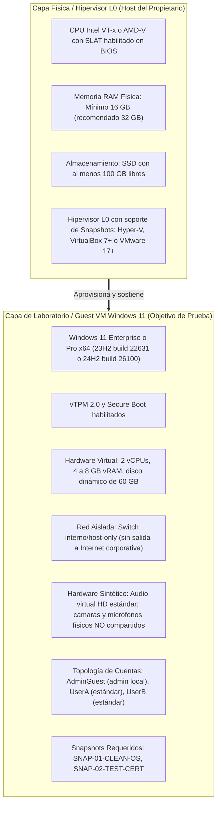

# PrivGuard — Fase 8B.1A.7.2: Rebaseline de Supuestos y Readiness del Laboratorio VM

**Fecha:** 2026-11-07  
**Autor:** Senior .NET/Windows Engineer, Transactional Recovery Architect & Security Auditor  
**Rama activa:** `audit/8b1a7-2-baseline-refresh`  
**HEAD remoto verificado (`origin/main`):** `07e41885f4b0398c05c7193e7191773bb658bd6f`  
**Parent en `main`:** `b9d4b8f1627c74b70b977f509cbc56acc7989ad0`  
**Último workflow CI:** Run #91 (ID: `42390732091`, commit `07e4188`, evento `push`, 7/7 jobs `success`)  
**Veredicto de Rebaseline:** **PASS — Auditoría de supuestos y conciliación estática completada**  
**Readiness del Laboratorio VM:** **HOLD — Requiere acción del propietario en Hipervisor L0**  
**Estado Microsoft Store:** **CONDITIONAL HOLD**  
**Estado Fase 8B.1C:** **BLOCKED / NOT AUTHORIZED**  

---

## 1. Resumen Ejecutivo y Veredicto Oficial

### 1.1 Resumen Ejecutivo
El propósito de este informe es ejecutar un **rebaseline técnico adversarial** previo al inicio de la Fase 8B.1A.7.2 (pruebas dinámicas de almacenamiento MSIX y recuperación en VM aislada).

Los informes y runbooks previos de virtualización (Fases 8B.1A.5, 8B.1A.6 y 8B.1A.7.1) fueron preparados tomando como base el commit histórico `9f856c0405e4e5b64e784309affad450c38d3a37`. Desde ese punto, el código avanzó a través de la integración del Sprint 1.0/1.1 (PR #11, commits `0a270a1`, `391d79e`, merge `ffc2273`), Sprint 1.2 (`d8ca7acc`) y tres commits documentales (`dded99c`, `b9d4b8f`, `07e4188`), alcanzando el HEAD actual `07e4188`.

Esta auditoría estática exhaustiva sobre el código vigente ha determinado:
1. **Supuestos históricos superados:** Las afirmaciones de informes anteriores que señalaban la ausencia de `IPackageIdentityDetector` / `IEditionProfileResolver` en DI, la presencia de `allowElevation` / `unvirtualizedResources` en el manifiesto, y la escritura indiscriminada de Store en `ConsentStore` **están formalmente superadas en código** tras la integración de los Sprints 1.0, 1.1 y 1.2.
2. **Brecha real de almacenamiento (D-05 no implementada en producción):** Aunque `DefaultEditionProfileResolver` calcula rutas aisladas por perfil (`DataDirectory`, `RecoveryDirectory`), **los servicios de almacenamiento en producción (`FileStateStore`, `FilePrivacySessionStore`, `FileActivePrivacySessionMarker`) continúan utilizando rutas globales no segmentadas** (`%LOCALAPPDATA%\PrivGuard` y `%USERPROFILE%\AppData\Local\PrivGvard\Recovery`). La Decisión D-05 permanece pendiente de integración efectiva.
3. **Coordinación y Mutex cross-edition:** `WindowsSingleInstanceGuard` continúa utilizando el mutex global `Global\PrivLock_SingleInstance`. No existen en código las abstracciones conceptuales de `MachineSafetyLatch`, `EndpointClaim` ni leases en `ProgramData` descritas en informes teóricos previos.
4. **Readiness del Entorno:** La inspección del entorno de ejecución actual confirma que sigue siendo un Guest de VirtualBox sin soporte de virtualización anidada (`VirtualizationFirmwareEnabled = False`, `SLAT = False`, 3.98 GB RAM). No es viable ejecutar en este entorno una máquina virtual anidada para las pruebas dinámicas sin una acción previa del propietario en el hipervisor físico L0.

### 1.2 Veredicto Formal

$$\mathbf{VEREDICTO:\ REBASELINE\ PASS\ —\ LAB\ HOLD\ (REQUIRES\ OWNER\ ACTION)}$$

- **Rebaseline de Supuestos:** **PASS**. Los supuestos estáticos están actualizados y alineados con el código real de `07e4188`.
- **Readiness del Laboratorio VM:** **HOLD**. El entorno local actual es un guest sin nested virtualization y recursos insuficientes.
- **Acción requerida del propietario:** Habilitar virtualización anidada en VirtualBox L0 y asignar memoria suficiente (o aprovisionar un host físico con Windows 11 y snapshots).

---

## 2. Baseline de Control de Versiones y Verificación Preflight

### 2.1 Verificación Preflight del Repositorio
Se ejecutaron las comprobaciones no destructivas en el entorno local:
- **Repositorio:** `cristianbarreiro/PrivGuard`
- **Binario Git:** `C:\Users\Cristian\AppData\Local\GitHubDesktop\app-3.6.10\resources\app\git\cmd\git.exe`
- **Rama activa de trabajo:** `audit/8b1a7-2-baseline-refresh` (creada limpiamente a partir de `origin/main`).
- **HEAD verificado de `origin/main`:** `07e41885f4b0398c05c7193e7191773bb658bd6f`
- **Estado del árbol de trabajo:** 100% limpio (`nothing to commit, working tree clean`).
- **Código funcional modificado:** **0 líneas** (esta fase es estrictamente documental y de diagnóstico de solo lectura).

### 2.2 Verificación de GitHub Actions y PRs
- **Workflow Run #91:**
  - **ID:** `42390732091`
  - **URL:** [https://github.com/cristianbarreiro/PrivGuard/actions/runs/42390732091](https://github.com/cristianbarreiro/PrivGuard/actions/runs/42390732091)
  - **Commit:** `07e41885f4b0398c05c7193e7191773bb658bd6f`
  - **Evento disparador:** `push` sobre `main`
  - **Resultado:** `completed / success` (7/7 jobs exitosos). El paso `Validate Release-Store MSIX Packaging (Windows)` finalizó en `success` en Windows y fue omitido (`skipped`) en Ubuntu/macOS.
- **Estado de Pull Requests:** 0 PRs abiertas. La PR #11 permanece cerrada y mergeada (corresponde a Sprint 1.0/1.1; no contiene Sprint 1.2 ni este rebaseline).
- **Protección de rama `main`:** `protected: false`. Los required status checks están desactivados.
- **Trigger `pull_request`:** El run #91, al igual que los runs #89 y #90, fue disparado por evento `push`. El comportamiento del trigger `pull_request` no ha sido demostrado empíricamente en CI.

---

## 3. Matriz de Reconciliación de Supuestos Históricos contra Código Actual

La siguiente tabla confronta las afirmaciones contenidas en los informes históricos (Fases 8B.1A.5, 8B.1A.6 y 8B.1A.7.1) con la realidad del código fuente en el HEAD actual `07e4188`:

| Documento Histórico | Afirmación Histórica | Estado Real en Código Actual (`07e4188`) | Dictamen / Vigencia | Evidencia / Ubicación en Código |
|---|---|---|---|---|
| **8B.1A.5 / 8B.1A.6** (P0-01) | El manifiesto MSIX declara `allowElevation` y `unvirtualizedResources`, violando D-01. | El manifiesto `packaging/Package.appxmanifest` declara **únicamente** `<rescap:Capability Name="runFullTrust" />`. Las capacidades `allowElevation` y `unvirtualizedResources` fueron eliminadas y su ausencia está protegida por tests y CI. | **SUPERSEDIDO** (Resuelto por D-01) | [`packaging/Package.appxmanifest#L59-L61`](file:///c:/Users/Cristian/Documents/GitHub/PrivGuard/packaging/Package.appxmanifest#L59-L61), [`StoreMsixManifestVerifier.cs#L95-L105`](file:///c:/Users/Cristian/Documents/GitHub/PrivGuard/src/PrivLock.Platform.Windows/Packaging/StoreMsixManifestVerifier.cs#L95-L105) |
| **8B.1A.5 / 8B.1A.6** (P0-02) | `IPackageIdentityDetector` e `IEditionProfileResolver` no están registrados en el contenedor de DI en `Program.cs`. | `Program.Main` resuelve el snapshot de identidad y `ConfigureServices` **registra como singletons en DI** tanto `IPackageIdentityDetector` como `IEditionProfileResolver`. También se configura en `WindowsPrivilegedSession`. | **SUPERSEDIDO** (Resuelto por Sprint 1.0) | [`src/PrivLock.Desktop/Program.cs#L25`](file:///c:/Users/Cristian/Documents/GitHub/PrivGuard/src/PrivLock.Desktop/Program.cs#L25), [`src/PrivLock.Desktop/Program.cs#L628-L630`](file:///c:/Users/Cristian/Documents/GitHub/PrivGuard/src/PrivLock.Desktop/Program.cs#L628-L630), [`Program.cs#L682`](file:///c:/Users/Cristian/Documents/GitHub/PrivGuard/src/PrivLock.Desktop/Program.cs#L682) |
| **8B.1A.5 / 8B.1A.6** (P0-03) | `WindowsUserPrivacyManager` escribe directamente en HKCU ConsentStore para Store Edition y no existe uso de `ms-settings:`. | `WindowsUserPrivacyManager` divide sus contratos en Reader y Writer. `SetCameraUserPrivacy` y `SetMicrophoneUserPrivacy` **rechazan explícitamente cualquier intento de escritura si el perfil no es `Standalone`** (D-02). En Store Edition, la mutación de cámara devuelve error dirigiendo a `ms-settings:privacy-webcam`. | **SUPERSEDIDO** (Resuelto por Sprint 1.0 / D-02) | [`WindowsUserPrivacyManager.cs#L62-L71`](file:///c:/Users/Cristian/Documents/GitHub/PrivGuard/src/PrivLock.Platform.Windows/Policies/WindowsUserPrivacyManager.cs#L62-L71), [`WindowsProtectionProvider.cs#L66-L74`](file:///c:/Users/Cristian/Documents/GitHub/PrivGuard/src/PrivLock.Platform.Windows/WindowsProtectionProvider.cs#L66-L74) |
| **8B.1A.5 / 8B.1A.6** (P0-04) | El almacenamiento de Store está aislado por perfil y protegido frente a desinstalación de Windows. | **Falso en tiempo de ejecución.** `FileStateStore`, `FilePrivacySessionStore` y `FileActivePrivacySessionMarker` continúan usando rutas canónicas compartidas (`%LOCALAPPDATA%\PrivGuard` y `AppData\Local\PrivGvard\Recovery`). La segmentación por subdirectorios (`Store` vs `Standalone`) calculada por `DefaultEditionProfileResolver` **no se inyecta en los stores reales**. | **VÁLIDO / PENDIENTE DE RESOLUCIÓN** (D-05 no integrada) | [`Program.cs#L632-L643`](file:///c:/Users/Cristian/Documents/GitHub/PrivGuard/src/PrivLock.Desktop/Program.cs#L632-L643), [`FileStateStore.cs#L24-L30`](file:///c:/Users/Cristian/Documents/GitHub/PrivGuard/src/PrivLock.Infrastructure.Common/Storage/FileStateStore.cs#L24-L30), [`FilePrivacySessionStore.cs#L59-L62`](file:///c:/Users/Cristian/Documents/GitHub/PrivGuard/src/PrivLock.Infrastructure.Common/Storage/FilePrivacySessionStore.cs#L59-L62) |
| **8B.1A.5 / 8B.1A.6** (P0-05) | `HKLM\SOFTWARE\PrivLock\PrivilegedOwnership\v2` actúa como un Machine Recovery Escrow completo. | Se confirma la refutación: HKLM almacena únicamente un fingerprint criptográfico SHA-256, un SID y una etapa. **No almacena datos de reversión de hardware ni snapshots de registro**. Si el WAL del usuario se destruye, el hardware no puede restaurarse desde HKLM. | **VÁLIDO (REFUTACIÓN CONFIRMADA)** | [`WindowsPrivilegedOwnershipStore.cs#L140-L180`](file:///c:/Users/Cristian/Documents/GitHub/PrivGuard/src/PrivLock.Platform.Windows/Privileged/WindowsPrivilegedOwnershipStore.cs#L140-L180) |
| **8B.1A.5 / 8B.1A.6** (P1-01) | `WindowsProtectionProvider` marca `micStandardIsVerified = true` ignorando si el hardware soporta mute físico. | `EvaluateMicrophoneStandardVerification` evalúa `AudioHardwareMuteSummary`. Si el mute es solo por software (`NotSupported` o `Unknown`), **no se otorga verificación de exclusión ni protección en modo exclusivo**, emitiendo advertencia explícita al usuario. | **SUPERSEDIDO** (Resuelto en código) | [`WindowsProtectionProvider.cs#L351-L355`](file:///c:/Users/Cristian/Documents/GitHub/PrivGuard/src/PrivLock.Platform.Windows/WindowsProtectionProvider.cs#L351-L355), [`WindowsProtectionProvider.cs#L481-L494`](file:///c:/Users/Cristian/Documents/GitHub/PrivGuard/src/PrivLock.Platform.Windows/WindowsProtectionProvider.cs#L481-L494) |
| **8B.1A.5** (Problema B) | Archivos `.claim` en `%ProgramData%\PrivGuard\endpoints` resuelven la exclusión mutua cross-edition. | El diseño de claims en `ProgramData` fue declarado inviable por riesgo de *Claim Squatting*, DoS y redirección VFS. **No existe ninguna implementación de claims en código** (`src/**/*.cs` tiene cero referencias). El diseño está descartado. | **VÁLIDO (DISEÑO RECHAZADO)** | Búsqueda exhaustiva en código (`0 coincidencias`). |
| **8B.1A.5** (P1-03) | Existe sincronización cross-edition mediante `Global\PrivGuard_Transaction_Gate` y `OwnerTuple`. | No existen en código. La sincronización se realiza mediante `Global\PrivLock_SingleInstance` y `Global\PrivLock_UninstallGate`. No hay coordinador cross-edition implementado. | **VÁLIDO (NO IMPLEMENTADO)** | [`WindowsSingleInstanceGuard.cs#L12-L15`](file:///c:/Users/Cristian/Documents/GitHub/PrivGuard/src/PrivLock.Platform.Windows/System/WindowsSingleInstanceGuard.cs#L12-L15) |
| **8B.1A.7.1** (Sección 6-7) | El paquete `PrivGuard-2.0.0.0-x64.msix` y su proveniencia generados en `$env:TEMP` son válidos para la prueba en VM. | Dicho paquete y su `BUILD-PROVENANCE.json` fueron generados desde el commit `9f856c0`. **Han quedado desactualizados por 5 commits de código funcional**. No deben reutilizarse. Se requiere un nuevo build reproducible desde el HEAD vigente cuando el laboratorio esté listo. | **SUPERSEDIDO (ARTEFACTO OBSOLETO)** | Historial Git: commits `ffc2273`, `0a270a1`, `391d79e`, `d8ca7ac` modificaron `Program.cs`, manifiesto y controllers. |

---

## 4. Auditoría Estática del Código Vigente (`07e4188`)

### 4.1 Identidad de Paquete y Registro en Contenedor DI
- En `Program.Main` ([línea 25](file:///c:/Users/Cristian/Documents/GitHub/PrivGuard/src/PrivLock.Desktop/Program.cs#L25)), se invoca `ResolveProcessEditionSnapshot()`, que crea de forma inmutable:
  - `WindowsPackageIdentityDetector` (inspecciona `GetCurrentPackageFamilyName` vía P/Invoke).
  - `DefaultEditionProfileResolver` (asigna `Store`, `Standalone` o `UntrustedOrIndeterminate`).
- En `ConfigureServices` ([líneas 628-630](file:///c:/Users/Cristian/Documents/GitHub/PrivGuard/src/PrivLock.Desktop/Program.cs#L628-L630)), se registran como singletons:
  ```csharp
  services.AddSingleton<IPackageIdentityDetector>(resolvedDetector);
  services.AddSingleton<IEditionProfileResolver>(resolvedProfile);
  ```
- En `ConfigureWindowsServices` ([línea 682](file:///c:/Users/Cristian/Documents/GitHub/PrivGuard/src/PrivLock.Desktop/Program.cs#L682)), se configura el resolver en la sesión privilegiada:
  ```csharp
  Platform.Windows.Privileged.WindowsPrivilegedSession.ConfigureDefaultProfileResolver(profileResolver);
  ```
- **Conclusión:** La identidad y el perfil de edición están plenamente integrados en el contenedor DI.

### 4.2 Estado de Almacenamiento: Rutas No Aisladas (Frontera D-05)
A pesar de la existencia de `DefaultEditionProfileResolver`, el contenedor DI en `Program.cs` ([líneas 631-643](file:///c:/Users/Cristian/Documents/GitHub/PrivGuard/src/PrivLock.Desktop/Program.cs#L631-L643)) contiene una nota explícita y registra los stores sin personalizar las rutas:
```csharp
// NOTE (D-05 boundary): Storage, WAL, active markers, logs, and crash reports keep their
// existing canonical paths until D-05 is explicitly approved.
services.AddSingleton<IStateStore, FileStateStore>();
services.AddSingleton<ILegacyArtifactDetector, DefaultLegacyArtifactDetector>();
services.AddSingleton<IActivePrivacySessionMarker>(_ =>
    OperatingSystem.IsWindows()
        ? new FileActivePrivacySessionMarker(GetWindowsActiveMarkerDirectory())
        : new NoOpActivePrivacySessionMarker());
services.AddSingleton<IPrivacySessionStore>(serviceProvider =>
    new FilePrivacySessionStore(
        serviceProvider.GetRequiredService<IActivePrivacySessionMarker>()));
```
- **`FileStateStore`:** Al invocarse con el constructor por defecto, llama a `StorageMigrationHelper.GetDefaultDataDirectory()`, persistiendo `state.json` directamente bajo `%LOCALAPPDATA%\PrivGuard\state.json`.
- **`FilePrivacySessionStore`:** Al instanciarse sin `customDirectory`, utiliza `%LOCALAPPDATA%\PrivGuard\Recovery\privacy-session-v1.json`.
- **`FileActivePrivacySessionMarker`:** Utiliza `GetWindowsActiveMarkerDirectory()` ([líneas 740-747](file:///c:/Users/Cristian/Documents/GitHub/PrivGuard/src/PrivLock.Desktop/Program.cs#L740-L747)), retornando `%USERPROFILE%\AppData\Local\PrivGvard\Recovery` (nótese el uso histórico de `PrivGvard` con 'v').
- **Conclusión:** **D-05 NO está implementada**. Si se instalan ambas ediciones (Store y Standalone) en el mismo perfil de usuario de Windows, compartirán o colisionarán sobre el mismo archivo de estado y diario de recuperación en `%LOCALAPPDATA%`.

### 4.3 Comportamiento y Riesgos de `StorageMigrationHelper`
Al inspeccionar [`StorageMigrationHelper.cs`](file:///c:/Users/Cristian/Documents/GitHub/PrivGuard/src/PrivLock.Infrastructure.Common/Storage/StorageMigrationHelper.cs):
- **Directorios de origen:** Migra desde `%LOCALAPPDATA%\PrivGvard` y `%LOCALAPPDATA%\PrivLock` hacia `%LOCALAPPDATA%\PrivGuard`.
- **Copia de `Recovery`:** Itera sobre `Directory.GetFiles(legacyRecovery)` copiando **todos** los archivos existentes con `File.Copy(file, targetFile, overwrite: false)`.
- **Riesgo:** **No utiliza allowlist de nombres de archivo**. Puede copiar archivos WAL temporales, copias de seguridad corruptas o marcadores de sesión activa (`active-session.marker`) pertenecientes a sesiones huérfanas de instalaciones previas.
- **Manejo de errores:** Captura excepciones globales como no fatales (`catch (Exception ex) { Log.Warning(...) }`).

### 4.4 Coordinación Cross-Edition y Guardia de Instancia Única
- [`WindowsSingleInstanceGuard.cs`](file:///c:/Users/Cristian/Documents/GitHub/PrivGuard/src/PrivLock.Platform.Windows/System/WindowsSingleInstanceGuard.cs#L12-L25) implementa el mutex por defecto `Global\PrivLock_SingleInstance` y el gate de desinstalación `Global\PrivLock_UninstallGate`.
- En `Program.cs` ([línea 703](file:///c:/Users/Cristian/Documents/GitHub/PrivGuard/src/PrivLock.Desktop/Program.cs#L703)), se registra:
  ```csharp
  services.AddSingleton<ISingleInstanceGuard, Platform.Windows.System.WindowsSingleInstanceGuard>();
  ```
- **Conclusión:** No se inyecta el nombre de mutex específico del perfil (`StoreMutexName` o `StandaloneMutexName`). Una instancia de Standalone impedirá el inicio de una instancia de Store y viceversa, bloqueando la ejecución simultánea a nivel de proceso completo mediante `Global\PrivLock_SingleInstance`.

### 4.5 Políticas y ConsentStore (Decisión D-02)
- [`WindowsUserPrivacyManager.cs`](file:///c:/Users/Cristian/Documents/GitHub/PrivGuard/src/PrivLock.Platform.Windows/Policies/WindowsUserPrivacyManager.cs):
  - Separa contratos: `IWindowsUserPrivacyReader` (lectura de estado, permitida en ambas ediciones) e `IWindowsUserPrivacyWriter` (escritura).
  - En `SetCameraUserPrivacy` y `SetMicrophoneUserPrivacy`, valida:
    ```csharp
    if (_editionProfileResolver.Profile != EditionProfile.Standalone)
    {
        return OperationResult.Fail($"Writing to HKCU ConsentStore is prohibited under edition profile '{_editionProfileResolver.ProfileName}'.");
    }
    ```
- En `WindowsProtectionProvider.cs` ([líneas 66-74](file:///c:/Users/Cristian/Documents/GitHub/PrivGuard/src/PrivLock.Platform.Windows/WindowsProtectionProvider.cs#L66-L74)), si se solicita protección Standard de cámara en Store Edition, se rechaza formalmente instruyendo al usuario a abrir `ms-settings:privacy-webcam`.
- **Conclusión:** D-02 está aplicada en código de forma estricta (*fail-closed*).

### 4.6 Control de Endpoints de Audio (Core Audio / WASAPI)
- [`WindowsCoreAudioController.cs`](file:///c:/Users/Cristian/Documents/GitHub/PrivGuard/src/PrivLock.Platform.Windows/Devices/WindowsCoreAudioController.cs):
  - Emplea `IAudioEndpointVolume.SetMute` sobre endpoints de captura activos (`eCapture`).
  - Consulta `QueryHardwareSupport` y extrae la máscara `ENDPOINT_HARDWARE_SUPPORT_MUTE` (`0x00000002`).
  - Evalúa `AudioHardwareMuteSupport` (`Supported`, `NotSupported`, `Unknown`).
  - Realiza verificación inmediata mediante `GetMute` posterior a la mutación (`hr != 0 || verifiedMute != mute`).
- [`WindowsProtectionProvider.cs` (líneas 481-494)](file:///c:/Users/Cristian/Documents/GitHub/PrivGuard/src/PrivLock.Platform.Windows/WindowsProtectionProvider.cs#L481-L494):
  - Diferencia formalmente el nivel de protección: si algún endpoint reporta `NotSupported` o `Unknown`, emite la advertencia formal de que el silenciamiento es únicamente por software y que aplicaciones en *Exclusive Mode* podrían omitir el mute. `StandardIsVerified` permanece en `false` para Exclusive Mode.

### 4.7 Manifiesto MSIX y Validación de Capacidades (Decisión D-01)
- [`packaging/Package.appxmanifest`](file:///c:/Users/Cristian/Documents/GitHub/PrivGuard/packaging/Package.appxmanifest#L59-L61):
  - Declara exclusivamente `<rescap:Capability Name="runFullTrust" />`.
  - No contiene `allowElevation` ni `unvirtualizedResources`.
- Protegido en CI por el gate de Sprint 1.2 (`StoreMsixManifestVerifier` y `verify-store-msix.ps1`), comprobado en los runs #89, #90 y #91.

---

## 5. Diagnóstico de Readiness del Host y Entorno de Virtualización

Se ejecutaron consultas de solo lectura en el entorno actual sin requerir elevación de privilegios:

| Parámetro de Diagnóstico | Valor Observado en Entorno Actual | Evaluación de Viabilidad |
|---|---|---|
| **Sistema Operativo** | Microsoft Windows 11 Enterprise Evaluation | Apto a nivel de SKU para Hyper-V y Sandbox. |
| **Versión / Build** | 10.0.26300 (Build 26300.1, 64-bit) | Versión moderna de Windows 11. |
| **Fabricante / Modelo** | `innotek GmbH` / `VirtualBox` | **Entorno Guest**. Se ejecuta dentro de una VM de VirtualBox. |
| **Hipervisor Detectado (L0)** | `HypervisorPresent = True` | Hipervisor activo en la capa física inferior. |
| **CPU Virtual** | Intel(R) Core(TM) i7-7700HQ @ 2.80GHz (4 vCPU) | Procesador asignado a este guest. |
| **Virtualización Firmware** | `VirtualizationFirmwareEnabled = False` | **BLOQUEO:** Virtualización anidada (*nested VT-x*) deshabilitada en L0. |
| **Extensiones SLAT** | `SecondLevelAddressTranslationExtensions = False` | **BLOQUEO:** No hay soporte de traducción de direcciones de segundo nivel en el guest. |
| **Memoria RAM Total** | 4,274,917,376 bytes (~3.98 GB utilizables) | **BLOQUEO:** Insuficiente para anidar una segunda VM Windows 11 (requiere mín. 8-12 GB en el host). |
| **Memoria RAM Libre** | ~1.15 GB libres | Insuficiente para instanciar cualquier VM anidada. |
| **Espacio Libre en Disco C:** | 25.28 GB libres (de 78.90 GB) | Muy ajustado para hospedar un disco virtual VHDX de 30-60 GB. |
| **Servicio Hyper-V (`vmms`)** | Ausente / No instalado | No disponible. |
| **Cmdlet `Get-VM`** | No disponible (`CommandNotFoundException`) | Módulo de gestión Hyper-V ausente. |
| **Oracle VirtualBox en Guest** | `False` (`VBoxManage.exe` no existe) | No instalado en este entorno. |
| **VMware Workstation en Guest**| `False` (`vmware.exe` no existe) | No instalado en este entorno. |
| **Windows Sandbox en Guest** | `False` (`WindowsSandbox.exe` no existe) | Característica no instalada (requiere nested virt). |

### 5.1 Requisitos Conciliados para el Laboratorio (Host L0 vs. Guest VM)

Es imperativo no mezclar los requisitos de ambas capas de virtualización:



### 5.2 Acciones Concretas Requeridas del Propietario
Para que el laboratorio dinámico sea viable, el propietario debe realizar **una** de las siguientes dos acciones fuera del entorno actual:

- **Opción A (Habilitar virtualización anidada en el Guest actual):**
  1. Apagar completamente esta máquina virtual VirtualBox.
  2. En el host físico del propietario, abrir terminal y habilitar VT-x anidado en esta VM:
     ```powershell
     VBoxManage modifyvm "<NombreDeEstaVM>" --nested-hw-virt on
     ```
  3. Aumentar la memoria RAM asignada a esta VM a un mínimo de **12 GB** (preferiblemente 16 GB) y el tamaño del disco a al menos 120 GB.
  4. Encender la VM y permitir la instalación de Hyper-V o Windows Sandbox dentro de ella.
- **Opción B (Recomendada: Aprovisionar una VM independiente en el Host Físico):**
  1. En la máquina física del propietario (que dispone de recursos suficientes), crear directamente una VM con Windows 11 Enterprise/Pro siguiendo la especificación del Guest VM detallada en la sección 5.1.
  2. Configurar los snapshots `SNAP-01-CLEAN-OS` y `SNAP-02-TEST-CERT`.
  3. Transferir el paquete MSIX y el script de prueba mediante carpeta compartida o ISO virtual para su ejecución en red aislada.

---

## 6. Estado de los Artefactos de Compilación y Proveniencia

### 6.1 Obsolescencia del Paquete de la Fase 8B.1A.7.1
- En la Fase 8B.1A.7.1 se compiló el paquete `PrivGuard-2.0.0.0-x64.msix` (SHA-256: `AE7E3978FA...`) y se generó `BUILD-PROVENANCE.json` a partir del commit `9f856c0`.
- **Dictamen:** Dicho paquete **es histórico y está totalmente obsoleto**. Contiene el manifiesto antiguo con `allowElevation` y `unvirtualizedResources`, carece del registro de perfiles en DI y de las guardas de D-02 en `WindowsUserPrivacyManager`.
- **Prohibición:** **No debe reutilizarse dicho paquete ni sus hashes criptográficos** como evidencia de pruebas dinámicas.

### 6.2 Estrategia de Build para la Fase 8B.1A.7.2
Una vez que el propietario proporcione el entorno de VM viable y autorice el inicio de la Fase 8B.1A.7.2:
1. Se compilará un paquete MSIX fresco directamente desde el HEAD vigente de `main` en ese momento (`07e4188` o superior) utilizando:
   ```powershell
   ./scripts/build-msix.ps1 -Architecture x64 -Configuration Release-Store -ValidateStoreIdentity -OutputDir <OutputDir>
   ```
2. Se extraerá y validará su manifiesto interno mediante `verify-store-msix.ps1`.
3. Se generará un nuevo archivo `BUILD-PROVENANCE.json` con el SHA de Git exacto, hashes SHA-256 de todos los ensamblados empaquetados y la versión de SDK empleada.
4. Dicho paquete generado se trasladará a la VM aislada y se firmará **exclusivamente dentro de la VM** con el certificado autofirmado confinado a `SNAP-02-TEST-CERT`.

---

## 7. Actualización Estática del Runbook Dinámico 8B.1A.7.2

El runbook dinámico mantiene las 11 pruebas normativas, adaptadas estrictamente al código real actual:

1. **TEST-01 (Persistencia física y contención de rutas):** Comprobar si los archivos `state.json`, `privacy-session-v1.json` y `active-session.marker` se escriben en `%LOCALAPPDATA%\PrivGuard` o en `AppData\Local\Packages\cdevstudios.PrivGuard_...\LocalCache\Local\PrivGuard`.
2. **TEST-02 (Aislamiento VFS y LocalCache de MSIX):** Monitorear con ProcMon las operaciones `CreateFileW`, `WriteFile` y `ReplaceFileW` para verificar si Windows redirige las escrituras al contenedor de la aplicación.
3. **TEST-03 (Comportamiento de reemplazo atómico `File.Replace`):** Capturar llamadas Win32 subyacentes durante el guardado del WAL transaccional.
4. **TEST-04 (Lectura y bloqueo de escritura de ConsentStore en HKCU):** Confirmar que la edición Store lee correctamente el estado de privacidad del sistema pero rechaza tajantemente la mutación directa en `HKCU` (cumpliendo D-02).
5. **TEST-05 (Resiliencia ante MSIX App Repair):** Ejecutar `Configuración de Windows → Aplicaciones → PrivGuard → Opciones avanzadas → Reparar` y verificar si el estado y diario de privacidad sobreviven intactos.
6. **TEST-06 (Impacto de MSIX App Reset):** Ejecutar `Restablecer` y comprobar si la purga de `LocalCache` elimina el WAL o si quedan cambios de hardware huérfanos en el sistema.
7. **TEST-07 (Impacto de MSIX Uninstall):** Desinstalar la aplicación y verificar si los endpoints de Core Audio quedan silenciados indefinidamente o si la desinstalación limpia los bloqueos.
8. **TEST-08 (Comportamiento de Mute de Audio y Exclusive Mode):** Probar con una aplicación de audio en modo exclusivo (ej. Audacity con WASAPI Exclusive) si la captura de micrófono es bloqueada o si se produce bypass cuando `HardwareMuteSupport` es `NotSupported`.
9. **TEST-09 (Fast User Switching e Inmunidad Multiusuario):** Iniciar sesión con `UserA`, aplicar bloqueo Standard, cambiar a `UserB` (FUS) y comprobar si las directivas o mutes interfieren entre perfiles.
10. **TEST-10 (Coexistencia con Edición Standalone):** Instalar la edición Standalone junto a la edición Store y verificar si colisionan en `%LOCALAPPDATA%` o si el mutex `Global\PrivLock_SingleInstance` previene la corrupción.
11. **TEST-11 (Manejo de Marcadores Huérfanos tras Crash Simulado):** Forzar terminación del proceso (`taskkill /F`) mientras el marcador activo está presente y comprobar la recuperación en el siguiente arranque.

---

## 8. Preservación Estricta de Decisiones y Salvaguardas

Las siguientes directivas y estados de salvaguarda permanecen inalterados:

- **Decisión D-01:** **Aprobada**. Manifiesto Store conserva exclusivamente `runFullTrust`. Prohibidas `allowElevation` y `unvirtualizedResources`.
- **Decisión D-02:** **Aprobada con condiciones**. Escritura en `ConsentStore` estrictamente prohibida en Store Edition. Lectura permitida. Redirección informativa a `ms-settings:privacy-webcam`.
- **Decisión D-03:** **Aprobación parcial**. Aislamiento conceptual de almacenamiento acordado; integración efectiva en DI y coordinación en tiempo de ejecución pendientes de validación en VM.
- **Decisión D-04:** **Pendiente** de formalización.
- **Decisión D-05:** **Pendiente** de formalización e integración en stores.
- **Microsoft Store:** **CONDITIONAL HOLD**. Prohibida la publicación en la tienda hasta completar la validación en VM y resolver la arquitectura de almacenamiento.
- **Fase 8B.1C:** **BLOCKED / NOT AUTHORIZED**. Queda terminantemente prohibido cualquier desarrollo o avance en esta fase.
- **Fase 8B.1A.7.2:** **No ejecutada**. Bloqueada hasta la provisión del laboratorio VM adecuado por parte del propietario.

---

## 9. Próximos Pasos Recomendados

1. **Acción del Propietario en Capa Física (L0):** Habilitar virtualización anidada y ampliar recursos en el hipervisor L0, o aprovisionar una máquina virtual Windows 11 aislada e independiente con capacidad de snapshots según las especificaciones de la sección 5.1.
2. **Reconstrucción del Paquete MSIX de Prueba:** Una vez disponible la VM de laboratorio, ejecutar la compilación de `PrivGuard-2.0.0.0-x64.msix` y generación de proveniencia desde el HEAD vigente de `main`.
3. **Ejecución Asistida del Runbook en VM:** Ejecutar la batería de pruebas dinámicas (TEST-01 a TEST-11) registrando trazas ProcMon y capturas de estado antes de autorizar cualquier cambio de arquitectura en almacenamiento (D-05).
