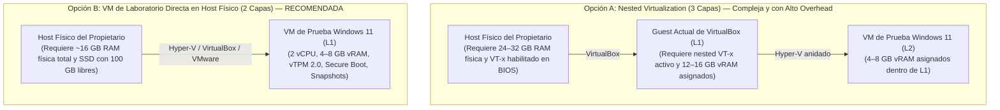

# PrivGuard — Fase 8B.1A.7.2: Rebaseline de Supuestos y Readiness del Laboratorio VM (Revisión Factual y Corrección Estática)

**Fecha de emisión:** 2026-11-07<br />
**Fecha de revisión factual:** 2026-11-07<br />
**Autor:** Senior .NET/Windows Engineer, Transactional Recovery Architect & Security Auditor<br />
**Rama activa de corrección:** `docs/correct-8b1a7-2-rebaseline-findings`<br />
**HEAD remoto verificado (`origin/main`):** `653be31040da53bea72a540ddb2a111f16b35d50`<br />
**Parent en `main`:** `07e41885f4b0398c05c7193e7191773bb658bd6f`<br />
**Último workflow CI:** Run #92 (ID: `42396473407`, commit `653be31`, evento `push`, **7/7 jobs `success`**)<br />
**Veredicto de Rebaseline:** **PASS — Auditoría estática y conciliación factual corregida**<br />
**Readiness del Laboratorio VM:** **HOLD — Requiere aprovisionamiento/acción del propietario en Hipervisor L0**<br />
**Estado Microsoft Store:** **CONDITIONAL HOLD**<br />
**Estado Fase 8B.1C:** **BLOCKED / NOT AUTHORIZED**  

---

## 1. Resumen Ejecutivo y Veredicto Formal

### 1.1 Resumen Ejecutivo
El presente documento constituye la **revisión factual y correctiva** del rebaseline técnico de la Fase 8B.1A.7.2 (pruebas dinámicas de almacenamiento MSIX y recuperación transaccional en VM aislada).

Los informes y runbooks previos de virtualización (Fases 8B.1A.5, 8B.1A.6 y 8B.1A.7.1) fueron redactados tomando como base el commit histórico `9f856c0405e4e5b64e784309affad450c38d3a37`. Desde dicho punto, la historia del repositorio avanzó mediante 5 commits en el rango `9f856c0..d8ca7acc` (Sprint 1.0, 1.1 y 1.2) seguidos de 4 commits documentales posteriores (`dded99c`, `b9d4b8f`, `07e4188` y `653be31`), alcanzando el HEAD remoto actual `653be31`.

Esta revisión introduce precisiones técnicas indispensables:
1. **Distinción entre Ruta Lógica y Ubicación Física MSIX:** En el código actual, `FileStateStore`, `FilePrivacySessionStore` y `FileActivePrivacySessionMarker` solicitan rutas canónicas ordinarias de `%LOCALAPPDATA%`, sin inyectar las propiedades aisladas de `DefaultEditionProfileResolver` (confirmando que **D-05 no está integrada en la composición de los stores**). Sin embargo, esto no demuestra que Store y Standalone colisionen físicamente en el mismo archivo: la ubicación física real de Store bajo MSIX depende de la virtualización de AppData y LocalCache (`AppData\Local\Packages\cdevstudios.PrivGuard_...\LocalCache`), lo cual es una **hipótesis que debe verificarse dinámicamente con ProcMon dentro de la VM**.
2. **Nombre Canónico del Marcador y Desinstalador Standalone:** El nombre exacto del marcador en código es `active-session-v1.marker`. El desinstalador Inno Setup (`installer/setup.iss`) inspecciona `%USERPROFILE%\AppData\Local\PrivGvard\Recovery\` y `PrivGuard\Recovery\`, pero **no inspecciona el contenedor virtualizado `Packages` de MSIX**, lo que representa un riesgo de invisibilidad que debe probarse en el laboratorio.
3. **Significado Exacto de `HypervisorPresent`:** La propiedad `HypervisorPresent = True` obtenida por WMI/CIM se observó desde el interior de un Guest de VirtualBox (`innotek GmbH / VirtualBox`). Indica que el sistema Windows invitado detecta un hipervisor expuesto, pero **no aporta evidencia sobre la CPU física, BIOS/UEFI ni recursos reales del host físico L0**, los cuales son desconocidos desde esta inspección.
4. **Topología de Virtualización (Tres Capas vs. VM en Host Físico):** La propuesta de ejecutar virtualización anidada dentro del Guest actual involucra tres capas (L0: host físico, L1: guest actual, L2: VM de prueba), requiriendo overhead y recursos sustanciales en el host. Se ratifica como alternativa recomendada y más sencilla la provisión de una VM Windows 11 directamente en el host físico (L0/L1).
5. **Cadena de Custodia Criptográfica del MSIX:** Se establece formalmente que el SHA-256 del paquete unsigned generado en build y el SHA-256 del paquete final firmado dentro de la VM son distintos y deben registrarse de forma diferenciada en la proveniencia del laboratorio.

### 1.2 Veredicto Oficial

$$\mathbf{VEREDICTO:\ REBASELINE\ PASS\ —\ LAB\ HOLD\ (REQUIRES\ OWNER\ ACTION)}$$

- **Rebaseline de Supuestos:** **PASS**. Se eliminan afirmaciones no demostradas sobre colisión física o conocimiento de L0, delimitando con precisión qué está resuelto en código y qué permanece como hipótesis para VM.
- **Readiness del Laboratorio VM:** **HOLD**. El entorno local actual es un guest sin virtualización anidada expuesta y recursos insuficientes. Se requiere acción del propietario en el host físico.
- **Salvaguardas Invariantes:** Microsoft Store en `CONDITIONAL HOLD`, Fase 8B.1C en `BLOCKED / NOT AUTHORIZED`.

---

## 2. Baseline de Control de Versiones e Integración Factual

### 2.1 Verificación de Git y Remoto
- **Repositorio:** `cristianbarreiro/PrivGuard`
- **Rama activa de corrección:** `docs/correct-8b1a7-2-rebaseline-findings` (creada limpiamente desde `origin/main`).
- **HEAD Remoto Canónico:** `653be31040da53bea72a540ddb2a111f16b35d50`
- **Forma Real de Integración:** El commit `653be31` (`docs: rebaseline 8B.1A.7.2 against current code`) fue integrado directamente en `main` sin Pull Request. La rama `main` presenta `protected: false` y required status checks desactivados en GitHub Settings.
- **Estado del Árbol de Trabajo:** Limpio (`nothing to commit, working tree clean`).
- **Código Funcional Modificado:** **0 líneas**. Esta revisión es estrictamente documental.

### 2.2 Evidencia de GitHub Actions (Run #92)
- **Workflow Run ID:** `42396473407`
- **URL:** [https://github.com/cristianbarreiro/PrivGuard/actions/runs/42396473407](https://github.com/cristianbarreiro/PrivGuard/actions/runs/42396473407)
- **Commit analizado:** `653be31040da53bea72a540ddb2a111f16b35d50`
- **Rama:** `main` | **Evento:** `push`
- **Estado / Conclusión:** `completed / success`
- **Jobs:** **7/7 jobs finalizados en `success`**:
  1. `Build & Test (windows-latest)`: `success` (incluye paso `Validate Release-Store MSIX Packaging (Windows)` en `success`).
  2. `Build & Test (ubuntu-latest)`: `success` (paso MSIX omitido / `skipped`).
  3. `Build & Test (macos-latest)`: `success` (paso MSIX omitido / `skipped`).
  4. `Publish Single-File (win-x64)`: `success`.
  5. `Publish Single-File (linux-x64)`: `success`.
  6. `Publish Single-File (osx-arm64)`: `success`.
  7. `Publish Single-File (win-arm64)`: `success`.

> [!IMPORTANT]
> **Ausencia de Evidencia en Evento `pull_request`:** Los cuatro runs del gate de empaquetado (#89, #90, #91 y #92) correspondieron exclusivamente a eventos de tipo `push` sobre la rama `main`. **El comportamiento del workflow en el evento `pull_request` permanece formalmente sin demostración empírica**.

---

## 3. Matriz de Reconciliación Corregida de Supuestos Históricos

La siguiente tabla confronta las afirmaciones de informes históricos frente a la realidad del código en `653be31`, delimitando qué constituye código implementado y qué es una hipótesis que requiere validación en VM:

| Documento Histórico | Afirmación Histórica | Estado Real en Código Actual (`653be31`) | Dictamen de Vigencia | Evidencia / Ubicación en Código |
|---|---|---|---|---|
| **8B.1A.5 / 8B.1A.6** (P0-01) | El manifiesto MSIX declara `allowElevation` y `unvirtualizedResources`, violando D-01. | El manifiesto `packaging/Package.appxmanifest` declara **únicamente** `<rescap:Capability Name="runFullTrust" />`. Las capacidades `allowElevation` y `unvirtualizedResources` fueron eliminadas y su ausencia está protegida por 16 tests unitarios y el CI gate. | **SUPERSEDIDO** (Resuelto por D-01) | [`packaging/Package.appxmanifest#L59-L61`](file:///c:/Users/Cristian/Documents/GitHub/PrivGuard/packaging/Package.appxmanifest#L59-L61)<br />[`StoreMsixManifestVerifier.cs#L95-L105`](file:///c:/Users/Cristian/Documents/GitHub/PrivGuard/src/PrivLock.Platform.Windows/Packaging/StoreMsixManifestVerifier.cs#L95-L105) |
| **8B.1A.5 / 8B.1A.6** (P0-02) | `IPackageIdentityDetector` e `IEditionProfileResolver` no están registrados en el contenedor de DI en `Program.cs`. | `Program.Main` resuelve el snapshot inmutable y `ConfigureServices` **registra como singletons en DI** tanto `IPackageIdentityDetector` como `IEditionProfileResolver`. También se configura en `WindowsPrivilegedSession`. | **SUPERSEDIDO** (Resuelto por Sprint 1.0) | [`Program.cs#L25`](file:///c:/Users/Cristian/Documents/GitHub/PrivGuard/src/PrivLock.Desktop/Program.cs#L25)<br />[`Program.cs#L628-L630`](file:///c:/Users/Cristian/Documents/GitHub/PrivGuard/src/PrivLock.Desktop/Program.cs#L628-L630)<br />[`Program.cs#L682`](file:///c:/Users/Cristian/Documents/GitHub/PrivGuard/src/PrivLock.Desktop/Program.cs#L682) |
| **8B.1A.5 / 8B.1A.6** (P0-03) | `WindowsUserPrivacyManager` escribe directamente en HKCU ConsentStore para Store Edition y no existe uso de `ms-settings:`. | `WindowsUserPrivacyManager` divide sus contratos en Reader y Writer. `SetCameraUserPrivacy` y `SetMicrophoneUserPrivacy` **rechazan explícitamente cualquier intento de escritura si el perfil no es `Standalone`** (D-02). En Store Edition, la mutación de cámara devuelve error dirigiendo a `ms-settings:privacy-webcam`. | **SUPERSEDIDO** (Resuelto por Sprint 1.0 / D-02) | [`WindowsUserPrivacyManager.cs#L62-L71`](file:///c:/Users/Cristian/Documents/GitHub/PrivGuard/src/PrivLock.Platform.Windows/Policies/WindowsUserPrivacyManager.cs#L62-L71)<br />[`WindowsProtectionProvider.cs#L66-L74`](file:///c:/Users/Cristian/Documents/GitHub/PrivGuard/src/PrivLock.Platform.Windows/WindowsProtectionProvider.cs#L66-L74) |
| **8B.1A.5 / 8B.1A.6** (P0-04) | El almacenamiento de Store está aislado por perfil y protegido frente a desinstalación de Windows. | **Precisión requerida:** En código, `FileStateStore`, `FilePrivacySessionStore` y `FileActivePrivacySessionMarker` solicitan rutas lógicas ordinarias (`%LOCALAPPDATA%\PrivGuard` y `AppData\Local\PrivGvard\Recovery`) sin consumir el resolver (D-05 no integrada en DI). **Sin embargo, la ubicación física efectiva bajo MSIX puede verse afectada por la virtualización VFS/LocalCache**. La colisión física o el aislamiento efectivo son **hipótesis que deben demostrarse con ProcMon en VM**. | **PARCIALMENTE VÁLIDO / HIPÓTESIS REQUIERE VM** | [`Program.cs#L632-L643`](file:///c:/Users/Cristian/Documents/GitHub/PrivGuard/src/PrivLock.Desktop/Program.cs#L632-L643)<br />[`FileStateStore.cs#L24-L30`](file:///c:/Users/Cristian/Documents/GitHub/PrivGuard/src/PrivLock.Infrastructure.Common/Storage/FileStateStore.cs#L24-L30)<br />[`FilePrivacySessionStore.cs#L59-L62`](file:///c:/Users/Cristian/Documents/GitHub/PrivGuard/src/PrivLock.Infrastructure.Common/Storage/FilePrivacySessionStore.cs#L59-L62) |
| **8B.1A.5 / 8B.1A.6** (P0-05) | `HKLM\SOFTWARE\PrivLock\PrivilegedOwnership\v2` actúa como un Machine Recovery Escrow completo. | Se confirma la refutación: HKLM almacena únicamente un fingerprint criptográfico SHA-256, un SID y una etapa. **No almacena datos de reversión de hardware ni snapshots de registro**. Si el WAL del usuario se destruye, el hardware no puede restaurarse desde HKLM. | **VÁLIDO (REFUTACIÓN CONFIRMADA)** | [`WindowsPrivilegedOwnershipStore.cs#L140-L180`](file:///c:/Users/Cristian/Documents/GitHub/PrivGuard/src/PrivLock.Platform.Windows/Privileged/WindowsPrivilegedOwnershipStore.cs#L140-L180) |
| **8B.1A.5 / 8B.1A.6** (P1-01) | `WindowsProtectionProvider` marca `micStandardIsVerified = true` ignorando si el hardware soporta mute físico. | `EvaluateMicrophoneStandardVerification` evalúa `AudioHardwareMuteSummary`. Si el mute es solo por software (`NotSupported` o `Unknown`), **no se otorga verificación de exclusión ni protección en modo exclusivo**, emitiendo advertencia explícita al usuario. | **SUPERSEDIDO** (Resuelto en código) | [`WindowsProtectionProvider.cs#L351-L355`](file:///c:/Users/Cristian/Documents/GitHub/PrivGuard/src/PrivLock.Platform.Windows/WindowsProtectionProvider.cs#L351-L355)<br />[`WindowsProtectionProvider.cs#L481-L494`](file:///c:/Users/Cristian/Documents/GitHub/PrivGuard/src/PrivLock.Platform.Windows/WindowsProtectionProvider.cs#L481-L494) |
| **8B.1A.5** (Problema B) | Archivos `.claim` en `%ProgramData%\PrivGuard\endpoints` resuelven la exclusión mutua cross-edition. | El diseño de claims en `ProgramData` fue declarado inviable por riesgo de *Claim Squatting*, DoS y redirección VFS. **No existe ninguna implementación de claims en código** (`src/**/*.cs` tiene cero referencias). El diseño está formalmente descartado. | **VÁLIDO (DISEÑO RECHAZADO)** | Búsqueda global en código (`0 coincidencias`). |
| **8B.1A.5** (P1-03) | Existe sincronización cross-edition mediante `Global\PrivGuard_Transaction_Gate` y `OwnerTuple`. | No existen en código. La sincronización se realiza mediante `Global\PrivLock_SingleInstance` y `Global\PrivLock_UninstallGate`. No hay coordinador cross-edition implementado. | **VÁLIDO (NO IMPLEMENTADO)** | [`WindowsSingleInstanceGuard.cs#L12-L15`](file:///c:/Users/Cristian/Documents/GitHub/PrivGuard/src/PrivLock.Platform.Windows/System/WindowsSingleInstanceGuard.cs#L12-L15) |
| **8B.1A.7.1** (Sección 6-7) | El paquete `PrivGuard-2.0.0.0-x64.msix` y su proveniencia generados en `$env:TEMP` son válidos para la prueba en VM. | Dicho paquete y su `BUILD-PROVENANCE.json` fueron generados desde el commit `9f856c0`. El historial contiene 5 commits en el rango `9f856c0..d8ca7acc` que alteraron código funcional y de packaging. **El artefacto está formalmente obsoleto** y debe reconstruirse desde el HEAD vigente cuando el laboratorio esté listo. | **SUPERSEDIDO (ARTEFACTO OBSOLETO)** | Historial Git: rango `9f856c0..d8ca7acc` (commits `0a270a1`, `391d79e`, `d8ca7ac`). |

---

## 4. Corrección de Hallazgos Estáticos en Código Vigente

### 4.1 Ruta Lógica vs. Ubicación Física MSIX (Frontera D-05)
Es necesario distinguir con rigor técnico tres capas:
1. **Ruta lógica solicitada por el código (.NET):**
   - `FileStateStore` solicita `StorageMigrationHelper.GetDefaultDataDirectory()` -> `%LOCALAPPDATA%\PrivGuard\state.json`.
   - `FilePrivacySessionStore` solicita `.../Recovery/privacy-session-v1.json`.
   - `FileActivePrivacySessionMarker` solicita `GetWindowsActiveMarkerDirectory()` -> `%USERPROFILE%\AppData\Local\PrivGvard\Recovery\active-session-v1.marker`.
   - `DefaultEditionProfileResolver` calcula `DataDirectory` (`.../Store` o `.../Standalone`), pero **dichas rutas no son inyectadas en la construcción de los tres stores citados** (`Program.cs` líneas 632-643). Por ende, **D-05 no está integrada en DI**.
2. **Ubicación física efectiva en Standalone no empaquetado:** Se escribe directamente en el sistema de archivos ordinario (`%LOCALAPPDATA%\PrivGuard`).
3. **Ubicación física efectiva en Store MSIX (Contenedor Desktop Bridge):** Las aplicaciones empaquetadas con capacidad `runFullTrust` en Windows 10/11 pueden experimentar redirección VFS hacia `AppData\Local\Packages\cdevstudios.PrivGuard_...\LocalCache\Local\...` o acceso nativo dependiendo de las políticas de virtualización del kernel de Windows.
   - **Corrección factual:** **No se puede afirmar a priori que ambas ediciones "colisionarán físicamente"**. Tampoco se puede afirmar que estén aisladas. Se trata de un **riesgo arquitectónico que debe ser demostrado empíricamente mediante trazas ProcMon (`CreateFileW`, `WriteFile`, `ReplaceFileW`) en el laboratorio VM**.

### 4.2 Marcador Activo y Desinstalador Inno Setup (`setup.iss`)
- **Nombre Canónico del Marcador:** En [`FileActivePrivacySessionMarker.cs#L13`](file:///c:/Users/Cristian/Documents/GitHub/PrivGuard/src/PrivLock.Infrastructure.Common/Storage/FileActivePrivacySessionMarker.cs#L13) la constante es explícitamente:
  ```csharp
  public const string FileName = "active-session-v1.marker";
  ```
- **Riesgo en Desinstalador Standalone:** Al inspeccionar [`installer/setup.iss`](file:///c:/Users/Cristian/Documents/GitHub/PrivGuard/installer/setup.iss#L18-L21), el script busca `active-session-v1.marker` en:
  - `AppData\Local\PrivGvard\Recovery\`
  - `AppData\Local\PrivLock\Recovery\`
  - `AppData\Local\PrivGuard\Recovery\`
  **`setup.iss` no inspecciona las rutas virtualizadas de paquetes en `AppData\Local\Packages\`**. Si Store MSIX escribe su marcador dentro de `LocalCache`, el desinstalador Standalone no detectará la sesión activa de Store, pudiendo desinstalar componentes compartidos mientras Store tiene mutes aplicados. Este comportamiento debe probarse en TEST-10.

### 4.3 Cuantificación Rigurosa de Commits (`9f856c0..d8ca7acc`)
El rango entre el commit de referencia de 8B.1A.7.1 (`9f856c0`) y el cierre de código de Sprint 1.2 (`d8ca7acc`) contiene exactamente **5 commits** (`git rev-list --count 9f856c0..d8ca7acc` = 5):
1. `7066b3b` — **Documental:** Registro de informes de Fase 8B.1A y proveniencia.
2. `0a270a1` — **Funcional / Packaging:** Integración de perfiles Store/Standalone, guardas D-01/D-02 y manifiesto depurado.
3. `391d79e` — **Funcional:** Inmutabilidad de perfil y rechazo fail-closed de mutaciones parciales `Both` en Store.
4. `ffc2273` — **Merge:** Fusión de Pull Request #11 (`feature/sprint-1-store-profile-guards-d01-d02`).
5. `d8ca7ac` — **CI / Packaging:** Incorporación del gate de validación Release-Store en `.github/workflows/ci.yml`.

Posteriormente, entre `d8ca7acc` y el HEAD actual `653be31` existen **4 commits exclusivamente documentales** (`dded99c`, `b9d4b8f`, `07e4188`, `653be31`).

**Conclusión:** El artefacto MSIX de `9f856c0` está obsoleto porque precede a dos commits de código funcional (`0a270a1`, `391d79e`) y al commit del gate de CI/packaging (`d8ca7ac`).

### 4.4 Guardia de Instancia Única y Coordinación Cross-Edition
- [`WindowsSingleInstanceGuard.cs`](file:///c:/Users/Cristian/Documents/GitHub/PrivGuard/src/PrivLock.Platform.Windows/System/WindowsSingleInstanceGuard.cs#L12) define `Global\PrivLock_SingleInstance`.
- `Program.cs` registra este guard sin pasar los nombres específicos calculados por el resolver (`StoreMutexName` / `StandaloneMutexName`).
- **Alcance real:** El mutex global impide que ambas ediciones se ejecuten concurrentemente como procesos independientes en la misma sesión interactiva (la segunda fallará al adquirir el mutex global). **Esto es una exclusión de proceso, no un coordinador transaccional de recursos**. No previene conflictos de almacenamiento si se ejecutan secuencialmente, no coordina leases de hardware y no sustituye la formalización de D-03 / D-05.

---

## 5. Diagnóstico de Readiness del Entorno y Modelo de Capas

### 5.1 Parámetros Diagnósticos Observados (Solo Lectura)
Las consultas WMI/CIM ejecutadas desde el entorno actual reportan:

| Parámetro | Valor Observado | Interpretación Factual Rigurosa |
|---|---|---|
| **OS / Build** | Windows 11 Enterprise Eval (Build 26300, 64-bit) | Sistema operativo de la máquina donde corre el agente. |
| **Manufacturer / Model** | `innotek GmbH` / `VirtualBox` | **Confirma que el entorno actual es un Guest de VirtualBox**. |
| **HypervisorPresent** | `True` | **El sistema invitado detecta un hipervisor expuesto**. No aporta información sobre el hardware ni configuración del host físico L0. |
| **CPU Virtual** | Intel Core i7-7700HQ @ 2.80GHz (4 vCPU) | Procesador virtual asignado a este guest. |
| **VirtualizationFirmwareEnabled** | `False` | **Virtualización anidada no expuesta** a este guest según la consulta. |
| **SLAT Extensions** | `False` | Extensiones de traducción de segundo nivel no expuestas al guest. |
| **Memoria RAM** | 3.98 GB utilizables (~1.15 GB libres) | Memoria asignada a este guest; insuficiente para hospedar otra VM. |
| **Disco C:** | 25.28 GB libres (de 78.90 GB) | Espacio ajustado para discos virtuales anidados. |
| **Herramientas de Virtualización** | `vmms`, `Get-VM`, VirtualBox, VMware, Sandbox ausentes | Ningún hipervisor utilizable dentro del guest. |

### 5.2 Modelo de Topologías: Tres Capas vs. VM en Host Físico



- **Evaluación de Topología A (Tres Capas):** Asignar 12-16 GB a la VM actual requiere que el host físico disponga de al menos 24 a 32 GB de RAM física para evitar swap y caídas. Además, la virtualización anidada dentro de VirtualBox puede presentar inestabilidades con vTPM y Secure Boot en Windows 11.
- **Evaluación de Topología B (Dos Capas — Recomendada):** Crear la VM de laboratorio directamente en el host físico del propietario con Hyper-V, VirtualBox o VMware Workstation. Demanda únicamente ~16 GB de RAM física total, simplifica la gestión de snapshots (`SNAP-01-CLEAN-OS`, `SNAP-02-TEST-CERT`) y garantiza el aislamiento de dispositivos físicos.

---

## 6. Cadena de Custodia Criptográfica del Artefacto MSIX

Para garantizar la integridad y trazabilidad absoluta cuando se habilite el laboratorio, se establece la separación estricta de hashes:

1. **Fase de Compilación (Build Stage — Fuera de la VM):**
   - Se compila el paquete unsigned desde el HEAD vigente de `main` con `scripts/build-msix.ps1 -Configuration Release-Store -ValidateStoreIdentity`.
   - Se registran en `BUILD-PROVENANCE.json`:
     - SHA del commit Git canónico.
     - Versión del .NET SDK y Windows SDK utilizados.
     - **SHA-256 del archivo `.msix` unsigned generado.**
     - **SHA-256 de los ensamblados en el directorio de staging (`win-x64`).**
     - SHA-256 de `AppxManifest.xml` y `resources.pri`.
2. **Fase de Transferencia y Test-Signing (Exclusivamente Dentro del Guest VM):**
   - El paquete unsigned se transfiere a la VM (en red aislada).
   - Se verifica que el SHA-256 del paquete recibido coincida exactamente con el SHA-256 unsigned de proveniencia.
   - Sobre el snapshot `SNAP-02-TEST-CERT`, se firma el paquete con la herramienta oficial `SignTool.exe` usando el certificado autofirmado confinado a la VM.
   - **Se calcula y registra el nuevo SHA-256 del archivo `.msix` firmado resultante.**
   - Se registra el Thumbprint del certificado de prueba y se verifica que dicho certificado no exista ni se instale en el host físico del propietario.

---

## 7. Actualización del Runbook Dinámico 8B.1A.7.2 (TEST-01 a TEST-11)

### Gate de Seguridad Previo a Pruebas Destructivas (TEST-06 / TEST-07)
Antes de ejecutar pruebas de Reset o Uninstall:
- La VM debe tener su red en modo privado/aislado y no compartir micrófonos ni cámaras físicas del host.
- Debe comprobarse la capacidad de revertir la VM al snapshot `SNAP-02-TEST-CERT`.
- Deben registrarse las claves de registro de ConsentStore, el estado de endpoints de audio y los contenidos de AppData antes de la operación.

### Secuencia de Pruebas Normativas Actualizada
1. **TEST-01 (Persistencia física y contención de rutas):** Verificar si `state.json`, `privacy-session-v1.json` y `active-session-v1.marker` se escriben en `%LOCALAPPDATA%\PrivGuard` o si son redirigidos a `AppData\Local\Packages\cdevstudios.PrivGuard_...\LocalCache`.
2. **TEST-02 (Trazas ProcMon de VFS y LocalCache):** Capturar llamadas Win32 `CreateFileW`, `WriteFile`, `SetRenameInformationFile` y `ReplaceFileW` para auditar la redirección del contenedor.
3. **TEST-03 (Reemplazo Atómico `File.Replace`):** Comprobar si `File.Replace` opera sobre el mismo volumen virtualizado o si genera códigos de error Win32 bajo el VFS de MSIX.
4. **TEST-04 (ConsentStore HKCU en Store Edition):** Confirmar que Store Edition lee el estado de ConsentStore pero devuelve error y no escribe en el registro ante intentos de mutación (D-02).
5. **TEST-05 (Resiliencia ante MSIX App Repair):** Ejecutar `Reparar` desde Configuración de Windows y verificar la supervivencia de datos en `LocalCache`.
6. **TEST-06 (Impacto de MSIX App Reset):** Ejecutar `Restablecer` y comprobar si la purga de `LocalCache` elimina el WAL y si quedan endpoints de hardware muteados sin posibilidad de reversión.
7. **TEST-07 (Impacto de MSIX Uninstall):** Desinstalar Store Edition y verificar si los endpoints de Core Audio quedan silenciados indefinidamente.
8. **TEST-08 (Mute de Core Audio y Exclusive Mode):** Probar con aplicación en modo exclusivo (ej. Audacity WASAPI Exclusive) si la captura es bloqueada o si se produce bypass cuando `HardwareMuteSupport` es `NotSupported`.
9. **TEST-09 (Fast User Switching e Inmunidad Multiusuario):** Iniciar sesión con `UserA`, silenciar micrófono, cambiar a `UserB` (FUS) y comprobar si las sesiones de audio interfieren.
10. **TEST-10 (Coexistencia con Edición Standalone):**
    - *Paso 10.1:* Intentar ejecutar simultáneamente ambas ediciones; verificar que `Global\PrivLock_SingleInstance` impide la concurrencia.
    - *Paso 10.2:* Ejecutar secuencialmente y registrar con ProcMon si ambas escriben en la misma ruta física o en rutas aisladas.
    - *Paso 10.3:* Verificar si el desinstalador Inno Setup (`setup.iss`) detecta el `active-session-v1.marker` de Store si este reside en `LocalCache`.
11. **TEST-11 (Recuperación de Marker y WAL tras Caída Simada):** Simular caída del proceso (`taskkill /F`) mientras el marcador activo está presente; reiniciar la aplicación y verificar que la recuperación automática restaura el estado sin intervención manual.

---

## 8. Preservación Estricta de Decisiones Arquitectónicas y Salvaguardas

Las decisiones y estados de salvaguarda del proyecto se mantienen rigurosamente:

- **Decisión D-01:** **Aprobada**. Manifiesto Store contiene exclusivamente `runFullTrust`. Prohibidas `allowElevation` y `unvirtualizedResources`.
- **Decisión D-02:** **Aprobada con condiciones**. Escritura en `ConsentStore` prohibida en Store Edition. Lectura permitida. Redirección informativa a `ms-settings:privacy-webcam`.
- **Decisión D-03:** **Aprobación parcial**. Aislamiento conceptual de almacenamiento acordado; integración efectiva de rutas en DI y coordinación en tiempo de ejecución pendientes de prueba en VM.
- **Decisión D-04:** **Pendiente** de formalización.
- **Decisión D-05:** **Pendiente** de formalización y de integración en los stores reales.
- **Microsoft Store:** **`CONDITIONAL HOLD`** (publicación bloqueada).
- **Fase 8B.1C:** **`BLOCKED / NOT AUTHORIZED`** (desarrollo prohibido).
- **Fase 8B.1A.7.2:** **No ejecutada** (bloqueada por entorno de laboratorio).

---

## 9. Próximos Pasos Recomendados

1. **Aprobación de la Corrección Documental:** Consolidar este informe en el repositorio mediante Pull Request hacia `main`.
2. **Acción del Propietario en el Host Físico (L0):** Aprovisionar una máquina virtual Windows 11 independiente en el host físico según las especificaciones de la Topología B (sección 5.2).
3. **Generación de Artefactos desde HEAD Vigente:** Tras disponer de la VM, compilar el paquete `Release-Store` desde el HEAD canónico actual y registrar la doble proveniencia criptográfica (unsigned y signed).
4. **Ejecución del Runbook 8B.1A.7.2:** Llevar a cabo los tests normativos TEST-01 a TEST-11 en la VM aislada con capturas de ProcMon.
