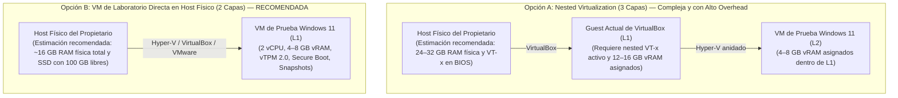

# PrivGuard — Fase 8B.1A.7.2-R2: Rebaseline de Supuestos, Readiness del Laboratorio VM, Máquina de Estados FUS y Preflight de Host (Revisión Factual y Corrección Estática R2)

**Fecha de emisión original:** 2026-11-07<br />
**Fecha de revisión factual R1:** 2026-11-07<br />
**Fecha de revisión factual R2:** 2026-11-07<br />
**Autor:** Principal .NET / Windows Security Engineer & Transactional Recovery Auditor<br />
**Rama activa de trabajo:** `docs/8b1a7-2-r2-fus-handoff-state-machine`<br />
**Baseline de código auditado:** `653be31040da53bea72a540ddb2a111f16b35d50`<br />
**HEAD documental remoto (`origin/main`):** `405f948d9267a5e7c8b4b0b2f74eeedf799cbf9d`<br />
**Parent directo en `main`:** `11a7e497a212000809084d56cb3c596ccd3c6f43`<br />
**Parent funcional anterior (Baseline auditado):** `653be31040da53bea72a540ddb2a111f16b35d50`<br />
**Último workflow CI:** Run #97 (ID: `42428357398`, commit `405f948d9267a5e7c8b4b0b2f74eeedf799cbf9d`, evento `push`, **7/7 jobs `success`**)<br />
**Workflows CI previos relevantes:**<br />
- Run #96 (ID: `42426468347`, commit `11a7e497a212000809084d56cb3c596ccd3c6f43`, evento `push`, **7/7 jobs `success`**)<br />
- Run #95 (ID: `42420318570`, commit `fc345ebd06239e8b86c0c502a4b289052e988a8c`, evento `push`, **7/7 jobs `success`**)<br />
- Run #94 (ID: `42417187681`, commit `aedd19cb24076e73c3da7278d655f4a7c06ebf19`, evento `push`, **7/7 jobs `success`**)<br />
- Run #93 (ID: `42410227273`, commit `54fb4462725514f7b6c7ce1a5e1ae77cfc21ec15`, evento `push`, **7/7 jobs `success`**)<br />
- Run #92 (ID: `42396473407`, commit `653be31040da53bea72a540ddb2a111f16b35d50`, evento `push`, **7/7 jobs `success`**)<br />
- Runs #87 y #86 (IDs: `42346415046` y `42342850877`, commits `391d79e67dca46797b539c394d284e9c79294ae0` y `0a270a133486395b225883ef4b82d449622d645e`, evento `pull_request`, `head_branch`: `feature/sprint-1-store-profile-guards-d01-d02`, destino: `main`, PR #11, **7/7 jobs `success`**)<br />
**Veredicto de Rebaseline R2:** **PASS — R2 STATE-MACHINE RECONCILED**<br />
**Clasificación de Host Preflight:** **GUEST DETECTED — L0 NOT VERIFIED**<br />
**Readiness del Laboratorio VM:** **HOLD — Requiere aprovisionamiento/acción del propietario en Hipervisor L0**<br />
**Estado Microsoft Store:** **CONDITIONAL HOLD**<br />
**Estado Fase 8B.1C:** **BLOCKED / NOT AUTHORIZED**

---

## 1. Resumen Ejecutivo y Veredictos Formales

### 1.1 Resumen Ejecutivo y Addenda de Reconciliación Factual (R1 y R2)
El presente documento constituye la **revisión factual, adversarial y correctiva R2** del rebaseline técnico de la Fase 8B.1A.7.2 (preparación para pruebas dinámicas de almacenamiento MSIX y recuperación transaccional en VM aislada).

Los informes y runbooks previos de virtualización (Fases 8B.1A.5, 8B.1A.6 y 8B.1A.7.1) fueron redactados tomando como base el commit histórico `9f856c0405e4e5b64e784309affad450c38d3a37`. Desde dicho punto, la historia del repositorio avanzó mediante 5 commits en el rango `9f856c0..d8ca7acc` (Sprint 1.0, 1.1 y 1.2) seguidos de **10 commits exclusivamente documentales en `d8ca7acc..405f948d`**:
- Cuatro commits documentales previos: `dded99c`, `b9d4b8f`, `07e4188` y `653be31` (este último fijando el baseline del código auditado).
- Seis commits documentales correctivos posteriores: `3f08f12`, `54fb446`, `aedd19c`, `fc345eb`, `11a7e49` y `405f948d9267a5e7c8b4b0b2f74eeedf799cbf9d`.

#### Addendum R2: Resolución Criptográfica de Identidad de Commit, Preflight de Host y Máquina de Estados FUS
1. **Reconciliación Definitiva de Identidad de Commit (`405f948`):**
   - Se investigó la aparente discrepancia entre el SHA reportado narrativamente en R1 (`405f9485121b6a12dfd54d241772ea59419b4872`) y el HEAD remoto de `origin/main` (`405f948d9267a5e7c8b4b0b2f74eeedf799cbf9d`).
   - La verificación criptográfica rigurosa mediante Git constata:
     - `git rev-parse origin/main` -> `405f948d9267a5e7c8b4b0b2f74eeedf799cbf9d`.
     - `git rev-parse docs/8b1a7-2-post-push-r1` -> `405f948d9267a5e7c8b4b0b2f74eeedf799cbf9d`.
     - `git cat-file -e 405f9485121b6a12dfd54d241772ea59419b4872^{commit}` -> Falla con `fatal: Not a valid object name`.
   - **Conclusión Factual:** El objeto `405f9485121...` nunca existió en la base de objetos de Git; fue una errata tipográfica/alucinación en la prosa del informe narrativo previo al expandir el prefijo corto `405f948`. El commit creado y sincronizado en `origin/main` fue y sigue siendo **`405f948d9267a5e7c8b4b0b2f74eeedf799cbf9d`** (`docs: reconcile 8b1a7 post-push evidence and test precision`).
2. **Evidencia del Workflow Run #97 en GitHub Actions:**
   - **Run ID:** `42428357398` | **URL:** [https://github.com/cristianbarreiro/PrivGuard/actions/runs/42428357398](https://github.com/cristianbarreiro/PrivGuard/actions/runs/42428357398)
   - **Commit:** `405f948d9267a5e7c8b4b0b2f74eeedf799cbf9d` | **Rama:** `main` | **Evento:** `push`
   - **Resultado:** **7/7 jobs finalizados en `success`** (Build & Test en windows-latest, ubuntu-latest, macos-latest; y Publish Single-File para osx-arm64, win-x64, linux-x64, win-arm64). Paso `Validate Release-Store MSIX Packaging (Windows)` completado exitosamente.
   - **Artefactos publicados en CI:** 4 ejecutables single-file (`PrivGvard-osx-arm64`, `PrivGvard-linux-x64`, `PrivGvard-win-arm64`, `PrivGvard-win-x64`). **CI no publicó ningún archivo MSIX instalable ni `BUILD-PROVENANCE.json`**.
3. **Corrección de la Máquina de Estados de FUS en `TryRequestRunningInstanceAndAcquire()`:**
   - Se rectifica el análisis de la liberación prematura de mutex en Fast User Switching:
     - En `WindowsUninstallRequestListener.cs` (líneas 136-144): cuando UserA libera los mutexes antes de que expire el timeout de UserB, la espera sobre el mutex de prueba (`instanceMutex.WaitOne(waitInterval)`) adquiere la propiedad.
     - A continuación, la línea 136 libera el handle de prueba (`instanceMutex.ReleaseMutex()`).
     - Inmediatamente después, la línea 137 ejecuta el reintento de adquisición de la guarda: `if (singleInstanceGuard.TryAcquireSingleInstance()) return true;`.
     - **Si dicho reintento tiene éxito (adquiriendo ambos mutexes: `Global\PrivLock_UninstallGate` y `Global\PrivLock_SingleInstance`), el método retorna `true` (ÉXITO)**, independientemente de que la señal no haya sido enviada (`requestSent == false`).
     - El mensaje de error *"The Windows uninstall gate is owned, but no running PrivGvard instance accepted a shutdown request."* se devuelve **ÚNICAMENTE si el reintento de la guarda devuelve `false` Y `!requestSent`** (líneas 140-144).
4. **Resultados del Preflight de Host en Solo Lectura:**
   - Ejecutado diagnóstico exhaustivo de hardware y entorno. El entorno actual reporta fabricante `innotek GmbH` y modelo `VirtualBox`, con `HypervisorPresent = True`, `VirtualizationFirmwareEnabled = False`, ~3.98 GB RAM total y ~0.45 GB libre.
   - Clasificación formal: **`GUEST DETECTED — L0 NOT VERIFIED`**. El entorno actual es un sistema operativo invitado sin virtualización anidada expuesta y recursos insuficientes para anidar VMs.

### 1.2 Veredicto Oficial

$$\mathbf{VEREDICTO:\ REBASELINE\ R2\ PASS\ —\ LAB\ HOLD\ (REQUIRES\ OWNER\ ACTION\ ON\ L0\ HOST)}$$

- **Rebaseline de Supuestos y Conciliación R2:** **PASS**. Se reconcilia la identidad de commit `405f948d9267a5e7c8b4b0b2f74eeedf799cbf9d` y el Run #97, se corrige exhaustivamente la máquina de estados de FUS, se documenta la adquisición secuencial de los dos mutexes (`UninstallGate` y `SingleInstance`), su ambigüedad diagnóstica de retorno `bool` y la condición de carrera entre liberación y reintento.
- **Readiness del Laboratorio VM:** **HOLD**. El host ha sido clasificado como `GUEST DETECTED — L0 NOT VERIFIED`. Se requiere aprovisionamiento de una VM directa en el host físico del propietario (Topología B).
- **Salvaguardas Invariantes:** Microsoft Store en `CONDITIONAL HOLD`, Fase 8B.1C en `BLOCKED / NOT AUTHORIZED`.

---

## 2. Baseline de Control de Versiones e Integración Factual

### 2.1 Verificación de Git y Remoto
- **Repositorio:** `cristianbarreiro/PrivGuard`
- **Rama activa de trabajo:** `docs/8b1a7-2-r2-fus-handoff-state-machine`
- **HEAD Remoto Canónico (`origin/main`):** `405f948d9267a5e7c8b4b0b2f74eeedf799cbf9d`
- **Parent directo en `main`:** `11a7e497a212000809084d56cb3c596ccd3c6f43`
- **Parent funcional anterior (Baseline auditado):** `653be31040da53bea72a540ddb2a111f16b35d50`
- **Historial `d8ca7acc..405f948d` (10 commits exclusivamente documentales):**
  1. `dded99c` — Documental: corrección de evidencia Sprint 1.2 postflight.
  2. `b9d4b8f` — Documental: ajuste de afirmaciones Sprint 1.2 postflight.
  3. `07e4188` — Documental: reconciliación Sprint 1.2 con estado remoto.
  4. `653be31` — Documental: rebaseline 8B.1A.7.2 contra código vigente (baseline de auditoría estática).
  5. `3f08f12` — Documental: corrección factual 8B.1A.7.2.
  6. `54fb446` — Documental: análisis Full Trust AppData y desinstalación.
  7. `aedd19c` — Documental: alineación post-push de baseline y análisis preliminar FUS.
  8. `fc345eb` — Documental: corrección de análisis de DACL de mutex y handoff en FUS.
  9. `11a7e49` — Documental: finalización de reconciliación de evidencia 8B.1A.7.
  10. `405f948d9267a5e7c8b4b0b2f74eeedf799cbf9d` — Documental: reconciliación post-push R1 y precisión de cobertura de tests.
- **Forma Real de Integración:** Los commits sobre `main` fueron integrados directamente mediante push sin Pull Request. La consulta a la API de GitHub (`/branches/main`) confirma `protected: false`, `protection.enabled = false` y lista vacía de rulesets. No existen Pull Requests abiertas actualmente.
- **Estado del Árbol de Trabajo:** Limpio en rama `docs/8b1a7-2-r2-fus-handoff-state-machine`.
- **Código Funcional Modificado:** **0 líneas**. Todos los commits posteriores a `d8ca7ac` son estrictamente documentales.

### 2.2 Evidencia de GitHub Actions (Runs #86, #87 y #89 al #97)

| Run ID | Commit SHA (40 chars) | Rama / Ref | Evento | Conclusión | Jobs Exitosos | Artefactos Publicados |
|---|---|---|---|---|---|---|
| **42428357398** (#97) | `405f948d9267a5e7c8b4b0b2f74eeedf799cbf9d` | `main` | `push` | `success` | 7/7 | 4 Single-File executables (Sin MSIX ni provenance) |
| **42426468347** (#96) | `11a7e497a212000809084d56cb3c596ccd3c6f43` | `main` | `push` | `success` | 7/7 | 4 Single-File executables (Sin MSIX ni provenance) |
| **42420318570** (#95) | `fc345ebd06239e8b86c0c502a4b289052e988a8c` | `main` | `push` | `success` | 7/7 | 4 Single-File executables |
| **42417187681** (#94) | `aedd19cb24076e73c3da7278d655f4a7c06ebf19` | `main` | `push` | `success` | 7/7 | 4 Single-File executables |
| **42410227273** (#93) | `54fb4462725514f7b6c7ce1a5e1ae77cfc21ec15` | `main` | `push` | `success` | 7/7 | 4 Single-File executables |
| **42396473407** (#92) | `653be31040da53bea72a540ddb2a111f16b35d50` | `main` | `push` | `success` | 7/7 | 4 Single-File executables (Baseline auditado) |
| **42346415046** (#87) | `391d79e67dca46797b539c394d284e9c79294ae0` | `feature/sprint-1-store-profile-guards-d01-d02` | `pull_request` (PR #11) | `success` | 7/7 | 4 Single-File executables |
| **42342850877** (#86) | `0a270a133486395b225883ef4b82d449622d645e` | `feature/sprint-1-store-profile-guards-d01-d02` | `pull_request` (PR #11) | `success` | 7/7 | 4 Single-File executables |

> [!NOTE]
> **Clarificación de Cobertura de Eventos en CI:** El evento `pull_request` fue probado y superado con éxito en los Runs #86 y #87 durante la tramitación de la PR #11. Los 10 commits documentales posteriores (`d8ca7acc..405f948d`) fueron integrados mediante eventos de tipo `push` directo sobre `main` (Runs #89 al #97).

---

## 3. Matriz de Reconciliación Corregida de Supuestos Históricos

| Documento Histórico | Afirmación Histórica | Estado Real en Código Actual (`653be31`) | Dictamen de Vigencia | Evidencia / Ubicación en Código |
|---|---|---|---|---|
| **8B.1A.5 / 8B.1A.6** (P0-01) | El manifiesto MSIX declara `allowElevation` y `unvirtualizedResources`, violando D-01. | El manifiesto `packaging/Package.appxmanifest` declara **únicamente** `<rescap:Capability Name="runFullTrust" />`. Las capacidades `allowElevation` y `unvirtualizedResources` fueron eliminadas y su ausencia está protegida por 16 tests unitarios y el CI gate. | **SUPERSEDIDO** (Resuelto por D-01) | [`packaging/Package.appxmanifest#L59-L61`](file:///c:/Users/Cristian/Documents/GitHub/PrivGuard/packaging/Package.appxmanifest#L59-L61)<br />[`StoreMsixManifestVerifier.cs#L95-L105`](file:///c:/Users/Cristian/Documents/GitHub/PrivGuard/src/PrivLock.Platform.Windows/Packaging/StoreMsixManifestVerifier.cs#L95-L105) |
| **8B.1A.5 / 8B.1A.6** (P0-02) | `IPackageIdentityDetector` e `IEditionProfileResolver` no están registrados en el contenedor de DI en `Program.cs`. | `Program.Main` resuelve el snapshot inmutable y `ConfigureServices` **registra como singletons en DI** tanto `IPackageIdentityDetector` como `IEditionProfileResolver`. También se configura en `WindowsPrivilegedSession`. | **SUPERSEDIDO** (Resuelto por Sprint 1.0) | [`Program.cs#L25`](file:///c:/Users/Cristian/Documents/GitHub/PrivGuard/src/PrivLock.Desktop/Program.cs#L25)<br />[`Program.cs#L628-L630`](file:///c:/Users/Cristian/Documents/GitHub/PrivGuard/src/PrivLock.Desktop/Program.cs#L628-L630)<br />[`Program.cs#L682`](file:///c:/Users/Cristian/Documents/GitHub/PrivGuard/src/PrivLock.Desktop/Program.cs#L682) |
| **8B.1A.5 / 8B.1A.6** (P0-03) | `WindowsUserPrivacyManager` escribe directamente en HKCU ConsentStore para Store Edition y no existe uso de `ms-settings:`. | `WindowsUserPrivacyManager` divide sus contratos en Reader y Writer. `SetCameraUserPrivacy` y `SetMicrophoneUserPrivacy` **rechazan explícitamente cualquier intento de escritura si el perfil no es `Standalone`** (D-02). En Store Edition, la mutación de cámara devuelve error dirigiendo a `ms-settings:privacy-webcam`. | **SUPERSEDIDO** (Resuelto por Sprint 1.0 / D-02) | [`WindowsUserPrivacyManager.cs#L62-L71`](file:///c:/Users/Cristian/Documents/GitHub/PrivGuard/src/PrivLock.Platform.Windows/Policies/WindowsUserPrivacyManager.cs#L62-L71)<br />[`WindowsProtectionProvider.cs#L66-L74`](file:///c:/Users/Cristian/Documents/GitHub/PrivGuard/src/PrivLock.Platform.Windows/WindowsProtectionProvider.cs#L66-L74) |
| **8B.1A.5 / 8B.1A.6** (P0-04) | El almacenamiento de Store está aislado por perfil y protegido frente a desinstalación de Windows. | **Precisión Full Trust:** El paquete declara `Windows.FullTrustApplication` y `runFullTrust`. Según Microsoft Learn, las escrituras de Full Trust en AppData no se redirigen por paquete (pass-through). En código, los stores no consumen el resolver (D-05 no integrada en DI). Por ende, **la expectativa técnica documentada es que ambas ediciones compartan las mismas rutas físicas en `%LOCALAPPDATA%`**. La confirmación empírica corresponde a ProcMon en VM. | **PARCIALMENTE VÁLIDO / EXPECTATIVA PASS-THROUGH (REQUIERE VM)** | [`Program.cs#L632-L643`](file:///c:/Users/Cristian/Documents/GitHub/PrivGuard/src/PrivLock.Desktop/Program.cs#L632-L643)<br />[`FileStateStore.cs#L24-L30`](file:///c:/Users/Cristian/Documents/GitHub/PrivGuard/src/PrivLock.Infrastructure.Common/Storage/FileStateStore.cs#L24-L30)<br />[`FilePrivacySessionStore.cs#L59-L62`](file:///c:/Users/Cristian/Documents/GitHub/PrivGuard/src/PrivLock.Infrastructure.Common/Storage/FilePrivacySessionStore.cs#L59-L62) |
| **8B.1A.5 / 8B.1A.6** (P0-05) | `HKLM\SOFTWARE\PrivLock\PrivilegedOwnership\v2` actúa como un Machine Recovery Escrow completo. | Se confirma la refutación: HKLM almacena únicamente un fingerprint criptográfico SHA-256, un SID y una etapa. **No almacena datos de reversión de hardware ni snapshots de registro**. Si el WAL del usuario se destruye, el hardware no puede restaurarse desde HKLM. | **VÁLIDO (REFUTACIÓN CONFIRMADA)** | [`WindowsPrivilegedOwnershipStore.cs#L140-L180`](file:///c:/Users/Cristian/Documents/GitHub/PrivGuard/src/PrivLock.Platform.Windows/Privileged/WindowsPrivilegedOwnershipStore.cs#L140-L180) |
| **8B.1A.5 / 8B.1A.6** (P1-01) | `WindowsProtectionProvider` marca `micStandardIsVerified = true` ignorando si el hardware soporta mute físico. | `EvaluateMicrophoneStandardVerification` evalúa `AudioHardwareMuteSummary`. Si el mute es solo por software (`NotSupported` o `Unknown`), **no se otorga verificación de exclusión ni protección en modo exclusivo**, emitiendo advertencia explícita al usuario. | **SUPERSEDIDO** (Resuelto en código) | [`WindowsProtectionProvider.cs#L351-L355`](file:///c:/Users/Cristian/Documents/GitHub/PrivGuard/src/PrivLock.Platform.Windows/WindowsProtectionProvider.cs#L351-L355)<br />[`WindowsProtectionProvider.cs#L481-L494`](file:///c:/Users/Cristian/Documents/GitHub/PrivGuard/src/PrivLock.Platform.Windows/WindowsProtectionProvider.cs#L481-L494) |
| **8B.1A.5** (Problema B) | Archivos `.claim` en `%ProgramData%\PrivGuard\endpoints` resuelven la exclusión mutua cross-edition. | El diseño de claims en `ProgramData` fue declarado inviable por riesgo de *Claim Squatting*, DoS y redirección VFS. **No existe ninguna implementación de claims en código** (`src/**/*.cs` tiene cero referencias). El diseño está formalmente descartado. | **VÁLIDO (DISEÑO RECHAZADO)** | Búsqueda global en código (`0 coincidencias`). |
| **8B.1A.5** (P1-03) | Existe sincronización cross-edition mediante `Global\PrivGuard_Transaction_Gate` y `OwnerTuple`. | No existen en código. `Global\PrivLock_SingleInstance` y `Global\PrivLock_UninstallGate` utilizan el namespace global de Windows para exclusión de instancia única; no poseen DACL explícita y no constituyen un coordinador de recursos, de almacenamiento ni de diarios cross-edition. | **VÁLIDO (NO IMPLEMENTADO)** | [`WindowsSingleInstanceGuard.cs#L12-L15`](file:///c:/Users/Cristian/Documents/GitHub/PrivGuard/src/PrivLock.Platform.Windows/System/WindowsSingleInstanceGuard.cs#L12-L15) |
| **8B.1A.7.1** (Sección 6-7) | El paquete `PrivGuard-2.0.0.0-x64.msix` y su proveniencia generados en `$env:TEMP` son válidos para la prueba en VM. | Dicho paquete y su `BUILD-PROVENANCE.json` fueron generados desde el commit `9f856c0`. El historial contiene 5 commits en el rango `9f856c0..d8ca7acc` que alteraron código funcional y de packaging. **El artefacto está formalmente obsoleto** y debe reconstruirse desde el HEAD vigente cuando el laboratorio esté listo. | **SUPERSEDIDO (ARTEFACTO OBSOLETO)** | Historial Git: rango `9f856c0..d8ca7acc` (commits `0a270a1`, `391d79e`, `d8ca7ac`). |

---

## 4. Auditoría Estática Corregida del Código Vigente

### 4.1 Full Trust y Rutas Efectivas en AppData (Frontera D-05)
1. **Declaración del Manifiesto:**
   - [`packaging/Package.appxmanifest#L36-L38`](file:///c:/Users/Cristian/Documents/GitHub/PrivGuard/packaging/Package.appxmanifest#L36-L38): `EntryPoint="Windows.FullTrustApplication"`.
   - [`packaging/Package.appxmanifest#L52`](file:///c:/Users/Cristian/Documents/GitHub/PrivGuard/packaging/Package.appxmanifest#L52): Extensión de inicio Full Trust.
   - [`packaging/Package.appxmanifest#L60`](file:///c:/Users/Cristian/Documents/GitHub/PrivGuard/packaging/Package.appxmanifest#L60): `<rescap:Capability Name="runFullTrust" />`.
   - Proceso AppContainer ausente.
2. **Doctrina Oficial de Microsoft Learn:**
   - Según [*MSIX Containerization Overview*](https://learn.microsoft.com/en-us/windows/msix/msix-containerization-overview), los procesos Full Trust operan con nivel de integridad media (*medium integrity*). La redirección de AppData hacia `Packages\<PFN>\LocalCache` aplica a procesos AppContainer/virtualizados. En aplicaciones Full Trust, las operaciones sobre AppData siguen la ruta normal del sistema de archivos (*pass-through*).
3. **Composición de DI en Código:**
   - En [`Program.cs#L632-L643`](file:///c:/Users/Cristian/Documents/GitHub/PrivGuard/src/PrivLock.Desktop/Program.cs#L632-L643), los tres stores se instancian sin consumir `IEditionProfileResolver`:
     - `FileStateStore` -> [`StorageMigrationHelper.GetDefaultDataDirectory()`](file:///c:/Users/Cristian/Documents/GitHub/PrivGuard/src/PrivLock.Infrastructure.Common/Storage/FileStateStore.cs#L26) -> `%LOCALAPPDATA%\PrivGuard\state.json`.
     - `FilePrivacySessionStore` -> `.../Recovery/privacy-session-v1.json` y `privacy-session-v1.json.bak`.
     - `FileActivePrivacySessionMarker` -> [`GetWindowsActiveMarkerDirectory()`](file:///c:/Users/Cristian/Documents/GitHub/PrivGuard/src/PrivLock.Desktop/Program.cs#L740-L747) -> `%USERPROFILE%\AppData\Local\PrivGvard\Recovery\active-session-v1.marker`.
   - **D-05 no está integrada en DI**.
4. **Conclusión Estática Correcta:**
   - Para esta configuración específica, la expectativa técnica más fundamentada es que **la edición Store y la edición Standalone accedan a las mismas ubicaciones físicas en `%LOCALAPPDATA%`**. La compartición o colisión física es la hipótesis con mayor respaldo formal. ProcMon en VM confirmará empíricamente este comportamiento.

### 4.2 Alcance Real de la Cobertura de `installer/setup.iss`
Al auditar directamente el desinstalador Inno Setup ([`installer/setup.iss#L18-L21`](file:///c:/Users/Cristian/Documents/GitHub/PrivGuard/installer/setup.iss#L18-L21) y [`lines 501-506`](file:///c:/Users/Cristian/Documents/GitHub/PrivGuard/installer/setup.iss#L501-L506)):
- `RecoveryRelativePath` (`PrivGvard\Recovery`): comprueba la existencia de `active-session-v1.marker` y del diario `privacy-session-v1.json` (con `.bak`). **Cubre el marcador activo del código vigente**.
- `ModernRecoveryRelativePath` (`PrivGuard\Recovery`): comprueba diario y backup, **no el marcador activo**.
- `setup.iss` enumera los perfiles interactivos desde `ProfileList` en HKLM y bloquea la desinstalación (*fail-closed*) si detecta un diario o marcador activo.
- **Límite Estricto:** Esta protección es exclusiva del instalador Standalone Inno Setup. **No tiene intervención ni capacidad para bloquear la desinstalación del paquete MSIX por parte de Windows**.

### 4.3 Cuantificación de Commits (`9f856c0..405f948d`)
El historial se divide en:
1. **Rango `9f856c0..d8ca7acc` (5 commits funcionales / CI / merge):** `7066b3b` (Docs 8B.1A), `0a270a1` (Sprint 1.0 D-01/D-02), `391d79e` (Sprint 1.1 Inmutabilidad), `ffc2273` (Merge PR #11), `d8ca7ac` (Sprint 1.2 CI Gate).
2. **Rango `d8ca7acc..405f948d` (10 commits exclusivamente documentales):** `dded99c`, `b9d4b8f`, `07e4188`, `653be31` (baseline de código auditado), `3f08f12`, `54fb446`, `aedd19c`, `fc345eb`, `11a7e49` y `405f948d9267a5e7c8b4b0b2f74eeedf799cbf9d` (HEAD canónico en `origin/main`).

### 4.4 Mutex Global, DACL, Dos Mutexes en Guard y Máquina de Estados FUS
La auditoría estática adversarial sobre los objetos de sincronización y control de instancia en Windows (`net10.0-windows10.0.19041.0`) establece las siguientes precisiones técnicas rigurosas:

#### 1. Implementación de .NET 10 y Win32 `CreateMutexExW`:
- En [`WindowsSingleInstanceGuard.cs#L40`](file:///c:/Users/Cristian/Documents/GitHub/PrivGuard/src/PrivLock.Platform.Windows/System/WindowsSingleInstanceGuard.cs#L40) y [`line 49`](file:///c:/Users/Cristian/Documents/GitHub/PrivGuard/src/PrivLock.Platform.Windows/System/WindowsSingleInstanceGuard.cs#L49), el código invoca:
  ```csharp
  _uninstallGate = new Mutex(initiallyOwned: false, _uninstallGateMutexName);
  _mutex = new Mutex(initiallyOwned: false, _mutexName);
  ```
- Según el código fuente del runtime de .NET 10 ([`Mutex.Windows.cs` (tag v10.0.0)](https://github.com/dotnet/runtime/blob/v10.0.0/src/libraries/System.Private.CoreLib/src/System/Threading/Mutex.Windows.cs)), el constructor de `Mutex(bool, string)` invoca:
  ```c
  CreateMutexExW(IntPtr.Zero, lpName, 0, (uint)rights);
  ```
  donde `lpMutexAttributes` es `IntPtr.Zero` / `NULL`, `rights` es `MAXIMUM_ALLOWED | SYNCHRONIZE | MUTEX_MODIFY_STATE` (`0x02100001`), y las opciones nombradas son `NamedWaitHandleOptions.None` (sin `CurrentUserOnly` ni `CurrentSessionOnly`).

#### 2. La Guarda de Admisión Utiliza DOS Mutexes Secuenciales:
- En [`WindowsSingleInstanceGuard.TryAcquireSingleInstance()`](file:///c:/Users/Cristian/Documents/GitHub/PrivGuard/src/PrivLock.Platform.Windows/System/WindowsSingleInstanceGuard.cs#L33-L69):
  1. **Primer Mutex:** Instancia y evalúa `_uninstallGate = new Mutex(false, @"Global\PrivLock_UninstallGate")`. Ejecuta `_uninstallGate.WaitOne(0)`. Si no lo adquiere, retorna `false`.
  2. **Segundo Mutex:** Si adquirió el gate, instancia y evalúa `_mutex = new Mutex(false, @"Global\PrivLock_SingleInstance")`. Ejecuta `_mutex.WaitOne(0)`. Si no lo adquiere, libera el primer mutex (`_uninstallGate.ReleaseMutex()`), invoca `Dispose()` en ambos objetos y establece ambos campos a `null`, retornando `false`.
- **Ambigüedad Diagnóstica del Retorno `bool`:** `TryAcquireSingleInstance()` devuelve únicamente `bool` (`true` o `false`). Cuando devuelve `false`, el llamador **no puede distinguir** si falló la adquisición de `UninstallGate`, si falló la de `SingleInstance`, o si se capturó una excepción interna (`UnauthorizedAccessException`, etc.) en el bloque `catch (Exception ex)` de las líneas 61-68.
- **Condición de Carrera en el Reintento:** Entre el momento en que `TryRequestRunningInstanceAndAcquire()` libera su handle de prueba en la línea 136 (`instanceMutex.ReleaseMutex()`) y la invocación de `singleInstanceGuard.TryAcquireSingleInstance()` en la línea 137, transcurre una ventana temporal no atómica. Si otro proceso adquiere `Global\PrivLock_SingleInstance` o `Global\PrivLock_UninstallGate` durante ese intervalo, el reintento de la guarda retornará `false`.

#### 3. Separación de Etapas de Adquisición:
- **Etapa 1: Apertura / Creación de Handle Nativo:** Si la DACL del objeto deniega el acceso al token del usuario, Win32 retorna `ERROR_ACCESS_DENIED` (5) y el constructor de .NET arroja `UnauthorizedAccessException` **antes de cualquier llamada a `WaitOne`**.
- **Etapa 2: Evaluación de Sincronización en `WaitOne(0)`:**
  - `true`: Propiedad adquirida.
  - `false`: Contención normal (objeto retenido por otro hilo/proceso).
  - `AbandonedMutexException`: El proceso anterior murió abruptamente sin liberar el mutex; el hilo receptor adquiere la propiedad.

#### 4. Modelado Exhaustivo de los Seis Caminos de Ejecución (Caminos A a F) en `TryRequestRunningInstanceAndAcquire()`:
Al analizar [`WindowsUninstallRequestListener.cs#L106-L147`](file:///c:/Users/Cristian/Documents/GitHub/PrivGuard/src/PrivLock.Platform.Windows/System/WindowsUninstallRequestListener.cs#L106-L147):
```csharp
using var instanceMutex = new Mutex(initiallyOwned: false, instanceMutexName);
// ...
if (instanceAcquired)
{
    instanceMutex.ReleaseMutex();
    if (singleInstanceGuard.TryAcquireSingleInstance())
    {
        return true;
    }
}
if (!requestSent)
{
    error = "The Windows uninstall gate is owned, but no running PrivGvard instance accepted a shutdown request.";
    return false;
}
```

- **Camino A (Handoff Exitoso en Misma Sesión):**
  - Ocurre en la misma sesión interactiva.
  - `TrySignalExistingInstance` encuentra `Local\PrivLock_UninstallRequested` (`requestSent = true`).
  - La instancia en ejecución recibe la señal, libera sus mutexes y termina limpiamente.
  - El bucle de espera de UserB adquiere `instanceMutex` (`instanceAcquired = true`).
  - UserB libera `instanceMutex` (línea 136) y llama a `singleInstanceGuard.TryAcquireSingleInstance()`.
  - La guarda adquiere `UninstallGate` y `SingleInstance`. Retorna `true` (**ÉXITO**).
- **Camino B (Timeout con Retención Activa en Misma Sesión o FUS):**
  - La instancia activa UserA retiene `Global\PrivLock_SingleInstance` durante todo el plazo de espera (`instanceAcquired = false`).
  - Al agotarse el timeout, si `requestSent == false` (FUS), retorna `false` con: *"No running PrivGvard instance accepted the uninstall shutdown request."*
  - Si `requestSent == true` pero UserA no liberó el mutex a tiempo, retorna `false` con: *"The running PrivGvard instance did not release its single-instance lock before the shutdown timeout expired."*
- **Camino C (Liberación Prematura en FUS con Reintento Exitoso — CORRECCIÓN R2):**
  - En FUS (Sesión 1 vs. Sesión 2), `Local\PrivLock_UninstallRequested` no es visible entre sesiones (`requestSent = false`).
  - UserA finaliza su proceso o libera sus mutexes antes de que expire el timeout de UserB.
  - `instanceMutex.WaitOne(waitInterval)` en UserB adquiere el mutex (`instanceAcquired = true`, por retorno `true` o captura de `AbandonedMutexException`).
  - La línea 136 ejecuta `instanceMutex.ReleaseMutex()`.
  - La línea 137 invoca `singleInstanceGuard.TryAcquireSingleInstance()`.
  - La guarda adquiere exitosamente ambos mutexes (`UninstallGate` y `SingleInstance`).
  - **El método retorna `true` (ÉXITO)**. El bloque de error `if (!requestSent)` de las líneas 140-144 no se ejecuta porque el método retornó en la línea 139.
- **Camino D (Liberación Prematura con Reintento Fallido por Contención / Carrera):**
  - En FUS o misma sesión, UserB adquiere el handle de prueba (`instanceAcquired = true`) y lo libera en la línea 136.
  - Sin embargo, al invocar `singleInstanceGuard.TryAcquireSingleInstance()`, la llamada devuelve `false` (por ejemplo, debido a que otro proceso capturó el gate/instance en la ventana de carrera, o contención residual).
  - El flujo continúa a la línea 140: al ser `!requestSent` (en FUS), el método retorna `false` con el mensaje: *"The Windows uninstall gate is owned, but no running PrivGvard instance accepted a shutdown request."*
- **Camino E (Denegación por DACL / Excepción al Abrir Handle en Probe Mutex):**
  - La línea 106 (`using var instanceMutex = new Mutex(initiallyOwned: false, instanceMutexName);`) intenta abrir el mutex global.
  - Si la DACL de `Global\PrivLock_SingleInstance` niega permisos al token de UserB, la API de Win32 retorna `ERROR_ACCESS_DENIED` y el constructor de .NET arroja `UnauthorizedAccessException`.
  - Esta llamada en `TryRequestRunningInstanceAndAcquire` **no tiene bloque `try-catch` local**.
  - La excepción escapa de la función y se propaga directamente al manejador exterior en `Program.Main` (líneas 476–495):
    1. Se genera un volcado JSON con `CrashReporter.GenerateCrashReport(ex, "Program.Main", ...)`.
    2. Se registra un error fatal en Serilog.
    3. Se muestra retroalimentación de error seguro: `SafeUninstallLauncher.ShowErrorFeedback("PrivGvard could not safely prepare for uninstall...", ...)`.
    4. El proceso termina con código de salida `1`.
- **Camino F (Mutex Abandonado por Caída de UserA):**
  - UserA muere abruptamente (`taskkill /F` o fallo de proceso) mientras retenía el mutex global.
  - En UserB, `instanceMutex.WaitOne(waitInterval)` arroja `AbandonedMutexException`.
  - El bloque `catch (AbandonedMutexException)` de las líneas 122–126 captura la excepción, registra un log de advertencia y establece `instanceAcquired = true`.
  - La línea 136 libera el mutex de prueba y la línea 137 ejecuta el reintento de la guarda.
  - En la guarda, si `_uninstallGate.WaitOne(0)` y `_mutex.WaitOne(0)` adquieren (capturando internamente `AbandonedMutexException` en las líneas 44 y 53), la guarda retorna `true` y el método retorna `true` (**ÉXITO**). Si la guarda no adquiere, sigue el Camino D.

#### 5. Matriz de Cobertura de Tests Unitarios vs. Validación Requerida en VM:

| Área Evaluada | Cobertura Automatizada Demostrada | Pendiente de Validación en VM de Laboratorio |
|---|---|---|
| **Startup Single-Instance** | Exclusión entre 2 tareas `Task.Run` en 1 proceso con mutexes `Local` de test | Concurrencia entre 2 procesos OS independientes, 2 SIDs distintos y sesiones FUS |
| **Listener de Desinstalación** | Señalización de evento local intra-proceso con guard fake; simulación de timeouts | Handoff real entre procesos OS distintos y entre sesiones Terminal Services en FUS (Caminos A–F) |
| **Uninstall Gate** | Comprobación de fallback cuando el guard fake devuelve `false` | Retención y contención real del mutex de producción entre procesos independientes |
| **Listener de Activación** | 2 listeners dentro del mismo proceso con evento `Local` inyectado por GUID | Evento `Global\PrivLock_ActivateExistingInstance` y activación cross-session en el SO |
| **DACL / Mutex Global** | No evaluada por los tests unitarios (usan nombres herméticos `Local`) | Descriptor de seguridad, ACEs, SIDs y permisos efectivos en `\BaseNamedObjects` |
| **Abandono de Mutex** | Captura simulada en código sin terminación abrupta real de procesos | Muerte forzada de proceso (`taskkill /F`) y recuperación real de estado y diario WAL |
| **Identidad y Perfiles** | Detección unitaria con paquetes mock / identidad fija | Dos usuarios estándar reales con SIDs y rutas normalizadas en `%LOCALAPPDATA%` |
| **Ciclo de Vida MSIX** | Verificación estática de manifiesto en runner CI (`runFullTrust`) | Instalación real, reparación, reset, upgrade y desinstalación en Windows 11 |

#### 6. Límites Arquitectónicos Fundamentales:
- `Global\PrivLock_SingleInstance` y `Global\PrivLock_UninstallGate` son exclusivamente **guardas de admisión de proceso único**.
- **No son coordinadores transaccionales de almacenamiento ni gestores de recursos**.
- **No otorgan leases de diario WAL** ni sincronizan ediciones si se ejecutan secuencialmente.
- **No integran D-03 ni D-05**.
- En `src/**/*.cs` **no existe ninguna implementación de `MachineSafetyLatch`, `EndpointClaim` ni leases en `ProgramData`**.

---

## 5. Diagnóstico de Readiness del Entorno y Modelo de Capas

### 5.1 Parámetros Diagnósticos Observados (Solo Lectura)

| Parámetro Diagnóstico | Valor Observado | Interpretación Factual Rigurosa |
|---|---|---|
| **OS / Build** | Windows 11 Enterprise Eval (Build 26300, 64-bit) | Sistema operativo de la máquina donde se ejecuta el agente. |
| **Manufacturer / Model** | `innotek GmbH` / `VirtualBox` | **Confirma que el entorno actual es un Guest de VirtualBox**. |
| **HypervisorPresent** | `True` | **El sistema invitado detecta un hipervisor expuesto**. No acredita hardware ni configuración del host físico L0. |
| **CPU Virtual** | Intel Core i7-7700HQ @ 2.80GHz (4 vCPU) | Procesador virtual asignado a este guest. |
| **VirtualizationFirmwareEnabled** | `False` | **Virtualización anidada no habilitada / no expuesta** a este guest. |
| **SLAT Extensions** | `False` | Extensiones de traducción de segundo nivel no expuestas al guest. |
| **Memoria RAM** | 3.98 GB utilizables (~0.45 GB libres) | Memoria asignada a este guest; insuficiente para hospedar otra VM. |
| **Disco C:** | 24.9 GB libres (de 78.9 GB totales) | Espacio ajustado para albergar imágenes de disco virtual anidadas. |
| **TPM / SecureBoot** | Acceso denegado (Standard user token) | No modificable desde el contexto de usuario estándar. |
| **Herramientas de Virtualización** | `vmms`, `Get-VM`, VirtualBox, VMware ausentes | Ningún hipervisor operativo dentro del guest. |
| **Clasificación Oficial** | **`GUEST DETECTED — L0 NOT VERIFIED`** | **El entorno no puede actuar como anfitrión de VM de pruebas.** |

### 5.2 Modelo de Topologías y Estimaciones de Recursos



- **Requisitos del SO Invitado (Windows 11):** 4 GB vRAM, 2 vCPU, 64 GB almacenamiento, TPM 2.0 y Secure Boot.
- **Topología Recomendada:** **Topología B**. Provisión de VM directa en el host físico del propietario (~16 GB de RAM física total estimada en el anfitrión), evitando el overhead crítico y la inestabilidad de la virtualización anidada en tres capas.

---

## 6. Cadena de Custodia Criptográfica del Artefacto MSIX

Se formaliza la separación estricta de hashes entre las etapas del ciclo de vida:

1. **Fase de Compilación (Build Stage — Fuera de la VM):**
   - Compilación unsigned con `scripts/build-msix.ps1 -Configuration Release-Store -ValidateStoreIdentity`.
   - Se registran en `BUILD-PROVENANCE.json`:
     - SHA del commit Git canónico.
     - Versión del .NET SDK y Windows SDK utilizados.
     - **SHA-256 del archivo `.msix` unsigned generado.**
     - **SHA-256 de los ensamblados en staging (`win-x64`).**
     - SHA-256 de `AppxManifest.xml` y `resources.pri`.
2. **Fase de Transferencia y Test-Signing (Exclusivamente Dentro del Guest VM):**
   - Transferencia a la VM (en red aislada).
   - Verificación de correspondencia del SHA-256 unsigned recibido contra la proveniencia de build.
   - Firma con `SignTool.exe` en el snapshot `SNAP-02-TEST-CERT` usando certificado autofirmado confinado a la VM.
   - **Registro del nuevo SHA-256 del archivo `.msix` firmado resultante.**
   - Registro del Thumbprint del certificado de prueba y confirmación de que dicho certificado no existe en el host físico.

---

## 7. Actualización del Runbook Dinámico 8B.1A.7.2 (TEST-01 a TEST-11)

> [!IMPORTANT]
> **Estado de Ejecución Dinámica:** Todas las pruebas dinámicas (TEST-01 a TEST-11) permanecen formalmente en estado **`LAB HOLD / NOT RUN`**. No se han ejecutado en el entorno de desarrollo actual debido a la clasificación `GUEST DETECTED — L0 NOT VERIFIED`. Las especificaciones a continuación constituyen el protocolo experimental falsable a ejecutar cuando la VM aislada sea provista en el host físico (Topología B).

### Gate de Seguridad Previo a Pruebas Destructivas (TEST-06 / TEST-07)
- Red en modo aislado y dispositivos físicos (cámaras/micrófonos) desconectados/no compartidos.
- Comprobación previa de capacidad de reversión al snapshot `SNAP-02-TEST-CERT`.
- Registro previo de estado de registro, endpoints y archivos AppData.

### Secuencia de Pruebas Normativas
1. **TEST-01 (Equivalencia y Rutas Físicas Efectivas en AppData) — `LAB HOLD / NOT RUN`:**
   - Registrar y comparar rutas devueltas por `Environment.GetFolderPath`, `%LOCALAPPDATA%`, `%USERPROFILE%\AppData\Local` y `ProfileImagePath` en `ProfileList\<SID>`.
   - Ejecutar PrivGvard en ambas ediciones (Store y Standalone) y capturar con Process Monitor (ProcMon) las rutas físicas efectivas donde se crean y modifican `state.json`, `privacy-session-v1.json` y `active-session-v1.marker`.
   - Inspeccionar `Packages\<PFN>\LocalCache` para documentar la presencia o ausencia de virtualización o carpetas privadas.
2. **TEST-02 (Trazas ProcMon de Operaciones de Archivo) — `LAB HOLD / NOT RUN`:**
   - Capturar con Process Monitor llamadas Win32 `CreateFileW`, `WriteFile`, `ReplaceFileW`/renombrado y `DeleteFileW`. Comparar rutas entre Store y Standalone.
3. **TEST-03 (Reemplazo Atómico `File.Replace`) — `LAB HOLD / NOT RUN`:**
   - Comprobar comportamiento y fallbacks de `File.Replace` al persistir el WAL transaccional.
4. **TEST-04 (ConsentStore HKCU en Store Edition) — `LAB HOLD / NOT RUN`:**
   - Confirmar que Store Edition lee ConsentStore pero devuelve error y no escribe en el registro (D-02).
5. **TEST-05 (Resiliencia ante MSIX App Repair) — `LAB HOLD / NOT RUN`:**
   - Ejecutar `Reparar` desde Configuración de Windows. Registrar supervivencia de `state.json`, WAL y endpoints.
6. **TEST-06 (Impacto de MSIX App Reset) — `LAB HOLD / NOT RUN`:**
   - Comprobación empírica: determinar qué datos elimina la acción `Restablecer` de Windows para este paquete Full Trust; verificar si los archivos en `%LOCALAPPDATA%` se conservan y confirmar que ningún reset deje un endpoint silenciado sin camino de recuperación.
7. **TEST-07 (Impacto de MSIX Uninstall) — `LAB HOLD / NOT RUN`:**
   - Desinstalar el paquete MSIX mediante Windows. Verificar eliminación del paquete, persistencia de datos en AppData, capacidad de reinstalar y recuperar, y estado final de los endpoints.
8. **TEST-08 (Mute de Core Audio y Exclusive Mode) — `LAB HOLD / NOT RUN`:**
   - Probar con aplicación en modo exclusivo si la captura es bloqueada o si se produce bypass cuando `HardwareMuteSupport` es `NotSupported`.
9. **TEST-09 (Fast User Switching, Perfiles y Comportamiento del Mutex Global) — `LAB HOLD / NOT RUN`:**
   - **Cuatro Estados Físicos Evaluados:** Mutex Libre (Unowned), Mutex con Propietario Activo, Mutex Abandonado (`AbandonedMutexException`) y Objeto Precreado (Squatting).
   - **TEST-09.1 — Identidad y Rutas por Perfil:** SIDs, variables de entorno, Session IDs y rutas físicas en `UserA` y `UserB`.
   - **TEST-09.2 — Mutex Global entre Sesiones y Permisos DACL:**
     - Iniciar PrivGvard en `UserA` (Sesión 1). Cambiar a `UserB` vía FUS (Sesión 2). Intentar iniciar en `UserB`.
     - *Etapa 1 (Apertura de Handle):* Comprobar si `CreateMutexExW` tiene éxito o si la DACL deniega el acceso arrojando `UnauthorizedAccessException` en el constructor antes de `WaitOne`. Inspeccionar DACL en `\BaseNamedObjects` (WinObj/Process Explorer).
     - *Etapa 2 (Sincronización en `WaitOne(0)` si handle abierto):* Comprobar contención normal (`false`), adquisición (`true`) o abandono.
   - **TEST-09.3 — Evento de Handoff `Local\` en FUS (Caminos A a F):**
     - Evaluar experimentalmente en VM los 6 caminos modelados en la Sección 4.4:
       - *Camino A:* Handoff exitoso en misma sesión (evento `Local\` visible, señal entregada, liberación, reintento de guard exitoso).
       - *Camino B:* Timeout con retención activa en misma sesión o FUS (mutex retenido todo el plazo -> error explícito).
       - *Camino C:* Liberación prematura en FUS con reintento exitoso (`requestSent == false`, UserA termina antes de timeout, probe adquiere, libera probe handle, guard adquiere ambos mutexes -> ÉXITO).
       - *Camino D:* Liberación prematura con reintento fallido por contención/carrera (guard retorna `false` -> error explícito).
       - *Camino E:* Denegación por DACL / Excepción al abrir handle en probe mutex (`UnauthorizedAccessException` propaga a `Program.Main` -> crash report, fatal log, user error feedback, exit code 1).
       - *Camino F:* Mutex abandonado por terminación abrupta de UserA (`AbandonedMutexException` capturada en probe, reintento de guard adquiere).
   - **TEST-09.4 — Resistencia a Precreación (*Mutex Squatting*):**
     - Proceso no privilegiado precrea `Global\PrivLock_SingleInstance` con DACL restrictiva.
     - *Ruta A (Inicio Normal):* Bloque `catch` en `WindowsSingleInstanceGuard` captura la denegación, registra error en Serilog y retorna `false` (*DoE fail-closed*).
     - *Ruta B (Flujo Safe Uninstall):* `new Mutex(...)` fuera de try-catch en `TryRequestRunningInstanceAndAcquire` arroja `UnauthorizedAccessException`, propagándose al `catch` de `Program.Main`, generando crash report, fatal log, diálogo de error y exit code 1.
   - **TEST-09.5 — Mutex Abandonado y Recuperación de Ownership:** Forzar `taskkill /F` en `UserA`; iniciar `UserB` y verificar adquisición y recuperación sin bloqueos huérfanos.
   - **TEST-09.6 — Impacto Funcional, Fallback Fail-Closed y Observabilidad:** Registrar fallbacks fail-closed en logs de Serilog (`%LOCALAPPDATA%\PrivGvard\Logs\`).
10. **TEST-10 (Coexistencia con Edición Standalone y Jurisdicción de Desinstaladores) — `LAB HOLD / NOT RUN`:**
    - Concurrencia Store/Standalone en misma sesión y entre sesiones; ejecución secuencial e inspección de rutas en AppData; handoff de desinstalación; y ratificación de que Inno Setup carece de autoridad sobre el paquete MSIX.
11. **TEST-11 (Recuperación tras Caída Simulada) — `LAB HOLD / NOT RUN`:**
    - Forzar terminación del proceso (`taskkill /F`) con marcador activo presente; reiniciar y verificar recuperación automática del WAL.

---

## 8. Preservación Estricta de Decisiones Arquitectónicas y Salvaguardas

- **Decisión D-01:** **Aprobada**. Manifiesto Store contiene exclusivamente `runFullTrust`. Prohibidas `allowElevation` y `unvirtualizedResources`.
- **Decisión D-02:** **Aprobada con condiciones**. Escritura en `ConsentStore` prohibida en Store Edition. Lectura permitida. Redirección informativa a `ms-settings:privacy-webcam`.
- **Decisión D-03:** **Aprobación parcial**. Aislamiento conceptual de almacenamiento acordado; integración efectiva de rutas en DI y coordinación en tiempo de ejecución pendientes de prueba en VM.
- **Decisión D-04:** **Pendiente** de formalización.
- **Decisión D-05:** **Pendiente** de formalización e integración en los stores reales.
- **Microsoft Store:** **`CONDITIONAL HOLD`** (publicación bloqueada).
- **Fase 8B.1C:** **`BLOCKED / NOT AUTHORIZED`** (desarrollo prohibido).
- **Fase 8B.1A.7.2 / R2:** **Rebaseline completado — `PASS — R2 STATE-MACHINE RECONCILED` / `LAB HOLD`** (bloqueada por entorno de laboratorio).

---

## 9. Próximos Pasos Recomendados

1. **Gobernanza del Repositorio en GitHub (Recomendación Documental):**
   - Configurar la protección de la rama `main` en GitHub Settings (Branch Protection Rules o Repository Rulesets) estableciendo:
     - Requerimiento obligatorio de Pull Request antes de fusionar en `main`.
     - Required status checks asociados a los jobs esenciales del workflow de CI (`CI / build-test (windows-latest)` y comprobación de packaging MSIX Store).
     - Bloqueo estricto de `force-push` y de eliminación de la rama `main`.
   - *Nota de auditoría:* Esta recomendación se formula con fines de planificación y no fue ejecutada en esta fase para respetar la frontera documental y de no alteración de configuraciones.
2. **Consolidación Local en Rama R2:** Mantener la rama local `docs/8b1a7-2-r2-fus-handoff-state-machine` con los cambios documentales y de auditoría estática reconciliados, en estricto cumplimiento de la directiva de no realizar push remoto ni abrir Pull Requests sin autorización previa.
3. **Acción del Propietario en el Host Físico (L0):** Aprovisionar una máquina virtual Windows 11 independiente en el host físico según las especificaciones de la Topología B (sección 5.2).
4. **Generación de Artefactos desde HEAD Vigente:** Tras disponer de la VM, compilar el paquete `Release-Store` desde el HEAD canónico actual y registrar la doble proveniencia criptográfica (unsigned en build stage y signed tras test-signing dentro de la VM).
5. **Ejecución del Runbook 8B.1A.7.2:** Llevar a cabo los tests normativos TEST-01 a TEST-11 en la VM aislada con capturas de ProcMon.
