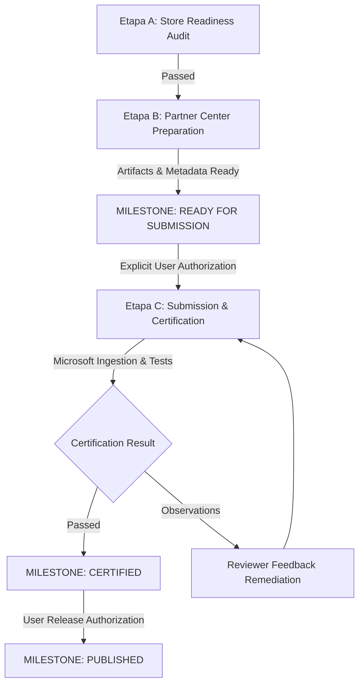

# PrivGvard 2.0 — Microsoft Store Publishing Plan

**Document Version:** 1.0.0  
**Effective Date:** November 2026  
**Product:** PrivGvard (v2.0.0.0)  
**Target Platform:** Windows 10 (10.0.19041.0+) and Windows 11 (x64, ARM64)  
**Release Artifact:** `release/store/PrivGvard-2.0.0.0-x64.msix` (SHA-256: `0397F8C8918CD80E4D282CCDB12C6504B2E49F1E4B96C0C21CA8146A4963B542`)  
**Package Family Name (PFN):** `cdevstudios.PrivGvard_tv7b4yqg10sw2`  
**Current Milestone:** `READY FOR SUBMISSION` (Awaiting explicit user authorization for Stage C)

---

## 1. Executive Strategy & Publishing Roadmap

This plan establishes the operational, technical, legal, and certification procedures required to publish **PrivGvard 2.0** on the **Microsoft Store**.

The publishing process is organized into three sequential stages:
- **Etapa A — Store Readiness Audit:** Technical, architectural, security, and policy compliance verification.
- **Etapa B — Partner Center Preparation:** Staging of Store-ready packages, metadata, listings, graphical assets, and reviewer notes.
- **Etapa C — Certification & Publishing:** Controlled submission to Microsoft certification, review tracking, issue resolution, and live release on the Microsoft Store.

---

## 2. Package Identity & Store Credentials

The official Microsoft Store Partner Center identity constants configured in the application package:

| Attribute | Partner Center Value | Configured Manifest Value | Match Status |
|---|---|---|:---:|
| **Package Name** | `cdevstudios.PrivGvard` | `cdevstudios.PrivGvard` | **EXACT** |
| **Publisher ID** | `CN=85AB4167-A0AE-4FDF-B840-B95CD225F7DD` | `CN=85AB4167-A0AE-4FDF-B840-B95CD225F7DD` | **EXACT** |
| **Publisher Display Name** | `cdev studios` | `cdev studios` | **EXACT** |
| **Package Family Name** | `cdevstudios.PrivGvard_tv7b4yqg10sw2` | Derived automatically from Name + Publisher ID | **EXACT** |
| **Application ID** | `PrivGvardApp` | `PrivGvardApp` | **EXACT** |
| **Version** | `2.0.0.0` | `2.0.0.0` | **EXACT** |
| **Entry Point** | `Windows.FullTrustApplication` | `Windows.FullTrustApplication` (`PrivGvard.exe`) | **EXACT** |

> [!IMPORTANT]
> The Microsoft Store signs ingested packages with official Microsoft production certificates. When submitting via Partner Center, the package is uploaded unsigned or test-signed; Microsoft's ingestion pipeline validates package integrity and signs the final distributed payload.

---

## 3. Account Requirements & Registration

Publishing requires an active **Microsoft Partner Center Windows Developer Account**:

- **Account URL:** `https://partner.microsoft.com/dashboard/registration`
- **Account Types:**
  - **Individual Account:** Registered using personal legal identity. Publisher Display Name represents the developer.
  - **Company Account:** Requires valid Dun & Bradstreet (D-U-N-S) number and business verification. Publisher Display Name represents the legal entity (`cdev studios`).
- **Security Rule:** No credentials, 2FA codes, or Partner Center API secrets are ever stored in this repository or transmitted via tools. All administrative account interactions are performed directly by the developer in the browser.

---

## 4. Packaging Pipeline & Artifacts

1. **Compilation Configuration:**
   - Framework: .NET 10.0 (`net10.0-windows10.0.19041.0`)
   - Compilation: Loose binary publish (`PublishSingleFile=false`) required for MSIX manifest packaging.
   - Optimization: Release mode, ready-to-run disabled to avoid native bytecode incompatibilities on downlevel builds.
2. **Resource Indexing (`MakePri.exe`):**
   - Configured with qualifiers for scales 100, 125, 150, 200, 400 and target sizes 16 to 256.
   - Bilingual indexing (`en-us`, `es-es`).
3. **Packaging (`MakeAppx.exe`):**
   - Package output: `release/store/PrivGvard-2.0.0.0-x64.msix`
   - Validated against `-ValidateStoreIdentity` in `scripts/build-msix.ps1`.
4. **Visual Assets Directory:**
   - Staged in `release/store/` with compliant dimensions for Store Listing, Start Menu, Taskbar, and Splash Screen.

---

## 5. Certification Strategy & Restricted Capabilities

PrivGvard declares three restricted capabilities (`rescap`) in `Package.appxmanifest`:
1. `rescap:runFullTrust`: Required for Win32 desktop APIs (Core Audio COM, CfgMgr32, WMI).
2. `rescap:allowElevation`: Required for launching the transient helper (`PrivGvard.exe --privileged-worker`) with `Verb="runas"` upon explicit user trigger for Secure Protection.
3. `rescap:unvirtualizedResources`: Required to ensure Windows registry policies (`HKLM\SOFTWARE\Policies\Microsoft\Windows\AppPrivacy`) and PnP state affect real operating system settings rather than virtualized AppContainer registries.

A comprehensive technical justification document is prepared in [docs/store/MICROSOFT-STORE-JUSTIFICATION.md](file:///c:/Users/Cristian/Documents/GitHub/PrivGuard/docs/store/MICROSOFT-STORE-JUSTIFICATION.md) and [docs/store/REVIEWER-CERTIFICATION-NOTES.md](file:///c:/Users/Cristian/Documents/GitHub/PrivGuard/docs/store/REVIEWER-CERTIFICATION-NOTES.md) for Microsoft certification testers.

---

## 6. Servicing & Update Policy

- **Version Numbering:** Semantic versioning mapping (`Major.Minor.Build.Revision`). Subsequent hotfixes will increment the third or fourth component (e.g., `2.0.1.0` or `2.0.0.1`).
- **Data Preservation:** Future updates inherit user preferences (`state.json`) and recovery journals (`privacy-session-v1.json`) seamlessly from `%LOCALAPPDATA%\PrivGvard`.
- **Downgrade Protection:** Package version enforcement in Windows prevents accidental rollbacks that could orphan session journals.
