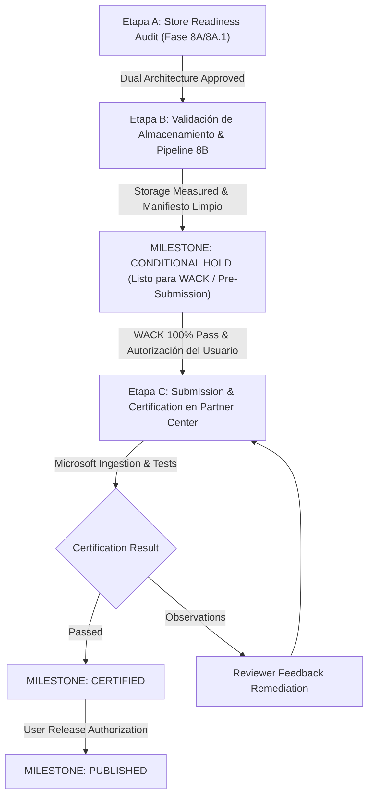

# PrivGuard 2.0 — Microsoft Store Publishing Plan

**Document Version:** 2.0.0
**Effective Date:** November 2026
**Product:** PrivGuard (v2.0.0.0)
**Target Platform:** Windows 10 (10.0.19041.0+) and Windows 11 (x64)
**Release Artifact:** `release/store/PrivGuard-2.0.0.0-x64.msix` (SHA-256: `4D77B8D76DB17D4FA8A8A432555628475BACD06A5F40929D883BC37792FC74CD`)
* **Historical Package:** `release/store/PrivGvard-2.0.0.0-x64.msix` (SHA-256: `0397F8C8918CD80E4D282CCDB12C6504B2E49F1E4B96C0C21CA8146A4963B542`)
**Package Family Name (PFN):** `cdevstudios.PrivGuard_tv7b4yqg10sw2`
**Current Milestone:** `CONDITIONAL HOLD — PENDING PACKAGE STORAGE VALIDATION & DUAL PROFILE IMPLEMENTATION` (Draft upload permitted; Certification submission blocked)

---

## 1. Executive Strategy & Dual Architecture Publishing Roadmap

This plan establishes the operational, technical, legal, and certification procedures required to publish **PrivGuard 2.0** on the **Microsoft Store**.

Following **Architectural Decisions D-01, D-02, and D-03**, the distribution of PrivGuard is structured as two distinct, complementary editions:

1. **PrivGuard Store Edition (MSIX Package):**
   - Distributed via Microsoft Store.
   - Runs strictly with standard user privileges (`asInvoker`).
   - Declares solely the standard `rescap:runFullTrust` capability.
   - Core mitigation: Silences microphone capture endpoints using the native Windows Core Audio COM API (WASAPI) and provides one-click navigation to Windows Camera/Microphone privacy settings (`ms-settings:`).
   - Completely excludes elevated code paths (`--privileged-worker`), PnP device node disabling (`CfgMgr32.dll`), and machine-level Group Policy writes (`HKLM`).
2. **PrivGuard Standalone Edition (Inno Setup Installer & Portable Zip):**
   - Distributed via GitHub Releases / Direct Download.
   - Retains the complete, uncompromised Secure Protection suite (PnP DevNode management and HKLM AppPrivacy policies via the on-demand authenticated worker) and Standard Protection (HKCU `ConsentStore`).

---

## 2. Package Identity & Store Credentials

The official Microsoft Store Partner Center identity constants configured in the application package:

| Attribute | Partner Center Value | Configured Manifest Value | Match Status |
|---|---|---|:---:|
| **Package Name** | `cdevstudios.PrivGuard` | `cdevstudios.PrivGuard` | **EXACT** |
| **Publisher ID** | `CN=85AB4167-A0AE-4FDF-B840-B95CD225F7DD` | `CN=85AB4167-A0AE-4FDF-B840-B95CD225F7DD` | **EXACT** |
| **Publisher Display Name** | `cdev studios` | `cdev studios` | **EXACT** |
| **Package Family Name** | `cdevstudios.PrivGuard_tv7b4yqg10sw2` | Derived automatically from Name + Publisher ID | **EXACT** |
| **Application ID** | `PrivGuardApp` | `PrivGuardApp` | **EXACT** |
| **Version** | `2.0.0.0` | `2.0.0.0` | **EXACT** |
| **Entry Point** | `Windows.FullTrustApplication` | `Windows.FullTrustApplication` (`PrivGvard.exe`) | **EXACT** |

> [!IMPORTANT]
> The Microsoft Store signs ingested packages with official Microsoft production certificates. When submitting via Partner Center, the package is uploaded unsigned or test-signed; Microsoft's ingestion pipeline validates package integrity and signs the final distributed payload.

---

## 3. Account Requirements & Registration

Publishing requires an active **Microsoft Partner Center Windows Developer Account**:

- **Account URL:** `https://partner.microsoft.com/dashboard/registration`
- **Account Type:** Individual Developer Account (Publisher: `CN=85AB4167-A0AE-4FDF-B840-B95CD225F7DD`, Display Name: `cdev studios`).
- **Security Rule:** No credentials, 2FA codes, or Partner Center API secrets are ever stored in this repository or transmitted via tools. All administrative account interactions are performed directly by the developer in the browser.

---

## 4. Packaging Pipeline & Artifacts

1. **Compilation Configuration:**
   - Framework: .NET 10.0 (`net10.0-windows10.0.19041.0`)
   - Compilation Profile: `Release-Store` (`STORE_EDITION` constant; excludes privileged worker and PnP/HKLM code).
   - Packaging: Loose binary publish (`PublishSingleFile=false`) packaged via `MakeAppx.exe`.
2. **Resource Indexing (`MakePri.exe`):**
   - Configured with qualifiers for scales 100, 125, 150, 200, 400 and target sizes 16 to 256.
   - Bilingual indexing (`en-us`, `es-es`).
3. **Packaging (`MakeAppx.exe`):**
   - Package output: `release/store/PrivGuard-2.0.0.0-x64.msix`
   - Validated against `-ValidateStoreIdentity` in `scripts/build-msix.ps1`.
4. **Visual Assets Directory:**
   - Staged in `release/store/` with compliant dimensions for Store Listing, Start Menu, Taskbar, and Splash Screen.

---

## 5. Certification Strategy & Capabilities

Under Architectural Decision D-01, the Store package declares solely:
- **`rescap:runFullTrust`**: Required for Win32 desktop APIs, COM WASAPI interop (`IMMDeviceEnumerator`, `IAudioEndpointVolume`), WMI hardware detection (`Win32_PnPEntity`), and System Tray lifecycle integration.

**Capabilities Omitted from Store Edition:**
- `rescap:allowElevation`: Excluded. Store Edition executes strictly under standard user rights (`asInvoker`).
- `rescap:unvirtualizedResources`: Excluded. Store Edition does not modify `ConsentStore` directly, directing users to native Windows settings instead.

*(Note on Evidence: Microsoft has not issued an express rejection regarding Individual accounts; the omission of elevated capabilities from Store Edition is a proactive engineering decision to prevent orphaned hardware states upon MSIX uninstallation and ensure minimal privilege).*

---

## 6. Servicing & Update Policy

- **Version Numbering:** Semantic versioning mapping (`Major.Minor.Build.Revision`). Subsequent hotfixes will increment the third or fourth component (e.g., `2.0.1.0` or `2.0.0.1`).
- **Data Preservation:** Updates within the package family preserve user preferences and runtime session data stored in `LocalCache\Local`.
- **Downgrade Protection:** Package version enforcement in Windows prevents accidental rollbacks.
